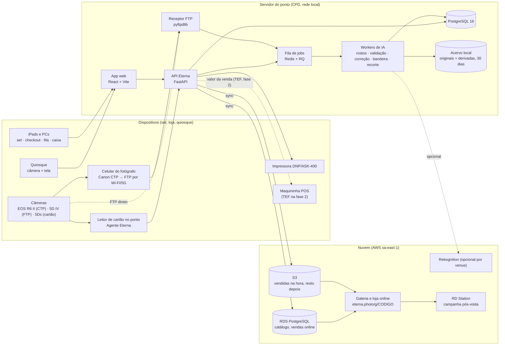
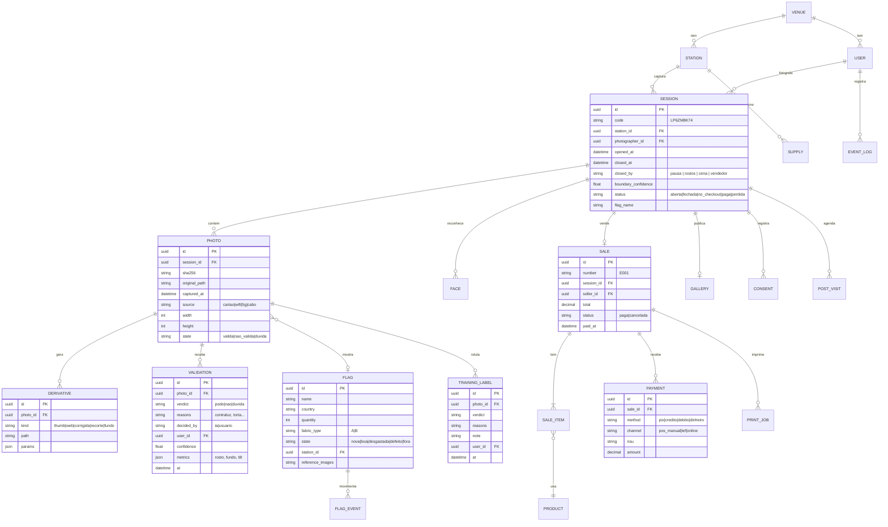
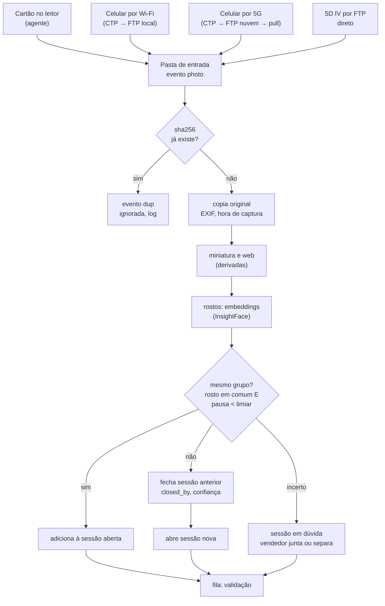
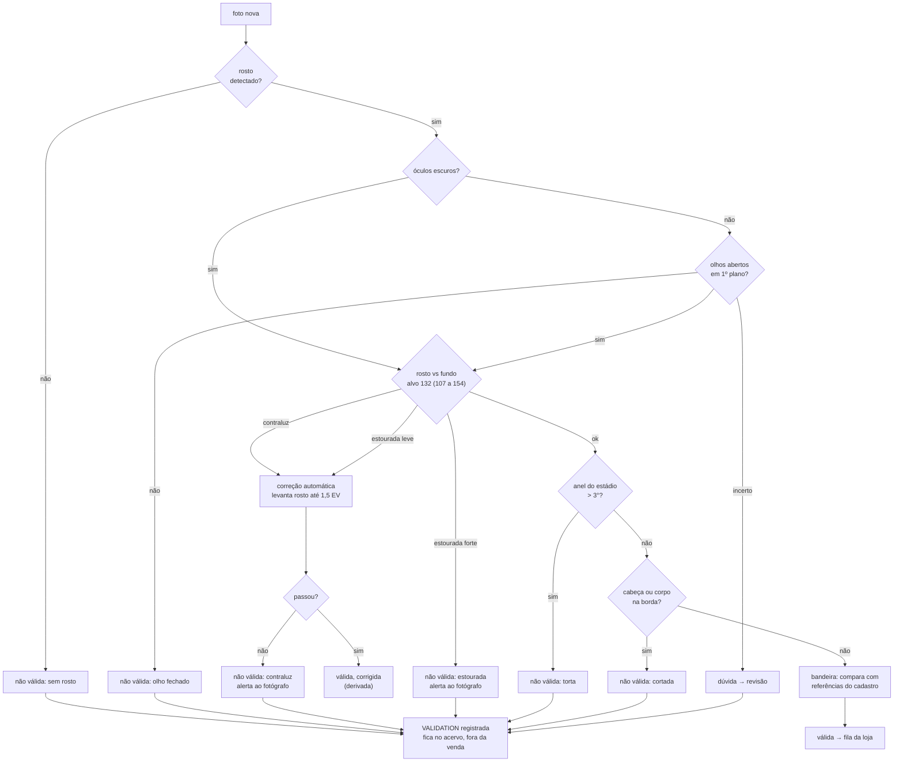
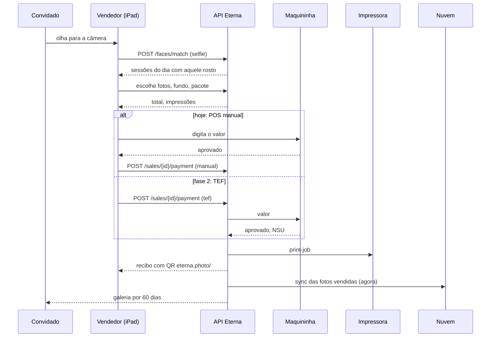
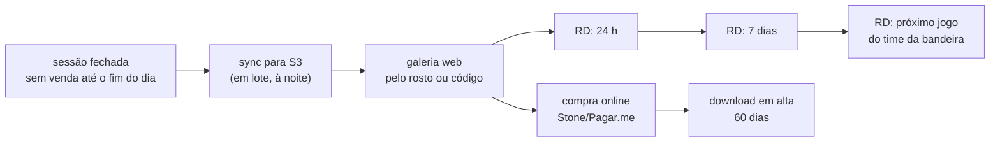
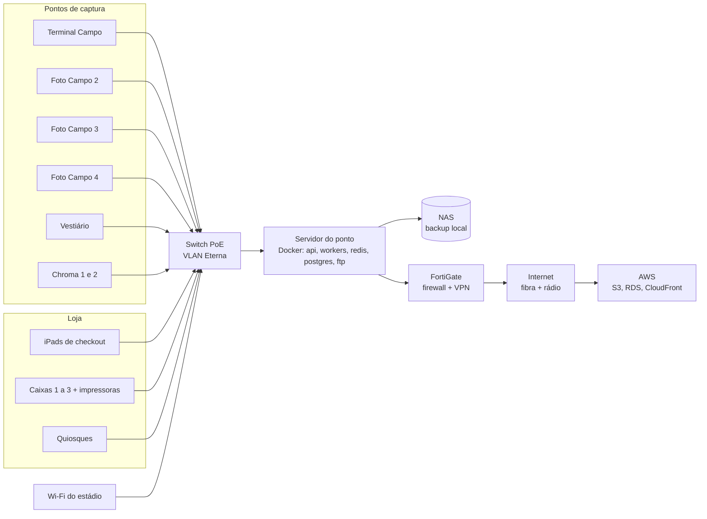
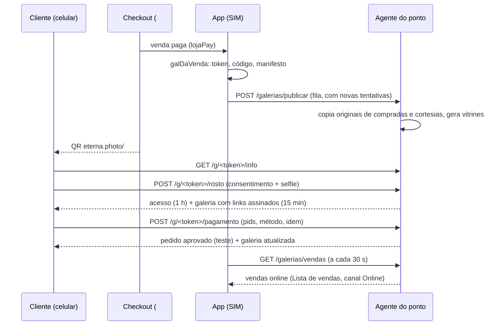

# Eterna: documentação técnica v1

**Fluxogramas do sistema, passo a passo e com cada bifurcação:** [`FLUXOS.md`](FLUXOS.md).

**Para entender o sistema sem ser de tecnologia:** [`Entendendo-o-Eterna.pdf`](Entendendo-o-Eterna.pdf), guia de 29 páginas para imprimir.

26/10/2026 · Eduardo Rezende · versão editável: https://claude.ai/artifact/1hPgjcUPEFf5B6g7wGWWo4

## 1. Visão geral

Eterna é o sistema de captura, validação, venda e entrega de fotos do Tour do Maracanã, construído para substituir o Roverpix a partir de 01/12/2026 e depois ser licenciado a outros venues. Esta é a versão 1 da documentação técnica: descreve o protótipo que está no ar em [eterna.photo](https://eterna.photo) e a arquitetura de produção decidida até 26/10/2026.

**Escopo do MVP (jan a abr 2027)**

- Ingestão automática de fotos por cartão de memória, Wi‑Fi e 5G, sem ação do fotógrafo.
- Separação de grupos pelo servidor, sem foto preta: pausa entre cliques, troca de rostos, mudança de cena.
- Validação técnica e por IA antes da fila da loja; correção automática de exposição; registro de toda decisão para retreino.
- Checkout com reconhecimento facial (QR e código como contingência), pacotes, fundos de IA, pagamento em maquininha avulsa (TEF na fase 2), impressão e recibo com galeria.
- Galeria web do convidado por 60 dias; grupo sem venda vai para campanha pós-visita.
- Gestão: fluxo ao vivo, lista de vendas, índice por fotógrafo, qualidade, estoque (rolos e bandeiras), alertas.

**Princípios**

1. Local primeiro. Ingestão, validação, venda, impressão e relatórios funcionam sem internet. A nuvem recebe cópia e serve a galeria e a venda online.
2. Zero toque no set. O fotógrafo só fotografa. Nada de pasta, botão, formulário ou foto preta.
3. Nada se perde. Original sempre guardado; a correção gera uma derivada; exclusão é registrada, nunca apagada sem log.
4. Um domínio, um login. Todo mundo entra em `eterna.photo` com e-mail e código; o que aparece depois depende das permissões daquele e-mail, módulo a módulo (C, R, U, D).

**Estado em 26/10/2026**

| Peça | Estado | Onde |
| --- | --- | --- |
| App web (protótipo funcional, todos os perfis) | no ar, v19 (login por e-mail e código, permissões por módulo) | eterna.photo, GitHub Pages |
| Agente do ponto (leitor automático de cartão) | funcional, v1 | `agente/eterna-agente.py` |
| Servidor do ponto (API, banco, pipeline) | especificado; código inicial de 29/09 (FastAPI, 14 entidades, 14 testes) | a migrar para o repositório |
| Pipeline de IA | regras v1 definidas; correção de exposição testada em 28 fotos | seção 7 |
| Nuvem | decidida (AWS); conta a criar | seção 9 |

## 2. Arquitetura

Três camadas: dispositivos de captura e venda, o servidor do ponto (local, no CPD do Maracanã) e a nuvem. Tudo que a operação precisa roda no servidor local; a nuvem é cópia, galeria e venda online.



**Responsabilidades**

| Camada | Faz | Não faz |
| --- | --- | --- |
| Dispositivos | capturam, mostram telas do app, imprimem, cobram | não guardam estado; tudo vem da API |
| Servidor do ponto | ingestão, grupos, validação, correção, catálogo, vendas, impressão, relatórios, acervo de 30 dias | não depende de internet para nada disso |
| Nuvem | cópia do acervo, galeria do convidado, venda online, campanhas, backup | não participa da venda no balcão |

**Contingências de transferência** (reunião de 26/10): 1) celular por Wi‑Fi local; 2) celular por 5G para FTP na nuvem, que o servidor puxa; 3) cabo RJ45 da caixinha para laptop ou cartão no leitor. Os três caem na mesma pasta de entrada e passam pelo mesmo pipeline. Custo de parada citado: cerca de R$ 25.000 por dia.

## 3. Stack e versões

Python no servidor e no agente, TypeScript no app, PostgreSQL como banco único, Docker para empacotar. Versões são as estáveis em outubro de 2026; fixar no `pyproject.toml` e no `package.json` ao abrir cada módulo.

**Servidor do ponto**

| Camada | Tecnologia | Versão | Uso |
| --- | --- | --- | --- |
| Linguagem | Python | 3.12 | API, workers, agente |
| API | FastAPI | 0.115 | REST e WebSocket (fila ao vivo, set, checkout) |
| Servidor ASGI | Uvicorn | 0.30 | processo da API |
| Validação de dados | Pydantic | 2.9 | esquemas de entrada e saída |
| ORM e migrações | SQLAlchemy + Alembic | 2.0 / 1.13 | modelo de dados, migrações versionadas |
| Banco | PostgreSQL | 16 | tudo do ponto: sessões, fotos, vendas, estoque, logs |
| Fila de jobs | Redis + RQ | 7.4 / 1.16 | ingestão, IA, impressão, sync em segundo plano |
| Receptor FTP | pyftpdlib | 1.5 | recebe do Canon CTP (celular) e da 5D IV |
| Imagens | Pillow + NumPy | 10.4 / 2.1 | leitura, EXIF, derivadas, miniaturas |
| Visão | OpenCV (headless) | 4.10 | nitidez, inclinação, corte, exposição por região |
| Rostos | InsightFace (buffalo_l) sobre ONNX Runtime | 0.7 / 1.19 | detecção, embeddings, olhos, óculos; roda em CPU, GPU opcional |
| Recorte de fundo | rembg com BiRefNet | 2.0 | Chroma e fundos de IA |
| Rotulagem assistida (treino) | OpenAI API (modelo com visão) | atual | pose, expressão, segunda opinião em dúvidas; nunca na venda ao vivo |
| Impressão | CUPS ou spooler do Windows + driver DNP | - | hot folder por caixa |
| Testes | pytest + httpx | 8.3 / 0.27 | API e pipeline |
| Empacotamento | Docker + Compose | 27 / 2.29 | api, workers, redis, postgres, ftp em um `compose.yml` |

**App web (todos os perfis)**

| Camada | Tecnologia | Versão | Uso |
| --- | --- | --- | --- |
| Linguagem | TypeScript | 5.6 |  |
| UI | React | 18.3 | telas por perfil |
| Build | Vite | 5.4 | dev server e bundle estático |
| Rotas | React Router | 6.26 | `/#perfil/tela` como hoje |
| Dados | TanStack Query | 5 | cache e revalidação da API |
| Estado local | Zustand | 4.5 | sessão aberta, carrinho, filtros |
| Estilo | CSS com tokens (sem framework) | - | design system da seção 10 |
| QR | qrcode | 1.5 | recibo e galeria |
| Testes | Vitest + Playwright | 2 / 1.47 | unidade e fluxo ponta a ponta |

**Agente do ponto (leitor de cartão)**

| Item | Tecnologia | Versão | Uso |
| --- | --- | --- | --- |
| Linguagem | Python, só biblioteca padrão | 3.12 | vigia volumes, copia, dedupe por hash, serve miniaturas em 127.0.0.1:8765 |
| Miniaturas | `sips` (macOS) ou Pillow | - | 900 px |
| Empacotamento | PyInstaller | 6.10 | executável único para Windows e macOS, sem instalar Python no ponto |

**Nuvem**

| Item | Tecnologia | Uso |
| --- | --- | --- |
| Armazenamento | AWS S3 (sa-east-1) + CloudFront | acervo sincronizado, entrega da galeria |
| Banco online | AWS RDS PostgreSQL 16 | catálogo, vendas online, consentimentos |
| Galeria e loja | mesmo app web, build `cliente`, em S3 + CloudFront ou ECS | eterna.photo/g/CODIGO |
| Facial opcional | AWS Rekognition | venues que preferirem nuvem ao InsightFace local |
| Pagamento online | Stone/Pagar.me (checkout web) | galeria |
| Campanhas | RD Station (API) | pós-visita 24 h, 7 dias, jogo |

**Protótipo atual (eterna.photo)**: HTML, CSS e JavaScript sem framework em um arquivo, Google Fonts, qrcodejs 1.0.0, sprites WebP das fotos reais, GitHub Pages. Serve de referência de telas e comportamento para o app React.

## 4. Repositório

Um repositório único, [github.com/dudurezende10/eterna](https://github.com/dudurezende10/eterna), público enquanto for só protótipo; vira privado quando o código do servidor entrar. Branch `main` publica o app no GitHub Pages em eterna.photo a cada push (cerca de 1 minuto).

**Estrutura hoje (26/10)**

```text
eterna/
├─ index.html          app completo (HTML + CSS + JS), v18
├─ img/                fundos de IA e vestiário (6 jpg)
├─ sprites/            fotos reais em sprites WebP (12 arquivos, 373 fotos)
├─ agente/
│  └─ eterna-agente.py leitor automático de cartão
├─ CNAME               eterna.photo
├─ .nojekyll
└─ README.md
```

**Estrutura alvo (monorepo)**

```text
eterna/
├─ apps/
│  ├─ web/             React + Vite: perfis admin, foto, venda, valida, cliente, quiosque
│  └─ galeria/         build da loja online (mesmo código, só perfil cliente)
├─ services/
│  ├─ api/             FastAPI: rotas, esquemas, serviços, auth
│  ├─ workers/         jobs RQ: ingestão, grupos, validação, correção, bandeira, recorte, impressão, sync
│  ├─ ftp/             receptor pyftpdlib (CTP e 5D IV)
│  └─ ia/              modelos, regras v1, avaliação contra o gabarito do treino
├─ agente/             leitor de cartão (Python stdlib) + build PyInstaller
├─ packages/
│  ├─ design-tokens/   tokens CSS e JSON (seção 10)
│  └─ schema/          tipos compartilhados gerados do OpenAPI
├─ infra/
│  ├─ compose.yml      api, workers, redis, postgres, ftp
│  ├─ ponto/           instalação do servidor do ponto, backup, NAS
│  └─ aws/             S3, CloudFront, RDS (Terraform)
├─ docs/               esta documentação, ADRs, runbooks
├─ prototype/          index.html atual, congelado como referência
└─ .github/workflows/  testes, build, deploy do Pages e das imagens Docker
```

**Convenções**

- Branches: `main` (produção), `dev` (homologação no servidor do CPD), ramos curtos por tarefa.
- Commits em português, imperativo, com o módulo no início: `api: fecha grupo por pausa`.
- Versão do app no rodapé do menu (`v18 · 26/10 16:10`), gerada no build a partir da tag.
- Decisões de arquitetura em `docs/adr/NNNN-titulo.md`, uma por decisão (sem foto preta, PostgreSQL, InsightFace local).

## 5. Componentes

| Componente | Roda em | Porta e interface | Entrada | Saída |
| --- | --- | --- | --- | --- |
| Agente do ponto | PC de cada ponto de captura | `http://127.0.0.1:8765` (`/status`, `/events`, `/thumb/{id}`, `/file/{id}`) | cartão inserido (DCIM) | arquivos em `~/Eterna/inbox/AAAA-MM-DD/`, eventos `photo` e `dup` para a API |
| Receptor FTP | servidor do ponto | 21 (FTP) e 990 (FTPS), um usuário por fotógrafo | JPG do Canon CTP ou da 5D IV | arquivo na pasta de entrada, evento na fila |
| API Eterna | servidor do ponto | 8000, REST `/v1/*` e WebSocket `/ws` | app web, agente, FTP, quiosque | JSON, eventos ao vivo, jobs na fila |
| Workers | servidor do ponto (CPU; GPU opcional) | fila Redis `ingest`, `ia`, `print`, `sync` | jobs | fotos em grupos, validações, derivadas, impressões, cópias na nuvem |
| Banco | servidor do ponto | 5432 |  | fonte de verdade do ponto |
| Acervo | NAS ou disco do servidor | SMB/NFS | originais e derivadas | retenção 30 dias local |
| App web | navegador (iPad, PC, quiosque) | servido pela API ou pelo Pages | API | telas por perfil |
| Sync | worker `sync` | S3 e RDS por HTTPS | vendidas na hora, resto em lote | galeria online |
| Galeria | nuvem (fase 1: agente do ponto) | eterna.photo/#g/{token}, código curto como contingência | S3, RDS | fotos, compra, download (ver "Galeria online por QR") |

**Contratos principais da API** (nomes definitivos ao gerar o OpenAPI):

- `POST /v1/ingest/events` (agente e FTP): foto nova ou repetida, com hash, hora de captura, ponto, fotógrafo.
- `GET /v1/sessions?status=` e `WS /ws/sessions`: grupos em formação, fechados, no checkout, pagos.
- `POST /v1/sessions/{id}/merge` e `/split`: ajuste do vendedor em grupos em dúvida.
- `POST /v1/faces/match` (selfie): devolve sessões do dia com aquele rosto.
- `POST /v1/sales` e `POST /v1/sales/{id}/payment`: venda e pagamento (POS manual hoje; TEF depois).
- `POST /v1/print-jobs`: impressão por caixa.
- `GET /v1/reports/*`: semana, fotógrafos, vendas, estoque, bandeiras, alertas.
- `POST /v1/validations/{photo_id}`: decisão humana ou da IA, com motivo, nunca sobrescrita (histórico).

## 6. Modelo de dados

A sessão (grupo de convidados) é a unidade central. Foto nunca é apagada: ganha validações e derivadas. Venda liga sessão, vendedor, itens e pagamento. Tudo que a IA decide fica em `validation`, com quem decidiu e por quê.



**Regras de integridade**

- `PHOTO.sha256` único por venue: a segunda chegada do mesmo arquivo vira evento `dup`, não linha nova.
- `VALIDATION` é só inserção. O estado da foto é a última validação; o histórico inteiro alimenta o retreino.
- `SESSION.boundary_confidence` abaixo do limiar marca a sessão como "em dúvida" para o vendedor juntar ou separar.
- `FACE` guarda embedding e hash, nunca a imagem do rosto; apagado 60 dias depois da visita ou quando o consentimento é retirado.
- `SALE.number` sequencial por dia e por caixa; cancelamento muda `status`, não apaga.

## 7. Fluxos de entrada e saída

Quatro fluxos cobrem a operação: ingestão, validação, checkout e pós-visita. Entradas à esquerda, saídas à direita.

**7.1 Ingestão e grupos** (sem foto preta)



Limiar de pausa aprendido por ponto (mediana dos intervalos entre sessões dos últimos 7 dias); valor inicial 20 s (`SESSAO_PAUSA_S`; era 45 s até 29/10).

**7.2 Validação e correção** (regras v1, requisitos seção 13)



Toda decisão, da IA ou de pessoa, vira uma linha em `VALIDATION`. Confiança baixa em qualquer regra manda para dúvida, nunca reprova sozinha.

**7.3 Checkout e pagamento**



**7.4 Não vendeu**



**Entradas e saídas do sistema (resumo)**

| Entrada | De | Formato | Saída | Para | Formato |
| --- | --- | --- | --- | --- | --- |
| Fotos | câmeras via agente, CTP, FTP | JPG (6 a 9 MB) | derivadas, grupos, validações | app, nuvem | WebP, JPG, JSON |
| Selfie | iPad, quiosque, celular | JPG | sessões correspondentes | app | JSON |
| PAX | catracas (painel Maracatour, JSON) | JSON | spend per guest, capture rate | gestão | relatórios, CSV |
| Catálogo e preços | admin | app | carrinho, recibo | checkout, quiosque, galeria | JSON |
| Pagamento | vendedor (manual) ou TEF | app, maquininha | venda registrada, impressão | lista de vendas, impressora | JSON, job |
| Rótulos do treino | validador | app | regras e gabarito da IA | pipeline | JSON |
| Inventário de bandeiras | admin, supervisor | app, CSV | uso por foto, lista de compra | gestão | relatórios |

## 8. Integrações externas

| Sistema | Direção | Protocolo | O que troca | Estado |
| --- | --- | --- | --- | --- |
| Canon Content Transfer Professional (celular) | entra | FTP/FTPS para o receptor local ou da nuvem | JPG no clique, auto transfer; R6 Mark II por cabo USB‑C | app validado na loja; teste de campo pendente |
| Canon EOS 5D Mark IV | entra | FTP pelo Wi‑Fi da câmera | JPG direto ao servidor, sem celular | a testar |
| Agente do ponto | entra | HTTP local 8765 | fotos do cartão, eventos dup | v1 funcional |
| Painel Maracatour (catracas) | entra | HTTP JSON `/api/stats`, `/api/fotos/stats?periodo=` | PAX por dia, hora e canal | disponível, sem login |
| Roverpix (transição até a troca) | entra | API em tempo real (credencial com o Ronaldo) | vendas e sessões para comparar o período paralelo | aguardando credencial |
| AWS S3 e CloudFront | sai | HTTPS, SDK boto3 | acervo e galeria | conta a criar |
| AWS Rekognition | sai (opcional) | HTTPS | facial para venues que preferirem nuvem | não usado no Maracanã |
| Maquininha POS | manual hoje | - | valor digitado pelo vendedor | em uso |
| TEF (Stone Connect, SiTef ou similar) | sai, fase 2 | API da adquirente ou cliente TEF | valor, confirmação, NSU, cancelamento | adquirente a definir |
| Stone/Pagar.me (online) | sai | API REST | checkout da galeria | fase 2 |
| RD Station | sai | API REST | contato, evento de visita, disparos 24 h, 7 dias, jogo | confirmar que é RD Station |
| Impressora DNP (ASK‑400) | sai | driver, hot folder | impressões por caixa, contador de rolo | em uso no Tour |
| OpenAI API | sai, só treino | HTTPS | rotulagem assistida e segunda opinião em dúvidas | chave oferecida na reunião de 26/10 |

## 9. Infraestrutura e rede

**Servidor do ponto (CPD)**: uma máquina com CPU de 8 núcleos ou mais, 32 GB de RAM, SSD NVMe de 2 TB para o acervo de 30 dias, GPU opcional (uma RTX de entrada reduz o tempo de rosto e recorte de 0,5 s para 0,05 s por foto). Sistema recomendado: Ubuntu Server 24.04 LTS com Docker; Windows Server 2022 é possível se for o padrão da TI, rodando os mesmos containers. Nobreak de 30 minutos (cotação de R$ 4.000 a 5.000).

**Rede**: VLAN própria para os pontos, iPads e quiosques; FortiGate como firewall e VPN para acesso remoto e para o pull do FTP na nuvem; link dedicado com redundância (fibra e rádio). Wi‑Fi do estádio para os celulares dos fotógrafos; 5G como contingência; cabo RJ45 nas caixinhas para descarga direta.



**Hospedagem do protótipo**: GitHub Pages (branch `main`), domínio eterna.photo (GoDaddy, registros A para 185.199.108/109/110/111.153 e CNAME www), HTTPS do GitHub. Em produção o app é servido pela API no servidor do ponto (sem depender de internet) e a galeria pela nuvem.

**E-mail do domínio**: hello@eterna.photo encaminhado para o Gmail do Eduardo pelo ImprovMX (plano grátis). DNS no GoDaddy: MX `mx1.improvmx.com` (10) e `mx2.improvmx.com` (20); SPF `v=spf1 include:spf.improvmx.com include:_spf.google.com ~all` (respostas saem pelo Gmail, "Enviar e-mail como"). É o e-mail oficial do Eterna: remetente dos códigos de login e contato do convidado (recibo e galeria). Envio real em produção sai pelo servidor (SMTP do Gmail com senha de app, ou o serviço da VM), sempre com remetente hello@eterna.photo.

**Roverpix (transição)**: enquanto o Eterna não opera sozinho, o agente do ponto sincroniza a API de relatórios da Roverpix (`/reports/orders`, `/payments`, `/photos`, cabeçalho `ApiKey`) a cada 5 minutos, últimos 30 dias, dia a dia (dias fechados ficam em cache). A chave fica só em `~/Eterna/roverpix.json` (permissão 600), digitada pelo admin na tela Repositório com o app aberto pelo agente; nunca vai para o site nem para o GitHub. Os dados brutos (com dados de clientes) ficam em `~/Eterna/roverpix/raw`; o app recebe por `GET /roverpix/data` só totais por dia, vendedor, fotógrafo, forma de pagamento e produto. Semana, Fotógrafos e Vendas e caixa passam a usar esses dados e seguem o filtro de datas.

**Backup**: originais e banco copiados para o NAS a cada hora; vendidas para o S3 na hora; acervo inteiro para o S3 à noite; retenção local de 30 dias, nuvem por 12 meses, galeria do convidado por 60 dias.

## 10. Design system

O mesmo sistema visual do site Wesden: papel claro, tinta quase preta, serifa para títulos e números grandes, sem-serifa para o resto, um acento terracota. Tudo em tokens CSS no `:root`, com versão escura automática. Os tokens já estão no `index.html` e vão para `packages/design-tokens`.

**Temas por venue**: o Eterna é a plataforma e cada venue entra com a própria marca. A tela Identidade (módulo Configuração) escolhe o venue, as duas cores (principal e apoio) e recebe o arquivo da logo oficial; o app aplica em `:root` (`--accent`, `--venue2`, `--display`, tema claro ou escuro) e troca nomes de pontos, taglines e assinatura. Regra de marca: a marca do venue vem primeiro em tudo que o público vê (quiosque, galeria, recibo), o Eterna assina pequeno ("fotos por Eterna"); nas telas da equipe o Eterna vem primeiro. Temas cadastrados: Viva Maracanã (Manual de Marca do Grupo Viva, out/2026: Azul #134078, Verde #005500, Amarelo #FFB800, secundárias Azul luz #307FE2, Azul noite #0C2340, Verde luz #43B02A, Amarelo luz #FCE300, Cinza museu #D9D9D6, Grafite #25282A; Big Shoulders com tracking 100 nos títulos, Inter nos textos; logo oficial em img/brand, branco sobre azul e azul sobre branco, mínimo 150 px em tela; grafismo multidão como pontos no menu e na entrada; white label com Eterna só como powered by) e Lollapalooza Brasil (escuro, rosa e lima, Archivo Black; variante de apresentação). As cores abaixo são as do tema base.

**Cor**

| Token | Claro | Escuro | Uso |
| --- | --- | --- | --- |
| `--bg` | #fafaf8 | #141311 | fundo da página |
| `--surface` | #ffffff | #1c1a17 | cartões e painéis |
| `--surface2` | #f1eee8 | #24211d | item de menu ativo, trilhas, fundos secundários |
| `--fg` | #141311 | #f2eee7 | texto e botão primário |
| `--muted` | #6b625a | #a69d92 | texto secundário, rótulos |
| `--line` | #dcd8d0 | #34302a | bordas |
| `--accent` | #53342e | #d2b29c | seleção de foto, destaque único por tela |
| `--good` / `--good-bg` | #2f6b3f / #e7f0e9 | #8fcb9d / #1f2e23 | pago, válida, conectado |
| `--warn` / `--warn-bg` | #8a6a14 / #f3ecd6 | #dcbb62 / #2f2812 | atenção, dúvida, em andamento |
| `--bad` / `--bad-bg` | #b3402a / #f6e3dd | #ee9479 / #3a211b | não válida, alerta, cancelada |
| `--bar` / `--bar2` | #141311 / #c9c2b6 | #f2eee7 / #4a443c | barras de gráfico, principal e comparativa |

Regra: uma cor de estado por elemento, sempre com texto junto (nunca só cor). O acento aparece uma vez por tela.

**Tipografia**

| Token | Fonte | Pesos | Onde |
| --- | --- | --- | --- |
| `--display` | Cormorant Garamond | 500, 600 | h1 38 px, h2 24 px, h3 19 px, números de tile 34 px, códigos de sessão 20 a 64 px, preços |
| `--body` | Inter | 400, 500, 600 | corpo 14 px / 1,45; notas 12 px; eyebrow 11 px em caixa alta com espaçamento 0,18 em |

Números sempre com `font-variant-numeric: tabular-nums`. Tabelas em 13 px.

**Espaço e forma**

- Escala de espaço: 4, 8, 12, 14, 16, 18, 22, 28 px. Gutter da página 28 px (16 no celular).
- Raio: 5 px em botões e inputs, 6 px em cartões e painéis, 999 em chips e pills, 28 px na moldura do celular, 12 px no quiosque.
- Bordas de 1 px em `--line`; sombra só na moldura do celular. Sem gradientes.
- Menu lateral de 230 px fixo, em grupos que abrem e fecham (v78). Entre 701 e 900 px vira barra no topo; até 700 px o cabeçalho fica com logo, ícone do Checkout e botão Menu, e o menu abre numa gaveta por cima da tela.

**Componentes** (nomes como estão no CSS)

| Componente | Classe | Para |
| --- | --- | --- |
| Tile | `.tile` | um número com rótulo e nota |
| Painel | `.panel` | bloco com título e conteúdo |
| Chip | `.chip` (`aria-pressed`) | filtro, modo, opção |
| Pill | `.pill.good/.warn/.bad/.neutral` | estado |
| Botão | `.btn`, `.primary`, `.ghost`, `.big` | ação; uma primária por tela |
| Cartão de sessão | `.scard` | código, fotógrafo, hora, estado |
| Foto | `.ph` (`data-sel`, `data-v`, `data-off`) | miniatura com seleção, nota, descarte |
| Cartão de perfil | `.role` | entrada de tela ou de perfil |
| Etapas | `.steps .step` | checkout em 4 passos |
| Celular | `.phone` | moldura de celular |
| Quiosque | `.kiosk .screen`, `.face` | tela cheia, câmera |
| Barras | `.bars .bar` | comparação horizontal |
| Alerta | `.alert.bad/.warn/.good` | regra disparada |
| Recibo | `.receipt` | monoespaçada |

**Estados**: `aria-pressed` em chips e botões de seleção; `aria-current="page"` no menu; foco visível com contorno de 2 px no acento; `[disabled]` a 45% de opacidade; animações só na chegada de foto e na câmera do quiosque, desligadas com `prefers-reduced-motion`.

**Linguagem**: convidado (não cliente), anfitrião (fotógrafo no set), sessão ou grupo (não cartão), ponto de captura, passe de foto, galeria. Frases curtas, números na frente, sem texto explicativo dentro do app. Taxa, prazo e tamanho do arquivo sempre no recibo.

**Acessibilidade**: contraste mínimo 4,5:1 nos textos (os tokens acima cumprem nos dois temas); alvos de toque de 42 px ou mais (botões grandes de 56 px no set, checkout e quiosque); tudo operável por teclado nas telas de gestão.

## 11. Segurança, LGPD, backup e observabilidade

**Acesso**: entrada por e-mail e código de uso único (sem senha). O usuário digita o e-mail, recebe um código de 6 dígitos válido por 10 minutos e entra; a sessão dura 12 h. Só entra e-mail cadastrado e ativo: fora do cadastro aparece "Este e-mail não tem acesso" (desde a v78 não existe mais perfil Cliente nem login de convidado; o cliente abre as fotos pela galeria pública `#g`). O acesso tem duas camadas: a permissão **C, R, U, D por módulo** decide o que a pessoa faz, e a lista de telas do menu decide o que ela vê. Os perfis prontos (Admin, Fotógrafo, Atendimento e venda, Validador, Supervisor, Checkout) preenchem as duas e podem ser ajustados por pessoa em Configurações › Permissões. Desativar ou excluir o e-mail corta o acesso na hora. O computador do Checkout entra com o e-mail do aparelho. Detalhes, regras e o que ainda é protótipo na seção "Acesso, permissões e menus (v78)". No protótipo o e-mail é simulado na tela; em produção o envio sai por Amazon SES ou Resend a partir da API, com o código guardado em Redis com expiração.

**Dados pessoais (LGPD)**: rosto é dado biométrico. O sistema guarda embedding e hash, nunca a imagem recortada do rosto; consentimento registrado em `CONSENT` no primeiro contato (checkout ou quiosque), com texto e versão; quem não autoriza usa QR ou código; embeddings apagados 60 dias depois da visita ou no pedido do titular; fotos não vendidas apagadas da nuvem em 60 dias; vendidas ficam 12 meses para reimpressão. Nome, e-mail e telefone só na venda e na galeria, com finalidade declarada; RD Station recebe apenas quem autorizou campanha.

**Rede e segredos**: API só na VLAN e pela VPN; FTP com usuário por fotógrafo e FTPS quando o CTP permitir; segredos em variáveis de ambiente do Docker, nunca no repositório; chaves de nuvem com permissão mínima por bucket.

**Backup e continuidade**: NAS a cada hora, S3 à noite; restauração testada por mês; servidor reserva (um PC de ponto) com o mesmo `compose.yml` e o último backup, sobe em 30 minutos; impressão e venda continuam sem internet.

**Observabilidade**: logs estruturados (JSON) por serviço; métricas de fila (tempo por foto em cada etapa), de ingestão (fotos por minuto por ponto, repetidas) e de IA (acerto contra o gabarito do treino); alertas operacionais já definidos no app (fotos por sessão, conversão, estação parada, rolo, bandeira). Ferramenta: Prometheus + Grafana no servidor do ponto, Sentry para erros do app.

## 12. Ambientes, versionamento e decisões em aberto

| Ambiente | Onde | Dados | Deploy |
| --- | --- | --- | --- |
| Desenvolvimento | notebook do desenvolvedor, Docker | amostra anonimizada (24 sessões) | `docker compose up` |
| Homologação | servidor do CPD, branch `dev` | cópia do acervo real, cartões de teste | push em `dev` |
| Produção | servidor do CPD, branch `main` | real | tag `vX.Y.Z`, janela fora do horário do Tour |
| Protótipo | GitHub Pages, eterna.photo | fotos reais em sprites, simulação no navegador | push em `main` |

Versionamento semântico: `v1.0.0` na substituição do Roverpix; o protótipo segue `v18`, `v19` até lá. Cada entidade e cada rota da API carrega versão no caminho (`/v1`).

**Decisões em aberto**

- [ ] Banco no servidor do ponto: PostgreSQL (recomendado) ou SQL Server, que a TI citou na reunião de 26/10. O ORM aceita os dois; a escolha afeta backup, licença e Docker.
- [ ] Sistema do servidor: Ubuntu com Docker (recomendado) ou Windows Server.
- [ ] Adquirente e forma de TEF (fase 2).
- [ ] "RD" do quadro de 26/10 é RD Station?
- [ ] Reflexo de flash na lente dos óculos: pode ou não pode?
- [ ] Nome definitivo: busca no INPI (classes 9, 41, 42) pendente desde 29/09.
- [ ] GPU no servidor do ponto: decidir depois de medir o tempo por foto em CPU com fotos em tamanho cheio.

**Documentos relacionados** (projeto Maracanã): requisitos v0.2, especificação v0.1, decisões técnicas, reunião de TI de 16/10, reunião de implantação de 26/10, inventário de bandeiras.

Fontes: protótipo em [eterna.photo](https://eterna.photo) e repositório [github.com/dudurezende10/eterna](https://github.com/dudurezende10/eterna); [Canon CTP](https://www.canon-europe.com/apps/content-transfer-mobile) e [câmeras compatíveis](https://cam.start.canon/en/S013/manual/html/UG-00_Before_0020.html); [Wi‑Fi e FTP da EOS 5D Mark IV](https://in.canon/en/support/8203044300); resumo da reunião "Implantação fluxo fotos" de 26/10/2026; requisitos Eterna v0.2 (projeto Maracanã).

## Glossário

| Termo | Significado |
| --- | --- |
| Sessão ou grupo | conjunto de fotos de uma família ou pessoa em um ponto, separado pelo servidor |
| Ponto de captura | lugar com fotógrafo ou estação automática (Terminal Campo, Foto Campo 2 a 4, Vestiário, Chroma 1 e 2) |
| Ingestão | chegada da foto ao servidor, por qualquer caminho, sem ação do fotógrafo |
| Validação | decisão pode, não pode ou dúvida sobre uma foto, com motivo; da IA ou de pessoa |
| Derivada | versão gerada de uma foto: miniatura, web, corrigida, recorte, com fundo |
| Checkout | tela única do vendedor: identificar, escolher, pagar, recibo |
| PAX | visitantes do dia pela catraca |
| Spend per guest | receita dividida por PAX |
| Índice do fotógrafo | receita do dia dividida pela média dos colegas do mesmo dia, vezes 100 |
| Agente do ponto | programa local que vigia o cartão e entrega as fotos |
| CTP | Canon Content Transfer Professional, app que manda a foto da câmera para FTP pelo celular |
| TEF | pagamento integrado: o sistema envia o valor à maquininha e recebe a confirmação |

## Histórico desta documentação

| Versão | Data | O que mudou |
| --- | --- | --- |
| v1 | 26/10/2026 | primeira versão: arquitetura, stack, repositório, modelo de dados, fluxos, integrações, infraestrutura, design system, segurança, ambientes |
| v1.1 | 26/10/2026 | acesso: login por e-mail e código substitui a tela de perfis; permissões CRUD por módulo; tela Usuários; app v19 |
| v1.2 | 26/10/2026 | câmera sempre ligada no checkout e quiosque; editor manual de ajustes; FTP embutido no agente; temas por venue (Maracanã, Lollapalooza) |
| v1.3 | 26/10/2026 | white label com a identidade Viva Maracanã do manual de marca |
| v1.4 | 26/10/2026 | e-mail hello@eterna.photo (ImprovMX + Gmail), registros de DNS |
| v1.5 | 26/10/2026 | hello@eterna.photo vira o e-mail oficial do Eterna (códigos de login e contato) |
| v1.6 | 26/10/2026 | sincronização Roverpix pelo agente (chave local, só agregados no app) |
| v1.7 | 28/10/2026 | galeria online por QR, fase 1 (app v77): rotas `#loja` e `#g`, manifesto, adaptadores, links HMAC, lápide, limites, CORS e Host, retenção 60 dias, administração Galerias online, canal Online, tempo da tela final, segurança e pendências da fase 2 |
| v1.8 | 28/10/2026 | acesso, permissões e menus (app v78): módulos novos, `MODULE_INFO`, duas camadas módulo e menu, `permValidate`, `ACT_MOD`, auditoria, `loginMark`, migração v2, tela "sem acesso", menus em grupos e gaveta no celular, telas removidas, contrato de servidor e pendências de segurança |
| v1.9 | 28/10/2026 | Checkout, caixa e ajuste automático (app v79): dinheiro aguardando caixa (`SIM.caixaDin`, estados, Caixa, Lista de vendas, CSV, Alertas, contrato futuro), sincronização entre janelas, aba do Checkout sem login, saída da equipe só na câmera, interruptor do ajuste automático, catálogo novo do Tour, `lojaIdeal`, `printsVenda`, economia, valor gravado na venda e pendências |


## Fundos de IA com Photoroom (v41, 27/10/2026)

- Os 10 fundos limpos ficam em `img/bg-<id>.jpg` e estão cadastrados em `DATA.backgrounds` com ângulo de câmera, tipo e direção da luz, cor (cor, sépia, P&B), enquadramentos aceitos e posição do grupo (`pos`).
- O recorte e a montagem são feitos pelo Photoroom (Image Editing API, `POST https://image-api.photoroom.com/v2/edit`), chamado pelo agente do ponto. O Eterna não recorta mais no navegador.
- Chave: `~/Eterna/photoroom.json` (permissão 600), digitada pelo usuário em Fundos de IA. Chaves `sandbox_` são grátis (1.000 por mês, com marca d'água).
- Agente: `GET /photoroom/status`, `POST /photoroom/config` e `POST /photoroom/compose` (só aceitam a origem do próprio agente), `GET /photoroom/result/<arquivo>`.
- Pedido: foto (`pid` do agente em alta, ou JPEG da tela), fundo, `outputSize` do fundo, `padding*` calculado da posição do grupo, `lighting.mode=ai.auto`, `shadow.mode=ai.soft`, `export.format=jpeg`.
- Cache: `~/Eterna/fundos-ia/<hash foto>_<fundo>_<hash posição>.jpg`. A mesma foto no mesmo fundo não é cobrada de novo.
- Sala de imprensa: o app recoloca a bancada por cima do resultado, para o grupo ficar atrás da mesa.

## Galeria online por QR, fase 1 (v77, 27/10/2026)

Depois da compra, a tela final do Checkout mostra um QR. Quem escaneia confirma com uma selfie e vê as fotos compradas e as cortesias para baixar, e o resto da visita com marca d'água para comprar. Para escola, um QR geral por grupo: o responsável envia a foto do rosto da criança e vê só as fotos em que ela aparece. Armazenamento e pagamento ficam atrás de adaptadores neutros. Nesta fase o agente do ponto faz o papel do bucket e o pagamento é simulado.

Plano completo, critérios de aceite e adendos: `docs/planos/2026-10-27-galeria-qr-fase1.md`. Revisões: `...-revisao.md` (código) e `...-seguranca.md` (segurança).



### Rotas do app

| Rota | Quem usa | O que abre |
| --- | --- | --- |
| `#loja` | cliente no Checkout (perfil Checkout, ou o botão "Abrir Checkout" da barra da equipe, desde a v78) | Checkout sem login, sempre em tela cheia, sem menu e sem cabeçalho do app. Etapas `state.kiosk.step` = code → review → cart → done |
| `#g/<token>` | cliente que escaneou o QR | galeria pública sem login (`vGaleriaQR`, classes `gq-`) |
| `#g` | cliente sem o QR | campo para digitar o código curto do recibo |

- `render()` trata `state.pub` e `state.lojaRota` antes de tudo: não pede login, não chama `syncHash` e não mostra `.bare-exit`. Recarregar a página nunca abre o Checkout para a equipe; ele só abre com `#loja` ou com o perfil quiosque.
- **Checkout (`#loja`)**: Esc ou o botão Sair do painel da equipe chamam `lojaSair()`, que sempre leva ao login (faz logout se houver usuário). 3 toques seguidos no logo (`lojaLogo`, janela de 1,5 s) abrem o painel escondido da equipe com "Sessões esperando" e "Sair". Botão "Voltar ao início" em todas as etapas (na escolha das fotos é o botão "Sair", com texto, que pede confirmação se houver foto marcada). Voltas automáticas por inatividade (v96): escolha parada 90 s sem toque (`LOJA_ESCOLHA_MS`, `lojaEscolhaOciosa`) volta ao Iniciar e apaga as marcas, também com pedido aberto (o Posto vê "o cliente saiu"); tela Pronto ou do valor parada 3 min (`LOJA_PRONTO_MS`) volta ao início e o Posto vê "o cliente saiu"; câmera ligada só pelo Iniciar, desliga com 60 s sem rosto (`LOJA_CAM_MS`, só rosto renova) e no teto de 3 min (`LOJA_CAM_TETO`). Idiomas por bandeiras em SVG (`LANG_FLAGS`, Brasil, EUA, Espanha, França, Alemanha), porque emoji de bandeira não aparece no Chrome do Windows.
- **Tela final do Checkout**: QR (`#lqr`) com o código `XXXX-XXXX` embaixo e contagem regressiva ("Voltamos ao início em", `ljBackIn`). Volta sozinha ao início em `SIM.lojaFimSeg` segundos (padrão 30, de 5 a 120). `lojaTick` é o único timer do Checkout e morre ao sair da rota, trocar de etapa ou recarregar.
- **Galeria pública (`#g/<token>`)**, passos de `state.pub.step`:
  - `carregando` → `GET /g/<token>/info` no agente (tempo limite 2,5 s);
  - `codigo`, `nao_existe`, `expirada` (410) ou `chegando` (agente fora e token desconhecido neste aparelho; nova tentativa a cada 20 s);
  - `consent` (texto do titular ou do responsável, botão desligado até marcar) → `selfie` (câmera frontal para adulto, traseira para criança) → `buscando` → `nao` (sem rosto, não encontrado ou bloqueado, com tentativas restantes) ou `galeria`;
  - `pagar` (Pix ou Cartão, aviso "Pagamento de teste") → `aguardando` (reservado para o adquirente real, consulta a cada 5 s).
- **Modo agente e modo SIM**: com o agente respondendo, tudo passa pelas rotas `/g/*`. Sem agente, mas com o token em `SIM.galerias` (o mesmo navegador que vendeu), a galeria roda no navegador com `faceFind` e `photoCanvas`. O modo SIM existe para o protótipo e os testes.
- **Links vencidos**: com mais de 12 min de galeria aberta, ou se um download falhar, o app pede `POST /g/<token>/galeria` e tenta de novo uma vez. Acesso vencido (401) volta para a selfie com o aviso `gq_again`.
- Textos do cliente: chaves `gq_*` e `lj*` no `I18N`, nas 5 línguas. "Baixar todas" baixa uma por uma (sem ZIP nesta fase).

### Token e código curto

- Token: 16 bytes de `crypto.getRandomValues`, base64url sem `=`, 22 caracteres (`^[A-Za-z0-9_-]{22}$`). Nunca `Math.random`, nunca derivado do código LP.
- Código curto: `XXXX-XXXX` com o alfabeto `ABCDEFGHJKLMNPQRSTUVWXYZ23456789` (sem 0, O, 1, I). É só um apelido do token para digitar quando o QR falha, e também exige selfie.
- Os dois nascem no app (`galToken`, `galCodigo`, `galNovo`), então o Checkout nunca trava sem internet. O QR é sempre desenhado por `qrDraw(el,texto,tamanho)` com a cópia local `vendor/qrcode/qrcode.min.js` (qrcodejs 1.0.0, MIT). Sem a biblioteca, aparece o código em texto.
- O recibo da venda (Lista de vendas › Recibo) mostra o mesmo QR e o código (`drawQR`, `galCod`).

### Manifesto `sessao.json`

Igual no app (`SIM.galerias[token]`) e no agente (`~/Eterna/galerias/<token>/sessao.json`).

```json
{"v":1,"token":"Qm9…22c","codigo":"K7QM-4WXR","tipo":"sessao","venue":"maracana",
 "nome":null,"sessoes":["LP2IVBK56"],"menor":false,
 "criada":"2026-10-27T15:02:00Z","expira":"2026-12-26T15:02:00Z",
 "precos":{"dig":39,"todas":250},"moeda":"BRL",
 "fotos":[{"id":"ag_3f9a1c","sessao":"LP2IVBK56","direito":"comprada","canal":"loja"},
          {"id":"ag_77b2e0","sessao":"LP2IVBK56","direito":"cortesia","canal":null,
           "cortesia":{"motivo":"escola","por":"eduardo@eduardorezende.com","em":"…"}},
          {"id":"ag_9d01aa","sessao":"LP2IVBK56","direito":"venda","canal":null}],
 "envio":{"compradas":"pendente","vitrine":"pendente"}}
```

- `tipo`: `sessao` (uma sessão, criada na venda ou pela administração) ou `evento` (grupo de escola: `nome`, `data`, várias `sessoes`, `menor:true`).
- `expira` = `criada` + 60 dias. `encerrada:true` aparece depois de "Encerrar".
- `precos.dig` vem do item `dig` do catálogo ("Foto digital avulsa (galeria online)", R$ 39). `precos.todas` vem do `mais` ("Pacote Maracanã Mais", R$ 250).
- `envio` é preenchido pelo agente: `ok` quando os originais das compradas e cortesias e as vitrines estão prontos.
- O agente valida tudo em `gal_validar` (só campos conhecidos, tipos e tamanhos, até 2.000 fotos e 200 sessões) antes de gravar.

### Direito por foto

| Direito | De onde vem | O que o cliente vê |
| --- | --- | --- |
| `comprada` | venda paga da Loja (`canal:"loja"`, todas as fotos escolhidas, porque todo pacote inclui digital) ou compra na galeria (`canal:"online"`) | "Suas fotos", com Baixar (original) |
| `cortesia` | dada na administração, guardada por foto em `SIM.sessions[card].cort` e válida em todas as galerias que contêm a sessão | "Suas fotos", com selo Cortesia e Baixar |
| `venda` | o resto da sessão | "Mais fotos da sua visita", vitrine com marca d'água, ✓ para comprar |

- Precedência: `comprada > cortesia > venda`. Uma foto comprada não recebe cortesia.
- `galAtualizar(token)` recalcula as fotos a partir da sessão e preserva a `comprada/online`. Cancelar uma venda da Loja tira a `comprada/loja` no app.
- No agente, `gal_mesclar` nunca deixa uma compra regredir, de nenhum canal. Por isso o cancelamento ainda não chega ao agente (pendência da fase 2).
- Sessão de adulto: o rosto bate quando alguma foto tem semelhança ≥ 0,45 (`LIMITE`) e abre a sessão inteira. A faixa "talvez" (0,38 a 0,45) não abre.
- Grupo de escola: só as fotos em que o rosto bate com ≥ 0,50 (`LIMITE_MENOR`), nunca a sessão inteira. O limite ainda precisa ser calibrado com fotos de escola (Ronaldo, `/rostos/medir`).

### Adaptadores no agente

| Adaptador | Interface | Fase 1 | Fase 2 |
| --- | --- | --- | --- |
| Armazenamento `Repositorio` | `salvar_manifesto`, `ler_manifesto`, `subir`, `existe`, `url`, `abrir`, `apagar`, `listar_expiradas` | `RepositorioLocal` em `~/Eterna/galerias/<token>/{sessao.json,original/,vitrine/}` | `ETERNA_REPO=s3` (`put_object`, `generate_presigned_url`) ou `azure` (`upload_blob`, `generate_blob_sas`). Hoje levantam `NotImplementedError` |
| Pagamento `Pagamento` | `criar(pedido)`, `consultar(id)`, `webhook(corpo,cabecalhos)` | `PagamentoDesligado` (padrão, v93): `POST /g/<t>/pagamento` responde 501 `compra_indisponivel` e a galeria manda `compra:false`. `PagamentoSimulado` (aprova na hora, `teste:true`) só com `ETERNA_PAGAMENTO=simulado` e `ETERNA_MODO_TESTE=1` | `ETERNA_PAGAMENTO=<provedor>` (Mercado Pago ou Asaas), chaves em `~/Eterna/pagamento.json` (chmod 600). Liberação só pelo webhook assinado ou pela consulta |

- As rotas não mudam quando o adaptador muda. Sem SDK nesta fase.
- O preço é sempre recalculado no agente: `min(n × dig, todas)`. O `total` mandado pelo navegador é ignorado.
- Vitrine: miniatura de 900 px. Com OpenCV, a marca d'água "VIVA MARACANA" é gravada na imagem. Sem OpenCV, a tela põe a sobreposição `.wm` e o `/status` informa `vitrine_marca:false`. O original só é copiado e servido para foto `comprada` ou `cortesia`.
- `galeria_loop()` processa a fila por token: primeiro os originais das compradas e cortesias, depois as vitrines. Depois de uma compra online, os originais são preparados antes de responder.
- D14: o agente só recebe sessões cujas fotos são todas `ag_`. Sessões de exemplo (sprites) ficam com estado `local` e funcionam só no modo SIM.

### Links assinados (HMAC)

- Formato: `/g/<token>/foto/<pid>?v=<vitrine|original>&exp=<epoch>&sig=<hex>`.
- `sig = HMAC-SHA256(segredo, "token|pid|v|exp")`, comparada com `hmac.compare_digest` depois de checar o formato `^[0-9a-f]{64}$`.
- Segredo de 32 bytes em `~/Eterna/galeria-segredo.json` (chmod 600), criado na primeira vez.
- Validade: 15 min (`URL_TTL=900`). O acesso devolvido pela selfie vale 1 h (`ACESSO_TTL=3600`) e fica só em memória.
- A rota de foto checa de novo o manifesto a cada pedido: 403 com assinatura ruim ou vencida, pid fora do token, galeria encerrada ou expirada, ou `v=original` em foto `venda`.

### Rotas do agente

**Públicas** (CORS `*`; token validado por regex antes de qualquer caminho em disco)

| Rota | Entrada | Saída |
| --- | --- | --- |
| `GET /g/<token>/info` | | `{ok,tipo,menor,expira,estado:"pronta"\|"chegando",venue}`. Nunca `sessoes`, `fotos`, `codigo` nem a quantidade de fotos. 404 se não existe, 410 se encerrada, expirada ou com lápide |
| `GET /g/codigo/<CODIGO>` | | `{token}`, ou 404 (também para galeria encerrada, expirada ou com lápide) |
| `POST /g/<token>/rosto` | `{consentimento:true,versao,idioma,imagem:"data:image/jpeg;base64,…"}` | bateu: `{ok:true,acesso,exp,galeria}`. Sem rosto: `{ok:false,motivo:"sem_rosto",restam}`. Não bateu: `{ok:false,motivo:"nao_encontrado",restam}`. Bloqueado: 429 `{motivo:"bloqueado",ate}`. Reconhecimento desligado ou fotos ainda não lidas: 503 `{motivo:"processando"}`. Sem consentimento: 400. Corpo acima de 2 MB: 413 |
| `POST /g/<token>/galeria` | `{acesso}` | `{galeria}` com links reassinados. 401 se o acesso for inválido ou vencido |
| `GET /g/<token>/foto/<pid>?v=&exp=&sig=` | | JPEG, ou 403 (ver acima) |
| `POST /g/<token>/pagamento` | `{acesso,pids:[…],metodo:"pix"\|"cartao",idem}` | `{ok,pedido:{id,status,total,canal:"online",teste,checkout_url,pix_copia_cola},galeria}`. Pid fora do acesso ou que não está à venda: 400. Mesmo `idem` duas vezes: a mesma venda |
| `POST /pagamento/webhook/<provedor>` | | 501 (reservado para o adquirente real) |

Objeto `galeria`:

```json
{"tipo":"sessao","menor":false,"expira":"…","estado":"pronta","precos":{"dig":39,"todas":250},
 "fotos":[{"pid":"ag_3f9a1c","direito":"comprada","vitrine":"/g/…?v=vitrine&exp=…&sig=…","original":"/g/…?v=original&…","chegando":false}]}
```

**Locais** (Origin vazio ou `http://127.0.0.1:PORTA`/`http://localhost:PORTA`, e `Host` igual a `127.0.0.1:PORTA` ou `localhost:PORTA`; o resto recebe 403)

| Rota | Função |
| --- | --- |
| `POST /galerias/publicar` | recebe `{manifesto}`, mescla com o que existe e devolve `{ok,token,estado}`. Token com lápide: 410 `{estado:"encerrada"}` |
| `POST /galerias/encerrar` | recebe `{token}`, grava `expira=agora` e `encerrada:true` |
| `GET /galerias/vendas?desde=n` | `{vendas:[{id,token,sessoes,pids,n,total,metodo,em,canal,todas,teste}],next}`, de 500 em 500 |
| `GET /galerias/status` | `{fila,galerias:[{token8,estado,envio}]}` |

`/status` ganhou `galerias:{fila,total,vitrine_marca}`.

### Encerrar e lápide

- "Encerrar" (só grupos, na administração) grava `encerrada:true` e `expira=agora` no app e no agente.
- Republicar não desfaz: `gal_mesclar` mantém a menor validade entre o manifesto velho e o novo, e mantém `encerrada`. Não existe ação para reabrir na fase 1.
- A limpeza diária apaga do disco as galerias encerradas ou expiradas. Antes, grava uma lápide em `~/Eterna/galerias/encerradas.json`: `{token: {encerrada:true, motivo:"encerrada"|"expirada", em, codigo}}`.
- Com lápide: republicar dá 410 (a fila do app marca `encerrada`), `/info` dá 410 e o código curto dá 404. Os originais em `~/Eterna/inbox` continuam guardados.

### Limites de tentativas

| Limite | Valor | Onde |
| --- | --- | --- |
| Falhas de selfie por `(ip, token)` | 5 falhas bloqueiam 15 min (sem rosto também conta). Um acerto não zera as falhas | `falhou`, `bloqueio` |
| Selfies por IP | 10 `POST /rosto` por minuto | `limite_ok(ip,"rosto",10)` |
| Código curto por IP | 30 `GET /g/codigo` por minuto | `limite_ok(ip,"codigo",30)` |
| Grupo de escola, por `(ip, token)` | no máximo 2 crianças diferentes em 24 h | `evento_permite` |
| Grupo de escola, por galeria | no máximo 60 acessos por hora, somando todos os IPs | `evento_permite` |
| Corpo | 2 MB no `/rosto` e no `/galerias/publicar`; 64 KB no `/galeria` e no `/pagamento` | `corpo()` |
| Imagem | acima de 40 MP é recusada (`OPENCV_IO_MAX_IMAGE_PIXELS`) | início do agente |
| Conexão | `timeout` de 20 s na classe `H` | `H.timeout` |

No navegador (modo SIM), as tentativas ficam em `sessionStorage` (`eterna.gq.<token8>`), só com contador e hora.

### CORS e Host

- `/g/*`: públicas, CORS `*`.
- `/biblioteca`, `/thumb/`, `/file/`: CORS só para a origem do agente e `ETERNA_APP_ORIGIN`; outra origem recebe 403. O `Host` precisa ser o do agente (127.0.0.1, localhost ou o IP da rede com `ETERNA_REDE`), contra DNS rebinding.
- `/rostos/*` e `/galerias/*`: só origem local, com `Host` `127.0.0.1:PORTA` ou `localhost:PORTA`.
- Rotas com chave (Roverpix, Photoroom, FTP remoto): como antes, só origem local.

### Retenção: 60 dias

- Galeria: `expira` = criada + 60 dias. Depois disso, `/info` dá 410 e a limpeza diária apaga a pasta (com lápide).
- Leituras de rosto no agente (`RETENCAO_DIAS`): subiu de 30 para 60 (D10), para a selfie funcionar até o último dia da galeria. A limpeza roda ao iniciar e uma vez por dia dentro do `galeria_loop`, mesmo com o agente ligado sem parar.
- A selfie e a foto da criança nunca vão para disco, log, `localStorage` ou `sessionStorage`. No navegador, `selfieStop()` zera a imagem logo depois da busca.

### Arquivos no agente

| Caminho | Conteúdo |
| --- | --- |
| `~/Eterna/galerias/<token>/sessao.json` | manifesto |
| `~/Eterna/galerias/<token>/original/<pid>.jpg` | originais de compradas e cortesias |
| `~/Eterna/galerias/<token>/vitrine/<pid>.jpg` | vitrines de 900 px |
| `~/Eterna/galerias/encerradas.json` | lápides |
| `~/Eterna/galerias/vendas-online.jsonl` | `{id:"O0001",token,sessoes,pids,n,total,metodo,em,canal:"online",idem,todas,pagamento,teste}` |
| `~/Eterna/galerias/consentimentos.jsonl` | `{token,tipo:"titular"\|"responsavel",versao,idioma,em}`, sem IP e sem imagem |
| `~/Eterna/galeria-segredo.json` | segredo HMAC (chmod 600) |
| `~/Eterna/pagamento.json` | chaves do adquirente (fase 2, chmod 600) |

Variáveis novas: `ETERNA_REPO` (padrão `local`), `ETERNA_PAGAMENTO` (v93: padrão desligado; `simulado` só com `ETERNA_MODO_TESTE=1`), `ETERNA_SEM_OPENCV` (testes).

### Estado novo no app (`SIM`)

| Chave | Conteúdo |
| --- | --- |
| `SIM.galerias[token]` | manifesto |
| `SIM.galFila` | `[{token,estado:"local"\|"pendente"\|"enviada"\|"encerrada"\|"erro",tent,erro,prox,em}]`. `galFilaTick` roda a cada 10 s; erro tenta de novo em 10 s, 30 s, 60 s e depois a cada 5 min |
| `SIM.vendasOnline` | `[{id,token,card,pids,n,total,pay:"Pix online"\|"Cartão online",at,canal:"online",status:"paga",todas,teste}]`. Vem do agente (`galVendasPoll`, a cada 30 s) ou do modo SIM |
| `SIM.galVendasN` | posição já lida de `/galerias/vendas` |
| `SIM.cortesiaLog` | `[{token,card,pid,acao:"deu"\|"retirou",motivo,nota,por,em}]`, até 500 |
| `SIM.sessions[card].cort` | cortesias por foto da sessão |
| `SIM.sessions[card].menor` | sessão com menor (consentimento do responsável) |
| `SIM.lojaFimSeg` | segundos da tela final do Checkout |

A venda paga cria e publica a galeria por `galDaVenda(card)`, na Loja (`lojaPay`) e no caixa (`caixaConfirm`). O `render` só lê.

### Administração: Galerias online

View `galerias` (`vGalerias`), módulo de permissão `galerias` ("Galerias e cortesias"). Admin recebe tudo; supervisor recebe criar, ver e alterar (sem excluir, então não vê "Encerrar"); os outros perfis não recebem nada. Um aviso no topo lembra a limitação da fase 1.

| Aba | O que faz |
| --- | --- |
| Sessões | busca por LP; tabela com venda, estado da galeria (sem galeria, local, pendente, enviada) e menor. Aberta a sessão: grade com o direito de cada foto. Tocar numa foto à venda abre a cortesia (motivo Escola, Parceiro, Reclamação ou Outro, nota opcional). Tocar numa cortesia oferece "Retirar cortesia". Botões "Criar galeria", "Ver QR", "Abrir galeria" (abre `#g/<token>` em outra aba), "Reenviar" e a chave "Sessão com menor" |
| Grupos e escolas | "Novo grupo" com nome, data, sessões do dia e "Grupo com menores" (marcado por padrão). Salvar cria um manifesto `evento` e marca `menor` nas sessões (e limpa das que saíram, se nenhum outro grupo com menor as tiver). Por grupo: "Imprimir QR" (página com logo, nome, data, QR grande, código e instrução), "Baixar PNG" (QR de 1024 px), "Abrir galeria", "Editar sessões" e "Encerrar" |
| Envio | `SIM.galFila` com estado, tentativas, último erro e "Tentar agora" |
| Cortesias | log com quando, quem, sessão, foto, motivo, ação (deu ou retirou) e nota |

Ações que gravam (`WRITE_OPS`): `gal-criar` (c), `gal-cort`, `gal-cort-ok`, `gal-cort-rm`, `gal-menor`, `gal-reenviar`, `gal-ev-editar` (u), `gal-ev-novo` e `gal-ev-salvar` (c), `gal-ev-encerrar` (d). Só leitura: `gal-tab`, `gal-open`, `gal-qr`, `gal-abrir`, `gal-ev-print`, `gal-ev-png`. As ações da galeria pública (`gq-*`) ficam fora do `WRITE_OPS`, porque não há usuário.

### Vendas: canal Online

- `allSalesSim()` junta as linhas de `SIM.vendasOnline` com `pdv:"Galeria online"`, `seller:"Online"`, itens `dig` (ou `mais` quando saiu pelo preço de todas) e `canal:"online"`. As demais linhas recebem `canal:"loja"`.
- Lista de vendas: chips "Canal: Todos / Loja / Online" e coluna Canal. Linhas online não têm Recibo nem Cancelar. O CSV ganhou a coluna `canal`.
- Venda com `teste:true` (pagamento simulado) aparece com status "teste" e pagamento "(teste)", e fica fora da receita.

### Checkout: tempo da tela final

Catálogo e preços › seção Checkout › "Tempo da tela final com o QR (segundos)". Padrão 30, mínimo 5, máximo 120, gravado em `SIM.lojaFimSeg` (permissão `catalogo.u`). Fora da faixa, o Checkout usa o padrão.

### Segurança da galeria por QR

**O que ainda é protótipo na v77**

- O celular do cliente não alcança o agente (127.0.0.1 no computador do ponto, e o navegador bloqueia https chamando IP de rede local). No celular, o QR mostra "Suas fotos estão chegando" até a nuvem (fase 2). A galeria funciona de verdade só no computador do ponto e nos testes.
- Pagamento simulado é o padrão: nada é cobrado e toda venda online sai com `teste:true`, fora da receita.
- Modo SIM: sem agente, toda a decisão (rosto, direito, compra) fica no navegador e é fácil de contornar. Só vale no navegador que tem o SIM e não expõe nada a terceiros, mas `window.ETERNA` expõe `SIM`. Precisa de uma chave para desligar em produção.
- Permissões da administração são verificadas só no navegador (o servidor passa a verificar quando entrar; ainda sem versão marcada).
- Estado em memória no agente (`acessos`, `_janelas`, `_falhas`, `_evento_acertos`): reiniciar o agente derruba os acessos, e o cliente volta para a selfie.
- Vendas e consentimentos em jsonl, com id de venda pela contagem de linhas.
- Sem prova de vida (liveness) na selfie. Risco aceito: quem tem o QR normalmente é o comprador.
- `LIMITE_MENOR` (0,50) não foi medido com fotos de crianças; o SFace foi calibrado em adultos.
- Com `ETERNA_REDE=1`, a galeria roda na rede local em http puro, com a selfie sem criptografia.

**Pendências para a fase 2**

- **IMPORTANTE.** Grupo de escola: quem já abriu as fotos de uma criança pode recortar o rosto de outra da vitrine e abrir as fotos dela. A v77 só reduz o risco (2 crianças por IP e galeria em 24 h, 60 acessos por galeria por hora). Decisão do Eduardo: PIN por criança ou família, ou desfoque dos outros rostos na vitrine.
- **IMPORTANTE.** Pagamento na Loja: Dinheiro fica "aguardando caixa" desde a v79 (seção "Checkout, caixa e ajuste automático"). Cartão e PIX ainda viram `paga` pelo que o cliente toca e liberam o original na galeria (I5 da v79).
- **IMPORTANTE.** Limite de selfies por `(ip, token)` no lugar de só por IP: hoje 10 por minuto num IP bloqueiam todos atrás do mesmo NAT (o Wi-Fi do estádio). Juntar com teto global na fila do `_busca_lock` e `X-Forwarded-For` só de proxy confiável.
- **IMPORTANTE.** Limite de concorrência nas rotas `/g/*` (a v77 já tem `timeout` de 20 s por conexão).
- **IMPORTANTE.** Adquirente real (Mercado Pago ou Asaas): liberar só pelo webhook com assinatura validada ou pela consulta, nunca pelo retorno do navegador.
- Banco em vez de jsonl: SQLite (ou o banco da nuvem) com `UNIQUE(token, idem)`; tirar `acessos`, `_janelas`, `_falhas` e `_evento_acertos` da memória.
- Compra online por foto valer em todas as galerias da sessão (hoje fica só no manifesto onde aconteceu, grupo ou sessão).
- Cancelamento de venda da Loja chegar ao agente, com uma ação explícita de estorno.
- Notas menores da revisão de segurança: limpeza de `_falhas`; faixa de preços no manifesto; recusar código curto repetido entre tokens; versão do consentimento definida pelo servidor e prazo para os logs; não expor `menor` no `/info` nem o total de galerias no `/status`; vitrine sem marca quando o `imread` falha; `os.link` para não duplicar originais; "não sou eu" e pedido de remoção na sessão de adulto (D2).

## Acesso, permissões e menus (v78, 28/10/2026)

A v78 reorganiza o menu em grupos, cria a área de Permissões em Configurações e tira as telas que a galeria por QR substituiu. Cada pessoa passa a ter duas coisas separadas: o que pode fazer em cada módulo (C, R, U, D) e quais telas vê no menu.

Planos: `docs/planos/2026-10-27-menus-v78.md` (com as decisões do programador) e `docs/planos/2026-10-27-permissoes-v78.md` (com as "Pendências para a v79"). Revisões: `docs/planos/2026-10-28-v78-revisao.md` e `docs/planos/2026-10-28-v78-seguranca.md`.

### Menus e submenus

| Grupo | Itens (view) |
| --- | --- |
| (sem grupo) | Início (`perfis`, abre pelo logo) · Checkout (`quiosque`, botão "Abrir Checkout") |
| Dashboard | Painel (`painel`, v80) · Bandeiras (`bandeiras`) · Estoque (`estoque`) · Fotógrafos (`fotografos`) · Vendas e caixa (`vendas`) · Lista de vendas (`vendas-lista`) · Galerias online (`galerias`) |
| Curadoria | Qualidade (`revisao`) · Treino da IA (`treino`) · Alertas (`alertas`) |
| Fotógrafo | Diário do set (`diario`) · Upload automático (`importar`) · Escala 5×2 (`escala`) |
| Configurações | Repositório (`repo`) · Identidade (`identidade`) · Painel de controle (`catalogo`, antes Catálogo e preços) · Fundos de IA (`chroma`) · Ajuste automático (`ajustes`) · Usuários (`usuarios`) · Permissões (`permissoes`) |
| Laboratório | Vestiário (`vestiario`) |

- O grupo é o 4º campo de cada linha de `VIEWS`. Grupo `''` é tela sem item no menu. Itens do mesmo grupo ficam contíguos, porque o `render()` abre um cabeçalho a cada troca de grupo.
- Os grupos abrem e fecham (`nav-grp`, `state.navOpen`, `aria-expanded` e `aria-controls`). O grupo da tela atual fica aberto (`state.navCur`). Grupo sem nenhum item permitido some.
- "Abrir Checkout" fica em `#rail-ck`, fora dos grupos, e só aparece com `canView('quiosque')` (ação `loja-abrir`, leva a `#loja`).
- `VIEWS_EXTRA`: telas sem item no menu. Desde a v97-ux (Posto único): `caixa` é o Posto só com o dinheiro (botão amarelo Caixa) e `checkout` (Venda manual) e `fila` são apelidos do Posto (`postoAlias`); antes eram Venda no balcão (`checkout`), Fila do balcão (`fila`) e Caixa (`caixa`). "Fila da loja" virou "Fila do balcão" para não haver duas coisas chamadas Checkout.
- **Celular (até 700 px)**: o cabeçalho fixo fica com o logo, o Checkout em ícone e o botão Menu (`#menu-btn`, `menu-toggle`). O menu abre numa gaveta por cima da tela (`body[data-drawer]`, `#railgav` com `role=dialog` e `aria-modal`). Fecha ao escolher um item, ao tocar no fundo escuro (`#navback`, `menu-close`), com Esc ou se a janela passar de 700 px. Entre 701 e 900 px o menu continua como barra no topo.

### Telas e perfis removidos

- **Fluxo**: saiu inteiro (`vFluxo`, `postvisit-all`, CSS `.flow`). O módulo `relatorios` ficou com Semana e Alertas.
- **Anfitrião no set** (view `set`): saiu. O check-in da câmera (`camPanel`, série da câmera → fotógrafo do dia) e a troca ou saída do fotógrafo (`fotoQuem`, `set-switch`, `set-logout` com `auth_next='importar'`) foram para o Upload automático (`importar`). O check-in respeita `can('set','u')`. O link antigo `#set` cai em `importar`. Ao carregar, sessões com `status:'aberta'` em `SIM.sessions` viram `fechada`, com `closedBy:'v78: Anfitrião no set removido'`, para nada ficar preso.
- **Convidado** (view `convidado`, módulo `galeria`): saiu. A galeria pública `#g/<token>` substitui. A selfie da `#g` usa `selfieStart`, `selfieMount`, `selfieStop` e `state.guest.selfie`. O recibo oferece "Abrir a galeria online" (`gal-abrir`). Pendência: a compra de fundo de IA depois da visita só existia no Convidado e fica para a fase 2 da `#g`.
- **Perfil Cliente e login de convidado**: saíram. `userFor(email)` devolve `null` para e-mail fora do cadastro ou desativado, e o login mostra "Este e-mail não tem acesso". Sessão forjada com e-mail desconhecido é recusada.

### Módulos (`MODULES` e `MODULE_INFO`)

| Módulo | Nome na tela | Telas | Letras que se aplicam |
| --- | --- | --- | --- |
| `estoque` | Estoque e bandeiras | bandeiras, estoque | C R U D |
| `relatorios` | Relatórios | alertas (v80: a Semana saiu) | R |
| `desempenho` | Índice do fotógrafo | fotografos | R |
| `financeiro` (novo) | Números de vendas | painel (v80), vendas, vendas-lista | R D (D = cancelar venda) |
| `galerias` | Galerias online | galerias | C R U D |
| `qualidade` | Qualidade e IA | revisao, treino | C R U |
| `diario` | Diário do set | diario | C R U D (D = ver e tratar as ocorrências da equipe toda) |
| `set` | Upload, câmeras e ajustes | importar, ajustes | C R U D (D = limpar a leva; v80: o check-in da câmera saiu) |
| `escala` (novo) | Escala 5×2 | escala | R U |
| `configuracao` | Configurações do venue | repo, identidade, chroma (e o FTP do estádio dentro do Painel de controle, v80) | R U |
| `catalogo` | Painel de controle (catálogo e preços) | catalogo | R U |
| `usuarios` | Cadastro de usuários | usuarios | C R U D |
| `permissoes` (novo) | Permissões | permissoes | R U, sempre juntos |
| `laboratorio` (novo) | Laboratório | vestiario | R |
| `venda` | Venda no balcão | checkout, fila, caixa | C R U |
| `quiosque` | Checkout (autoatendimento) | quiosque | C R |

- O módulo `galeria` (Galeria do convidado) saiu.
- O Ajuste automático aparece no grupo Configurações, mas a tela `ajustes` continua no módulo `set`. Assim a migração não tira nem dá o direito de ajustar fotos a ninguém.
- `MODULE_INFO[m]` = `{desc, c?, r?, u?, d?}`: uma descrição do módulo e o texto de cada letra que se aplica. Letra sem texto não se aplica (`opOk(m,op)` falso), aparece como um traço na matriz (`.perm-na`, "Não se aplica a este módulo") e é gravada como `false`.
- `OPS_INFO` dá os rótulos: Criar (C · Create), Ver (R · Read), Alterar (U · Update), Excluir (D · Delete). `OPS` continua existindo para o `guardAct`.
- `permNorm(perms)`: zera letra que não se aplica, liga R quando há C, U ou D, e em `permissoes` liga R e U juntos ou nenhum.
- O teste `testes/permissoes.js` (critério 19) abre cada tela como admin e confere que toda ação do `WRITE_OPS` encontrada tem a letra aplicável no `MODULE_INFO` do módulo dela.

### Perfis prontos (`PRESETS`)

| id | Nome | Módulos | Menu | Tela inicial |
| --- | --- | --- | --- | --- |
| `admin` | Admin | tudo | todas as telas (`menu:'*'`) | Início |
| `foto` | Fotógrafo | set C R U, diario C R U, escala R | diario, importar, escala | Upload automático |
| `venda` | Atendimento e venda | venda C R U, quiosque C R, catalogo R | quiosque, checkout, fila, caixa, catalogo | Início |
| `valida` | Validador | qualidade (tudo), diario R | revisao, treino, diario | Qualidade |
| `supervisor` | Supervisor | relatorios R, desempenho R, financeiro R, diario tudo, set R, venda C R U, qualidade R, estoque tudo, configuracao R U, escala R U, laboratorio R, catalogo R, galerias C R U | todas as telas desses módulos | Início |
| `quiosque` | Checkout (tela do cliente) | quiosque C R | quiosque | Checkout |

- Cada perfil tem `desc` em linguagem simples, mostrada na aba Perfis prontos e ao escolher o perfil.
- **Pendente de confirmação do Eduardo**: o Fotógrafo vê só o grupo Fotógrafo. Ficou sem o Índice do fotógrafo e sem o Ajuste automático no menu. O plano de permissões assumia que ele continuaria vendo o próprio índice.

### Duas camadas: módulo e menu

- `canView(v)` exige as duas: "Ver" do módulo da tela (no Checkout, `quiosque.r` ou `venda.r`) **e** a tela na lista `menu` da pessoa (`menuOk(v)`). Em `permissoes`, exige também `permissoes.u`.
- `userMenu(u)`: para Admin, todas as telas; para os outros, `u.menu` ou, se faltar, `presetMenu(u.preset)`.
- A lista é de telas permitidas, não de escondidas. Tela nova não aparece para ninguém até alguém liberar, menos para o Admin, que recebe tudo.
- Tela não permitida: some do menu, `go(v)` mostra "Sem acesso a esta tela", o `#hash` mostra o mesmo aviso e o `render()` cai no `homeView()`.
- `homeView()`: a tela inicial da pessoa (`inicio`) se ela puder ver; senão `semacesso` quando nenhuma tela é permitida; senão a primeira tela, no aparelho só de Checkout; senão o Início.
- **Tela `semacesso`** (`vSemAcesso`): quem foi criado com "Sem acesso ainda" vê "Seu acesso ainda não foi liberado. Peça ao administrador." e o botão Sair, sem menu.
- O Início só mostra "R$" para quem tem `financeiro.r`, e as contagens de set e venda só para quem tem `set.r` ou `venda.r`.

**Regra para tela nova**: entra em `VIEWS` (com o grupo), em `MODULES` (num módulo existente ou novo), em `MODULE_INFO` (com o texto de cada letra que se aplica) e no `menu` dos perfis que devem vê-la. Ação que grava entra em `WRITE_OPS` com a letra.

### Usuário v2

Gravado em `localStorage` `eterna.users.v1` (mapa por e-mail) e em `usuarios/<email>` no `state.db`.

```json
{"v":2,"email":"carlos@eterna.photo","name":"Carlos","key":"carlos","preset":"foto",
 "perms":{"set":{"c":true,"r":true,"u":true,"d":false},
          "financeiro":{"c":false,"r":false,"u":false,"d":false}},
 "menu":["diario","importar","escala"],"inicio":"importar",
 "active":true,"createdAt":"2026-10-26T12:00:00.000Z","createdBy":"seed",
 "updatedAt":"…","updatedBy":"eduardo@eduardorezende.com","lastLogin":null}
```

- `perms` tem uma entrada para cada módulo de `MODULES` (no exemplo, só duas).
- `preset` é o id do perfil ou `custom`. `presetMatch(d)` devolve o id quando módulos, menu e tela inicial batem exatos com um perfil; senão `custom`.
- `inicio` é uma view ou `null` (padrão).
- Exclusão no `state.db` deixa lápide: `{"email":"…","deleted":true,"at":"…"}`.

### Migração para v2

`migrateUsers()` roda ao carregar e `migrateUser(x)` roda também em cada documento do `onSnapshot('usuarios')`.
- Chave que não é e-mail (exemplo: `__proto__`) é descartada, no `localStorage` e no `onSnapshot`.
- Usuário com perfil pronto: módulos, menu e tela inicial vêm do perfil novo. O vendedor perde a Lista de vendas de propósito.
- Usuário personalizado: mantém o que tinha, módulo a módulo. `escala` e `laboratorio` herdam do antigo `configuracao` (`MIGRA_V1`). `financeiro` recebe Ver se havia `venda.r` ou `relatorios.r`, e Excluir se havia `venda.d`. `permissoes` recebe Ver e Alterar se havia `usuarios.u`. O menu vira todas as telas dos módulos com Ver, e `inicio` fica `null`.
- Telas que não existem mais (`set`, `convidado`, `fluxo`) saem do menu e do `inicio`.
- `ensureAdmin()` (só no protótipo, decisão D12): se não houver nenhum administrador ativo, os e-mails admin da semente voltam a ser admin e o histórico registra `acao:'recuperacao'`.

### Regras de toda gravação: `permValidate`

`permValidate(editor, antes, depois, usersDepois)` devolve `{ok:true}` ou `{ok:false, motivo, msg}`. É chamada em todo caminho que grava usuário: `permSave` (Permissões), `userSave` (criar e editar no cadastro) e `userApply` (desativar, reativar, excluir). Sem editor logado, devolve `sem_poder`. As regras, nesta ordem:

| Motivo | Quando barra |
| --- | --- |
| `sem_permissao` | quem grava não tem a letra da ação: criar exige `usuarios.c`; excluir exige `usuarios.d`; mudar nome, e-mail, fotógrafo ou ativo exige `usuarios.u`; mudar módulos, menu, tela inicial ou perfil exige `permissoes.r` e `permissoes.u` |
| `auto_bloqueio` | o editor tiraria de si mesmo Ver ou Alterar de Usuários ou Permissões, ou essas telas do próprio menu |
| `sem_admin` | depois da gravação não sobraria nenhum administrador ativo (ativo, todas as letras aplicáveis e todas as telas) |
| `sem_poder` | a gravação liga uma letra ou tela que o editor não tem |
| `alvo_maior` | a pessoa editada já tinha algo que o editor não tem; o editor abre essa pessoa só para leitura ("Esta pessoa tem acessos que você não tem") |

- `userApply` e `permSave` também conferem a permissão logo no início, antes de montar a mudança.
- O select de perfil (cadastro e Permissões) só lista perfis que cabem nos acessos do editor (`presetsFor`).
- O `change` de `perm-op`, `perm-view`, `perm-inicio` e `perm-preset` confere `can('permissoes','u')` antes de tudo e desfaz o clique se faltar.
- Regras do rascunho: ligar C, U ou D liga Ver; desligar Ver limpa C, U, D e as telas do módulo; ligar uma tela liga Ver; em Permissões, Ver e Alterar andam juntos.

### `guardAct` e `ACT_MOD`

- `guardAct(a)` confere a letra exigida em `WRITE_OPS[a]` contra um módulo. Desde a v78, as ações de cadastro e de permissões têm módulo fixo, sem depender da tela aberta:

```js
const ACT_MOD={'user-new':'usuarios','user-save':'usuarios','user-active':'usuarios',
               'user-del-ok':'usuarios','perm-save':'permissoes','perm-preset-apply':'permissoes'};
```

- As outras ações usam `MODULE_OF[state.view]`. Ação do `WRITE_OPS` em tela sem módulo (Início, por exemplo) agora é barrada com "Sem permissão nesta tela". Antes passava.
- Entradas novas no `WRITE_OPS`: `perm-save:'u'`, `perm-preset-apply:'u'`, `user-del-ok:'d'`. Saiu `user-perm`. `user-del-ask` só pede a confirmação e não grava.

### Auditoria

`auditLog(acao, alvo, mudancas, extra)` acrescenta no início de `localStorage` `eterna.users.log.v1` (no máximo 1.000 entradas) e, com `state.db`, grava `usuarios_log/<id>`. Sem mudanças, não grava nada.

```json
{"id":"L1761579000000-k3f9","em":"2026-10-28T15:30:00.000Z","por":"eduardo@eduardorezende.com",
 "alvo":"carlos@eterna.photo","acao":"permissoes",
 "mudancas":[{"campo":"perms.set.d","de":false,"para":true},
             {"campo":"menu","sai":["importar"],"entra":[]},
             {"campo":"preset","de":"foto","para":"custom"}],
 "venue":"maracana","origem":"app-v78"}
```

- `acao`: `criar`, `alterar`, `permissoes`, `perfil_aplicado`, `desativar`, `reativar`, `excluir` ou `recuperacao`.
- `excluir` leva também `antes:{name,preset,modulos:[...]}`, para o histórico saber quem era.
- Nunca guarda código de login, token nem IP.
- `permDiff(antes, depois)` gera as `mudancas`. `auditText(e)` monta a frase da aba Histórico, sempre com `esc()`. A aba mostra no máximo 300 linhas, com busca.
- O `onSnapshot('usuarios_log')` junta no log local sem duplicar (por `id`).

### Login e sincronização entre aparelhos

- `loginMark(email)` grava só `lastLogin`: no `localStorage` e em `usuarios_login/<email>` (`{email, lastLogin}`). O login nunca regrava o cadastro inteiro, para uma cópia velha não devolver um acesso revogado. O `onSnapshot('usuarios_login')` só atualiza `lastLogin` quando a data é mais nova.
- O `onSnapshot('usuarios')` aplica a migração, trata a lápide `deleted:true` e, se o usuário logado sumiu ou foi desativado, faz logout com "Seu acesso foi removido".
- Entre abas do mesmo navegador, o evento `storage` de `eterna.users.v1` relê, migra e faz o mesmo logout. Ele só lê dados, não executa nada deles, não roda a recuperação de admin e ignora `newValue` nulo.

### Tela Permissões (view `permissoes`)

- `vPermissoes()`, com `state.perm={tab,sel,draft,q,logQ,presetPick}`. Legenda fixa explicando C, R, U e D.
- **Por usuário**: lista com busca; editor com perfil atual, "Perfil pronto" + "Aplicar perfil", "Tela inicial" e a matriz `permMatrix` (uma linha por módulo, com a descrição e o texto de cada letra; com Ver ligado, a sublinha "Aparece no menu:" com uma caixa por tela). Pill "alterações não salvas", Salvar e Descartar. Até 700 px cada módulo vira um card.
- **Perfis prontos**: só leitura, um card por perfil.
- **Histórico**: quando, quem, ação, pessoa e o que mudou.
- O cadastro (view `usuarios`) ficou só com os dados da pessoa: criar (perfil entre os permitidos, ou "Sem acesso ainda"), alterar nome, e-mail e fotógrafo vinculado, Desativar ou Reativar, e "Excluir acesso" com "Confirmar exclusão". Na própria linha não aparecem Desativar nem Excluir. O botão "Editar permissões" leva à tela Permissões.

### O que é protótipo na v78

- **IMPORTANTE.** Permissões e login são verificados só no navegador. Quem edita o `localStorage` (`eterna.users.v1`) vira admin. Esconder do menu é experiência de uso, não segurança.
- **IMPORTANTE.** O `sessionLoad()` confia no e-mail gravado em `eterna.session`, sem verificar token.
- **IMPORTANTE.** O `state.db` aceita escrita de qualquer pessoa, inclusive em `usuarios/`, `usuarios_login/` e `usuarios_log/`. O histórico pode ser apagado ou forjado, e o campo `por` é declarado pelo próprio navegador.
- O agente do ponto não confere usuário nas rotas (já registrado na v77).

### Contrato do servidor (ainda não implementado)

| Rota (Bearer do `/auth/verificar`) | Função |
| --- | --- |
| `GET /auth/eu?venue=` | devolve `{email,nome,venue,perfil,perms,menu,inicio,versao,exp,assinatura}`; o app guarda como cache para funcionar offline |
| `GET /usuarios?venue=` · `POST /usuarios` · `PATCH /usuarios/:email` · `DELETE /usuarios/:email` | cadastro; cada rota checa a permissão e roda `permValidate` (com `sem_permissao`) numa transação |
| `PUT /usuarios/:email/acessos/:venue` | grava `{perfil,perms,menu,inicio}` por venue |
| `GET /auditoria?alvo=&desde=&cursor=` | auditoria só de acréscimo, paginada, com `por` vindo do token |

- Modelo: `usuarios(email)`, `acessos(email, venue, perfil, perms, menu, inicio)`, `perfis(venue, id, …)`, `auditoria` (só acréscimo) e um papel de plataforma separado do admin do venue.
- O retrato `/auth/eu` vem assinado (Ed25519) com validade de 12 h. O agente valida com a chave pública. Offline, uma revogação demora no máximo até essa validade vencer.
- Mudar permissão exige servidor (fica bloqueado offline); o ponto opera com o último retrato assinado.

### Pendências de segurança (para o servidor)

- **IMPORTANTE.** Servidor como fonte da verdade: contrato acima, `permValidate` no servidor e auditoria só de acréscimo. Fecha os três riscos aceitos do protótipo.
- **IMPORTANTE.** Recuperação de admin (D12) sem trava: o `ensureAdmin` roda sempre que o app carrega, só localmente, e um `onSnapshot('usuarios')` posterior pode sobrescrever o admin recuperado. Pôr atrás de uma marca de protótipo e trocar por um comando no servidor.
- **IMPORTANTE.** LGPD no histórico: nomes e e-mails ficam em `eterna.users.log.v1` e em `usuarios_log` sem prazo de retenção. Definir a retenção. O `onSnapshot` da coleção inteira não escala e vira consulta paginada no servidor.
- No modo real com `MAIL_API`, o servidor deve responder igual para e-mail desconhecido, para não dar pista de quem tem cadastro.
- Menores: chamar `permValidate` na migração só para registrar no histórico; validar `inicio` contra o menu no `permSave` (hoje o `homeView` já confere).

Corrigido na volta da v78: `permValidate` com `sem_permissao`, `ACT_MOD` no `guardAct` e bloqueio de gravação em tela sem módulo (bloqueante da segurança); login grava só `lastLogin`; e-mail inválido (`__proto__`) não entra pelo `onSnapshot` nem pelo `localStorage`.

### Decisões do Eduardo (fechadas em 28/10)

- Perfil Fotógrafo sem o Índice do fotógrafo e sem a tela Ajuste automático no menu. Ele liga e desliga o ajuste pelo Upload automático (v79).
- Ajuste automático no grupo Configurações, com a tela no módulo `set`.
- Módulos novos `escala`, `laboratorio` e `financeiro` mantidos.
- A mensagem cortada "Aí ele vai passar para o..." foi descartada.

## Checkout, caixa e ajuste automático (v79, 28/10/2026)

A v79 muda quatro coisas. Dinheiro no Checkout fica "aguardando caixa" até a equipe confirmar. O fotógrafo liga e desliga o ajuste automático no Upload. A equipe tem uma saída do Checkout só na tela da câmera. O carrinho calcula o pacote ideal, as impressas e a economia pelo catálogo novo do Tour.

Plano com todas as decisões e as correções da revisão: `docs/planos/2026-10-28-v79-checkout-caixa-ajuste.md`. Testes: `testes/v79-regressao.js`.

### Limite desta versão

Checkout e Caixa funcionam **no mesmo computador e no mesmo navegador**, em duas janelas (`#loja` na tela do cliente, Caixa na tela da equipe). Entre computadores diferentes só com o agente ou o servidor (plano v80, vários terminais).

### Dinheiro aguardando caixa

**Fluxo** (histórico da v79: desde a v96 o Checkout não mostra pacote, preço nem forma de pagamento e não manda o cliente ao caixa; o pedido nasce em `escolha` e o atendente escolhe pacote e meio no Posto de venda)

1. Cliente escolhe Dinheiro no carrinho. O botão vira "Finalizar e pagar R$ X no caixa" e aparece a nota "Em dinheiro, a compra é confirmada no caixa."
2. `lojaDinheiro(card)`: `simFresh()`, fecha uma pendência anterior da mesma sessão como `substituida`/`novo_pedido`, cria o token da galeria **sem publicar** (`galDaSessao(card,true)`), grava o registro em `SIM.caixaDin` e põe a sessão em `status:'aguardando'`, `din:<id>`. Não baixa estoque, não grava `aiOf().bought`, não gera `saleNo`.
3. Tela final do cliente (`lj-wait`, ícone de dinheiro em amarelo): "Pague no caixa em dinheiro", valor, código `XXXX-XXXX` (o mesmo da galeria) e QR. Volta à câmera em `SIM.lojaFimSeg` segundos, como as outras.
4. Na janela do Caixa a pendência aparece sozinha (evento `storage`) em **Caixa › Aguardando caixa · dinheiro do Checkout**.
5. **Recebi R$ X** (`dinConfirmar`) ou **Cancelar** com segunda confirmação (`dinCancelar`).

**Contrato `SIM.caixaDin`** (lista, mais novo primeiro)

```json
{"id":"D<ts36><rand4>","venue":"maracana","card":"LP...","token":"<galeria>","codigo":"ABCD-2345",
 "criada":"ISO","total":190,"prints":8,"n":8,"nPh":4,"nAI":4,
 "cart":[{"id":"maracana","v":190}],"selected":["..."],"aiSel":["ph|bg"],
 "estado":"aguardando|confirmada|cancelada|nao_paga|substituida",
 "fechada":"ISO|null","por":"email|sistema|null","porNome":"Thainá|null",
 "motivo":"null|cancelada_no_caixa|fim_do_dia|novo_pedido|pago_de_outro_jeito","saleNo":"E012|null"}
```

Na sessão (`SIM.sessions[card]`): enquanto espera, `status:'aguardando'` e `din:<id>`. Confirmada: `status:'paga'`, `payment:'Dinheiro'`, `paidAt` (hora da confirmação), `saleNo`, `caixaPor` (nome), `caixaEm`, `prints`, `total`.

| Estado | Quando | Sessão volta para |
| --- | --- | --- |
| `aguardando` | cliente finalizou em Dinheiro | fica `aguardando` |
| `confirmada` | Recebi R$ X no Caixa | `paga` |
| `cancelada` | Cancelar no Caixa (`cancelada_no_caixa`) | `pronta` |
| `nao_paga` | virada do dia local, `por:'sistema'`, `fim_do_dia` (`dinVirada`, no boot e a cada 60 s) | `pronta` |
| `substituida` | novo pedido em Dinheiro (`novo_pedido`) ou pago com cartão, PIX ou no balcão (`pago_de_outro_jeito`) | conforme o novo pagamento |

**Regras**

- Uma pendência aberta por sessão.
- `dinPegar(id)` concentra as travas de Confirmar e Cancelar: recusa com `state.lojaRota` ou `state.pub` ("Confirme no Caixa da equipe"), exige `can('venda','c')`, roda `simFresh()` e é idempotente ("Já confirmada por <nome> às hh:mm"). Estoque, `saleNo` e receita mudam uma vez só.
- Confirmar aplica `cart`, `selected` e `aiSel` do registro, grava `aiOf(card).bought` com `where:'loja'`, baixa `prints` de `SIM.stock['Caixa 1']`, publica a galeria (`galDaVenda`) e mostra o recibo com "Recebido por <nome> às hh:mm". Se a galeria `#g` estiver aberta em "esperando o caixa", ela recarrega sozinha (`pubLoad`).
- Cancelar não publica a galeria. O token é reaproveitado numa compra futura.
- Retenção: registros fechados ficam 30 dias, no máximo 1000 (`DIN_DIAS`, `DIN_MAX`). Sem dado do cliente.
- `CAIXA_ALERTA_MIN=15`: pendência com mais de 15 min vira alerta "Dinheiro esperando no caixa há N min · código X" e a pill fica amarela.

**Onde aparece**

| Lugar | O que mostra |
| --- | --- |
| Caixa (até a v96 `vCaixa`; desde a v97-ux o `vPosto` com o filtro dinheiro) | painel no topo: busca por código ou sessão (ignora hífen e maiúsculas), código grande, sessão, valor, hora, "há N min", fotos e impressas, até 4 miniaturas. Botões só com `venda.c`; sem ela, "Só quem registra pagamento confirma." |
| Barra da equipe (`#rail-ck`) | botão Caixa com o número de pendências, para quem tem `canView('caixa')` e `venda.c` |
| Início (`vPerfis`) | cartão "Caixa · N aguardando dinheiro" e pill "N aguardando caixa" |
| Lista de vendas | status "aguardando caixa" e "não paga" (`statusLabel`), filtro Status (Todos, Pagas, Aguardando caixa, Não pagas, Canceladas, `sales-status`), bloco "Aguardando caixa" com N e R$. Receita só soma `paga` |
| CSV | `status` `aguardando` ou `nao_paga`; colunas novas no fim: `caixa` (nome) e `caixa_em` (ISO). Nunca o e-mail. Célula que começa com `= + - @` ganha `'` na frente |
| Galeria `#g` | passo `aguarda_caixa`: "Seu pagamento em dinheiro está esperando o caixa", sem foto liberada e sem compra |
| Alertas | pendência acima de 15 min; janela antiga aberta; armazenamento cheio |

**Permissões**: `din-confirm`, `din-cancel` e `din-cancel-ok` em `WRITE_OPS` com `c` e `ACT_MOD` `venda`. Podem Atendimento e venda, Supervisor e Admin. Fotógrafo, Validador e o perfil Checkout não. `din-q`, `din-cancel-no` e `sales-status` não gravam. `MODULE_INFO.venda.c`: "registrar pagamento, reimprimir, confirmar ou cancelar dinheiro do Checkout".

**Contrato futuro do servidor** (documentado, não implementado)

| Rota | Função |
| --- | --- |
| `POST /caixa/pendentes` | cria a pendência com o corpo do registro, sem `por` |
| `GET /caixa/pendentes?venue=&estado=aguardando` | lista do caixa |
| `POST /caixa/pendentes/<id>/confirmar` e `/cancelar` | corpo `{"esperado":"aguardando"}`; 409 com `{estado,porNome,fechada}` se já fechada; `por` vem do token, nunca do corpo |

### Sincronização entre janelas

- `SIM` continua um bloco único em `localStorage['eterna.sim.v1']`.
- `simFresh()` relê o `SIM` gravado pela outra janela antes de qualquer ação de caixa.
- Ouvinte `storage`: sempre adota o `SIM` novo, mas só redesenha quando muda o que aparece (`simResumo`: pendências do caixa, status das sessões e da sessão aberta, ajuste automático e rolo). Com um campo em foco, não redesenha.
- **Janela antiga (I2).** `SIM` sem `caixaDin` ou sem `catalogoV` vem de uma janela v78. Não é adotado. Aparecem o toast e o alerta "Há uma janela antiga do Eterna aberta. Recarregue as outras janelas."
- `ajQueue` não roda na janela do Checkout.
- **Armazenamento cheio (I3).** `saveSim()` devolve `true`/`false`. Sem espaço, poda o registro antigo e os ajustes automáticos de fotos que não estão no computador e tenta de novo. Se falhar: `lojaDinheiro` desfaz e mostra ao cliente `ljSaveFail` ("Não conseguimos registrar o pedido. Fale com a equipe no balcão.", 5 línguas); Confirmar e Cancelar desfazem e mostram "Não gravou, tente de novo". Alerta "Armazenamento do navegador cheio".
- Continua "último que grava ganha" no `SIM` inteiro. O servidor resolve.

### Aba do Checkout sem login (D7 e I1)

- Sair do `#loja` por qualquer caminho (Esc, painel, trocar o endereço, voltar do navegador, ir para `#g`) passa por `lojaSair`, que sempre remove `eterna.session` e zera `state.user`.
- `sessionStorage['eterna.lojaTab']='1'` marca a aba como tela do cliente. É gravada por `lojaAbrir`, no boot com `#loja` e ao entrar em `#loja` pelo `hashchange`. Com a marca, o boot não chama `sessionLoad()` e vai para `#loja`. Recarregar, digitar `#caixa` ou duplicar a aba não entra logado.
- A marca só sai com um login feito nessa aba ou pelo botão da equipe (`lojaVoltarApp`).
- Para o computador do cliente: Chrome em modo quiosque (Guia da equipe).

### Saída da equipe no Checkout

- `lojaAbrir` liga o modo equipe (`state.lojaEquipeAte`, `LOJA_EQUIPE_MS` = 10 min) quando quem abre é da equipe e não é o perfil Checkout. Guarda a tela de origem em `state.lojaDe`.
- `lojaEquipeOn()` exige `#loja`, usuário, não ser o perfil Checkout, `state.kiosk.step==='code'` (só na câmera) e o prazo.
- `lojaCliente()` encerra o modo equipe para sempre na primeira interação de cliente: `kiosk-go`, `kiosk-emerg`, Enter no código, `cam-pick`, a câmera achando um rosto (`camFound`, qualquer rosto, inclusive o da equipe), `loja-exit`, `loja-new`. Também zeram `lojaPay` e `lojaDinheiro`. Recarregar a página zera.
- Botão `loja-inicio`, rótulo fixo em português: "Equipe: voltar ao app". Primeiro toque arma por 3 s ("Toque de novo: voltar ao app da equipe"). Segundo toque no prazo chama `lojaVoltarApp()`: desliga timer e câmera, limpa a marca da aba, `replaceState('#')` e volta para `state.lojaDe` ou `homeView()`, **logado**. É o único caminho do `#loja` para o app logado.

### Ajuste automático: interruptor do fotógrafo

- `ajAutoPanel()` no topo do Upload automático (`vImportarCore`) e em Configurações › Ajuste automático (`vAjustes`). Título "Ajuste automático da IA", botão Ligado/Desligado e a linha "Desligado por Carlos às 14:02".
- `ajAutoSet(on)` grava `SIM.autoAj` e `SIM.autoAjPor={on,por,nome,em}`, registra no log e confere `can('set','u')` por dentro.
- Vale para o computador do ponto inteiro (D9). Ao religar, o `ajQueue` ajusta as fotos que chegaram com ele desligado.
- `WRITE_OPS['aj-autotoggle']='u'`, `ACT_MOD` `set`. Fecha a brecha da v78 em que o Supervisor (só leitura em `set`) mexia no ajuste.
- O menu do Fotógrafo não muda: a tela Ajuste automático continua só em Configurações.

### Catálogo novo e carrinho

| id | Produto | Preço | Digitais | Impressas 10×15 |
| --- | --- | --- | --- | --- |
| `mais` | Pacote Maracanã Mais | R$ 250 | todas | 0 |
| `tribuna` | Pacote Tribuna de Honra (novo) | R$ 220 | 12 | 12 |
| `maracana` | Pacote Maracanã | R$ 190 | 9 | 9 |
| `gramado` | Pacote Gramado (novo) | R$ 150 | 6 | 6 |
| `zona` | Pacote Zona Mista | R$ 110 | 3 | 0 |
| `arq` | Pacote Arquibancada | R$ 70 | 1 | 1 |
| `extra` | Foto adicional | R$ 35 | 1 | 1 |
| `fundo`, `dig` | sem mudança | R$ 40, R$ 39 | | |

- **Migração única.** Preços editados antes para `maracana`, `zona`, `arq` e `extra` são descartados uma vez, com registro no log. A versão fica em `localStorage['eterna.catalogo.v']` e em `SIM.catalogoV=2`, para um `SIM` antigo não repetir a migração.
- **Fotos com fundo de IA contam dentro do pacote** no Checkout (decisão do Eduardo). Número de fotos = fotos do campo + fotos com fundo de IA. O carrinho não leva mais itens `fundo`. A compra continua registrando quais são de IA (`aiOf(card).bought`, `s.aiSel`). A receita de fundo só soma o que foi pago no balcão.
- `lojaIdeal(n)`: menor custo de pacote + adicionais (`priceOf`, então vale com preço editado). Empate: mais impressas; depois o pacote menor. Só preço, inclusive contra o "Todas". Com os preços padrão: 1 Arquibancada R$ 70; 2 Arquibancada + 1 R$ 105; 3 Zona Mista R$ 110; 4 Zona Mista + 1 R$ 145; 5 e 6 Gramado R$ 150; 7 Gramado + 1 R$ 185; 8 e 9 Maracanã R$ 190; 10 a 12 Tribuna R$ 220; 13 ou mais Todas R$ 250.
- `printsVenda(cart,n)`: impressas = min(fotos, impressas do pacote) + 1 por adicional. Usado em `lojaCart`, `reconSale`, `caixaConfirm`, `simPrints` e na Venda no balcão.
- **Economia (N6):** compra avulsa de verdade = Arquibancada + (fotos − 1) × Foto adicional, menos o que a pessoa paga. No "Todas" contam as fotos da sessão. Só aparece quando é maior que zero. Exemplo: 8 fotos no Maracanã, 70 + 7 × 35 = 315 − 190 = R$ 125.
- Carrinho: selo Ideal, linha "+ N adicionais de R$ X" por pacote, resumo linha a linha (`.lj-sum`) antes do Total, "Cabem mais N fotos neste pacote sem pagar mais" quando sobra espaço. "Impressas prontas em 2 minutos" só aparece com impressas e fora do Dinheiro.
- **Valor gravado (I4).** A venda grava `s.total` e o preço de cada item (`{id,v}`) em `lojaPay`, `lojaDinheiro`, `dinConfirmar` e `caixaConfirm`. Lista de vendas, CSV, recibo, Início e Caixa leem o gravado (`saleTotal`, `itemV`). O preço atual só vale para venda antiga sem total.
- Vendas antigas reconstruídas da Roverpix (`reconSale`) usam o Ideal do catálogo atual.
- **Sessão paga não paga de novo.** Nenhuma forma de pagamento tira uma sessão de `paga`. Reaberta no Checkout, mostra o QR e `ljMais`. `lojaMais` cria a venda complementar em uma sessão-filha (`<sessão>M2`, campo `pai`), só com as fotos ainda não compradas; `lojaCart` cobra cada foto como `extra`, sem pacote.
- **Tempos da venda.** `ljTempo` marca `inicio` e `escolha` na sessão, e o evento `criar` leva `tempos`. O agente grava o evento `fila` quando o pedido termina (`ev_fila`). A visão `venda_tempos` do `vendas.db` traz uma linha por venda para o BI.
- `fmtR` usa espaço fixo entre R$ e o valor.

### Pendências de segurança e de tela (v79)

- **IMPORTANTE (I5, requisito de produção).** Cartão e PIX no Checkout ainda fecham a venda na hora, sem confirmação real do pagamento. Antes de operar com dinheiro de verdade: TEF ou adquirente, ou PIX com confirmação do PSP (webhook no servidor), e a venda só vira `paga` com a confirmação. Até lá, o Checkout opera com a equipe ao lado.
- **IMPORTANTE.** Confirmação, permissão, `por` e idempotência valem só dentro do mesmo navegador. Quem mexe no `localStorage` forja uma confirmação. Corrige com o contrato do servidor acima.
- **IMPORTANTE.** Risco que sobra no botão da equipe: um cliente na tela da câmera, nos primeiros 10 min de um Checkout aberto pela equipe e antes de qualquer interação. Mitigação: no terminal do cliente, usar o perfil Checkout ou `#loja` direto, em Chrome modo quiosque.
- Compra em dobro: se a galeria da sessão já estava publicada antes, o cliente pode comprar online enquanto o dinheiro espera. Risco baixo na fase 1; rever na fase 2.
- Sugestão para depois: relatório "canceladas no caixa por operador".
- Tela: o ícone do celular no cartão do QR está quase invisível.
- Tela: em 390 px, na tela "já compradas", o botão "Voltar ao início" aparece só como ícone.


## Painel, Painel de controle, cópia de permissões e upload sem check-in (v80, 28/10/2026)

Plano: `docs/planos/2026-10-28-v83-painel.md` (escrito como v83; publicado como v80). Testes: `testes/painel.js` e `testes/copiar-permissoes.js`.

### Painel (view `painel`, módulo `financeiro`)

- Primeira tela do Dashboard e tela inicial de Admin e Supervisor (`PRESETS.*.inicio='painel'`). Substitui a Semana (`vSemana` e `barChart` saíram). `#semana` e `eterna.view='semana'` abrem o Painel (`LEGACY_HASH`).
- Fica no módulo `financeiro` (D2): `relatorios` cobre só Alertas. Quem tinha só `relatorios.r` deixa de ver receita.
- Migração única por usuário (`migraPainel`, marca `x.mv=83`, roda dentro de `migrateUser` antes do filtro `MODULE_OF`; quando muda algo e há servidor, grava o usuário de volta com a marca, para a cópia sincronizada não migrar e registrar de novo): `semana` no menu vira `painel` com `financeiro.r` (sem isso só sai); perfil pronto ganha as telas novas de `presetMenu`; início `semana` vira `painel`; admin e supervisor com início `perfis` (ou vazio) passam a `painel`; registra `migracao_v83` no histórico.
- Tela inicial vazia ("Padrão") agora vale a do perfil: `homeView` usa `PRESETS[u.preset].inicio` e `presetMatch` trata início vazio como o do perfil.
- Funções puras (não alteram `DATA` nem `state.range`): `painelRover(from,to,pdv)` lê `LIVE.days[d]` direto (não usa `liveRangeAgg`) ou, sem LIVE, `DATA.daily` e `DATA.rows`; `painelEterna(from,to,pdv,sales)` lê `allSalesSim()` (`date:'hoje'` vira `venueToday()`; `teste`, `est` e `aguardando` fora da receita; `aguardando` só em `aguardandoCaixa`; sessões `lost` contam como descartadas); `painelDados(f)` junta pela fonte e devolve o contrato do plano (mais `vazio`). Auxiliares: `prodKey`, `payKey`, `splitOrder`, `pctParts` (maior resto, "<1%"), `deltaOf`, `fmtRv`, `safeN`, `venueToday` (`America/Sao_Paulo`), `addDays`, `diasEntre`.
- Filtro: `state.painel` em `localStorage 'eterna.painel.v1'`, validado por `painelFiltro` (fonte em {tudo, roverpix, eterna}; ponto precisa estar em `painelPontos`). O ponto só liga com LIVE ou fonte Eterna (D12). `eterna.range` adulterado é recusado na leitura.
- Comparação (D9): período anterior de mesma duração, só se estiver inteiro nos dados da Roverpix e a fonte não for Eterna. Alta ▲ verde, queda ▼ grafite, abaixo de 1% "estável".
- Modo importado com parte do período: Vendas, Fotos, Ranking e Pagamentos usam o total de 07 a 15/10 com a pill "total de 07/10 a 15/10".
- Sem dado nenhum no período: só os 4 cartões com "—" e um alerta com "Ver 07/10 a 15/10".
- Gráficos (template string, `esc()` em todo texto, inclusive `<title>`, `aria-label`, `data-tip`, `<option>`): `kpiCard`, `donut`, `stackBar`, `funnelBars`, `rankList`, `dayBars`. Dica única `#tip` (ouvintes delegados de `pointerover`, `pointerout`, `pointerdown`, `focusin`; escreve com `textContent`).
- CSV: `painelCSV(D)` (`;`, uma linha por dia e uma de total, `'` antes de célula iniciada por `= + - @`), baixado por `painelBaixar` como `eterna-painel-<from>_<to>.csv`; exige `financeiro.r`; não é ação de gravação.
- Tokens: `--pn-focus`, `--pn-focus2`, `--pn-rest`, `--pn-rest2`, `--pn-hl`, `--pn-up`, `--pn-up-bg`, `--pn-down`, `--pn-down-bg` (padrão para qualquer venue; valores do manual em `:root[data-venue="maracana"]`).
- Período: `rangeBar(note,extra,semAlerta)` com Hoje, Ontem, 7 dias, 30 dias (fuso do venue), Importado (sem LIVE) e Personalizado; campos de data por `dateField(act,valor,rótulo,max,vazio)`, sempre dd/mm/aaaa (input nativo transparente por cima). Também em Qualidade (`rev-date`) e Galerias (`gal-ev-data`).
- Desempenho (critério 28, abaixo de 50 ms com 30 dias × 400 pedidos): `prodKey` memoizado por nome (`PK_MEMO`), preços do catálogo lidos uma vez por `painelDados` (`PN_PRECO`), pontos da Roverpix recalculados só quando o LIVE muda (`PN_PONTOS`) e um `Intl.NumberFormat` único para `fmtN`/`fmtR` (`NF_BR`).
- Fonte Tudo com venda do Eterna no período: a seta de Faturamento some (o período anterior só tem a Roverpix).
- Escala: com muitos venues, o mesmo contrato vira `GET /painel?from&to&pdv&fonte` no servidor (venue da sessão, período até 366 dias, agregados diários por venue e ponto). `painelDados` e `vPainel` estão em `window.ETERNA` só para os testes; não podem ir para o build de produção.

### Outras telas

- Vendas e caixa: só a tabela de vendedores e o link para o Painel.
- Fotógrafos: quem não tem sessão no período mostra "sem dados" em cor apagada, vai para o fim e não mostra o índice em vermelho; colunas secundárias com `c2` (somem até 1600 px) e `c3` (até 900 px).
- Catálogo e preços passou a se chamar **Painel de controle** (view e hash continuam `catalogo`; subtítulo "catálogo, preços, Checkout e FTP").

### FTP do estádio no Painel de controle

- `rftpPanel` saiu do Upload automático (`vImportar`) e entrou no fim de `vCatalogo`. Ver: `configuracao.r`; alterar (`rf-save`, em `WRITE_OPS` e `ACT_MOD` com `configuracao`): `configuracao.u`; sem `.u` os campos ficam desativados e aparece "somente leitura". A senha continua só no agente (`~/Eterna/*.json`); o navegador nunca recebe a senha salva. Sem o agente conectado, o cartão aparece desligado (pílula "agente desconectado", campos desativados e a nota para abrir o Eterna pelo agente em http://127.0.0.1:8765).

### Upload sem check-in da câmera

- Saíram o cartão de check-in (`camPanel`), o botão "É a minha" (`cam-mine`), o select de fotógrafo por câmera (`cam-who`) e `camName`.
- Ficaram: `camDay` e `camWho` (check-ins já gravados em `SIM.camDia` continuam valendo), o nome do autor gravado na câmera (`keyByName`), o palpite pela Roverpix (`camGuess`) e a sessão.
- `libWho` usa primeiro o login do FTP (segurança I1), quando ele bate com um fotógrafo do cadastro; depois a câmera (check-in antigo ou nome gravado), o palpite pela Roverpix e a sessão. FTP com nome desconhecido continua em `ftp:<nome>`.

### Copiar permissões de… (Permissões)

- `permCopia(de, alvo, editor)`: copia `perms` (C/R/U/D), `menu` e `inicio` da origem; nunca nome, e-mail, status. Letra ou tela que o editor não tem (e o alvo ainda não tem) fica de fora e volta em `fora`; tela inicial fora do menu vira vazia; `preset` por `presetMatch`.
- Em Permissões: botão "Copiar permissões de…" (`perm-copy`), escolha da pessoa (`perm-copy-from`), prévia com `permDiff` e o que ficou de fora, "Confirmar e salvar" (`perm-copy-ok`, em `WRITE_OPS` `u` e `ACT_MOD` `permissoes`). `permCopiaSalvar` passa por `permRO` e `permValidate` como uma edição manual e grava `permissoes_copiadas` (`de`, `para`, `fora`, `mudancas`).
- Em Usuários: no cadastro novo, "Começar com as permissões de…" (`user-copy-from`) troca o perfil pelo da pessoa escolhida (filtrado pelo que o editor pode dar) e registra `criar` e `permissoes_copiadas`.

### Agente (revisão de segurança da v80)

- **B1** FTP embutido: o dono da foto é sempre o login (`quem = self.user`). Subpasta = fotógrafo só para login listado em `"compartilhado": [...]` no `~/Eterna/ftp.json` e só se a subpasta for um fotógrafo cadastrado (usuário do FTP ou `PHOTOGRAPHERS`).
- **I2** Foto cortada: `jpeg_completo` recusa o que não começa como JPEG nem PNG; o FTP não anuncia `REST STREAM` e responde 550 a `REST` maior que 0 (a câmera manda a foto inteira de novo).
- **I3** `rota_privada` também cobre `/metricas`, `/ftp-remoto/*` e `/photoroom/status` (sem CORS `*`; `Host` do agente).
- **I4** `/rostos/projecao`: só com `ETERNA_TESTE_CARGA=1`, por `POST {"n":...}`, origem local, no máximo 200 mil rostos (`PROJECAO_MAX`). O `teste-carga.py` passou a usar POST e extrapola acima de 200 mil.
- **I5** `/ftp-remoto/config`: se servidor, porta ou usuário mudarem, a senha salva não é reaproveitada (400 "digite a senha de novo").
- **I7** FTP embutido: senhas novas com `secrets.choice` e 12 caracteres, `ftp.json` com chmod 600, senha comparada com `hmac.compare_digest`, 5 erros seguidos bloqueiam o IP por 15 min (421), senhas fora do console. Senhas antigas com menos de 12 caracteres continuam valendo (para não derrubar câmeras configuradas) e geram um aviso no console.
- **I6** (parcial) `metricas.jsonl` é podado para os últimos 3 dias ao abrir o agente. Pendentes: `pasta_vigiada` faz `os.walk` a cada 0,5 s e o hash relê o arquivo (ver o plano).
- `ETERNA_FTP_PORTA`: porta do FTP embutido (testes); sem ela, 21 ou 2121.
- Testes: `testes/agente-seguranca.js`.
- `rota_privada` inclui `/roverpix/`: `/roverpix/status` e `/roverpix/data` só devolvem CORS para a origem do agente e `ETERNA_APP_ORIGIN`; outra origem recebe 403 sem `Access-Control-Allow-Origin` (e o `Host` precisa ser o do agente, contra DNS rebinding). O app aberto pelo agente (mesma origem) continua lendo.

## Bandeiras, Fundos em teste, Checkout em janela separada e FTP do estádio (v81, 28/10/2026)

Testes: `testes/v81.js` e `testes/agente-seguranca.js`.

- **Checkout em janela separada.** "Abrir Checkout" faz `window.open(location.pathname+'#loja','eterna-checkout','popup,width=1280,height=800')`: a janela vai para o segundo monitor e a aba do admin continua logada. Na janela do cliente (sem login), Esc ou sair do `#loja` só volta ao início do Checkout e não apaga a sessão salva do admin no mesmo navegador; a janela do cliente não fica ligada à do admin (sem `opener`).
- **Fundos em teste.** Só 5 fundos visíveis ao cliente: Noite de campeão (sem a taça, `img/bg-campeao-v81.jpg`), Mirante ao pôr do sol, Arquibancada 1950 em P&B, Saída do túnel e, desde a v86, Pódio de campeão. `DATA.backgrounds[].inativo` é o padrão; o estado por venue fica em `SIM.bgAtivo[id]`. Os inativos vão para Laboratório › Fundos em teste, com Ativar e Mover para o Laboratório (pedem Alterar em Configurações do venue; registram `fundo_ativado` e `fundo_laboratorio` no histórico). Fundo sem enquadramento aceito não se ativa. Escolha salva só com fundos ocultos volta ao padrão; variação oculta cai na Noite de campeão.
- **Bandeiras.** As imagens do item 67 em diante estavam desalinhadas. Tabela de correção (arquivo antigo errado para o certo; `""` = sem imagem) com fonte em `docs/bandeiras-correcao-2026-10-28.json`. Migração única na cópia salva (`SIM.flagList`): troca só o arquivo antigo errado pelo certo; item editado com outro arquivo e foto enviada (campo 7) ficam. Registra `v81_bandeiras` no histórico. Bandeira sem imagem certa fica sem foto.
- **Menu.** Títulos dos grupos em maiúsculo, negrito, 12px, cor no token `--nav-grp`.
- **Fotógrafos.** Klassius e Sandessa entram em `DATA.people` (lista oficial: Carlos, Klassius, Márcio, Marinara, Samuel, Sandessa, Yago).
- **Agente, FTP do estádio (B1).** `rftp_origem(path, pasta)`: a subpasta logo abaixo da pasta configurada só vira o fotógrafo se estiver cadastrada (comparação `sem_acento`); qualquer outro caso (fora do prefixo, `/outro`, `/../`) fica como `ftp-estadio`. Pasta vazia (450) não é erro; arquivo com tamanho desconhecido não baixa e gera aviso.

## Bandeiras com imagem da Wikimedia (v82, 28/10/2026)

Testes: `testes/v82.js`.

- **Imagens.** As 30 bandeiras sem imagem no maracafly recebem escudo ou bandeira da Wikimedia (`FLAG_WEB_V82`, fonte em `docs/bandeiras-web-2026-10-28.json`). `flagSrc` aceita URL completa só de `upload.wikimedia.org` e `maracafly.com.br` (allowlist); o resto continua sendo nome de arquivo do maracafly. Imagem que não carrega some sem quebrar o layout.
- **Migração `flagMigraV82`.** Uma vez só (`eterna.flags.v=82`): item salvo com campo 6 vazio ou com o arquivo errado da v81 recebe a URL da Wikimedia; foto enviada (campo 7) e arquivo editado ficam. Registra `migracao_v82_bandeiras` no histórico.

### Pendências de segurança (v82)

- Pôr `referrerpolicy="no-referrer"` nas imagens das bandeiras.
- Baixar os 30 PNG para `img/` antes de produção, para funcionar offline (hoje dependem da Wikimedia).
- Usar `esc(r.f[7])` na miniatura da foto enviada.
- Escudos de clubes são logos de uso restrito: só uso interno, como referência, nunca em produto vendido.

## Multiterminal, etapa 1: pagamento na maquininha, Posto de venda e impressão 10×15 (v83, 29/10/2026)

Plano: `docs/planos/2026-10-29-v83-multiterminal.md` (decisões D1 a D11, notas de D8 e da DNP). Esta etapa roda num notebook só, sem rede; pareamento, `/ponto/*` e envio da fila ao agente ficam para a etapa 2. Testes: `testes/v83.js`, `testes/v81.js` e `testes/agente-seguranca.js`.

### Pagamento aguardando (parte D)

- (histórico; `lojaPay` saiu na v96 e o Checkout chama `lojaPedido(card)` sem meio) `lojaPay` só chamava `lojaPedido(card,meio)`. Cartão, PIX e Dinheiro viram pendência em `SIM.caixaDin` com `meio`, `prov`, `saleNo` e `vendedor` (de `eterna.posto.vendedor`). Nada de venda, estoque, fundo comprado ou galeria até a confirmação.
- `PAG_PROV`: `pos-manual` (maquininha avulsa, confirmação humana) e `tef:null`, reservado para o TEF real.
- `pendConfirmar(id,{ref})`: "Pago na maquininha" com NSU ou autorização opcional (4 a 12 dígitos). `refErro` recusa 13 a 19 dígitos (parece número de cartão) e o valor nunca é gravado. Dinheiro usa "Recebi R$ X" (`dinConfirmar` é apelido). Confirmar não baixa estoque.
- `lojaPendCheck`: o Checkout vai ao QR quando a pendência é confirmada, ou volta ao carrinho da mesma sessão com `ljPayCancelled` (5 línguas) quando é cancelada. Saíram as promessas de "2 minutos" e a contagem na tela de pagamento.
- TEF simulado (`caixa-tef`) não marca venda como paga enquanto `PAG_PROV.tef` for `null`.

### Tela Posto de venda (view `posto`)

- Em `VIEWS_EXTRA`, módulo `venda`; tela inicial de Atendimento e venda (`mpv83` acrescenta `posto` ao menu dos perfis prontos com venda). `loja-abrir` abre a janela do Checkout e leva o admin ao Posto.
- Colunas: "No Checkout agora" (`ecoPainel`), Aguardando pagamento (`pendPainel`), Impressão 10×15 (`impPainel`) e Minhas vendas de hoje (`minhasVendas`: valor de cada venda, sem total, ticket nem contagem em reais).
- Venda acompanhada (parte E): o Checkout publica no BroadcastChannel `eterna-loja` o que o cliente vê; o Posto só lê e atualiza `#eco`. Só campos conhecidos são lidos, nunca HTML vindo do canal. Nada passa pelo agente.

#### Posto único (v97-ux, 11/11/2026, plano `docs/planos/2026-11-11-posto-unico.md`)

- Views: `posto` (`vPosto({filtro:'todos'})`) e `caixa` (`vPosto({filtro:'dinheiro'})`). `checkout` e `fila` continuam em `VIEWFN`, `MODULES` e nos menus gravados, mas são apelidos: `postoAlias(v)` devolve `{v:'posto',manual}`; `go`, `readHash` e `render` aplicam. Endereços: `#posto`, `#caixa`, `#checkout` (Posto com a Venda manual; `syncHash` escreve `#checkout` enquanto o bloco está aberto), `#fila` vira `#posto`, `#venda` vira `#checkout`.
- Permissão: mesmo módulo `venda`, mesmas letras. `canView('posto')` aceita quem tem qualquer uma de `VENDA_VIEWS` no menu (com `venda.r`); o botão amarelo Caixa exige `caixa` no menu e `venda.c`; a Venda manual exige `checkout` no menu (o `case 'posto-manual'` recusa sem isso). Em Permissões, `fila` não aparece mais na lista de telas, mas continua gravado.
- Dinheiro esperando confirmação: `dinEspera(r)` = `aberta(r) && !pendSemMeio(r) && meioDe(r)==='dinheiro'`; `caixaAbertas()` e `caixaAtrasada()`. É o número do botão amarelo (`#rail-cx`), a lista da vista Caixa e o cartão "Caixa" do Início. Pedido do Checkout sem pacote ou sem meio não conta. O item do menu (`#rail-din`) continua com todas as pendências.
- Cabeçalho: Posto com `postoNome()` em cima de "Posto de venda"; Caixa com `postoTitulo()` ("Posto de venda · Caixa 1") em cima de "Caixa". Um selo de rolo só, no cabeçalho. No Caixa, o chip "Dinheiro ✕" (`posto-filtro`, `data-f="todos"`) volta ao Posto; no Posto não há chips.
- Venda manual: `vCheckoutCorpo()` dentro de `<section id="posto-manual">`, aberta por `posto-manual` e fechada por `posto-manual-fechar` (`checkoutVoltar` devolve a sessão `no checkout` ao estado anterior). `state.posto.manual` e `state.posto.recibo` só na memória da tela. Venda manual e Recibo usam o mesmo `state.caixa.session`: abrir uma fecha o outro, e com a Venda manual numa sessão os botões Recibo e "Vindas da Fila do balcão" ficam desabilitados e `caixa-open` é recusado. `camWanted` e `camFound` valem com o bloco aberto. O campo do código é `#ck-code` com `data-keep`.
- O botão LGPD ("Cliente pediu: apagar as fotos") saiu da Fila do balcão e está na etapa 2 da Venda manual, com a mesma regra (`galerias.u`, sessão não paga, confirmação, `lgpd-excluir`).
- Confirmar dinheiro (`pendConfirmar`) não abre recibo sozinho em nenhuma das vistas. Saíram `vFila`, `vCaixa`, `fila-open`, `fila-back`, `fila-send`, `state.posto.filtro` e `state.posto.filtroCaixa`. Sessão `no caixa` deixada por uma janela antiga aparece em "Vindas da Fila do balcão" e é cobrada pelo `caixaDetalhe`.
- Testes: `testes/posto-unico.js` (compara a venda em dinheiro, a Venda manual e os `PRESETS` com o resultado da `a9b4028`).
- Aviso da Edição Maracanã (Eduardo, 11/11): a montagem (`aiSel`) não vai para a galeria do QR e o `impFotos` corta em `s.prints` com as montagens no fim da fila. `pendMontSemImp(r,prints)` conta as montagens fora das impressões (mesma ordem do `impFotos`); `pendMontAviso(r)` mostra `.pend-mont` abaixo dos pacotes no `pendEscolhaItem` (pacote só digital, ou montagens que não cabem) e os pacotes sem impressão ganham o selo `.pend-semmont`. Na Venda manual o aviso aparece com `sim.bg` escolhido (o fundo da Venda manual não entra em `aiSel`, então não é impresso nem vai para a galeria). Só avisa, não bloqueia. Teste `testes/posto-montagem.js`. Pendente: levar a montagem para a galeria e para a impressão dos pacotes só digitais.

### Impressão 10×15 na DNP DS-RX1HS (parte F)

- Uma DNP por notebook, pelo Chrome. `printMontar` monta `#print-root` com `body.pr-on` e `@page foto` de 102×152 mm sem margem; foto deitada é girada.
- `impFotos`/`impSel` marcam as fotos (favoritas primeiro, até `prints`). Foto com fundo de IA imprime (D8, decisão do Eduardo em 29/10): `compHi` monta de novo com o fundo `fileHi` de 5000 px (`img/fundos-5k/`). Se a montagem falhar, só essa foto fica para tentar de novo. `semFoto` só conta quando o pacote prevê mais impressões que o total de fotos (campo mais IA).
- `impOk` ("Saiu certo") baixa o rolo uma vez por foto; `impFalha` ("Não saiu") registra a tentativa sem baixar; `impReimprimir` imprime as fotos escolhidas com motivo (`IMP_MOTIVOS`: Falhou, Outra cópia, Cor, Outro) e só baixa no "Saiu certo". Todos com `simFresh`.
- Rolo por `postoNome()` ("Caixa 1" em local/off), `ROLO_CAP=700`, alerta abaixo de `ROLO_ALERTA=40`; venda paga sem impressão há mais de 10 min vira alerta. A troca é `stock-swap` em Estoque (exige estoque u) ou, desde a v96, `roloTrocar` no selo "Rolo: N de 700" do Posto, Caixa e Impressão 10×15: só com `pontoModo()==='posto'`, só o posto deste aparelho, com venda c; grava SIM.stock, log, `pvEvento('rolo')` (com `de` e quem) e `auditLog('rolo_troca')`; `saveSim` falho desfaz; troca de hoje com mais de 60 sobrando vira alerta grave. **IMPORTANTE.** A auditoria do rolo é só local (plano da etapa 2, item 11). Os valores iniciais do SIM0 (58, 142, 171) são de demonstração: registrar a troca em cada posto antes de usar. Venda no balcão também não baixa mais o estoque.
- `galPrint` avisa que, num posto com `--kiosk-printing`, o cartaz A4 sairia na DNP.

### Fila local de eventos (parte G, só o local)

- `pvEvento` grava `criar`, `pagar`, `cancelar`, `impressao` e `rolo` em `eterna.ponto.fila.v1` (fora do SIM), com `navigator.locks`; até 7 dias ou 2000 eventos, descartes em `eterna.ponto.descartes.v1`. `pvId` = `<dispId>-<ts36><rand4>`; `pvSaleNo` (dentro do lock) gera `L0-NNN` por dia (`P<num>-NNN` nos postos da etapa 2).

### Agente

- Fundos do Photoroom por mapa fixo: `FUNDOS_PREVIA` (2400 px) e `FUNDOS_IMPRESSAO` (`img/fundos-5k/`, com `hi`). Nunca `img/bg-campeao2.jpg` (fundo antigo, com a taça). A prévia cobre todos os fundos de `DATA.backgrounds` (os 4 ativos e os do Laboratório, que podem ser ativados), com o mesmo arquivo do app; a impressão em 5000 px existe só para os 4 aprovados.
- `recorte:true` pede só a pessoa em PNG transparente, para a impressão; W e H até 5000 (`PR_LADO_MAX`) no `/photoroom/compose`.

### Pendências de segurança (v83)

- A simulação do TEF continua no código, desligada (`PAG_PROV.tef=null`). Quando o TEF real entrar, ela precisa ser **trocada** pela integração real, não só religada.
- Um número de venda (`L0-NNN`) pode ser pulado (por exemplo, quando a gravação falha depois de gerar o número). Não há número repetido, mas a sequência pode ter buracos.

## Fundos de IA com recorte local, sem Photoroom (v84, 29/10/2026)
Decisão do Eduardo (29/10): a montagem dos fundos sai do Photoroom. O agente recorta a pessoa no computador do ponto e o app monta no canvas com as regras de `docs/fundos-ia-regras.md`.

### Agente (`eterna-agente.py`)
- `POST /recorte` com `{pid, lado}` (só foto da biblioteca, `pid_ok` + `lib`; `lado` 3000, padrão, para a impressão, ou 2400 para a prévia): devolve a pessoa em PNG RGBA (lado maior até 3000 px, `REC_LADO_MAX`; EXIF de orientação aplicado). O RGB fora da máscara é zerado: o PNG não leva o fundo nem quem estava ao redor. Cache em `~/Eterna/recortes/<pid>.png` e `<pid>_2400.png` (chmod 600; a de 2400 sai da de 3000, sem rodar os modelos de novo). `GET /recorte/<pid>.png` devolve o de 3000 já feito.
- Recorte: rembg com duas sessões, `isnet-general-use` e `u2net_human_seg`, sobre uma cópia de até 1600 px (`REC_TRAB`). Máscara (`rec_limpa_mascara`, regras 12 e 13): máximo das duas (o que uma delas pega com alfa alto fica), níveis (abaixo de 0,3 vira 0, de 0,3 a 0,9 estica, acima de 0,9 vira 1), entra tudo o que tem algum sinal (≥ 0,04) ligado a um ponto que a máscara de pessoa (`u2net_human_seg`) pega com alfa alto (≥ 0,6): objeto solto que não encosta na pessoa sai (v88, taça num pedestal ao lado); miolo sólido onde o sinal passa de 0,10 ou fica cercado por ele, com reentrâncias de até 0,8% do lado fechadas (só a borda, até 0,2% do lado, fica macia); furo fechado com sinal médio ≥ 0,03 fecha; furo sem sinal decide pela cor da cópia de trabalho (`rec_limpa_mascara(masks, foto)`, `_rec_furo_e_objeto`): fecha se a borda não tem contraste (diferença de cor < 20 entre 3 px dentro e 3 px fora) em ≥ 40% da volta, ou em 15% a 40% se a cor do furo não aparece no fundo perto do grupo; vão entre braço e corpo fica vazado: taça, bandeira aberta, boné e óculos saem inteiros e sólidos. Pedaço com 3% ou mais da área do maior fica sempre; pedaço menor só sai se estiver solto, a mais de 1,5% do lado do grupo (na dúvida, mantém). Depois volta ao tamanho final e perde 1 px de borda (sem halo); `rec_sem_soltos` tira pedaço opaco (≥ 128) com menos de 0,5% do maior que ficou solto, com até 3 px de borda macia. Pedaço só do ISNet encostado na pessoa (`_rec_encostados`, precisa da foto) sai só com quatro provas: alfa ISNet ≥ 0,5 fora da pessoa engordada 2 px, média do modelo de pessoa < 0,15 e área < 1,5% da pessoa; contato curto (pontos colados na pessoa / raiz da área < 2); o fundo continua por ele (≥ 30% da borda com o fundo sem contraste de cor); a foto mostra borda entre ele e a pessoa (diferença de cor ≥ 15). Até 32 pedaços e 1,5 s (`REC_ENC_SEG`); na faixa de 2 px junto dele vale o alfa do modelo de pessoa. No fim (`_rec_ilhas`), ilha com alfa ≥ 0,5 que não está ligada à pessoa pelo alfa ≥ 0,5 nem pelo miolo (sinal ≥ 0,10; rotulado depois de abrir 1 px com a cruz 3x3, para fio de 1 px não ligar); pedaço mantido que só se liga à pessoa por miolo fraco ganha o caminho mais curto desse miolo opaco (`_rec_pontes`, até 16 pedaços, 5% do lado e 1,5 s, `REC_PONTES_SEG`; a busca para quando toca a pessoa); pedaço com semente de pessoa e pelo menos 0,2% do maior nunca cai por tamanho e tem menos de 3% da área dela sai, com a borda macia em volta. Até 48 furos sem sinal (os maiores) são decididos pela cor, em no máximo 2 s; o resto fica aberto. Semente sem pessoa ≥ 0,6: 80% do máximo do modelo de pessoa (se > 0,3); sem nada, alfa alto em qualquer uma das máscaras, como antes da v88. Conferido com fotos de exemplo do repo: óculos escuros, taça segurada e bandeira aberta saem sólidos. Casos da v88 (fotos reais de 30/10, fora do repo): convidado ao lado da taça da Libertadores num pedestal sai sem a taça e sem o pedestal; bandeira do Vasco segurada atrás do corpo sai inteira, sem furo no branco e sem o teto do estádio; família com bandeiras e a taça segurada pela criança sai com tudo, sem fechar os vãos entre as pessoas. Limite: objeto que encosta ou se sobrepõe à pessoa na imagem vai junto, segurado ou não.
- Prazo do cache (v93: de hora em hora, guarda as bases de IA de hoje; ver "Os 2 primeiros cliques de cada sessão só para os fundos de IA"): `limpar_recortes()` uma vez por dia no `galeria_loop` (junto do `limpar_rostos`): apaga o que tem mais de 2 dias (mtime), o de foto que saiu da biblioteca e, acima de 5 GB (`ETERNA_RECORTES_GB`), os mais antigos. O `POST /recorte` também apaga o recorte quando a foto não está mais na biblioteca.
- Sessões abertas uma vez, na primeira foto, dentro da thread de trabalho (`rec_carregar`, com trava própria: o `/status` nunca espera a carga), `intra_op_num_threads = núcleos − 1`, sem arena de memória. Erro ao abrir os modelos: 503 por 60 s e depois tenta de novo.
- Fila `rec_fila` (até 24; v93: fila com prioridades, os 24 contam só os pedidos do Checkout) com 1 trabalhador (`ETERNA_RECORTE_CONC=2` para 2). Fila cheia: 429 `fila_cheia`; mais de 180 s: 504.
- Sem rembg, onnxruntime, Pillow, numpy, scipy ou os modelos: 503 `{error:"recorte_indisponivel", motivo, como}` (o `como` manda rodar `instalar-recorte`). Nada é importado no topo. O agente nunca baixa modelo sozinho; procura em `$REMBG_HOME/models/<nome>/<nome>.onnx` (padrão `~/.rembg`) e em `$U2NET_HOME/<nome>.onnx` (padrão `~/.u2net`). `ETERNA_SEM_RECORTE=1` desliga (testes).
- `/status` traz `recorte:{ok,motivo,carregado,modelos,fila,feitos,ms_medio,ms_ultimo,simultaneos}` e `fundos_modo`; o console de abertura mostra "Recorte local".
- Acesso: `/recorte` e `/recorte/` em `rota_privada`. `POST /recorte` só de loopback, com `Host` do agente e `Origin` vazia ou do agente (a regra do `/photoroom/compose`; os postos pareados entram na etapa 2 da v83 com a mesma regra). `GET /recorte/` também só de loopback. Limite de 60 recortes novos por minuto por IP (o cache não conta).
- Trava do Photoroom: `POST /fundos/modo {modo:"local"|"photoroom"}` (só loopback e origem local) grava `~/Eterna/fundos-modo.json`. Sem o arquivo vale `local`, e o `/photoroom/compose` responde 409 `photoroom_desligado`.
- Medido no ambiente de teste (2 vCPU, 7 GB, CPU): cerca de 1,1 GB residentes com as duas sessões abertas e pico de 1,7 GB durante o recorte; 5 a 6 s por foto de 3000×2000 (a primeira, com a abertura dos modelos, de 7 a 8 s). Recomendado: 16 GB de RAM no computador do ponto.

### App (`index.html`)
- `fiaMontar(photoId,bgId,{hi})`: única montagem para a prévia (`compose`, recorte de 2400 px e fundo `file` de 2400 px, imagem por `toBlob`), o Checkout, o Posto de venda e a impressão da v83 (`compHi`, recorte de 3000 px e fundo `fileHi` de 5000 px, saída `IMP_PX` 1844×1240 em 10×15, cortada na horizontal pelo centro e presa embaixo; a impressão espera até 60 s pela montagem). `fiaRecorte` (POST `/recorte`, até 8 recortes na memória), `fiaMedir` (máscara com alfa ≥ 128 numa cópia de até 600 px; meio corpo quando a máscara encosta embaixo), `fiaLayout` (pura) e `fiaDesenhar`. O cache `COMP` apaga a montagem que deu erro ou ficou pendente.
- Rosto nunca cortado (D5, regra 10): quando a regra corta o recorte, o YuNet do app (`ynDetect`) lê os rostos do recorte (`fiaRostos`, uma vez por foto) e a linha de corte desce até a base do rosto mais baixo + 15% da altura dele (rostos com pelo menos 30% da altura do maior).
- Regras em `FIA_REGRAS` (corte = fração da altura da pessoa mantida a partir do topo; alt e larg = teto no quadro; cx = centro; o grupo sempre encosta embaixo; sem sombra):

| Fundo | Meio corpo | Corpo inteiro | Outros |
| --- | --- | --- | --- |
| Noite de campeão (`campeao2`) | inteiro, 88% alt., 92% larg. | joelho (62%), 85% alt., 95% larg. | sem sombra (regra 9) |
| Mirante (`mirante`) | 80% alt., centro 45% | joelho (62%), 80% alt., centro 45% | |
| Arquibancada 1950 (`arq1950`) | umbigo (72%), até 100% larg. | 60% e 78% alt. | grupo largo: zoom do fundo 80% preso no topo, corte 55%, até 105% larg. (regra 10); tudo P&B, grupo com +10% de contraste |
| Saída do túnel (`tunel`) | teto 75% alt. | joelho (62%), teto 75% | |
| Pódio de campeão (`podio`, v86) | inteiro, 80% alt., 62% larg., centro 45% | joelho (62%), 80% alt., 62% larg., centro 45% | borda direita do grupo até 76%; nunca cobre a taça do fundo (80% a 94%) |

- `fit` do Campeão, do Mirante, do Túnel e do Pódio aceita `inteiro` (vira do joelho para cima).
- Checkout: no modo local, `lojaAI` só oferece fundo de IA com `state.agent.recorte.ok` e só para fotos do agente (`fiaOferece`). A miniatura mostra `T('aiMaking')` com indicador (`.lj-aimk`, `.lj-spin`) até a montagem ficar pronta. Item que falhou (503, sem pessoa ou erro) entra em `FIA_RUIM` (`fiaFalhou`; falha do recorte vale para a foto inteira) e sai da venda e da escolha já feita.
- Interruptor em Painel de controle › Montagem dos fundos (`SIM.fundosModo`: `local` padrão ou `photoroom`; ação `fundos-modo`, módulo `configuracao.u`), que também grava o modo no agente (`POST /fundos/modo`). O código do Photoroom ficou intacto como `composePR` e `compHiPR`, chamado só no modo Photoroom.
- Fundos de IA ganhou o quadro "Recorte local" (`fiaPanel`), com o motivo real (não instalado, erro ao abrir os modelos ou desligado). Foto de exemplo (sem `ag_`) não é recortada.

### Instalador
`agente/instalar-recorte.command` (Mac) e `agente/instalar-recorte.bat` (Windows): criam `~/Eterna/venv` e instalam versões fixas (`rembg==2.0.86`, `onnxruntime==1.29.0`, `opencv-python-headless==4.10.0.84`, `psutil==7.2.2`, sem o extra `[cli]`), depois baixam os dois modelos por `rembg.new_session`. `Eterna.command` e `iniciar-eterna.bat` passam a usar o Python do venv quando ele existe.

### Fora desta entrega
- Zonas protegidas (Cristo, Pão de Açúcar). A escolha das fotos continua pela nota simulada e pelo `fit` de cada fundo.
- Recorte pedido de outro posto da rede (etapa 2 da v83).

## Nuvem: fotos online, galeria do cliente e teste de estanque (plano v85, 29/10/2026)
Documento próprio: [NUVEM.md](NUVEM.md) (recursos da AWS, variáveis do agente, API da galeria, DNS, custos, como recriar e como apagar).

## Fundo Pódio de campeão (v86, 29/10/2026)

Teste: `testes/v86.js`. Regra 14 em [fundos-ia-regras.md](fundos-ia-regras.md).

- **Fundo novo.** 5º fundo de IA, `id:'podio'`, "Pódio de campeão": estádio lotado verde e amarelo, confete, pódio dourado no centro e uma taça num pedestal à direita (de 80% a 94% da largura). Aprovado direto pelo Eduardo (29/10), sem passar pelo Laboratório. Arquivos: `img/bg-podio.jpg` (2400 px, prévia) e `img/fundos-5k/podio.jpg` (5000 px, impressão, `fileHi`). `fit:['meio','close','inteiro']`.
- **Ativo por padrão.** `BG_DEF=['campeao','mirante','arq1950','tunel','podio']`, dentro do limite `BG_MAX=5`.
- **Montagem local.** `FIA_REGRAS.podio`: `meio {corte:1, alt:.80, larg:.62, cx:.45}` e `inteiro {corte:.62, alt:.80, larg:.62, cx:.45}`. Com centro em 0,45 e largura até 0,62, a borda direita do grupo fica em até 0,76, antes da taça. A taça é zona protegida (regra 2): o grupo nunca a cobre.
- **Photoroom (`bgPad`).** `pos` ganhou `larg` opcional, teto da largura do grupo em fração do quadro: a largura útil passa a ser `min(min(cx,1-cx)×2×0,95, larg)`. Sem `larg`, nada muda nos outros fundos. O Pódio usa `pos:{cx:.45, top:.2, base:1, larg:.62}`, com o mesmo limite de 0,76 da montagem local.
- **Migração `bgMigraPodio`.** Uma vez só, depois da migração do catálogo (a gravação já sai com `catalogoV=2`). Quem tem a escolha de fundos salva (`SIM.bgOn`) com 1 a 4 fundos ganha o `podio` no fim da lista. Lista vazia fica vazia (foi escolha da pessoa). Se tirarem o Pódio depois, ele não volta. A marca fica em `SIM.bgPodioV86=true` e em `localStorage['eterna.bgpodio.v']='86'`, para um `SIM` antigo gravado por outra janela não refazer.
- **Agente.** `podio` entrou no mapa fixo `FUNDOS_PREVIA` (`img/bg-podio.jpg`) e `FUNDOS_IMPRESSAO` (`img/fundos-5k/podio.jpg`). O agente precisa ir para o Mac do Eduardo (o deploy faz).
- **IMPORTANTE: trocar a imagem de um fundo exige trocar o nome do arquivo.** O agente guarda o fundo em cache pelo nome do arquivo. Se a imagem nova entrar com o mesmo nome, a prévia e a impressão podem sair com a imagem antiga. Novo nome no `file`/`fileHi` do `DATA.backgrounds` e no mapa do agente (como foi feito com `img/bg-campeao-v81.jpg`).

## Fila do fotógrafo (v87, 30/10/2026)

Plano: `docs/planos/2026-10-30-fila-do-fotografo.md`. Testes: `testes/fila-fotografo.js` (app, Playwright, `/fila-fotografo` simulado) e `testes/fila_fotografo_agente.py` (agente, chamado pelo .js, critérios 1 a 13).

Decisões do Eduardo (30/10): D1 sai da coluna final 15 min depois de pronto (`FF_PRONTA_MIN = 15`); D2 nome do fotógrafo grande, hora de início e nº de fotos, sem código LP; D3 automático, sem botão; D4 miniaturas na tela da equipe e nunca na TV (ajuste da segurança B1, abaixo); D5 colunas "Clicando agora" · "Chegando" · "Já no Checkout" (estados `fotografando`, `subindo`, `pronta`); D6 Admin, Supervisor, Fotógrafo e Atendimento e venda, módulo `filafoto` só com Ver. Adendo: cada grupo mostra o fotógrafo e, entre parênteses, de onde vem.

### Agente

- **Por que no agente.** A sessão LP ainda nasce no navegador (v85 A não está no main): cada navegador monta sessões e códigos diferentes. A chegada da foto no agente (`meta[pid].u`) é a única verdade comum, então a fila é calculada lá, por fotógrafo.
- **Grupo.** Fotos da mesma chave em que cada chegada fica a no máximo `FF_PAUSA` (20 s; `ETERNA_SESSAO_PAUSA` de 2 a 600 só nos testes) da anterior. Chave: 1) a origem `o`, se `sem_acento(o)` estiver em `ff_cadastrados()` (os cadastrados menos os logins `compartilhado` do `ftp.json`: login compartilhado sem subpasta não é fotógrafo, L3); 2) `autor` ou `dono` do EXIF (inteiro ou o primeiro nome), se cadastrado; 3) sem fotógrafo, agrupado por série (`câmera ···1234`) ou pela fonte (`ftp-estadio`, `cartão`, `pasta`). Subpasta não cadastrada nunca vira nome na tela (L1).
- **Relógio da câmera.** Por série, deque das últimas 50 diferenças `u − cap`; `desvio = min` (com sinal: relógio adiantado também é compensado). `ultimo_clique = min(cap_max + desvio, ultima_chegada)`; sem `cap`, usa a chegada.
- **Estado (`ff_estado`).** Chegada nos últimos `FF_PAUSA` s: sem `cap` = `fotografando` (as duas etapas viram uma); leva de cartão = `subindo`; senão `fotografando` se `agora − ultimo_clique ≤ FF_PAUSA`, `subindo` se não. Sem chegada: `subindo` enquanto houver foto do grupo na fila de rostos (rostos ligados ou ainda "iniciando", `ff_rostos_ligados`); depois `pronta`, com `pronta_em = max(ultima_chegada + FF_PAUSA, fim da última leitura de rosto)`; `fora` depois de `FF_PRONTA_MIN` min (podado em `ff_json`). Virada do dia limpa a lista.
- **Estado em memória.** `ff_grupos`, `ff_aberto`, `ff_desvio`, `ff_pid_g`, `ff_rev`, `rostos_pendentes`, `ff_funcao`, todos sob `ff_lock`. **O `ff_lock` nunca é pego com o `lock` na mão**: `ingest_file` copia o meta dentro do `lock` e chama `ff_add` depois de soltar; `ff_carregar` copia o meta e solta antes. `ff_carregar()` roda no começo de `main()` e refaz os grupos de hoje a partir do meta de hoje (mesmos ids e `n`; cada pid num grupo só; meta estragado de uma foto é pulado com aviso). A poda tira de `ff_pid_g` os pids do grupo podado. `ingest_file` chama `ff_add` e `ff_rosto_fila` (antes do `put`) dentro de `try`: erro na fila nunca barra a foto. `lgpd_excluir` chama `ff_esquecer(pid)` (sai da contagem e das miniaturas). `ff_rosto_fila` (junto de cada `fila_rostos.put`) e `ff_rosto_lido` (no `finally` do leitor, com erro também) contam as fotos na fila de rostos.
- **Limites.** Até `FF_MAX = 2000` grupos por dia; até 24 grupos na coluna final; `pids` só nos grupos `fotografando` e `subindo`, até 6 (`FF_PIDS`); nos `pronta`, `pids: []`. Sem nome de arquivo, sem série completa, sem nome de convidado.
- **Função do dia.** `~/Eterna/ponto/funcao.json` (`{dia, map, em}`, chmod 600, tmp + `os.replace`). A função é fotografada no grupo quando ele abre (trocar na Escala não muda grupo aberto). Reiniciar o agente refaz os grupos de hoje com a função atual do arquivo (a fotografia por grupo não é gravada em disco).

`GET /fila-fotografo` → 200, `Cache-Control: no-store`, CORS só para as origens de `ETERNA_ORIGENS` (nunca `*`; segurança N1). Exige `posto()` (loopback ou `Host` em `ORIGENS_REDE_HOSTS`) e `origem_local()`; senão 403.
```json
{"ok":true,"agora":1761830000.1,"rev":88,"pausa":20,"pronta_min":15,
 "grupos":[{"id":"G014","estado":"subindo","fotografo":"carlos","fonte":"ftp","funcao":{"tipo":"campo","point":"terminal"},
   "inicio":1761829900.0,"ultima_chegada":1761829995.2,"ultimo_clique":1761829970.0,"pronta_em":null,"n":11,"pids":["a1b2c3d4e5f6"]}]}
```
`fonte`: `ftp` ou `cartão` quando há fotógrafo; senão `câmera ···NNNN`, `ftp-estadio`, `cartão` ou `pasta`.

`POST /fila-fotografo/funcao` com `X-Eterna: 1`, corpo até 4 KB: `{"dia":"AAAA-MM-DD","map":{"carlos":{"tipo":"campo","point":"terminal"},"yago":{"tipo":"volante","modo":"chute"}}}`. Exige `posto()`, `origem_local()` e o cabeçalho (403), `limite_ok` de 30 por minuto por IP (429), corpo até 4096 bytes (413). Resposta `{"ok":true,"ignoradas":n}`: chave fora de `ff_cadastrados()` é ignorada e contada (revisão 1). Validação (400): `dia` = hoje no fuso do agente (ou em UTC); `map` objeto com até 40 chaves; numa chave cadastrada: `tipo ∈ {campo, volante, folga}`; `point` `^[a-z0-9_-]{1,24}$`; `modo ∈ {grupo, chute, livre}`. Só `tipo`, `point` e `modo` são gravados (o resto, como `from`, sai). A gravação do arquivo e da memória é feita com o `ff_lock` (dois POSTs não disputam o `.tmp`; N2). O console registra "função do dia atualizada por este computador" ou "por posto <IP>", sem conteúdo.

**`ETERNA_ORIGENS` sem esquema (segurança I1).** Entrada sem `http://` ou `https://` não vira Host vazio em `ORIGENS_REDE_HOSTS` e é avisada no console no boot.

**Miniatura pelo endereço da rede (risco 4).** `origem_privada_ok` aceita `/thumb/<pid>` com `Host` em `ORIGENS_REDE_HOSTS` (Origin vazia ou em `ETERNA_ORIGENS`), para a TV aberta pelo endereço do servidor do ponto. `/file/` continua só com `HOSTS_OK`. (Desde 138d45e, `HOSTS_OK` inclui `ORIGENS_REDE_HOSTS`, então `/file/` também abre pelo endereço da rede; o teste da v91 foi alinhado a isso.)

### App

- View `fotofila` (`vFotoFila`) no grupo Fotógrafo, logo depois de `importar`; módulo `filafoto` (`MODULE_INFO.filafoto` com `r` e `u`, este só para o interruptor das miniaturas); `PRESETS`: `foto` e `venda` com `filafoto:{...RO}` e `fotofila` no `menu`, Supervisor com `filafoto` Ver e Alterar, Admin pelo `ALL`. Só `fotofila-mini` entra em `WRITE_OPS`. Migração única `x.mff87` põe `fotofila` no menu salvo de quem tem perfil pronto que inclui a tela.
- `fotoFilaPoll` a cada 2 s, `AbortController` de 4 s; sem resposta, mantém o último dado e mostra "Sem conexão com o servidor · atualizado há N s". Estrutura `if-wrap`/`if-board` da Fila de impressão; coluna do meio (`Chegando`) destacada.
- `ffOnde(f)`: `campo · <ponto>`, `volante · <modo>`, `set interno · <ponto>` (ponto `kind:'vestiario'`) ou `sem ponto`. Sem função no agente, `ffPadrao(chave)` usa o ponto fixo de `DATA.points` (igual em todo navegador). Fotógrafo de folga mandando fotos ganha o aviso "De folga na Escala e mandando fotos" (L4).
- Miniaturas: até 6 `/thumb/<pid>">` (pid conferido por regex) só em Clicando agora e Chegando, e só se `ffMiniOn()` (segurança B1): a escolha gravada no aparelho (`localStorage['eterna.fotofila.tvmini']` `'1'`/`'0'`) vale; sem escolha, ligado só quando o perfil não tem `venda.r` nem `quiosque.r` (o perfil venda é o caixa/TV) **e** a janela não está em tela cheia (`ffTelaCheia`: `body.if-tv`, `document.fullscreenElement`, `matchMedia('(display-mode: fullscreen)')` ou `screen.height − innerHeight < 2`, que pega F11 e quiosque); senão desligado. Assim a TV recarregada, em quiosque ou aberta direto em `#fotofila` não mostra rostos. O interruptor "Miniaturas neste aparelho" (`fotofila-mini`, `WRITE_OPS` `u`, `ACT_MOD` `filafoto`) aparece só com `filafoto.u` (Admin e Supervisor) e registra `fotofila_miniaturas` no `auditLog`. Um `resize` redesenha a tela (F11 na hora).
- Tela cheia (`fotofila-tv`, igual ao `impfila-tv`). Correção: a classe `if-tv` saía presa depois do Esc; agora `fullscreenchange` (fim da tela cheia), Esc sem tela cheia e `go()` (`tvSair`) tiram a classe. Vale também para a Fila de impressão.
- `setFunc` chama `ffFuncaoEnviar()` (POST com `X-Eterna: 1`, `dia` local, só pessoas de `humans`, sem bloquear e sem erro na tela). `agentPoll` envia de novo só quando o `boot` do agente é diferente do último envio deste aparelho (`ffBootNovo`, `localStorage['eterna.fotofila.boot']`), e só para quem tem `escala.u`.
- Sem `T()`: tela da equipe.

### Limites e riscos (para a v85 A e o pareamento)

- Sem código LP e sem "vendida" até a v85 A e as vendas no agente. "Já no Checkout" quer dizer fotos no servidor e rostos lidos; se o navegador do caixa estava fechado quando as fotos chegaram, o Checkout pode não achar a sessão (a sessão ainda é montada no navegador).
- O agente não tem autenticação: qualquer máquina que passe na checagem de origem lê a fila e troca a função do dia (impacto só de exibição; POST com limite por minuto e registro do IP). O pid continua abrindo `/file/` para quem tem o `Host` certo (risco já existente, v85 risco 1); por isso só 6 pids por grupo aberto. A correção é o pareamento do posto (v83 A).
- Polling de 2 s por tela; com mais de 5 telas, acrescentar 304 por `rev`.

## Sessões por tempo e rosto (v91, 30/10/2026)

Plano: `docs/planos/2026-10-30-sessoes-por-rosto-e-tempo.md`. Testes: `testes/sessoes_agente.py` (agente, critérios 1 a 20, rostos sintéticos, roda no `rodar.sh`) e `testes/sessoes-upload.js` (app, critérios 21 a 25, agente falso). Reaproveita a v85 A do Ronaldo (5fe4e5c: `_sess_codigo`, `sess`, `sess_pid`, `sess_aberta`, `sess_rev`, `sess_sujo`, gravação por dia, `sess_feed`, gancho no `ingest_file` e na LGPD, `srvPull` e `ingClose(how,srv)` no app), com as correções 1 a 11 da revisão do plano.

Decisões do Eduardo (30/10 18:10): pausa de 1 minuto; regra do rosto S5 a S7; sessão separada por rostos novos fica 1 min "fechando" e pode fundir (individuais antes do grupo); foto atrasada de sessão já fechada forma sessão própria marcada "atrasada"; mesma família com dois fotógrafos fica em sessões separadas; "Já no Checkout" da Fila em ~60 s.

### Regra (agente, `sess_*`)

- **S1 Pausa.** `SESS_PAUSA = 60` (`ETERNA_SESSAO_PAUSA` de 2 a 600 só nos testes); `FF_PAUSA` é apelido; `SESSAO_PAUSA_S = 60` no app.
- **S2 Relógio = hora do clique corrigida** (`sess_clique`). `t = cap + min(desvio da série)`, desvio = deque das 50 últimas `u − cap` das fotos que não vieram de cartão. Sem `cap` válido, `mt` (data do arquivo de origem, gravada no meta pelo `ingest_file`); sem as duas, a chegada `u` (`fonte_t ∈ {cap, mt, u}`). Clique fora de `[u − 48 h, u + 10 min]` é inválido (EXIF forjado e câmera adiantada mais de 10 min caem na chegada).
- **S3 Trilhas.** `dia(t)|fotógrafo` (ao vivo) e `dia(t)|fotógrafo|t` (atrasada: `s == "cartao"` ou `u − t > 600`). Não se misturam; a sessão atrasada leva `atrasada:true`, `trilha:"atrasada"`.
- **S4 Fotógrafo:** `ff_quem` (D2 da v85), sem mudança.
- **Tempo.** Contra a aberta da trilha: `t − cap1 > 60` ou `t < cap0 − 60` abre sessão nova (`motivo:"pausa"`) e fecha de vez a aberta e as separadas da trilha (`fechada_por:"pausa_clique"`). Sem aberta: `inicio` (primeira da trilha no dia) ou `pausa`. Quem abre por tempo é decidido na hora (`dec:"t"`) e os rostos dele entram na sessão quando lidos (`_guardar`).
- **S5 Rosto** (`_sess_decide`). Rostos principais: largura ≥ 0,5 × o maior da foto e ≥ `ROSTO_MIN`. Qualidade (para votar por sessão nova): score ≥ 0,80, largura ≥ 60 px na foto de 1600 px, frontal (nariz a até 0,35 × a distância entre os olhos do meio deles; `ler_rostos(..., detalhe=True)`). `sim` = maior cosseno contra os rostos guardados das candidatas. `sim ≥ 0,38` fica (`r`); com rosto de qualidade e todos `< 0,25` abre sessão nova `rostos_novos` (`n`, `sim_abertura`) e a aberta vira `separada`; dúvida (`d`), sem rosto ou só perfil/pequeno (`s`) ficam na aberta.
- **S6 Espera.** Foto que passou no tempo entra em `pend` e em `sess_espera[trilha]` (ordem do clique). Decide quando o rosto dela foi lido (`sess_rostos_lidos`) e o de quem abriu a sessão também; prazo `SESS_ROSTO_ESPERA = 20 s` desde a chegada, depois vale o tempo (`t`). Com os rostos desligados (`sess_rostos_on()` falso: `ETERNA_SEM_OPENCV` ou leitor sem OpenCV/modelos) não há pendência.
- **S7 Fusão.** Candidatas: a aberta e as separadas não fechadas da trilha, até 3. A foto vai para a de maior `sim`; se bater ≥ 0,45 com duas ou mais, elas se fundem na mais antiga (`f`) e a outra vira `removida:true`, `fundida_em`. Se bater com uma separada, ela volta a ser a aberta.
- **S8 Fechamento** (`status:"fechada"`): 60 s sem chegada (`pausa`), pausa de clique na trilha (`pausa_clique`), sessão aberta antes da virada do dia (`virada_do_dia`) ou reinício (`reinicio`). Pendentes ficam na sessão que fecha (`t`). Só a fechada vai para o SIM e nunca muda de foto, exceto pela LGPD.
- **S9 Vetores** só em memória (`sess_rostos_mem`, até 40 por sessão, sem repetido ≥ 0,7, por pid) e só das sessões não fechadas; somem no fechamento. Nada de vetor em `/sessoes`, nos arquivos ou em log. `rostos.db` igual (60 dias).
- **S10** Python puro (`array('f')`, `sum(map(operator.mul, …))`).
- **S11** `fila_rostos` é `PriorityQueue` com `(prio, seq, pid, caminho, t_fila)` por `rostos_enfileira`: 0 = foto nova (`ingest_file`), 1 = atraso do boot (`rostos_thread`).
- **S12 Fila = sessões.** `ff_json` monta os grupos de `sess` (hoje, não removida): `id` = código LP, `inicio` = `aberta_em`, `ultimo_clique` = `cap1`, `n` = fotos + pendentes, `pids` (6 mais novas) fora de `pronta`. `fotografando` = aberta, ao vivo e clique há ≤ 60 s; `subindo` = o resto não fechado ou fechada com foto na fila de rostos; `pronta` = fechada e rostos lidos (`pronta_em` = fechamento ou fim da última leitura), some da Fila depois de 15 min (continua em `/sessoes`). Saíram `ff_add`, `ff_grupos`, `ff_aberto`, `ff_pid_g`, `ff_estado`; `ff_cadastrados` tem cache de 30 s.
- **S14 Arquivos** `~/Eterna/ponto/sessoes/AAAA-MM-DD.json` (dia do clique), 60 dias (`sess_limpar`, uma vez por dia no `sess_loop`). A LGPD limpa o pid também nos arquivos dos dias anteriores (`sess_esquecer_disco`).
- **Boot** (`sess_carregar`): lê ontem e hoje; a não fechada fecha com `reinicio`; foto sem sessão (queda antes da gravação) é reagrupada pela mesma regra em ordem de chegada, com os rostos do `rostos.db` (sem score e pose no banco: nunca votam por sessão nova), `motivo:"reagrupada"`, e fecha com `reinicio`.
- **Travas.** `sess_lock` nunca com `lock`, `ff_lock` ou `_mat_lock` na mão; `ff_json` copia `rostos_pendentes` sob o `ff_lock` e solta antes de pegar o `sess_lock`. O leitor chama `sess_rostos_lidos` no `finally`, depois do `commit` e fora do `_mat_lock` (erro = lida sem rosto).

### Contratos

`GET /sessoes?desde=<rev>[&ontem=1]` (mesmas travas da v85 A: origem privada; só hoje, ontem com `ontem=1`): `{"ok","gen","rev","pausa":60,"rostos":true,"completo","sessoes":[{"card","dia","fotografo","fonte","ponto","funcao","trilha","atrasada","status","motivo","aberta_em","ultima_chegada","cap0","cap1","fonte_t","fechada_em","fechada_por","fotos","pend","dec","sim_abertura","fundida_em","removida","rev","origem"}]}`. `status ∈ {aberta, separada, fechada}`; `motivo ∈ {inicio, pausa, rostos_novos, reinicio, reagrupada}`; `fechada_por ∈ {pausa, pausa_clique, virada_do_dia, reinicio}` (`null` na fundida); `dec[pid] ∈ {r, n, d, s, t, f}`. `ponto` = `point` da função do dia quando `tipo:"campo"`. `/status.sessoes` = `{"v":2,"pausa":60,"rostos":bool,"rev","gen","hoje","abertas"}`. `/fila-fotografo`: contrato da v87, `grupos[].id` = LP, `pausa` = 60.

### App

- `SRV.sess` (card → sessão de hoje, aberta, separada e fechada; removida sai). `srvPull` compara com o dia local (`localDay`; o `todayKey` é UTC e pulava as sessões depois das 21 h). Fechada nova entra em `SRV.mat` e vira sessão do SIM em `srvMaterializa` (até 12 por ciclo). Fechada que já está no SIM só muda pela LGPD (`srvLgpd`: sem venda paga, as fotos saem da sessão do SIM; com venda paga, só uma linha no `log`). Redesenha só em `importar` e `fotofila`.
- `ingClose(how, srv)` (revisão 6): `point`/`pdv` de `srv.ponto`, `closedAt` de `fechada_em`, `source` = `cartao` na atrasada ou `srv.fonte`, `key` = `srv.fotografo` quando é chave de `P`, senão `impWho`; campo novo `motivo`. A validação de IA (`validateReal`) roda uma por vez no navegador (`VAL_FILA`).
- `upSessoes()` no `vImportarCore` quando o agente está ligado e manda `st.sessoes` (senão continuam "Sessão em formação" e "Sessões criadas nesta leva"): filtro por `state.imp.key` e `state.imp.point`, mais nova primeiro (por `aberta_em`), 30 por vez (`up-sess-mais`, `state.upSessN`), até 48 miniaturas (`` dentro do `photoBtn`, `--img:none`) com "+N" (`up-sess-tudo`, `state.upSessAll`). Cabeçalho: LP, fotógrafo (`P[k].name` ou `Sem fotógrafo · fonte`), ponto, `cap0–cap1` (com "chegada" quando `fonte_t:"u"`), nº de fotos, motivo (`UP_MOTIVO`), "atrasada", estado (`up-sess on` com borda #FFB800 e "aberta · recebendo"; "fechando"; fechada com `UP_FECHADA` e "Abrir sessão" quando já está no SIM e `canView('revisao')`). Pendentes com "lendo rostos" e opacidade .6. `zoom` no Upload abre a galeria só com as fotos da sessão. Aviso quando `st.sessoes.rostos === false`. `up-sess-*` são só leitura (fora do `WRITE_OPS`). Sem `T()` (tela da equipe).

### Riscos (para o revisor)

1. Biometria: vetores só em memória das sessões não fechadas (minutos); `sess_esquecer` limpa pendentes e vetores; RIPD precisa citar o agrupamento interno por rosto, inclusive de criança.
2. Vazamento entre famílias: zona de dúvida, rosto principal, fusão só ≥ 0,45 e só antes do fechamento. Família seguinte grande ao fundo ainda pode juntar. Calibrar com um dia real por `/rostos/medir` antes de 01/12.
3. `/sessoes` para `ETERNA_ORIGENS` (desvio do D9 pelo Ronaldo), mesma exposição de `/biblioteca`; decisão do revisor até o pareamento.
4. EXIF não confiável: janela do S2; identidade pelo login do FTP primeiro.
5. Leitura de rosto atrasada: cai no prazo (só tempo, nunca pior que hoje); S11 evita o pior caso. Ver `espera_ms` em `/metricas`.
6. Escala: arquivo do dia regravado inteiro a cada 2 s quando muda; `validateReal` em cada navegador (agora em fila); `SIM.sessions` com as listas de fotos no `localStorage` precisa de poda ou do D4 antes do go-live.
7. Sessão da trilha atrasada (cartão) ganha o `dia` da chegada (revisão S2): cartão de ontem descarregado hoje aparece hoje.

## Checkout: todas as fotos da pessoa no dia, de várias sessões (v91 parte B, 01/11/2026)

Pedidos do Eduardo (01/11 11:39 e 12:12) e devoluções da segurança (B1 a B3) e do revisor (C1 a C5). Regra completa, critérios e riscos: plano `docs/planos/2026-10-30-sessoes-por-rosto-e-tempo.md`, seção "Parte B".

- **O `lojaDele` saiu do fluxo da selfie.** Sessão com pelo menos uma foto clara da pessoa (>= `FACE_SIM`) entra inteira (a família junta no balcão); sessão de menor ou de grupo de escola (`lojaSesProtegida`) entra só com as fotos claras dela. O `lojaDele` continua para essas sessões e para o "É uma destas?" antigo.
- `faceFind` devolve `res`, `talvez` e `sims`. `camFound` chama `lojaJuntar(res, talvez, sims)`, que devolve false sem foto clara (segue o fluxo antigo, sem códigos na tela do cliente). Sessão só com "talvez" vai para a etapa `talvez`: "Esta sessão também é sua?", uma por vez, até 3 sessões, até 3 miniaturas pequenas (`phStyle`), nunca de menor ou escola (`kiosk-tv-sim`, `kiosk-tv-nao`).
- `lojaAbrirSo(minhas, âncora)`: `state.kiosk.so = {card, cards, ids}`. Âncora = sessão com mais fotos claras dela (ainda não paga quando houver). Abre na etapa `gallery`, que é a foto ampliada (tela cheia do `fea744a`), com ponto · hora na foto (`.lj-lbsrc`, `lojaBloco`, hora no idioma escolhido); "Ver todas" é a grade com o rótulo de cada bloco (`.lj-blk`).
- `lojaFotos(card)`: as fotos das sessões de `soCards(card)`, em ordem de hora; achado pela selfie, sem as já vendidas (`vendidasTodas`) e sem as sessões pagas. Sem nada sobrando, "já pago" com o QR da venda da âncora.
- Venda: `sessoes` no pedido, no evento `criar` (`pvDados`; o agente guarda até 20 códigos válidos) e na sessão paga. Galeria própria da venda (`galDaVendaJunta`, `m.venda`, `m.so[sessão]`), refeita do zero a cada pedido enquanto não paga; `galDaSessao` não a acha; `galDaVenda(card, token)` publica a dela; a âncora paga guarda `galVenda`. `galAtualizar`: comprada = só o `selected` desta venda (ou da própria sessão, na galeria de sessão) mais as compras online; `m.menor` = alguma sessão do manifesto de menor.
- Código no Checkout (`lojaCodigo`): `LP…` da sessão do recibo ou `XXXX-XXXX` da galeria; 5 errados seguidos travam 1 minuto (`LJ_COD`).
- Agente: `POST /galerias/publicar` chama `_gal_confere_sessoes` depois da lápide (recusa com 400 foto de outra sessão que o agente conhece e foto fora de `m.so`). `metricas_dia` conta as sessões da venda como sessões com venda.
- Rapidez: `faceFind` não abre o face-api do navegador quando o servidor responde; `valLivre` segura a validação de IA no Checkout enquanto há cliente; `lojaPreload` baixa a primeira foto grande e as duas seguintes; quadros da selfie de até 960 px; `DS_CACHE` monta as sessões uma vez por desenho do Checkout; no agente, `buscar_vetor` separado e a matriz do dia recebe a foto nova por acréscimo no `leitor_loop`. Medição (`testes/selfie_rapidez.py`, 3.000 fotos e cerca de 7.500 rostos sintéticos): busca fria ~18 ms, quente ~1 ms, detecção e reconhecimento dos 3 quadros ~250 ms; no app (`testes/checkout-varias-sessoes.js`, 2.918 fotos), da resposta da busca à foto ampliada na tela em menos de 150 ms.
- Teste: `testes/checkout-varias-sessoes.js`.

### Devolução da segurança e janela da selfie (v91, 01/11 à tarde)

- **B4** (decisão do Eduardo, "só as fotos em dúvida"): `kiosk-tv-sim` grava em `tv.minhas[card]` todas as fotos "talvez" daquela sessão (`ask[i].todas`), nunca `null`; sessão inteira só com reconhecimento claro.
- **B5** (rosto principal): `buscar_vetor` devolve por foto `principal` = o rosto que bateu tem largura >= `ROSTO_PRINCIPAL` (0,5) x a do maior rosto daquela foto. A matriz do dia em `_mat[dia]` é `(M, pids, larguras, {pid: maior largura})` (`_mat_le`, `mat_acrescenta`); `_mat_ver[dia]` sobe a cada leitura gravada e limpeza, e `matriz()` só guarda a releitura do dia se a versão não mudou (até 3 tentativas). No app, `faceFind` conta `pri` por sessão (agente sem o campo e fotos de amostra contam como principal); `lojaJuntar` passa `inteiras` (foto clara principal, nunca menor ou escola); `lojaIdsSo(minhas, inteiras)` monta as fotos; `lojaAbrirSo(minhas, âncora, inteiras)`.
- **IMPORTANTE 1**: `lojaPedido` usa `galDaVendaJunta` (galeria própria, `m.venda`, `m.so`) quando há várias sessões, quando a âncora é protegida (`lojaSesProtegida`) ou quando alguma sessão da escolha não entrou inteira; `pendConfirmar` grava `galVenda` quando a galeria do pedido é de venda.
- **/file/ pela rede**: aceito até o pareamento (v83 etapa 2), com `limite_ok(ip, "file", FILE_TAXA)` = 120 por minuto por IP que não é loopback (429).
- `LJ_COD` no `sessionStorage` (`eterna.ljcod`). `valLivre` com teto `VAL_TETO` (10 min seguidos de balcão ocupado: valida mesmo assim). `sess_desvio`: menor desvio depois de descartar os fora da curva. Aviso (`.toast`) no alto do Checkout (`body:has(.lj-full) .toast`); `.lj-lbsrc` dentro de `.lj-lbimg`, e a foto real ganha a proporção dela (`LJ_AR`, `ljAspecto`, classe `fit`).
- **Correção (bug antigo, também no main):** em `validateReal`, `const big=...` estava grudada no comentário anterior e a validação de olhos fechados nunca marcava foto.
- **Janela da selfie** (Eduardo, 01/11 16:46 e 16:51): no Checkout, a selfie só considera as sessões com a última foto (`cap1`; sem clique, `ultima_chegada`) nos últimos N minutos. O valor fica em `estado.db` (`col='config'`, `id='busca'`, `{janela_min, por, em}`), gravado pelo Painel de controle › Checkout (`buscaJanelaPanel`, `buscaJanelaSalva`, ações `busca-janela` e `busca-janela-dia` em `WRITE_OPS`/`ACT_MOD` com `configuracao`, `auditLog('busca_janela')`) e lido pelo agente em cada busca (`busca_janela_cfg`, cache de 3 s, zerado quando `POST /ponto/docs` grava `config`). Valores: 0 (dia todo) ou 15 a 480 (`_busca_janela`). `ETERNA_BUSCA_JANELA_MIN` é só o padrão inicial (90). Com `ETERNA_BUSCA_DIAS` definida, a janela não vale (dia todo dos dias da busca; `/status.sessoes.janela_fixa`). `/status.sessoes` traz `janela_min` e `janela_padrao`. O filtro do agente é por pid (`sess_pids_janela`, sob o `sess_lock`, fora do `_mat_lock`) antes do produto da matriz; sem sessão em memória, sem filtro. `POST /rostos/buscar` com `todo:true` (a galeria por QR) procura o dia todo. No app: `buscaJanelaMin()` (o do Painel, senão o do `/status`, senão 90), `sesUltima(card)` (`SIM.sessions[card].cap1`, gravado pelo `ingClose` das sessões do servidor, senão `closedAt`), filtro em `faceFind` só no Checkout. Código do recibo e da galeria, Upload e Fila não mudam.
- Testes: `testes/v91-seguranca.js`, `testes/selfie_rapidez.py` (B5, corrida, janela e Painel), `testes/sessoes_agente.py` (desvio), `testes/fila_fotografo_agente.py` (risco 4 do `/file/` com o comportamento real e o limite).

## Selfie da galeria só pela câmera (04/11/2026)

A galeria não aceita mais foto escolhida do aparelho: saíram o botão, o `#gq-file` e o texto `g_pickFile`.

- `selfieMount` liga a captura automática assim que o vídeo chega (`onloadeddata`). Antes ela dependia de outro redesenho da tela e podia nunca disparar.
- Depois de 10 s sem captura, aparece o botão de tirar a foto (`sf.botao`, ação `gq-snap`).
- Com a câmera bloqueada ou ausente, a tela mostra `gq_camBloq` e o botão de tentar de novo. A equipe do Tour é a saída de quem não consegue liberar.

O servidor de teste está descrito em `docs/SERVIDOR-DE-TESTE.md`.

## Estatísticas no banco (05/11/2026)

Tudo em `~/Eterna/ponto/vendas.db`.

| Onde | O que tem |
| --- | --- |
| `venda_tempos` | Uma linha por venda: início do Checkout, escolha, pedido, pagamento, fila e impressão |
| `venda_dia` | Por dia: pedidos, pagas, cartão, PIX, dinheiro, receita, fotos impressas e tempos médios em segundos |
| `selfie` | Cada selfie da busca local: horário, origem (`checkout` ou `qr`), resultado, fotos achadas e duração |
| `selfie_dia`, `selfie_hora` | Totais por dia e origem, e por hora |

`selfie` não guarda imagem, vetor do rosto, sessão nem venda, para não identificar ninguém. A selfie da galeria em eterna.photo fica nos eventos da nuvem (`EVT#<token>`, tipos `selfie_*`) e não entra nessas tabelas.

## Estatísticas e calendário de eventos (v92, 05/11/2026)

Plano, critérios e decisões: `docs/planos/2026-11-05-estatisticas.md`. Testes: `testes/estatisticas.js`, `testes/estatisticas_agente.py`, `testes/v92-testador.js`, `testes/v92_testador_agente.py` (todos no `rodar.sh`).

**Decisão do Eduardo (05/11 noite): o Eterna não faz controle de ponto.** Presença, faltas, atrasos, abono, folgas fixas e horário dos turnos são do sistema de ponto do RH e saíram da v92 (agente e app). Não existe rota, tabela, coleção ou tela para isso. A seção Fotógrafos mostra só produção. Não reabrir sem o Eduardo.

### Arquitetura

- O servidor do ponto continua dono dos dados (v90). As Estatísticas leem o resumo do dia (`~/Eterna/ponto/metricas/AAAA-MM-DD.json`) por `GET /metricas/dia`, que agora traz a versão 2 do resumo, e juntam com a coleção `agenda` do `estado.db`.
- Banco novo `~/Eterna/ponto/operacao.db` (SQLite, WAL, `synchronous=full`) só para as entradas da bilheteria. Entra no `backup_loop` junto com `vendas.db` e `estado.db`.
- Fuso fixo: `fuso_ajusta()` no `main()` põe `TZ = ETERNA_TZ` ou `America/Sao_Paulo` (com `tzset`) em Mac e Linux. No Windows vale o fuso do sistema, que precisa ser o de Brasília ([CHECKLIST-SERVIDOR.md](CHECKLIST-SERVIDOR.md), seção 1). `/status.fuso = {tz, offset_min}`; a tela Estatísticas avisa quando `offset_min` é diferente do `venueOffsetMin()` do app.
- App: view `estatisticas` (módulo `estatisticas`, grupo Dashboard, logo depois do Painel; só o Admin recebe pela `migrateUser`) e view `calendario` (módulo `escala`, grupo Fotógrafo; Admin e Supervisor no menu; atalho no Painel de controle).

### Captura da venda (`_ev_limpo` e `pvDados`)

O evento `criar` ganha quatro campos. Campo inválido é descartado e a venda continua aceita.

| Campo | Regra | Quem manda |
| --- | --- | --- |
| `cart` | até 30 itens `{id: ^[a-z0-9_-]{1,20}$, v: 0..1e6}`; `__proto__`, `constructor` e `prototype` recusados | Checkout e balcão |
| `lang` | `pt`, `en`, `es`, `fr` ou `de` | só o Checkout (o idioma que o cliente escolheu) |
| `canal` | `checkout` ou `balcao` | Checkout e balcão |
| `t0` | ISO entre `em − 2 h` e `em` | só o Checkout: `state.kiosk.t0`, gravado pelo `kioskT0` ao sair da etapa `code`, zerado em `lojaReset` |

Venda de antes da v92 não tem `cart`: aparece como `sem_detalhe`, nunca somada a um pacote.

### Endpoints novos

`POST /ponto/entradas` (posto, origem local, `X-Eterna: 1`, 30 por minuto por IP, corpo até 1 MB):

```json
{"origem":"bip","dia":"2026-11-05","seg":[32460,32475,38460],"arquivo":"bip-05-11.csv","por":"Eduardo Rezende"}
```

- `origem`: `bip` ou `catraca`. `dia`: de hoje − 400 até hoje. `seg`: 1 a 50.000 inteiros de 0 a 86399 (segundos do dia, hora do Rio). Seg inválido é contado em `recusadas`.
- Numa transação: apaga o mesmo dia e a mesma origem, insere e registra a importação. Depois regrava o resumo daquele dia numa thread (hoje e ontem inteiros; dia antigo só troca o campo `entradas`).
- Resposta: `{"ok":true,"id":"imp_<12hex>","dia","origem","aceitas","recusadas"}`. Erros: 403 (origem ou cabeçalho), 429, 400 com `error` (`origem inválida`, `dia inválido`, `dia fora do intervalo`, `entradas inválidas`, `nenhuma entrada válida`), 500 em JSON.

`GET /ponto/entradas/importacoes` (posto e origem local, `no-store`): as 20 últimas.

```json
{"ok":true,"importacoes":[{"id":"imp_3fa1c2d4e5b6","em":"2026-11-05T19:02:11Z","por":"Eduardo Rezende","arquivo":"bip-05-11.csv","origem":"bip","dias":["2026-11-05"],"aceitas":812,"recusadas":3}]}
```

`em` vem em UTC; o app mostra no fuso do venue (dd/mm hh:mm). `operacao.db` que não abre responde 500 em JSON.

`GET /metricas/dia?de=AAAA-MM-DD&ate=AAAA-MM-DD`: `{"ok":true,"dias":[...]}`, um resumo por dia (v1 com os campos v2). O app (`esPull`) pede até 366 dias e guarda 5 min em cache.

`/status` ganha `estatisticas: {v:2, migracao:{estado, feitos, total, erro}}` e `fuso`.

### `operacao.db`

- `entrada(dia text, origem text, seg int)`, índice `(dia, origem)`.
- `importacao(id, em, por, arquivo, origem, dias, aceitas, recusadas)`.
- Só números e o nome do arquivo. Nenhum ingresso, CPF, nome ou e-mail: o CSV é lido no navegador (`esEntradasParse`) e só `origem`, `dia` e `seg` saem dele.

### Resumo do dia v2 (contrato)

A v2 só acrescenta campos. Os da v1 (fotos, sessões, vendas, faturamento, `por_fotografo`, `por_vendedor`, `por_posto`, meios de pagamento, online) não mudam.

```json
{"v":2,
 "por_hora":{"10":{"vendas":3,"faturamento":570,"sessoes":12,"fotos":180}},
 "por_produto":{"tribuna":{"n":2,"receita":440},"sem_detalhe":{"n":1,"receita":190}},
 "por_canal":{"checkout":{"vendas":4,"faturamento":800},"balcao":{"vendas":1,"faturamento":70}},
 "por_idioma":{"pt":{"vendas":3,"faturamento":600},"es":{"vendas":1,"faturamento":200}},
 "tempos":{"cliente_s":H,"pagamento_s":H,"clique_checkout_s":H,"transferencia_s":H},
 "por_confirmador":{"Ana":{"pagamento_s":H}},
 "por_fotografo":{"carlos":{"clique_checkout_s":H}},
 "entradas":{"fonte":"catraca","total":812,"por_origem":{"bip":790,"catraca":812},"por_hora":{"09":95},
             "pico_min":{"hhmm":"10:41","n":9},"pico_15":{"hhmm":"10:30","n":88},"primeira":"09:01","ultima":"16:58"}}
```

- `H = {"n","soma","f":[c0..c6]}`: faixas fixas de 0 a 30 s, 30 a 60 s, 1 a 2 min, 2 a 5 min, 5 a 10 min, 10 a 20 min e mais de 20 min. Mediana e p90 saem das faixas (`esFaixas`), nunca de média de médias.
- `cliente_s` = `t0` até criar. `pagamento_s` = criar até pagar, só `canal:'checkout'` (no balcão os dois saem juntos). `clique_checkout_s = fechada_em − cap1` e `transferencia_s = ultima_chegada − cap1`, só da trilha `vivo`.
- `por_idioma` conta só vendas do Checkout.
- Quem confirmou vai para `por_confirmador`, nunca para o `por_vendedor` da v1. O Painel mostra só linha com contagem da v1.
- `entradas` é `null` sem entrada. Com bip e catraca no mesmo dia, `fonte` e `total` são da catraca.
- Hora do dia, rapidez e idioma existem só a partir da v92.

### Gravação e migração

- Toda gravação do resumo passa por `met_escreve` (lock por dia, `mkstemp` em `MET_DIR`): `metricas_loop`, importação de entradas e migração. Resumo que existe e não abre fica como está (log). Dia sem resumo que recebe entradas ganha registro mínimo `{dia, gerado, so_entradas, entradas}`, sem `v:2`.
- `metricas_migra_v2()` roda uma vez numa thread, com 0,2 s entre dias. **Só acrescenta**: horas e `pagamento_s` a partir do `vendas.db`; tempos de clique e de câmera só se o arquivo de sessões do dia ainda existir (60 dias). Nunca sobrescreve a v1. Marca `v:2` e `migrado:true`. O agente continua atendendo durante a migração.

### Coleção `agenda` (`estado.db`)

```json
{"id":"ag_<12hex>","data":"2026-11-08","hora":"16:00","tipo":"jogo","mandante":"Flamengo","visitante":"Palmeiras","competicao":"Brasileirão","obs":"","origem":"manual","por":"Ana","em":"2026-11-05T18:00:00Z"}
```

- `tipo`: jogo, show, feriado, fechado, evento ou outro. `origem`: manual, csv ou feriados.
- `agenda_valida` no `estado_gravar`: só os campos acima, textos até 60 caracteres (obs até 200), sem `<` nem `>`, até 2 KB por registro e até 5000 registros.
- App: `ESTADO_COLS` inclui `agenda`, cópia local em `eterna.agenda.v1` sem servidor, `agAplicaSnap` não apaga evento ainda na fila nem traz de volta o apagado. CSV `data;hora;tipo;mandante;visitante;competicao;obs` (`agImportar`, até 2000 linhas e 1 MB, atualiza em vez de duplicar). `agFeriados(ano)`: nacionais, móveis pela Páscoa e os do Rio (20/01, 23/04, 20/11). `agClube` normaliza o nome do clube.

### Permissões

| Ação | Pede |
| --- | --- |
| ver Estatísticas | `estatisticas.r` (só Admin) |
| importar entradas (`es-importar`) | `estatisticas.c` |
| criar, editar, apagar, importar e feriados no Calendário (`ag-*`) | `escala.u` (Admin e Supervisor), com `auditLog` |

### Sessão do fotógrafo vence na virada do dia

Segurança de sessão (D2), sem relação com ponto. Usuário com `key` (fotógrafo) que abriu a sessão num dia do venue tem de entrar de novo no dia seguinte: `sessaoVencida` no `sessionLoad` (ao abrir o app) e `sessaoVirada()` no relógio de 1 min (app aberto na virada: `logout()` e o aviso "Novo dia: entre de novo").

### Pendências de segurança

- **IMPORTANTE.** O agente não sabe quem está logado. `/metricas/dia` e `/ponto/entradas/importacoes` respondem a qualquer posto da lista de origens; o "só Admin" das Estatísticas é conferido só no navegador. Vai para a fila do login no servidor e do pareamento do posto (v83 etapa 2).
- **IMPORTANTE.** O descarte das colunas pessoais do CSV de entradas acontece no navegador. O agente aceita só inteiros, mas um cliente feito à mão pode mandar o que quiser em `arquivo` e `por` (limpos e cortados em 80 e 60 caracteres).
- **IMPORTANTE.** Servidor Windows fora do fuso de Brasília grava as horas do dia erradas. O app avisa; a correção é no Windows (CHECKLIST-SERVIDOR, seção 1).
- O resumo de hoje é recalculado a cada pedido; a tela só busca de novo depois de 5 min.

### Próximo passo

- A agenda automática de jogos entrou na v97 (seção "Agenda automática e série diária (v97)").
- Também fora da v92: tempo da fila de impressão, idioma de quem foi ao Checkout e não comprou, exportar as estatísticas em CSV, conector do bip ou da catraca (formato do bip vem do Ronaldo), estatísticas de vários venues pela nuvem.

## Acesso ao servidor do ponto, postos pareados, FTP e configuração (v93, 09/11/2026)

**Quem pode cada rota.** Todas as rotas do agente estão numa tabela única, `ROTAS` (`rota_regra`), aplicada por `H.autoriza` antes de qualquer outra coisa em `do_GET` e `do_POST`. Tipos:

| Tipo | Quem | Exemplos |
| --- | --- | --- |
| `publica` | qualquer um | app (`/`, `/index.html`, `img/`, `vendor/`, `sprites/`), `/status` mínimo, galeria do cliente `/g/*`, webhook, `/auth/entrar`, `/postos/aceitar` |
| `posto_ou_sessao` | aparelho pareado ou pessoa conectada com o módulo | `/thumb/`, `/file/`, `/sessoes` (venda, quiosque, set, estoque, galerias ou qualidade, Ver); `/ponto/eventos`, `/rostos/buscar`, `/galerias/publicar`, recorte, Photoroom (venda, quiosque ou galerias, Criar); `/ponto/docs` (regra por documento); `/fila-fotografo` (filafoto, Ver) |
| `sessao` | pessoa conectada com o módulo | `/biblioteca` e `/events` (`set.r` ou `estoque.r`), `/metricas*` (`estatisticas.r` ou `financeiro.r`), `/roverpix/*`, configurações (`configuracao.u`), impressão (`venda`), `/galerias/vendas|status|encerrar` e `/lgpd/excluir` (`galerias`) |
| `teste` | `ETERNA_TESTE_CARGA=1` e `configuracao.u` | `/rostos/projecao`, `/nuvem/link` |

Rota fora da tabela responde 404. Fora das públicas, o `Host` precisa ser do agente, a `Origin` (quando vem) precisa ser a do próprio agente, de `ETERNA_ORIGENS` ou de `ETERNA_APP_ORIGIN`, e todo POST leva `X-Eterna: 1`. Respostas: 401 `sem_sessao`, 403 `sem_permissao` ou `origem`. CORS aberto (`*`) só em `/g/*`. `/status` sem credencial devolve só `{ok, agent, version, boot}`; com posto ou sessão, o resto (sem logins do FTP nem pastas; `impressora_locais` só com sessão). `/photoroom/status` sem `configuracao.r` devolve só `{configured, fundos_modo}`.

**Gravação de documentos.** `POST /ponto/docs` confere documento por documento (`auth_filtrar_docs`): `usuarios` pela regra de cadastro; `usuarios_login` só o próprio; `usuarios_log` e `sim/cortesiaLog|*` só acrescentam; as outras coleções pelo módulo (`DOC_COL_MOD`) e a coleção `sim` pelo começo do id (`DOC_SIM`; `stock|` também com `venda`, porque a impressão baixa o rolo). Id desconhecido é recusado. Aparelho pareado sem pessoa conectada não grava. O recusado volta em `recusados` (o app não reenvia) e fica no `login_log`.

**Postos pareados.** Cookie `eterna_posto` (HttpOnly, SameSite=Strict, 400 dias), só o SHA-256 no `estado.db` (`posto`, `posto_convite`). Rotas: `POST /postos/parear {nome}` e `POST /postos/revogar {id}` (`configuracao.u`), `GET /postos` (`configuracao.r`), `GET /postos/eu`, `GET /postos/aceitar?c=` (link de uso único de 10 min gerado por `python eterna-agente.py --parear-posto "<nome>"`). O número do posto (`P1`, `P2`...) vira o prefixo do número da venda. No app: cartão "Postos deste ponto" no Painel de controle, `postoCarregar`, `postoDisp`, `pontoModo() === 'posto'`; Checkout sem pareamento mostra "Este aparelho ainda não foi pareado". Todo pedido ao agente passa por `agFetch` (cookie e `X-Eterna: 1`); 401 `sem_sessao` com alguém conectado leva à entrada com "Sua sessão terminou". A fila de vendas do aparelho nunca descarta por 401.

**Posto automático (Ronaldo, 10/11/2026).** Pedido da operação: chegar uma máquina na rede do ponto e ela funcionar como posto, sem passo manual. `GET /postos/eu` sem cookie de posto e com sessão de pessoa (`self.sessao()`) cria o posto na hora (`posto_criar(None, usuario, ip)`, nome `Posto N` pelo número) e grava o cookie `eterna_posto`; sem sessão continua 401 `sem_posto`. Só vira posto quem está na rede local do ponto (`posto_auto_ok`: IP privado, fora do Tailscale/VPN `100.64.0.0/10`, fora do loopback e diferente do IP do próprio servidor). Quem acessa de fora (Ronaldo e Eduardo pelo Tailscale) recebe 200 `{posto: null, remoto: true}`: usa o sistema e abre o Checkout para testar, sem criar posto. Várias janelas do mesmo navegador em 15 s reaproveitam o mesmo posto (`posto_recentes`, chave pessoa + hash do login + `auto`). O registro no `estado.db` e o `auth_log` (`posto_pareado`, `por` = a pessoa) seguem iguais, então o rastreio por posto continua. O pareamento manual (`POST /postos/parear`, link de uso único) fica para aparelho que abre o Checkout sem ninguém conectado. No Posto de venda saiu o segundo botão "Abrir Checkout" do cabeçalho; fica o do menu.

**Posto automático: regras da revisão de segurança (Eduardo, 10/11/2026).** O cookie de posto abre rotas da venda (`/sessoes`, `/file/`, `/rostos/buscar`, `/galerias/publicar`, `/photoroom/compose`), então virar posto ficou restrito:

| Regra | Como ficou |
|---|---|
| Quem cria | Só Admin (`auth_pode(cadastro, "configuracao", "u")`). Outro perfil num aparelho que ainda não é posto recebe 401 `sem_posto` (tela "Este aparelho ainda não é um posto"). Na instalação, um Admin entra uma vez no aparelho pelo atalho. |
| Onde | Só IP dentro de `ETERNA_POSTO_REDE` (faixa da rede do ponto, ex.: `192.168.10.0/24`; várias separadas por vírgula). Vazia desliga o automático. Continua excluindo loopback, Tailscale `100.64.0.0/10` e o IP do próprio servidor. A faixa é configurada uma vez no servidor; só muda se o roteador do ponto mudar de faixa. |
| Validade | Posto automático (`criado_por` = `auto:<pessoa>`) cai depois de 30 dias **sem uso** (`POSTO_AUTO_IDADE`, conferido em `posto_quem` por `ultimo_uso`). Cada `GET /postos/eu` renova o cookie por mais 30 dias, então posto usado não vence. Pareamento manual segue com 400 dias. |
| Teto | 3 postos automáticos por pessoa e IP em 24 h (`posto_auto_cota`); passou disso, 429 `limite_postos`. |
| Auditoria | `login_log`: `usuario` = `posto:<id>`, `acao` = `posto_auto <User-Agent>`, `por` = `auto:<pessoa>`, `ip`. A lista de postos mostra `criado_por` = `auto:<pessoa>`. |
| Pessoa removida | `auth_remover` revoga os postos que ela criou (pareados ou automáticos), com `posto_revogado` na auditoria. |

Testes em `testes/postos_agente.py` (parte "Posto automático"): perfil sem `configuracao.u` não vira posto, Admin vira com cookie de 30 dias, uso renova, auditoria com `auto:` e User-Agent, teto de 3, 31 dias parado não vale, remoção revoga, faixa vazia desliga.

Ainda a fazer, antes de produção: atrás do proxy de `posto.eterna.photo` o IP visto é o do proxy, então o automático só deve ser ligado lá depois de aceitar `X-Forwarded-For` vindo só de um `ETERNA_PROXY_IP`. `--unsafely-treat-insecure-origin-as-secure` é só do servidor de teste: no ponto o atalho usa `https://posto.eterna.photo` (o instalador só põe a flag quando o endereço é `http://`). Sugestões ainda em aberto: criar o posto por POST com `X-Eterna: 1` e abrir o atalho com `--app=`.

**Impressão no posto (10/11/2026).** `ETERNA_IMPRESSORA_POSTOS` aceita `*=local`: todo posto que não está na lista imprime na DNP ligada nele (`impNoServidor()` falso quando `pontoModo() === 'posto'` e `impressora_locais` tem `*`; o navegador imprime com `--kiosk-printing`). O computador do servidor continua imprimindo na `ETERNA_IMPRESSORA`.

**Programa de impressão do posto (10/11/2026).** Com `--kiosk-printing` o Chrome ainda mostra a prévia por um instante. Para a foto sair sem prévia nenhuma, cada posto roda `servidor/posto/eterna-impressao.ps1` (PowerShell do Windows, nada a instalar), escondido, ligado pelo atalho "Eterna impressao" na inicialização. Ele escuta só em `127.0.0.1:8790` e só aceita pedido com `Origin` igual ao endereço do Eterna passado em `-Endereco` (obrigatório; sem IP fixo no script). `GET /status` devolve a impressora padrão; `POST /imprimir {venda, imagens:[data:image/jpeg;base64,...]}` (até 20 fotos, 80 MB) grava as fotos numa página igual ao `#print-root` do index.html e manda imprimir por um Chrome só do programa (perfil `C:\Eterna\chrome-impressao`, `--kiosk-printing`, janela fora da tela em -32000,-32000, fecha sozinho no `afterprint`). Assim a foto sai igual à impressão pelo Chrome do Eterna e a prévia acontece fora da vista. A primeira versão imprimia pelo System.Drawing e a foto saiu pálida na DNP (10/11): o Windows descarta a correção de cor (ICM) que o Chrome usa, então esse caminho foi abandonado. Responde o pré-voo do Chrome para rede local (`Access-Control-Allow-Private-Network`). Log em `C:\Eterna\impressao.log`. No `index.html`, `impImprimir` em modo posto chama `impLocal()`: se `/status` não responde em 1,5 s, volta ao `window.print()` de antes. As fotos vão em JPEG de até 1800 px (`impJpegs()`, o mesmo da impressão pelo servidor). O `preparar-posto-eterna.cmd` leva uma cópia do `.ps1` depois do segundo `#ETERNA#`: mudou o `.ps1`, rode `servidor/posto/montar-preparar-posto.ps1`. Ainda a fazer: registrar no servidor a impressão feita no posto (venda, posto e pessoa), como já acontece na impressão pelo servidor.

**Rolo pela DNP e auditoria de impressão (10/11/2026, pedido do Ronaldo).** O contador do rolo deixa de depender do "Saiu certo". O programa de impressão conversa com o firmware da DNP pelo USB, só com comandos de leitura: interface usbprint `{28d78fad-5a12-11d1-ae5b-0000f803a8c2}` do fabricante `VID_1343` (DS-RX1). O comando tem 32 bytes: `ESC P` + comando (6) + argumento (16) + 8 espaços. A resposta traz 8 dígitos de tamanho e os dados. São usados `STATUS` (0 pronta, 1 imprimindo, 900 espera; 1000 ou mais é erro: 1000 tampa, 1100 papel acabou, 1200 fita acabou, 1300 enrosco...), `INFO MQTY` (contador do rolo, com margem de 50: `restantes = MQTY - 50`) e `MNT_RD COUNTER_LIFE` (folhas cortadas desde a fábrica). A DNP só é consultada com a fila do Windows vazia, para o comando nunca se misturar aos dados de uma impressão. O driver do Windows (pacote DNP 1.2.3.0) não expõe nada disso. Leituras no posto do Bernardo em 10/11: MQTY 740, vida 20, firmware 02.21.

- `POST /imprimir`: lê a DNP antes (com erro, recusa com o texto da DNP) e, depois do Chrome, espera a fila esvaziar e o MQTY descer o número de fotos (até 60 s + 25 s por foto). Responde com `dnp` = `{mqty, antes, saiu, restantes, vida, vida_antes, status, texto, conferido}`. `GET /status` também traz `dnp`.
- App: com `dnp.conferido`, `impOk` roda sozinho (sem "Saiu certo"). O rolo do posto passa a ser `dnp.restantes`. Sem conferência (DNP com erro ou sem resposta), os botões continuam e o Posto mostra o aviso da DNP.
- `dnpLer`: no posto, a cada 5 min (e nunca durante uma impressão), lê `/status`. Se algo mudou desde a última leitura (`localStorage['eterna.dnp.v1']` por posto), atualiza o rolo e manda o evento `rolo` com `dnp` (origem `leitura`). Se o MQTY sobe mais de 5, é rolo novo: origem `troca`, registro de auditoria `rolo_troca` por "DNP".
- Servidor: o contrato do evento (`_ev_limpo`) passa a guardar `fotos` (impressão) e `dnp` (`_ev_dnp`, só números, status, texto e origem). Antes, a lista de fotos impressas era descartada.
- Auditoria (`metricas_dia` → `rolo` por posto): `vida_ini` e `vida_fim` (menor e maior contador de vida do dia), `folhas_dnp` (folhas que a DNP cortou), `folhas_eterna` (fotos registradas como impressas, com `reimpressoes` à parte), `diferenca = folhas_dnp - folhas_eterna` (folha sem registro: impressão por fora do Eterna, teste, erro), `trocas` e `restantes`. Junto com `fotos_vendidas` e `impressoes` do mesmo resumo, dá para bater vendido × registrado × cortado pela impressora.
- Alerta visual do rolo (Ronaldo, 10/11, sobre as regras da v96 do Eduardo): `ROLO_AVISO=100` deixa o selo amarelo; abaixo de `ROLO_ALERTA=40` o selo fica vermelho piscando (`rolo-pisca`, sem animação com `prefers-reduced-motion`), `roloFaixa()` põe uma faixa vermelha no alto do Posto e do Caixa e o item em Alertas passa a grave. Status da DNP 1000 ou mais (ou rolo em 0): faixa vermelha cheia com o texto da DNP. O alerta grave de troca com mais de 60 sobrando (`ROLO_SOBRA`) vale também para a troca detectada pela DNP (`de` = restantes antes).
- Enquanto o programa imprime, o Posto mostra "Imprimindo e conferindo com a impressora..." no lugar dos botões (`IMP_CONF`, `job.local`).
- Teste real no posto do Bernardo (10/11 15:41, reimpressão de 1 foto da P3-001): MQTY 740 → 739, vida 20 → 21, registrada sozinha, rolo do Posto 690 → 689. O MQTY desce 1 por foto 10×15. A margem de 50 vem do protocolo DNP; com o rolo de 700 e 9 folhas já cortadas nele (`COUNTER_P`), 740 - 50 = 690 bate com 700 - 9 com diferença de 1.
- **Histórico de impressão mora no banco** (10/11, Ronaldo: "se tivesse gravando no banco a gente não teria esse problema e ainda faria estatística"). Antes, `s.impressao` e `s.impressoes` viviam só no `localStorage['eterna.sim.v1']`; outra aba do mesmo posto gravando o SIM por cima apagava a reimpressão registrada (P3-001: 2 reimpressões no banco, 1 na tela depois de recarregar). Agora o registro é o evento `impressao` no `vendas.db` (que já subia por `POST /ponto/eventos`) e a tela é refeita dele: `GET /ponto/impressoes?vendas=id1,id2` (até 100, `posto_ou_sessao` com permissão de venda, sem CORS aberto) devolve, por venda, `[{idem, em, posto, por, resultado, n, reimpressao, motivo, fotos, semFoto, dnp}]` em ordem (`ev_impressoes`). No app, `impSrvLer` (ao abrir e a cada 15 s, as 100 vendas pagas mais recentes com impressão) guarda em `IMP_SRV` e `impRefaz(s)` remonta `s.impressoes` = eventos do servidor + os da fila de envio deste navegador (`eterna.ponto.fila.v1`, sem repetir `idem`); `feitas` = fotos das impressões ok que não são reimpressão; `impressa` quando `feitas` alcança `alvo` (por quem e a que horas = o evento que fechou), senão `pendente`. Venda que o servidor ainda não respondeu fica como está. `impOk`/`impFalha` mandam o evento com a mesma hora do registro local. O evento passa a guardar também `semFoto`.

**FTP embutido.** Só modo passivo, em faixa fixa (`ETERNA_FTP_PASV`, padrão 50000-50050), com a conexão de dados aceita só do IP do controle; `PORT`/`EPRT` respondem 502. `USER` depois do login zera a sessão; o dono da foto é o login aceito. Pasta temporária por sessão; só `.jpg`/`.jpeg` (553 antes de abrir a transferência); até 60 MB (552); controle parado 5 min encerra; 8 sessões por IP e 64 no total (421). Foto apagada a pedido do cliente responde 226 sem entrar; falha ao gravar responde 451 (a câmera reenvia). `ETERNA_FTP=0` desliga o FTP embutido.

**Compra pelo celular.** Desligada por padrão: `/g/<t>/info` e a galeria mandam `compra: false`, `POST /g/<t>/pagamento` responde 501 `compra_indisponivel` e a `#g` mostra "fale com a equipe no balcão" (`gq_buyOff`, 5 línguas). Pagamento simulado só com `ETERNA_PAGAMENTO=simulado` e `ETERNA_MODO_TESTE=1`; `/status.pagamento` = `teste` ou `desligado`.

**Configuração.** A chave da Roverpix só vai para `https://beta.api.roverpix.com` ou `https://api.roverpix.com` (`ROVER_BASES`). O FTP do estádio aceita IP da rede interna (10/8, 172.16/12, 192.168/16) ou nome listado em `~/Eterna/ftp-remoto-hosts.txt`, portas 21 ou 990, 5 testes por minuto, erro sem detalhe da conexão. Corpos com teto (`corpo()`): 4 KB nas chaves, 32 MB na montagem do Photoroom. Nome de fotógrafo e de ponto vindos da Roverpix sem caracteres de HTML (sinais de menor e maior, aspas, crase e &), até 60 caracteres; o seletor de fotógrafo do Upload escapa o nome.

**Testes.** `testes/_agente_sessao.{py,js}` cria pessoa com sessão e posto pareado no `estado.db` do agente de teste. Novos: `postos_agente.py`, `seguranca_rotas_agente.py` (toda linha de `ROTAS` e rota no código sem regra), `seguranca_ftp_agente.py`, `seguranca_config_agente.py`, `posto-checkout.js`, `seguranca-config.js`.

**Ajustes da revisão (v93).** FTP: 25 s para entrar, 2 sessões sem login por IP, 16 das 64 vagas reservadas para quem entrou, linha de comando de até 4 KB; `ETERNA_FTP_RAW=descartar` aceita RAW e descarta. Galeria publicada: cortesia nova só com `galerias.u` (a que já está no servidor fica), validade até 60 dias (`GAL_DIAS`), `menor` marcado no servidor não sai. Coleção `sim`: `edits|`/`discarded|` com set ou qualidade, `invalid|` com set, qualidade, venda ou estoque, `flagUse|` com set, estoque ou venda, `ai|` com venda ou qualidade, `lojaFimSeg` com catalogo. `GET /ponto/docs?col=usuarios` sem `usuarios.r` devolve o próprio cadastro e, dos outros, só nome e fotógrafo vinculado; `usuarios_log`/`usuarios_login` só para quem tem módulo de equipe. `GET /ftp/contas` (`configuracao.r`) no cartão do Upload. `/postos/aceitar`: o GET mostra o botão e o POST gasta o código. `roverpix.json` e `ftp-remoto.json` conferidos também ao ler. Pastas do app (`img/`, `vendor/`, `sprites/`) só com nome e tipo de arquivo do pacote (`APP_ARQUIVO`). `/photoroom/compose`: até 300 por posto ou pessoa por hora. App: gravação recusada mostra "N alterações não foram aceitas (sem permissão)" e fica em `eterna.db.recusados.v1`; agente em outro endereço fica indisponível com aviso; página aberta por `https://posto.eterna.photo` usa o agente na mesma origem (`state.agent.sonda`); depois de parear pela tela, a conta do Admin sai do aparelho; o posto confirmado fica em `eterna.posto.v1` até um 401. Os testes do agente param sem HOME temporário (`_agente_sessao`) e usam um administrador fictício (`adminFicticio` em `_entrar.js`).

### Etapa 1 da v93: pareamento, Checkout e operação (10/11/2026)

**Pareamento repetido.** `POST /postos/parear` guarda por 15 s (`POSTO_REPETIDO_S`) o último pareamento de cada combinação (pessoa, SHA-256 do login deste navegador, nome). O mesmo pedido nesse prazo devolve o mesmo posto e o mesmo cookie, sem criar outro (`posto_recentes`, `posto_par_lock`). Outro login da mesma pessoa, ou outro nome, cria posto novo. Posto revogado nunca é devolvido: `posto_ativo(pid)` confere antes, e `posto_revogar` limpa a lembrança. No app, o botão fica desativado com "Pareando…" (`state.posto.pareando`) até a resposta; "Revogar" desativa o botão e marca o posto como revogado na lista na hora, e o servidor confirma em seguida.

Resposta do pareamento:

```json
{ "ok": true, "posto": { "id": "p_1a2b3c4d", "nome": "Checkout 1", "num": 3 } }
```

`GET /postos/eu`: `{"ok": true, "posto": {...}}` ou 401 `{"erro": "sem_posto"}`. `POST /postos/aceitar` (botão da página do link) confere o `Host` e a `Origin` (quando vem) como as outras rotas; fora disso, 403 `origem`.

**Endereço com certificado.** Os aparelhos abrem o app por `https://posto.eterna.photo`, atrás de um proxy que repassa o `Host` original e manda `X-Forwarded-Proto: https`. Com esse cabeçalho, os cookies de login e de posto saem com `Secure`. `ETERNA_ORIGENS` precisa ter `https://posto.eterna.photo`. O cookie do posto vale por endereço: ao trocar o endereço, cada aparelho é pareado de novo. Entrada de `ETERNA_ORIGENS` sem `http://` ou `https://` é ignorada com aviso no log.

**Código no Checkout.** `lojaCodEspera(txt)` (app) espera a sessão aparecer antes de `lojaCodigo` conferir o código, quando o código `LP...` é de uma sessão que a aba já conhece sem fotos ou que está na fila para entrar (`SRV.mat`). Espera até 4 s (`LJ_ESPERA_MAX`), com intervalo crescente (`LJ_ESPERA_MS` = 200, 400, 800, 1200 ms), chamando `srvMaterializa` e `srvPull`. Não espera (responde na hora) quando o campo está travado pelos erros, quando a sessão tem todas as fotos descartadas ou recusadas (`ljSessSemFoto`) ou quando é de fora dos dias do Checkout. Qualquer erro encerra a espera. Durante a espera, o botão fica desativado com `T('codeSearching')` ("Buscando suas fotos…", 5 línguas) e o texto digitado fica em `kiosk.codTxt`. `lojaReset` troca `kiosk.codN`: a espera de um cliente nunca abre a sessão depois que a tela voltou ao início. A normalização do código é única (`ljCodNorm`).

**Galeria da venda no aparelho pareado.** `pendConfirmar` chama `galDaVenda` também com `pontoModo() === 'posto'`; o servidor aceita `/galerias/publicar` do posto (rota `posto_ou_sessao`, `VENDER`). Venda confirmada antes de a aba conhecer a sessão: `galAtualizar` mantém as fotos que já estavam e marca `m.pendSess`; a fila (`galFilaTick`) mostra o estado `aguardando` e refaz a galeria a cada volta. `srvMaterializa` monta a sessão do servidor por cima do registro sem fotos (as fotos entram, os dados da venda ficam) e chama `galFilaTick`; `srvPull` não pula sessão fechada que a aba conhece sem fotos.

**Outros ajustes.**

- FTP embutido: prazo fixo de 25 s para entrar (`FTP_LOGIN_S`, contado do início da conexão; comandos antes do login não renovam), até 3 pares `USER`/`PASS` por conexão (`FTP_TENTATIVAS`). Acima disso, 421 e a conexão fecha.
- `/photoroom/status` aceita também quem tem `configuracao.r` (o Photoroom aparece para quem vê o Painel de controle).
- Senha provisória: `authSenhaProvisoria` tenta de novo por até 10 s, com espera crescente, enquanto o servidor responde 404 (cadastro novo ainda subindo).
- Preços e "Voltar aos preços de hoje" no Painel de controle ficam só leitura sem `catalogo.u`.
- Checkout sem pareamento (`ljNaoPareado`): texto centralizado e botões do Checkout (`lj-cta`, `lj-ghost`).

**Detalhe conhecido.** Ao recarregar a página com a sessão de login vencida, o app volta à entrada sem o aviso "Sua sessão terminou" (o aviso aparece só quando o 401 chega com o app aberto).

**Testes.** Novos: `testes/operacao-agente.js` (operação de ponta a ponta com o agente: entrada, cadastro, FTP, Upload, pareamento, Checkout, Caixa, venda sem rede e endereço com certificado), `testes/caixa-galeria-agente.js`, `testes/checkout-codigo-espera.js`, `testes/seg-pareamento-codigo-agente.js` (pareamento repetido com dois logins, revogação, proxy HTTPS e código com as fotos carregando).

**IMPORTANTE (operação).** Antes de usar no ponto: (1) `ETERNA_ORIGENS=https://posto.eterna.photo` e proxy com `Host` e `X-Forwarded-Proto`; (2) re-parear todos os aparelhos no endereço novo; (3) firewall com a faixa passiva do FTP (`ETERNA_FTP_PASV`) ou `ETERNA_FTP=0` onde outro FTP usa a porta 21; (4) conferir no log se `ftp-remoto.json` e `roverpix.json` foram aceitos (configuração fora das regras é ignorada); (5) teste da Canon com intervalo de 6 min e RAW+JPEG. Lista completa no `GUIA-DA-EQUIPE.md` (Para o TI) e no `CHECKLIST-SERVIDOR.md`.
## Agenda automática e série diária (v97, 10/11/2026)

Plano: `docs/planos/2026-11-10-agenda-estatisticas.md` (com as decisões do Eduardo de 10/11 e os pontos de contato no fim).

**Feriados.** `feriados_de(ano)` no agente (Páscoa pelo mesmo cálculo do `pascoa` do app; lista D8) e `agenda_semear_feriados()` no boot e na virada do dia (`agenda_loop`): de 2026 até o ano que vem, id `agenda_id("feriado|AAAA-MM-DD")` (`ag_` + sha1[:12]), `origem "feriados"`, `por "Eterna"`. Não grava se o id já existe (inclusive lápide: apagado não volta) nem se a data já tem feriado (os do botão antigo, de id aleatório). Sem internet.

**Jogos (API-Football).** Chave em `~/Eterna/api-football.json` (600, `{chave, em, por}`), colada em Configurações › Painel de controle (painel "Calendário de eventos · fonte dos jogos", logo abaixo do Checkout; Eduardo, 10/11: quem edita o calendário não precisa ter a chave) ou na variável `ETERNA_API_FOOTBALL` do servidor (vale por cima; a tela não sobrescreve). `af_get` só fala com `AF_URL` (host fixo `v3.football.api-sports.io`, sem seguir redirecionamento, timeout 20 s, até 2 MB); o estádio é descoberto uma vez por `/venues?search=Maracan` e guardado em `~/Eterna/ponto/agenda-fonte.json` (600, situação sem a chave). `agenda_jogos_sync` busca `fixtures?venue=&season=` de 2026 até o ano atual (e o próximo em dezembro) toda segunda às 06:00, no boot se a última passou de 7 dias, 6 h depois de uma falha e em "Atualizar jogos agora". Regra D9: registro com `origem "api"`, `por "Eterna"` e `ext "af:<id>"` é do agente; editado ou apagado por pessoa não muda nem volta; jogo à mão na mesma data impede o automático (`ja_no_calendario`); adiado, cancelado, abandonado ou suspenso sai (e volta se for remarcado, só quando quem tirou foi o agente: `apagados_api`). Hora UTC da API convertida para `America/Sao_Paulo` (`_af_local`). Falha nunca apaga nada; a situação guarda a última que deu certo (`ultima`) e a última tentativa.

**Série diária.** Tabela `dia` do `operacao.db` (uma linha por dia desde `DIA_DESDE` = 2026-11-10, sem retroativo; colunas do contrato) e `entrada_total` (total diário por origem, hoje só `bilheteria`; o nome `entrada_dia` do plano já era de um índice). `dia_linha`: tipo pela precedência fechado > jogo > show > evento (evento ou outro) > feriado > véspera > normal, marcas separadas e até 5 eventos curtos sem quem cadastrou. Vendas (D6): resumo do dia do servidor com vendas ou sessões (vendas e faturamento somam o online) > `roverpix/agg/<dia>.json` > null (sem operação, nunca zero). Visitação (D5): catraca > bilheteria > bip. `dia_consolidar` nunca zera uma fonte que sumiu. `dia_loop`: a cada 10 min hoje, ontem e os dias marcados (`dia_marcar`, chamado pelo `estado_gravar` na mudança da agenda, com a véspera, e pelo total da bilheteria; acorda o loop em 3 s), e uma vez por dia o período inteiro (até 800 dias, de 50 em 50).

**Rotas (AGENDA_ROTAS, deny-by-default).** Todas em `rota_privada`, com `posto()` + `origem_local()` e `no-store`:

| Rota | Guarda | Notas |
| --- | --- | --- |
| `GET /estatisticas/dias?ano=` | ler | linhas do ano (2000 até o atual) |
| `GET /agenda/status` | ler | situação das fontes; da chave só `final` (4 últimos), `salva_em`, `salva_por`, `env` e o último teste |
| `POST /agenda/atualizar` | gravar (X-Eterna, 1 por minuto) | 409 `sem_chave`; 429 `espera` com `motivo` `intervalo` (menos de 10 min da última busca) ou `falha` (6 h depois de uma falha) e `espera_min` |
| `POST /ponto/entradas/totais` | gravar (X-Eterna, 30/min, 256 KB) | `{origem:"bilheteria", dias:[{dia,total}]}`, até 1000 dias, total 0 a 100.000, dia de 2026-01-01 até hoje; registra em `importacao` |
| `POST /agenda/fonte` | admin (X-Eterna, 10/min) | `{acao:"salvar", chave}` ou `{acao:"remover"}`; chave `[A-Za-z0-9]{20,64}`; 409 `chave_no_servidor` |
| `POST /agenda/testar` | admin (X-Eterna, 1/min) | uma consulta da temporada atual, dentro do `agenda_lock`; 409 `ja_rodando` com a busca rodando, 429 `espera` com menos de 1 min do último teste (de qualquer posto) |

"admin" = o e-mail mandado em `quem` precisa ser, no cadastro do servidor (`usuarios` do `estado.db`), de um Admin ativo: Configurações, Usuários e Permissões em Alterar (`admin_do_cadastro`; a Supervisora não tem Usuários e recebe 403 `so_admin`). **Barreira, não autenticação**: o agente ainda não confere quem está logado. `/status.agenda` (CORS aberto) traz só `feriados_ate` e `jogos {fonte, chave (bool), ultima, ok, erro}`, com `erro` só como código (`"falha"` ou null); o motivo fica em `/agenda/status`.

**Teto global de consultas** (todos os postos juntos, não por IP; `af_espera` e `af_cota`): uma busca de jogos no máximo a cada 10 min (`AF_ATUALIZAR_S`), pedida pela tela ou pelo horário; um Testar agora no máximo por minuto (`AF_TESTAR_S`); nenhuma consulta sai com menos de 10 restantes no dia (`x-ratelimit-requests-remaining`) ou passando de 80% do plano diário (100 no grátis; o `x-ratelimit-requests-limit` da API vale por cima), e a conta zera na virada do dia; depois de uma falha, 6 h de espera também para o Atualizar jogos agora (Testar agora não espera as 6 h, para conferir uma chave nova; salvar ou remover a chave zera a falha). Pedido da tela barrado pelo teto fica na fila do `agenda_loop` e roda quando abrir. Feriados: os anos já semeados ficam em `agenda-fonte.json` (`feriados_anos`) e não são semeados de novo.

**App.** Calendário: `agConexao` (`#ag-sem-servidor` sem `state.db.agente`), `agStatusPull`/`agFontesTxt` (`#ag-fontes`), `ag-colar` (`#ag-colar-txt`, `agImportar` aceita `;`, `,` ou TAB), `ag-atualizar` (só com chave), `AG_ORIGEM_NOME`. Painel de controle (`vCatalogo`): `agBlocoFontes` logo abaixo do painel Checkout (só o Admin, `isAdminUser(state.user)`; campo com `autocomplete="new-password"`; `ag-chave-salvar|testar|trocar|remover|remover-ok`; a chave sai do campo `data-keep` direto para o POST e nunca entra em `state`, SIM, `localStorage` ou `auditLog`, que registra `agenda_chave_salvar|trocar|remover` sem ela). `agSalvarForm`: automático com data, tipo ou times mudados vira `manual` (sem `ext`). Estatísticas: seção `g` "Jogos e ano a ano" (`esSecoes` só mostra para `isAdminUser`), sem `rangeBar`, chips de ano (`es-ano`), `esDiasPull` (ano e anterior; 5 min no ano atual, 1 h nos fechados), funções puras `esDiasLimpa`, `esPorTipo`, `esPareado`, `esMesAMes`, `esTendencia`, `esDiasCSV` (`es-dias-csv`, `receita` só Admin, proteção contra fórmula: célula que começa com `= + - @`, TAB ou `\r` ganha `'`); aviso de fuso (`esFusoAviso`) também na seção g; R$ só para o Admin. Seção f: `es-importar-totais` (`esTotaisParse`, `esImportarTotais`, blocos de 1000).

Testes: `testes/agenda_agente.py` (agente importado, servidor numa thread na porta `PORTA_BASE` + 0 a 899, padrão 42000, API-Football falsa com chave falsa) e `testes/agenda-estatisticas.js` (agente falso; `SHOTS=<pasta>` grava os prints).


## Os 2 primeiros cliques de cada sessão só para os fundos de IA (v93, 06/11/2026)

Pedido do Eduardo (06/11 07:54), regra 15 de [fundos-ia-regras.md](fundos-ia-regras.md). Plano, critérios e respostas do Eduardo: `docs/planos/2026-11-06-dois-cliques-ia.md`. Testes: `testes/cliques_ia_agente.py`, `testes/cliques_ia_e2e_agente.py`, `testes/cliques_ia_fila_limpeza_agente.py`, `testes/cliques-ia.js`, `testes/cliques-ia-e2e.js`.

Em cada sessão de ponto de campo, os N primeiros cliques (padrão 2: o 1º de corpo inteiro, o 2º mais fechado) são só base das montagens com os fundos de IA. Nunca são vendidos como foto normal. O servidor recorta as bases assim que chegam, com a sessão ainda aberta, e o Checkout abre com as 5 montagens. Se o fotógrafo esquecer, os N primeiros viram base do mesmo jeito (sem botão de devolver, D3).

### Arquitetura

- Agente: a regra é aplicada no fechamento da sessão (`sess_*`, v91). Na chegada, os N primeiros cliques da sessão aberta vão para a fila de recorte com prioridade (`rec_ia_loop`). A montagem continua no navegador (`fiaMontar`); montagem no servidor fica para a nuvem.
- App: as bases saem da venda normal (Checkout, galeria, impressão, "Todas") e viram um conjunto de 5 montagens por venda.
- Ordem dos cliques: hora do clique corrigida (`_t[pid][0]`, a mesma de `fotos`). A ordem de chegada não conta.

### Configuração `config/ia` (`estado.db`, col `config`, id `ia`)

Gravada pelo Painel de controle › Fotos para os fundos de IA (`iaCfgPanel`, `iaCfgSalva`) por `/ponto/docs`, com cópia em `localStorage['eterna.ia.v1']`.

```json
{"ligada": true, "cliques": 2, "pontos": ["terminal","campo2","campo3","campo4"], "volante": false, "por": "email", "em": "ISO"}
```

- Padrão (sem documento gravado): ligada, 2 cliques, os 4 pontos de campo, sem volante. Vestiário e volante ficam fora (D1) e podem ser ligados.
- `cliques` de 1 a 3 (`IA_CLIQUES_MAX`), `pontos` até 20 itens válidos por `_re_ff_point`, booleanos. `ia_valida` recusa qualquer outra coisa.
- Agente: `ia_cfg()` lê com cache de 3 s, fora do `sess_lock`; dentro do lock vale `ia_cfg_mem()` (último valor lido). Erro de leitura ou documento ilegível: fica o último valor válido. `POST /ponto/docs` com `config` zera o cache.
- `estado_gravar`: `config/ia` inválida é recusada; apagar `config/ia` é recusado (religaria a regra pelo padrão; desliga-se pelo Painel). Toda mudança vai para o console com de, para, por e host.
- App: as ações `ia-ligada`, `ia-cliques`, `ia-ponto`, `ia-volante` estão em `WRITE_OPS` (`u`) e `ACT_MOD` (`configuracao`); sem `configuracao.u` os campos ficam desabilitados. A cópia local só sobe ao servidor com `configuracao.u`.
- A mudança vale para as sessões que fecharem depois dela. Sessão fechada não muda.

### Sessão (`GET /sessoes` e arquivo do dia)

```json
{"ia": ["<pid1>","<pid2>"], "ia_regra": {"n": 2, "motivo": null}}
```

- `motivo`: `null | "desligada" | "volante" | "sem_funcao" | "ponto_fora" | "poucas_fotos"` (`_sess_ia_regra`, `_sess_ia_fecha`).
- A regra vale com `funcao.tipo == 'campo'` e o ponto na lista. Sem função do dia ou fotógrafo sem cadastro: `sem_funcao`, nada some da venda.
- Sessão que fecha com N fotos ou menos: `poucas_fotos`, as fotos ficam à venda e servem de base como antes.
- Sessão aberta tem `ia = []`; a lista final só existe depois do fechamento. Fusão: valem os N primeiros da sessão fundida. Separação por rostos novos: cada sessão tem as suas bases. Trilha atrasada (cartão): a regra vale igual.
- Reinício do agente: a sessão que fecha com "reinicio" calcula `ia`. Arquivo antigo sem `ia` fica com `ia = []` (nada retroativo).
- LGPD: `sess_esquecer` tira o pid de `ia`, apaga os recortes de 3000 e 2400 na hora e cancela o trabalho de recorte (`rec_cancelar`; o trabalhador pula o cancelado e apaga 3000, 2400 e `.tmp` se a foto saiu da biblioteca durante o recorte).

### Fila de recorte com prioridades

- `rec_fila` é `PriorityQueue` com itens `(prio, seq, job)`:

| Prioridade | Quem pede |
| --- | --- |
| 0 | Checkout ao vivo (`POST /recorte`) |
| 1 | Base de IA da trilha ao vivo |
| 2 | Base de IA da trilha atrasada (cartão) |
| 3 | Recorte antecipado (`rec_pre_loop`) |

- `rec_jobs` (pid → trabalho, sob o `rec_lock`): um pid tem um trabalho só. O segundo pedido espera o mesmo `Event`; o mais urgente sobe a prioridade do mesmo trabalho e fica com o menor lado (o de 2400 sai junto do de 3000).
- `REC_FILA_MAX = 24` conta só a prioridade 0: a IA nunca dá `fila_cheia` ao cliente.
- `rec_ia_loop` (thread ao lado do `rec_pre_loop`): tira os pids de `sess_ia_novos` (deque com teto de 2.000, `IA_NOVOS_MAX`), pede com lado 2400 (gera 3000 e 2400) e confere o 2400 no fim. Admissão por prioridade: no máximo `IA_FILA_ALVO = 2` trabalhos de IA por vez, contados por `_ia_ocupadas(pr)` (conta o já pego e o que espera com prioridade igual ou melhor). Assim a base ao vivo passa na frente da base de cartão já admitida. Não faz nada com o recorte indisponível ou no modo Photoroom (o `rec_pre_loop` recupera depois).
- `rec_pre_escolha(fotos, x)`: com bases, as bases e depois as 2 primeiras fotos normais (plano B do Checkout, prioridade 3); sem bases, as 2 primeiras. Saiu o extra por pessoa (A14): de até 10 recortes por sessão para 2 a 4.
- `/status.recorte` ganha `fila` (trabalhos ainda não pegos) e:

```json
{"ia": {"ligada": true, "fila": 0, "feitos": 0, "erros": 0, "pausa_disco": false, "livre_gb": 120.4, "piso_gb": 10, "atraso_p50_s": null, "atraso_p90_s": null}}
```

- Atraso = da chegada da foto (`u`) ao recorte pronto, nas últimas 200. O painel Recorte local (`fiaPanel`) mostra "Fotos para IA: fila X · p90 Y s desde a chegada · Z erros" e a pausa por disco.

### Disco e limpeza

- `ETERNA_RECORTES_PISO_GB` (padrão 10): abaixo disso de espaço livre, o `rec_ia_loop` pausa as bases (`/status.recorte.ia.pausa_disco`, uma linha no console). O Checkout continua recortando na hora.
- `limpar_recortes` roda de hora em hora (antes, uma vez por dia). Não apaga, nem por idade nem pelo teto de 5 GB (`ETERNA_RECORTES_GB`), o recorte de base de IA das sessões de hoje, abertas ou fechadas, enquanto a foto está na biblioteca. O conjunto vem de `sess_ia_hoje()`, calculado antes e fora dos locks (fechadas: `ia`; abertas: as bases já pedidas e os N primeiros cliques de agora).

### Fila do fotógrafo e galeria

- `GET /fila-fotografo`, em cada grupo: `"ia": {"n":2, "motivo":null, "pids":["..."], "prontas":1}`. `pids` só no grupo aberto (mesma regra das miniaturas, só com `ffMiniOn()`); `prontas` conta o recorte de 2400 pronto, calculado fora do `sess_lock`.
- Galeria (`_gal_confere_sessoes`): base de IA sai do manifesto sem recusar a publicação (`ignoradas`). A base já comprada (por navegador antigo) fica.

### App (`index.html`)

- `ingClose` grava `SIM.sessions[card].ia` (ids `ag_`). `srvIaCompleta` completa `ia` de sessão fechada que um navegador antigo materializou sem ela, menos a sessão paga. `srvLgpd` tira de `ia` também.
- `demoSessions` tira as bases de `photos` e as põe em `ia` (sem filtrar olhos fechados). `iaSet()` junta todas as bases (com `DS_CACHE`). `impFotos` e `galAtualizar` pulam as bases, menos a que já está no `selected` de venda paga.
- `FIA_BASE = {arq1950:0, podio:0, campeao2:1, campeaoarg:1, campeaocol:1, mirante:1, tunel:1}`: 0 = 1º clique (corpo inteiro), 1 = 2º clique (fechado). Fundo fora do mapa usa 1.
- `lojaAIBase(card)` escolhe a sessão das bases: a âncora da venda e, se ela não tiver bases, a próxima (D2). Menor ou escola: só a base em `so.ids`.
- `lojaAI(card)`: uma montagem por fundo de `bgOn()` (5 por venda), item `{t:'ai', id:'ag_<pid>', bg, k:'ai:ag_<pid>|<fundo>', ses}`, mesma chave de antes (carrinho, `aiSel`, impressão e pós-venda iguais). Base ruim (`FIA_RUIM`, olhos fechados, sem imagem) usa a outra; as duas ruins voltam ao jeito antigo (`lojaAIAntigo`, as 2 primeiras fotos normais do cliente).
- `iaAquecer(card)`: monta as 5 no `COMP`, uma por vez, assim que a selfie ou o código acha a sessão (só no modo local).
- A15: a selfie também compara as bases (`faceFind` percorre `photos` e `ia`). A base reconhecida entra em `so.ids` e libera as montagens; nunca aparece como foto.
- O total do "Todas" não conta as bases.
- Upload automático: tags `UP_IA_TAG` ("Fundo IA 1 · corpo inteiro", "Fundo IA 2 · fechada"; com a sessão aberta, "Fundo IA?"), encurtadas com reticências e texto inteiro no `title`; pílula do cabeçalho pela regra do servidor (`g.ia`, `UP_IA_MOTIVO`); `upIaPoll`. A tag "IA" do ajuste automático não mudou.
- Fila do fotógrafo: `ffIa` mostra "Fundo IA: falta o 2º clique" ou "Fundo IA ✓✓"; miniaturas das bases primeiro com `.ff-iamk`.
- Sem texto novo de cliente: a espera usa `aiMaking` (5 línguas).

### Vendas de navegador antigo

- Um navegador sem a v93 mostra as bases como fotos e pode vendê-las. O agente aceita a venda (já paga) e grava `ia_vendidas` no evento, com uma linha no console (`ev_receber`).
- Base já paga continua na galeria (`galAtualizar` e `_gal_confere_sessoes`) e na impressão (`impFotos`). `srvIaCompleta` não mexe em sessão paga.

### Testes e variáveis

- `REC_FALSO_SEG`: recorte falso só por atributo do módulo, ligado pelos testes. `ETERNA_RECORTE_FALSO` é ignorada (aviso no console). `/status.recorte.falso` aparece quando ligado.

### Ordem de deploy

1. App (`index.html`).
2. Recarregar todos os navegadores dos caixas (navegador antigo vende base como foto).
3. Agente no servidor do ponto (Ronaldo).

### Pendências de segurança

- **IMPORTANTE.** `config/ia` grava pelo `/ponto/docs` sem login no servidor. Qualquer posto pareado consegue desligar a regra ou subir para 3 cliques. Mitigação: formato validado, teto de 3, apagar recusado, mudança no console. Fecha com o login no servidor (plano de 04/11).
- **IMPORTANTE.** `POST /imprimir` do agente não detecta base de IA: recebe as imagens prontas do navegador. A defesa está só no `impFotos` do app.
- **IMPORTANTE.** Navegador antigo vende base como foto até ser recarregado. O agente só registra (`ia_vendidas`); não recusa a venda.
- EXIF forjado pode mudar a ordem dos cliques e transformar outra foto em base. Impacto baixo: a foto não se perde, vira montagem.
- Disco: cada base gera PNG de 3000 e 2400 px. Medir no servidor; se precisar, subir `ETERNA_RECORTES_GB`.

### Fora desta entrega

Montagem no servidor (nuvem e galeria online), aviso de enquadramento do 1º clique, botão de devolver as bases à venda, Estatísticas contando as bases à parte, Curadoria das bases, montagem antecipada no modo Photoroom.

## Recorte BiRefNet, levas e visitas (v97, 10/11/2026)

Plano: `docs/planos/2026-11-10-recorte-birefnet-sessoes.md` (com as decisões do Eduardo de 10/11 no fim). Branch `feat/recorte-birefnet`.

### Recorte (E1)
- `agente/eterna-recorte.py`: processo FILHO do agente, aberto por `rec_carregar` (`subprocess.Popen([sys.executable, eterna-recorte.py, --inbox, --recortes, --modelos])`). Só numpy, Pillow, opencv-python-headless, onnxruntime e rembg. Motivo: o BiRefNet em CPU passa de 4,7 GB; se o sistema matar o filho por falta de memória, o agente (FTP, vendas, Checkout) segue e `rec.erro` mostra "recorte parou: memória insuficiente (código -9)"; passado `REC_ERRO_SEG` (60 s), a próxima foto reabre o filho.
- Contrato (uma linha JSON por mensagem; o stdout do filho é só protocolo, o fd 1 vira o stderr):
  ```
  -> {"pronto":true,"provedor":"cuda|cpu|directml","modelos":[...],"carga_ms":N}   ou {"pronto":false,"erro":"..."}
  <- {"id":"<pid>.<seq>","origem":"<caminho na inbox>","destino":"<recortes>/<pid>.png","trab":1600}
  -> {"id":...,"ok":true,"ms":{"birefnet","pessoas","isnet","pose","regra","gravar","total"},"pico_mb":N,"pessoas":K}
  -> {"id":...,"ok":false,"erro":"sem_pessoa|imagem_grande|caminho_recusado|..."}
  ```
  Origem só dentro de `INBOX` e destino só em `RECORTES` (`realpath`), nome `<pid>.png`. MAX_PIXELS conferido pelo cabeçalho antes de decodificar, `exif_transpose`, lado até 3000, máscaras em 1600, alfa volta ao tamanho final (LANCZOS), RGB zerado onde o alfa é 0, PNG 600 por `mkstemp` + `os.replace`. O de 2400 continua sendo cópia do de 3000 no agente.
- Regra (`regra()` no filho): cópia fiel de `recorte2.regra` do protótipo (conferida bit a bit nas máscaras em cache das 5 fotos) mais A4 (componente pequeno e separado com ombro ou quadril de pessoa com ombros >= 0,5 da maior fica), A5 (sem pessoa no u2net: maior componente do BiRefNet) e teto de custo (64 pedaços, 1,5 s). Depois do teste com 21 fotos de campo (10/11, decisão do Eduardo): objeto grudado só sai quando está solto (mão apoiada, contato >= 10% ou membro da pose coberto = fica inteiro; `pose_mascaras`), ao tirar a pessoa e os membros nunca saem, e `_buracos` preenche o miolo furado de objeto grudado (até 4% da imagem; vão cercado de pessoa, sobre o vão da pose ou com a cor do fundo de fora fica aberto). Nas 5 fotos de referência nada muda. Regra 16 de `docs/fundos-ia-regras.md`.
- Agente: `REC_MODELOS = ("birefnet-general", "u2net_human_seg", "isnet-general-use")`, `REC_POSE` (MoveNet em `~/Eterna/modelos`, SHA-256 fixo `REC_POSE_SHA`, conferido com cache por tamanho e data), `REC_VERSAO = "birefnet-1"`. `rec_estado` exige rembg, onnxruntime, PIL, numpy, cv2 (scipy saiu), os 3 modelos, o MoveNet certo e o `eterna-recorte.py` ao lado do agente. `rec_versao_cache()` na partida: `.versao` diferente apaga só `*.png` e `*.tmp` de `~/Eterna/recortes/` (link desfeito, nunca seguido). `REC_CONC=2` só vale com o provedor `cuda` (cada trabalhador tem o seu filho). Com o provedor CPU, o recorte antecipado faz só as bases (`rec_pre_escolha`). Saíram `rec_limpa_mascara` e companhia.
- `/status.recorte` acrescenta `modelo`, `auxiliares`, `versao`, `provedor`, `carga_ms`, `etapas_ms` (última foto), `pico_mb` (do filho) e `filho: {vivo, reinicios}`. `POST /recorte` e `GET /recorte/<pid>.png` sem mudança.
- Variáveis: `ETERNA_RECORTE_GPU` (`auto` padrão, `cpu`), `ETERNA_RECORTE_CONC=2` (só com CUDA). Testes trocam o filho por `m.REC_FILHO` (`testes/_recorte_filho_falso.py`, modelos falsos, mesmo protocolo e gravação); o recorte falso do v93 (`m.REC_FALSO_SEG`) continua.

### Instaladores (E2)
`instalar-recorte.command` e `.bat` com as versões fixas (`rembg==2.0.86 onnxruntime==1.29.0 opencv-python-headless==4.10.0.84 psutil==7.2.2`) e `agente/instalar-recorte-modelos.py`: os 3 modelos pelo `download_models` do rembg (hash do próprio rembg, sem abrir o modelo) e o MoveNet de `github.com/Kazuhito00/MoveNet-Python-Example` com SHA-256 conferido (temporário e troca no fim; diferente, apaga e para). Cerca de 1,3 GB, 16 GB de memória. `instalar-recorte.bat gpu`: `onnxruntime-gpu[cuda,cudnn]==1.29.0` (versão a confirmar pelo Ronaldo) e mostra o provedor que abriu (`--provedor`). `iniciar-eterna.bat` baixa também o `eterna-recorte.py`.

### Medição (E7, script)
`agente/medir-recorte.py <pasta> [--gpu auto|cpu] [--saida <pasta>]`: abre o filho de verdade e mostra por foto os ms de cada etapa e o pico de memória (psutil a cada 50 ms), com mediana e p90. Rodar com o agente fechado. Números da máquina de teste (2 vCPU, 8 GB e troca em disco, CPU, 10/11, as 5 fotos de referência pelo agente): carga dos modelos 6 a 12 s; BiRefNet 68 a 79 s por foto, total 78 a 89 s; u2net 2,8 a 3,6 s; isnet 5,1 a 5,8 s; pose 0,6 a 0,8 s; regra 0,12 a 0,24 s; pico do filho 5,5 a 5,7 GB. Sem a troca em disco o sistema matou o filho nas 5 fotos (o agente seguiu de pé). Falta medir no Mac do Eduardo e no servidor do estádio (critério 10: portão de produção com a GPU, BiRefNet <= 3 s, total <= 6 s, pico <= 6 GB).

### Levas e visitas (E3)
- Leva = a sessão de hoje (sem mudança: por fotógrafo ou câmera, 60 s sem disparo, rostos novos; código LP; Upload e Fila continuam por leva).
- Visita: levas ligadas quando um rosto de qualidade (principal, >= 60 px, frontal, score >= 0,80) de uma bate com um de outra com `sim >= VIS_LIM` (0,50 fixo; os testes trocam `m.VIS_LIM`, sem variável de ambiente), em corrente, com o 1º e o último clique a até `VIS_JANELA` (3000 s). Teto `VIS_LEVAS_MAX` 12 e `VIS_ROSTOS_MAX` 15 (acima disso a aresta fica `barrada` e a visita `grande`). Leva de escola ou de menor (galerias publicadas: `vis_protege_manifesto`) só liga por Juntar.
- Estado sob o `sess_lock`: anel `vis_idx` (até `VIS_IDX_MAX` 4000 vetores, numpy), `vis_arestas[dia]` (`{a, b, tipo: rosto|juntar|separar, sim, pa, pb, por, posto, em, seq, barrada?, desfeita?}`), `vis_de`, `vis_info`, `vis_rostos` (rostos diferentes por leva, só memória). `_vis_ligar` roda em `_sess_decide`, no ramo `_guardar` e na foto já decidida de `sess_rostos_lidos`. `_vis_recalc(dia, toque)`: união-busca com Juntar primeiro e as de rosto na ordem; Separar vira "não ligar" entre a leva e o resto da visita; refaz só o pedaço do dia ligado às levas tocadas. Id da visita `V` + código da leva mais antiga (estável no reinício).
- Persistência: `~/Eterna/ponto/visitas/AAAA-MM-DD.json` (600, `mkstemp`, sem vetor), gravado junto do `sess_gravar`; no boot as arestas são relidas e o anel refeito do `rostos.db` das últimas 50 min (largura e principal; o banco não guarda score nem pose). 60 dias. LGPD tira o pid das arestas (memória e disco) e a leva removida sai da visita. Registro `~/Eterna/ponto/visitas-log.jsonl` (600; quem, posto, quando, de, para; sem rosto).
- D4 (bases por visita): `_sess_ia_fecha` fecha com `ia=[]` e `ia_regra.motivo = "visita_ja_tem"` a leva cuja visita já tem outra leva fechada com bases; o recorte antecipado não faz nada dessa leva.
- Rotas: `GET /visitas?desde=<rev>[&ontem=1]` (posto + origem local, `no-store`; com `desde >= rev` devolve `igual` e lista vazia, senão a lista inteira `completo`): `{rev, visitas:[{id, levas, rev, inicio, fim, grande, separadas}]}`. `POST /visitas/juntar {a, b, por, posto}` e `POST /visitas/separar {card, por, posto}` (posto + origem + `X-Eterna: 1` + 30 por minuto; só levas de hoje; `por` e `posto` limpos como no `/ponto/eventos`). `/status.sessoes.visitas`: `n`, `rev`, `ligacoes_rosto`, `barradas`, `ms_ultimo`, `ligar_p90_ms`, `limiar`. Desempenho medido (3.000 fotos, 6 trilhas): ligação p90 3 a 7 ms, recálculo p90 2 a 6 ms.

### Photoroom (E4)
`fundos_modo()` sempre `local` no agente e no app (D6): a chave fica em `~/Eterna/photoroom.json` sem uso, `/photoroom/compose` dá 409, sai o quadro Montagem dos fundos e o do Photoroom. O código do Photoroom sai depois do merge da `idiomas-base`. Testes antigos que precisavam de fundos de IA sem o agente usam `ETERNA.fundosModoTeste('photoroom')` (só em memória).

### App: Checkout e Posto (E5, E6)
- `visPull` (pelo rev de `/status.sessoes.visitas`) grava `SIM.visitas = {rev, levas:{card:[levas]}, grande:{card:true}}` (cópia; fora da sincronização do `estado.db`). `visitaDe(card)`: as levas da visita no SIM, sem menor e sem escola (v77).
- Selfie (`lojaJuntar`): cada leva com foto clara traz a visita inteira (todas as fotos e as bases em `so.ids`); menor ou escola só com as fotos achadas; o "talvez" só para levas fora das visitas. Código LP ou da galeria: `lojaSoVisita`. `so` guarda `base`, `fix` e `visita`; `lojaVisitaAtualiza` (relógio de 5 s e cada `visPull`) refaz a escolha quando o Posto junta ou separa e tira só as marcas de fotos que saíram. Muda a regra da v95 no Checkout (decisão do Eduardo, 10/11); a galeria por QR continua na v95 até a proposta do plano ser implementada (depois da v96.1).
- Bases (`lojaAI`): base boa; senão o jeito antigo (foto real sem a nota simulada); senão a base barrada pela validação. `compHydrate`: 503 do recorte tenta de novo em 30 s (`FIA_REC_DE_NOVO_MS`) e não marca `FIA_RUIM`.
- Posto: `pendVisitaHtml` no pedido do Checkout (levas, Separar, Juntar outra leva com as de hoje dos últimos 50 min ou o código LP), `visitaPost` (X-Eterna), `auditLog('visita_juntar'|'visita_separar')`, `pendTiraLeva` (Separar com o pedido aberto tira as fotos daquela leva e o pacote volta a ser escolhido). `visita-juntar` e `visita-separar` com venda u.
- Testes: `testes/recorte_birefnet_agente.py` (com `ETERNA_RECORTE_FOTOS` e `ETERNA_RECORTE_REF`, as 5 fotos de referência com o BiRefNet de verdade; nunca fotos no repositório), `testes/visitas_agente.py`, `testes/visitas-checkout.js`; `testes/v84.js` com o recorte real só com `ETERNA_RECORTE_REAL=1`.

### Correções da Segurança e do Revisor (11/11)
- **Ligação por rosto desligada até a calibração (B1)**: interruptor `config/visitas` no `estado.db`, `{"rosto": false}` por padrão (sem documento ou ilegível = desligada). Só muda por `POST /visitas/config {rosto: bool, por, posto}` (posto + origem local + `X-Eterna: 1` + 10 por minuto); a sincronização `/ponto/docs` recusa `config/visitas`. `vis_cfg()` relido a cada 3 s fora do `sess_lock` (como o `ia_cfg`), `vis_cfg_mem()` dentro. Desligada: `_vis_ligar` não cria aresta `rosto`, o `_vis_recalc` não conta as antigas, e cada par de levas com `sim >= VIS_CALIB_PISO` (0,35) vai para `~/Eterna/ponto/visitas-calibracao.jsonl` (600; `{em, dia, a, b, pa, pb, sim, ligada}`: só ids de leva e de foto e o score). Juntar e Separar continuam. `vis_cfg_gravar` refaz as visitas na hora (desligar desfaz as ligações automáticas), registra no console e no `visitas-log.jsonl`. `/status.sessoes.visitas` ganha `rosto`, `rosto_em` e `calibracao`. App: Configurações › Painel de controle › "Juntar a família pelo rosto (em teste)" (`visRostoPanel`, `visRostoSalva`), só para `isAdminUser`, valor do `/status`, com `auditLog('visitas_rosto')`; inativo com o servidor do ponto fora.
- **Anel do boot só com rosto de qualidade**: tabela nova `rosto_q (pid, dia, emb)` no `rostos.db` com os rostos de score >= 0,80 e frontais, gravada pelo leitor junto da `rosto` e apagada com ela (prazo e LGPD). `vis_idx_boot` só põe no anel o rosto principal que passa em `_sess_qualidade` com o score e a pose da `rosto_q`; rosto lido antes da tabela existir fica fora.
- **Escola ou menor publicada depois da ligação (item 5)** e **Separar (item 6)**: `vis_protege` guarda a visita de antes, refaz e chama `_vis_ia_reabre`; `vis_acao('separar')` também. A leva fechada com `visita_ja_tem` que ficou sem visita com bases volta a ter as N primeiras como bases (`ia_regra.reaberta = separar|protegida|rosto_desligado`), que entram na fila de recorte (`sess_ia_novos`). App: `srvIaCompleta` aceita as bases reabertas, menos quando alguma já foi vendida ou está num pedido aberto.
- **Recorte morto por memória (item 1)**: `_rec_erro` conta as mortes por memória seguidas (`rec.mortes_mem`), a espera dobra (60, 120 s) e na 3ª (`REC_MORTES_MAX`) o recorte para até reiniciar o agente (`/status.recorte.parado` com o texto). Foto feita zera. Antes de abrir o filho, `rec_mem_livre_gb()` (psutil ou `/proc/meminfo`) abaixo de `REC_MEM_MIN_GB` (6) recusa com "memória livre insuficiente ... X GB livres, precisa de 6 GB" (`/status.recorte.mem_livre_gb`). `rec_espera()` é o prazo; `_rec_abrir` não abre parado ou dentro do prazo.
- **Ambiente do filho**: `rec_env()` passa só `REC_ENV_PASSA` (caminhos, temporários, idioma, `REMBG_HOME`/`U2NET_HOME`, `ETERNA_RECORTE_GPU`, CUDA); nada de `MODEL_CHECKSUM_DISABLED`, `PYTHONPATH`, `PYTHONSTARTUP`, `AWS_*` ou outro segredo. Testes acrescentam `m.REC_ENV_PREFIXOS`.
- **Processo órfão**: o pid de cada filho fica em `~/Eterna/ponto/recorte-filhos.json` (600); `rec_orfaos_encerrar()` na partida encerra o que ainda está vivo e é mesmo um `eterna-recorte.py` (psutil, com a hora de criação, ou `/proc`). O filho também sai sozinho quando o pai muda (agente caiu no meio de uma foto; fora do Windows).
- **Retenção**: `vis_logs_poda` (no `sess_limpar`, uma vez por dia) tira as linhas com mais de 60 dias do `visitas-log.jsonl` e do registro de calibração; LGPD tira o pid do registro de calibração.
- **Instaladores (itens 2 e 3)**: `agente/recorte-requisitos.txt` (CPU, 32 pacotes) e `recorte-requisitos-gpu.txt` (39, com `onnxruntime-gpu` 1.29.0 e as `nvidia-*` do CUDA 13 e cuDNN 9, sem o `onnxruntime` de CPU), versões fixas de todas as rodas e dependências com o SHA-256 de cada arquivo do PyPI; os instaladores usam `pip install --require-hashes --only-binary=:all: -r`. No modo gpu, o `onnxruntime` de CPU, se estiver lá, sai antes (com o da placa, que volta limpo); o `onnxruntime-gpu` só é reinstalado (`--force-reinstall --no-deps -r recorte-requisitos-ort-gpu.txt`) se faltar o `CUDAExecutionProvider`. Rodar de novo não baixa nada. `.bat gpu <venv>` instala num venv fora do perfil (servidor). `agente/gerar-requisitos-recorte.py` refaz os 3 arquivos. Validado com `pip install --dry-run --require-hashes` para Mac arm64 (CPU) e Windows amd64 3.12 (placa).
- **Posto (Revisor)**: `pendTiraLeva(card, id)` mexe só no pedido do botão, com `simFresh` antes e desfazendo se o `saveSim` falhar. `visPull` compara `gen:rev` (o rev das visitas recomeça no reinício do agente).
- Testes: `testes/visitas_agente.py` (B1, rota, boot, LGPD, retenção, itens 5 e 6), `testes/recorte_birefnet_agente.py` (item 1, ambiente, órfão), `testes/instalar_recorte.py` (requisitos e .bat), `testes/visitas-config.js` (interruptor), `testes/visitas-separar-pedido.js` (Separar num pedido só, bases reabertas no app).

### Telão do Maracanã (E8)
Fundo `telao` (`img/bg-telao.jpg`, arte do Eduardo, 2576×1840; `fileHi` = o mesmo arquivo) no lugar do `podio` (agora `inativo:true`, em Laboratório › Fundos em teste). `BG_DEF = ['campeao','mirante','arq1950','tunel','telao']`; `bgMigraTelao` (uma vez, marca `SIM.bgTelaoV97` e `eterna.bgtelao.v`): lista salva com o pódio troca pelo telão na mesma posição; com menos de 5, ganha o telão. Montagem própria em `fiaTelao` (chamada por `fiaMontar` quando o fundo tem `telao.quad`): `fiaHomog` (homografia por 4 pontos) e `fiaWarp` (amostragem bilinear por linha, só na caixa da tela): desentorta o conteúdo da tela em meia resolução, desenha a pessoa pelo `fiaLayout` com `FIA_REGRAS.telao` no quadro da tela, acabamento por `ctx.filter` e entorta de volta. Prévia ~0,4 s por foto com tudo carregado. `FIA_BASE.telao = 1`. Nome do fundo para o cliente em `bgNomeCli` (`T('bgTelao')`). Regra 17 de `docs/fundos-ia-regras.md`. O mapa de fundos do Photoroom no agente (`FUNDOS_PREVIA`) não tem o telão (Photoroom inativo). Teste `testes/telao.js`; `v86.js` e `v81.js` ajustados (o pódio é ligado à mão no teste da v86).

### Ordem de deploy
1) `instalar-recorte` (Mac e servidor) com os modelos novos; 2) agente: `eterna-agente.py` e `eterna-recorte.py` juntos (no Mac do Eduardo em `~/Documents/ETERNA/eterna/` e `~/Downloads/Eterna/`); 3) app; 4) recarregar Checkout, Posto e Upload. Agente novo sem o instalador = sem fundos de IA. O servidor do estádio está na `idiomas-base`: o `eterna-recorte.py` precisa entrar no `instalar-servidor.ps1` e no vigia (`eterna-vigia.ps1` só atualiza o `eterna-agente.py`).

## Selo Edição Maracanã nas montagens de IA (v97, 11/11/2026)
Plano `docs/planos/2026-11-11-selo-edicao-maracana.md` (decisões D1 a D8 do Eduardo e a investigação D1). Testes `testes/selo-edicao.js` (Checkout, Posto, Estatísticas) e `testes/montagens_agente.py` (agente).

### Checkout
- Ordem: `lojaItems(card)` = montagens (ordem de `bgOn`) + fotos comuns (ordem de sempre). A montagem não tem `lb` ("ponto · hora"). Marcas para a grade: `edIni` (1ª montagem) e `edFotos` (1ª foto comum, só com uma leva; com várias, os blocos `lj-blk` fazem esse papel). `lojaCart`, `lojaSync`, `lojaPedido`, `aiSel`, `n` e preço não mudam (só a ordem).
- Selo: `lojaThumb` acrescenta `<span class="lj-ed">` (texto `edSeloTxt()`, chave do venue `VENUES.maracana.selo`) depois do `.compimg` (que o `compHydrate` esvazia). Grade com `.lj-edh` (`.lj-edeb` + `h3` `edTitulo`) antes da 1ª montagem e `.lj-blk.lj-edfotos` (`edFotos`) antes da 1ª foto. Etiqueta do card (`.lj-tag`) com o nome do fundo (`bgNomeCli`), no lugar de "Fundo de IA" (`aiTag` fica no dicionário sem uso). Tela cheia com `.lj-lbsrc.lj-edn` (nome do fundo) e caixa `fit` na proporção da montagem (`--ar`; 3/2 até ficar pronta; `LJ_AR['ai:<base>|<fundo>']` gravado pelo `compHydrate`).
- Abertura: `ljAbrirEd(k)` (em `lojaAbrirSo`, `kiosk-go` e `loja-open`) põe `k.i = k.ver = ljPrimeira(card)` (1ª montagem pronta; sem nenhuma, a 1ª montagem; sem montagem, 0), limpa a âncora e agenda `lojaEdEspera` em `LJ_ED_ESPERA_MS` (8 s). Sem toque desde a abertura (`k.toque`) e com a montagem da tela ainda em preparo, vai uma vez para o 1º item pronto (montagem pronta, senão a 1ª foto comum). Pronta = `fiaPronta(x)`: `COMPURL` ou `COMPOK` (o `compose` marca as montagens terminadas).
- Âncora: `ljAncora(k, items)` no começo do ramo review. Guarda as chaves do último desenho (`k.verKs`, `k.verCode`); se a lista mudou, `k.ver` (e `k.i`) passam a ser o número novo da mesma chave; se ela sumiu, o mesmo número limitado ao tamanho novo. Nunca age nas setas, no deslizar ou nas teclas (a lista não muda).
- Vistas: `edVista(chave)` só no `#loja` (`state.lojaRota`), com `t0`, montagem pronta na tela cheia (no desenho e no `compHydrate` dentro de `#lj-lb`), uma vez por atendimento (`k.edVistos` por `k.edT0`). Soma em `localStorage['eterna.edvistas.v1'] = {terminal, dias:{AAAA-MM-DD: n}}` (só hoje e ontem, dia do venue) com o terminal aleatório `eterna.terminal.v1` (12 caracteres `[a-z0-9]`, `crypto.getRandomValues`). `edVistasEnviar` manda o total de cada dia a `POST /ponto/montagens` 30 s depois da vista; falha ou agente fora tenta de novo em 5 min. Mandar o total (não a soma) deixa o envio repetido sem efeito.
- CSS `.lj-ed` (amarelo `#FFB800`, azul noite `#0C2340`, maiúsculas, `letter-spacing:.1em`, Big Shoulders, sem quebra, `pointer-events:none`) perto do `.lj-tag`. Miniaturas (`.lj-mimg`, `.pend-th`, `.eco-mini`) com `container-type:inline-size` e o selo menor abaixo de 150 px. Com a imagem encostada no alto da tela, o selo anda para a direita do logo do overlay (`@container (min-aspect-ratio:4/3)`).

### Posto
- Pedido: as miniaturas de montagem (`pend-th`, pelo `lojaThumb`) têm o selo e o nome do fundo no `title` do ícone. A ordem do pedido (`pendEscolhaItem`) não mudou: D7 pendente da `fix/checkout-espera`.
- Eco da tela do cliente: `ecoThumb` troca a etiqueta "IA" por `.lj-ed.eco-ed` com o nome do fundo no `title`.

### Estatísticas
`esDados` lê `montagens` do resumo do dia (`edVistas`, `edCompradas`; `null` = sem registro). `esEdPainel(D)` na seção a, depois de Produtos e Pagamento: "Edição Maracanã: montagens vistas × compradas", um dia por linha (mais novo em cima, dd/mm/aaaa), Vistas, Compradas, Compradas por vista, "sem registro" para dia antes da versão e total do período. Só Admin (a tela já é só do Admin).

### Agente
`POST /ponto/montagens` (`montagens_post`): mesma guarda do `/ponto/entradas` (posto + `origem_local` + `X-Eterna: 1` + `limite_ok` 30/min por IP), corpo até 1 KB. `montagens_validar`: só `dia` (hoje ou ontem no fuso do agente), `terminal` (`^[a-z0-9]{8,16}$`) e `vistas` (inteiro de 0 a 20.000); outro campo é 400 `campo`. `montagens_gravar`: tabela `montagem_vista (dia, terminal, vistas, em)` no `operacao.db`, fica o maior valor, até 40 terminais por dia (o 41º é 409 `muitos_terminais` e conta em `/status.estatisticas.montagens_recusadas`). Resposta `{"ok":true,"vistas":<gravado>}`. CORS e `Access-Control-Allow-Headers` com `X-Eterna` como no `/ponto/entradas`. O console nunca imprime o corpo. `met_v2`: `montagens = {vistas: montagens_dia(dia), compradas: soma de nAI das vendas pagas do canal checkout}`. Sem IP, sessão, rosto, foto ou nome. `operacao.db` já vai para o backup.

### Fora desta entrega
- Galeria por QR (D1): a montagem não vai para a galeria (só a impressa sai da DNP). Contrato para quando for: no plano.
- Ordem do pedido no Posto com as montagens primeiro (D7).
- Selo ou nome do fundo na impressão, no download e no arquivo (decisão do Eduardo: o selo é só da tela).


## v97: visão de conjunto (11/11/2026)

Junta o que a `release/v97` mudou e aponta para as seções de cada parte. Planos: `docs/planos/2026-11-09-ondas-ux.md`, `2026-11-10-recorte-birefnet-sessoes.md`, `2026-11-10-agenda-estatisticas.md`, `2026-11-11-posto-unico.md`, `2026-11-11-minhas-fotos-envio-manual.md` e `2026-11-11-selo-edicao-maracana.md`.

### Regra fixa do projeto: recorte e montagem no computador do ponto

**O recorte e a montagem dos fundos de IA são feitos e guardados no computador do ponto (servidor). O Checkout só mostra.** Vale para toda entrega daqui para a frente.

| Etapa | v97 (hoje) | v98 (previsto) |
| --- | --- | --- |
| Recorte da pessoa | no servidor: processo `eterna-recorte.py`, PNG em `~/Eterna/recortes/` | igual |
| Montagem no fundo | ainda na tela: `fiaMontar` e `fiaTelao` no navegador do Checkout e do Posto, sem arquivo guardado no servidor | no servidor, com o arquivo guardado |
| Checkout | mostra e também monta | só mostra |

Consequência na v97: como a montagem não existe como arquivo no servidor, ela não entra na galeria do QR e só chega ao cliente impressa. Por isso o Posto avisa o caixa quando o pedido tem montagem em pacote só digital (`pendMontAviso`, seção "Posto único"). O aviso sai quando a montagem passar a ser feita e guardada no servidor. Nenhuma tela nova deve recortar ou montar fora do servidor.

### Telas e menu

Grupos de `VIEWS` (4º campo; o 5º campo é a pasta dentro do grupo):

| Grupo | Telas (view) |
| --- | --- |
| Venda | Posto de venda (`posto`) |
| Dashboard | Painel, Estatísticas, Bandeiras, Estoque, Fila de impressão, Fotógrafos, Vendedores (`vendas`), Lista de vendas, Galerias online, Calendário de eventos (`calendario`, veio do grupo Fotógrafo; módulo `escala`, permissões iguais) |
| Curadoria | Qualidade, Treino da IA, Alertas |
| Fotógrafo | Diário do set, Minhas fotos (`importar`), Fila do fotógrafo, Escala |
| Configurações | Preços e Checkout (`catalogo`, abas `precos`, `checkout`, `fundos`, `avancado` em `state.catTab`), Ajuste automático |
| Sistema | Repositório, Identidade, Fundos de IA (técnico) (`chroma`), Usuários, Permissões e a pasta Laboratório: Vestiário, Chute a gol (`chute-a-gol`), Fundos em teste |

- `viewLabel(v)` dá o nome da tela por pessoa e é o mesmo texto do menu e do `h1`. `catalogo` aparece como "Preços" para quem só lê os preços. O teste `testes/nomes-antigos.js` confere que nenhum texto visível usa "Painel de controle" ou "Vendas e caixa".
- `VIEWS_EXTRA`: `caixa` (o Posto filtrado em dinheiro), `checkout` e `fila` (apelidos do Posto). Detalhe na seção "Posto único".
- Botões amarelos no alto do menu (`railCk`): "Abrir Checkout" (`canView('quiosque')`) e "Caixa" (`canView('caixa')` e `venda.c`), com o número de `caixaAbertas()`.
- Aba Checkout de Preços e Checkout: tempo da tela final, janela da selfie, e só para o Admin (`isAdminUser`) a fonte dos jogos (`agBlocoFontes`) e "Juntar a família pelo rosto (em teste)" (`visRostoPanel`). Aba Fundos de IA: fundos ativos e a regra dos cliques (`iaCfgPanel`). Aba Avançado: FTP do estádio e cartões com QR.
- Supervisora: o menu não tem `repo`, `identidade`, `chroma`, `vestiario`, `chute-a-gol` nem `fundos-teste` (`SUP_SEM94`).
- Laboratório › Chute a gol (`vChuteAGol`, módulo `laboratorio`, migração `mcg97` para quem já via o Vestiário): ficha de produto em teste, com a prévia das 5 placas e a referência em `img/lab/chute-a-gol-ref.jpg`. Sem venda e sem rota no agente.

### Checkout e Posto

- Espera do pagamento (`ljPronto`): a tela Pronto e a tela do valor não têm "Voltar ao início" nem a casa do topo. Parada `LOJA_PRONTO_MS`, volta sozinha ao início. A tela final com o QR mantém "Voltar ao início".
- "Recomeçar o Checkout" (Posto): `pendRecBtn(r)` aparece só no pedido que o monitor espera (`ecoEsperaId()`), para quem tem `venda.u`. `pendRecAsk` pede confirmação; `pendRecomecar(id)` grava `r.recomecar` (hora) no SIM e o Checkout volta ao início pelo evento `storage` (`lojaPendCheck`). O pedido continua aberto. `auditLog('checkout_recomecar')` e a marca "Checkout recomeçado às hh:mm" (`pendRecPill`).
- "Pago na maquininha" é o botão principal (`pend-main`); "Cancelar compra" é o link `link-danger` em `.pend-cancel`, com a confirmação de sempre.
- Tela final: QR ao lado da foto no mesmo card (`lj-final`, `drawLojaQR`), 320 px ou mais em 1920 de largura (389 px em 1920×1080, 280 px em 1366×768), margem branca de 4 módulos.
- Selo Edição Maracanã, visitas e Posto único: seções próprias acima.

### Fotógrafo

- Nome e ponto fixos: `impPreso()` devolve a chave do fotógrafo logado (quem tem pessoa ligada e não é Admin nem Supervisora); `impPontoDe()` lê a função do dia da Escala. Em `vImportarCore` os seletores viram texto (`.imp-fixo`). Admin e Supervisora continuam com os seletores.
- "Minhas fotos de hoje": `libPanelFoto(k, ix, hoje)` no lugar da Biblioteca com filtros, por sessão, com "Ainda sem sessão", até 400 fotos. `libPanel()` segue igual para Admin e Supervisora.
- Escala: `vEscalaFoto(k)` para quem tem `fotoKey()` e não tem `escala.u`: "Hoje você está em:" com o ponto (`.esc-ponto`), volante, folga ou fora da escala, e os próximos 7 dias (`escDiaFunc`; dias futuros mostram o ponto fixo como previsto).
- Faixa sem conexão: `faixaConexao({estado, ultimo, onde, extra})`. Estado `off`: `.conn-off` com "O computador do ponto não está respondendo. Chame a TI." e "Último dado às hh:mm" (`state.agent.lastOk`). Vale em Minhas fotos, Posto, Fila do fotógrafo e Fila de impressão. Endereço, porta, pasta e registro de chegadas ficam em "Detalhes técnicos", só para o Admin.
- Modo demonstração: `demoOn()` e `demoSet()` (chave `eterna.demo.v1` no aparelho), só o Admin liga, em Identidade. Sem a chave, as ações de simulação são recusadas. Sessão criada na demonstração leva `demo: 1` e a venda dela não publica galeria.

### Envio manual das fotos do cartão

Plano B quando o leitor não reconhece o cartão. A foto entra pelo mesmo caminho do cartão (`ingest_file(..., "cartao")`), então segue para sessões, rostos e Fila do fotógrafo.

App (`index.html`): `envioPainel()` em Minhas fotos, só com `set.c` (Fotógrafo, Supervisora e Admin). `envioQuem()`: o fotógrafo manda no próprio nome; Admin e Supervisora escolhem no seletor, nunca "Todos". `fotosEnviar(lista)`: até 2.000 arquivos por lote, 2 por vez, 3 tentativas por foto, espera crescente quando o servidor responde ocupado. Só envia com o app aberto pela origem do agente (`fotosNoServidor()`) e com `/status.envio` presente. `auditLog('fotos_envio_manual')` sem nome de arquivo.

`POST /fotos/enviar?nome=<arquivo>&quem=<fotógrafo>` no agente. Corpo: o JPEG. Cabeçalhos: `Content-Type: image/jpeg`, `Content-Length`, `X-Eterna: 1`. Rota privada (posto e origem local, sem CORS aberto).

| Resposta | `erro` | Quando |
| --- | --- | --- |
| 200 | | `{"ok": true, "resultado": "new" ou "dup"}`: foto nova ou repetida (a repetida não entra de novo); `resultado: "recusada"` com `ok: false` quando a entrada não aceita a foto |
| 400 | `tamanho`, `quem`, `incompleta` | tamanho inválido, fotógrafo fora do cadastro, corpo cortado |
| 403 | `origem` | fora do posto ou sem o cabeçalho |
| 408 | `lenta` | o corpo não chegou em 120 s (`FOTO_ENVIO_PRAZO`) |
| 411, 413 | `tamanho` | sem `Content-Length` ou acima de 60 MB (`FOTO_ENVIO_MAX`) |
| 415 | `formato`, `nao_jpeg` | tipo ou extensão errados, ou o arquivo não é um JPEG de verdade |
| 429 | `taxa`, `teto_dia` | mais de 300 por minuto por aparelho, ou teto diário atingido |
| 500 | `servidor` | falha ao guardar a foto (conta como recusada) |
| 503 | `ocupado` | 4 gravações ao mesmo tempo no agente ou 2 no mesmo aparelho |
| 507 | `disco` | espaço livre abaixo do piso |

- JPEG de verdade: `jpeg_envio_erro` confere o cabeçalho, as dimensões (lado menor de 64 px ou mais, até 40 MP) e o tamanho mínimo de 1 KB.
- Nome gravado: o do cliente só se casar com letras, números, `_` e `-` e extensão JPEG; senão `envio_<hhmmss>_<hex>.jpg` (`envio_nome`).
- Teto do dia: `ETERNA_ENVIO_TETO_DIA` fotos novas, somando todos os aparelhos, contado em `~/Eterna/envio-dia.json` (só o dia e o número; vale depois de reiniciar).
- Piso de disco: o mesmo do recorte, `ETERNA_RECORTES_PISO_GB`.
- `/status.envio = {v: 1, max_mb: 60, novas, repetidas, recusadas}`. O índice é gravado uma vez depois do lote e refeito na abertura do agente.
- Testes: `testes/envio_manual_agente.py` e `testes/envio-manual.js`.

### App sem internet (cópia em disco no agente)

- O agente serve o app e guarda cada arquivo em `~/Eterna/app-cache/` (um arquivo por caminho, gravação atômica, teto de 300 MB com poda dos mais antigos, até 80 MB por arquivo). Reiniciado sem rede, serve tudo do disco.
- Só caminhos da lista: `/index.html`, `vendor/`, `img/` e `sprites/`, com as extensões de `APP_TIPOS`. O resto responde 404 sem consultar a origem (`app_rel`).
- `index.html`: pela rede a cada 60 s; sem rede, o do disco. Os outros arquivos: disco primeiro, revistos pela rede uma vez por abertura do agente, em segundo plano (`app_revisar_loop`).
- Pré-aquecimento (`app_preaquecer`, na abertura): `APP_ESSENCIAIS` (index, QR, fontes Big Shoulders Display e Inter em `vendor/fonts/`, marca, ONNX Runtime e os modelos do rosto do Checkout) e `APP_FUNDOS_ATIVOS` (os fundos de `BG_DEF`, com as variações da Noite de campeão e o Telão), depois os outros fundos. Se faltar algo, tenta de novo de minuto em minuto, 30 vezes.
- **`/status.app_offline_pronto`** (booleano): todos os essenciais e os fundos ativos estão no disco. É o que a TI confere antes de confiar no ponto sem internet.
- **Mudou `BG_DEF` ou o arquivo de um fundo no app, mude `APP_FUNDOS_ATIVOS` no agente.** O teste `testes/app_offline_agente.py` compara os dois.
- Origem fora do ar: por 45 s ninguém tenta a rede de novo (disco, ou 502 `app_indisponivel` na hora). `ETERNA_APP_ORIGIN` só aceita `https://` (ou `http://` de `127.0.0.1` e `localhost`); fora disso o agente avisa no console e usa a origem padrão.
- As fontes da marca são locais (sem Google Fonts). Exceção: a Archivo Black do tema de teste do Lollapalooza.
- Sem internet não funcionam: a galeria do QR no celular do cliente (nuvem) e a busca de jogos na API-Football.
- Testes: `testes/app_offline_agente.py` e `testes/app-offline.js` (Checkout com toda a rede externa bloqueada).

### Apagar a pedido do cliente (LGPD)

- App: `lgpdPlano(card)` separa o que sai, o que fica e o pedido aberto. Ficam as compradas (`vendidasTodas()`), a base de montagem paga, as cortesias e toda foto com direito de comprada ou cortesia em algum manifesto. Pedido aberto usando foto que sairia recusa a ação: o caixa cancela o pedido antes. Galeria com comprada ou cortesia continua aberta. O link está na Venda manual, com `galerias.u`.
- Agente (`POST /lgpd/excluir`, `lgpd_excluir`): pula a foto com direito `comprada` ou `cortesia` em manifesto publicado que ainda vale, não encerra a galeria que tenha uma delas e tira as apagadas do manifesto. A resposta ganhou `preservadas` e `galerias_mantidas`.
- Testes: `testes/lgpd-compradas.js` e `testes/lgpd_compradas_agente.py`.

### Rotas do agente novas ou alteradas na v97

| Rota | Para quê | Detalhe em |
| --- | --- | --- |
| `POST /fotos/enviar` | envio manual das fotos do cartão | acima |
| `POST /ponto/montagens` | total de montagens vistas por dia e terminal | "Selo Edição Maracanã" |
| `GET /visitas`, `POST /visitas/juntar`, `POST /visitas/separar`, `POST /visitas/config` | levas da mesma família; interruptor da ligação por rosto | "Recorte BiRefNet, levas e visitas" |
| `GET /estatisticas/dias` | série diária do ano | "Agenda automática e série diária" |
| `GET /agenda/status`, `POST /agenda/atualizar`, `POST /agenda/fonte`, `POST /agenda/testar` | fontes do calendário e chave da API de jogos | idem |
| `POST /ponto/entradas/totais` | total de visitantes por dia (bilheteria) | idem |
| `GET /g/<token>/livres` | compradas e cortesias da venda pelo QR, sem selfie (`gal_livres`; 30 por minuto por aparelho; grupo de escola fica de fora). Existe também na nuvem. | "Galeria online por QR", nota da v96.1 no `VERSOES.md` |
| `POST /lgpd/excluir` | resposta com `preservadas` e `galerias_mantidas` | acima |
| `GET /status` | campos novos: `app_offline_pronto`, `envio`, `agenda`, `sessoes.visitas`, `recorte` (`modelo`, `provedor`, `parado`, `mem_livre_gb`, `filho`), `estatisticas.montagens_recusadas` | cada seção |

### Variáveis de ambiente novas ou alteradas

| Variável | Padrão | Uso |
| --- | --- | --- |
| `ETERNA_ENVIO_TETO_DIA` | 20000 | fotos novas por dia pelo envio manual, somando todos os aparelhos |
| `ETERNA_RECORTES_PISO_GB` | 10 | espaço livre mínimo, em GB. Já pausava o recorte das bases de IA (v93); na v97 também recusa o envio manual (507) |
| `ETERNA_RECORTE_GPU` | `auto` | `cpu` força o recorte sem placa de vídeo |
| `ETERNA_RECORTE_CONC` | 1 | 2 recortes ao mesmo tempo, só com CUDA |
| `ETERNA_API_FOOTBALL` | vazio | chave da API de jogos definida no servidor; vale por cima da colada na tela |
| `ETERNA_APP_ORIGIN` | origem padrão do app | na v97 só aceita `https://` (ou `http://` local) |

### Pendências

- **IMPORTANTE (segurança):** as rotas novas (`/fotos/enviar`, `/ponto/montagens`, `/visitas*`, `/agenda/*`, `/estatisticas/dias`, `/ponto/entradas/totais`) têm o mesmo nível de proteção das outras rotas privadas do ponto. A conferência do login e da permissão no servidor entra com a `idiomas-base`, e todas elas precisam estar na matriz de permissões dessa entrega.
- **IMPORTANTE (segurança):** a ligação automática de levas por rosto fica desligada até a calibração com fotos reais. Só o Admin liga.
- **IMPORTANTE (produto):** montagem comprada em pacote só digital não chega ao cliente até a montagem ser feita e guardada no servidor (regra fixa acima, v98).
- Montagens primeiro no pedido do Posto (D7 do plano do selo).
- Medir o recorte no servidor do estádio com a placa de vídeo (critério 10 do plano do recorte).
- Deploy: instalar o recorte antes do agente; o agente leva `eterna-agente.py` e `eterna-recorte.py`; depois o app; fechar e reabrir Checkout, Posto e Minhas fotos em todos os balcões. Conferir `/status.app_offline_pronto` com internet antes de testar o ponto sem rede.
