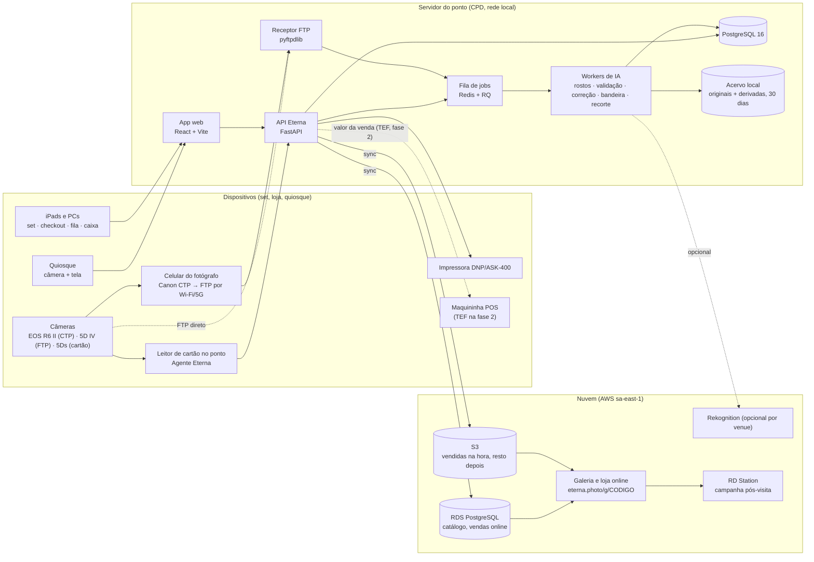
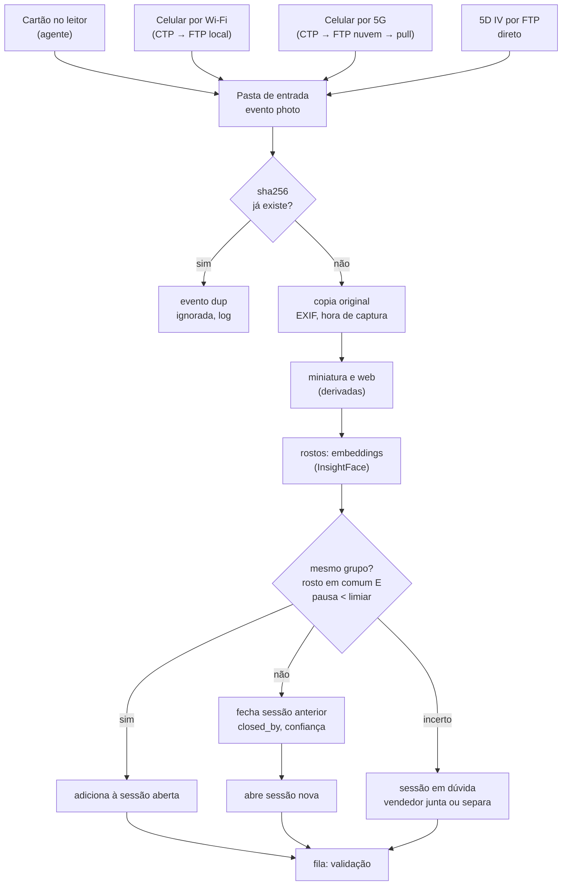
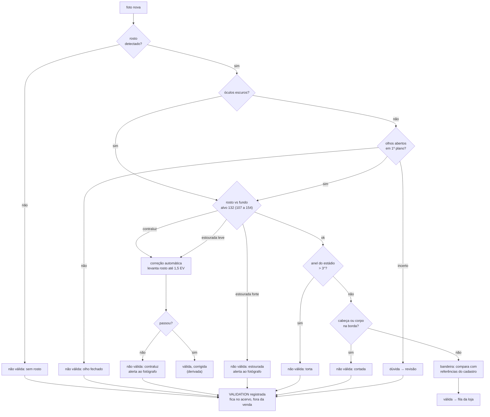
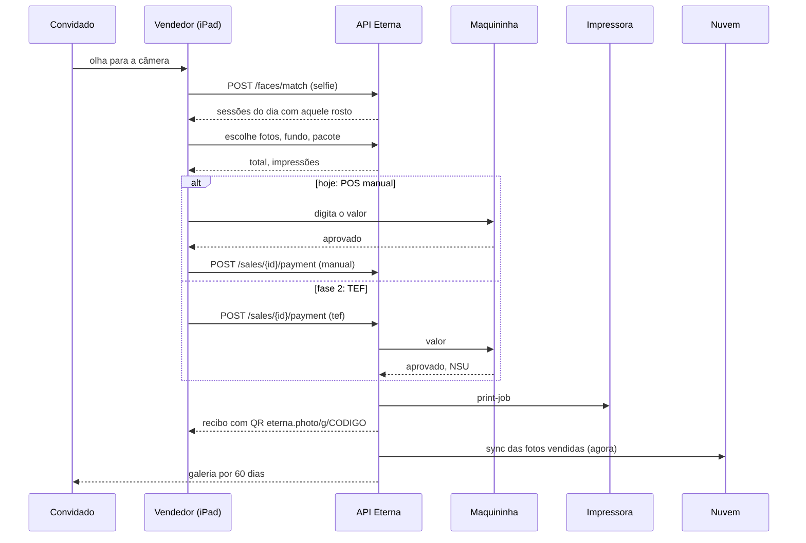
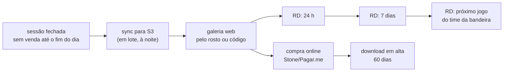
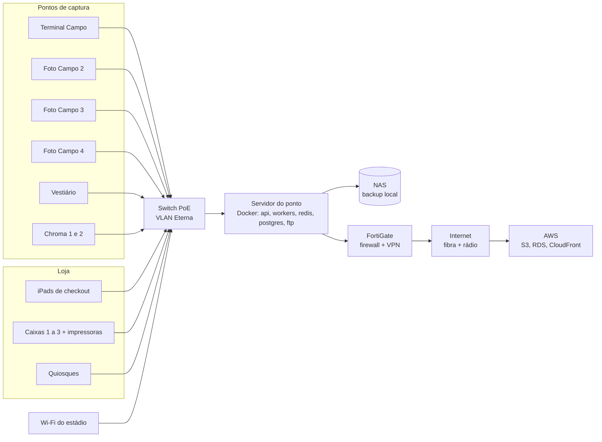

# Eterna: documentação técnica v1

26/10/2026 · Eduardo Rezende · versão editável: https://claude.ai/artifact/1hPgjcUPEFf5B6g7wGWWo4

## 1. Visão geral

Eterna é o sistema de captura, validação, venda e entrega de fotos do Tour do Maracanã, construído para substituir o Roverpix a partir de 01/12/2026 e depois ser licenciado a outros venues. Esta é a versão 1 da documentação técnica: descreve o protótipo que está no ar em [eterna.photo](https://eterna.photo) e a arquitetura de produção decidida até 26/10/2026.

**Escopo do MVP (jan a abr 2027)**

- Ingestão automática de fotos por cartão de memória, Wi‑Fi e 5G, sem ação do fotógrafo.
- Separação de grupos pelo servidor, sem foto preta: pausa entre cliques, troca de rostos, mudança de cena.
- Validação técnica e por IA antes da fila da loja; correção automática de exposição; registro de toda decisão para retreino.
- Checkout com reconhecimento facial (QR e código como contingência), pacotes, fundos de IA, pagamento em maquininha avulsa (TEF na fase 2), impressão e recibo com galeria.
- Galeria web do convidado por 60 dias; grupo sem venda vai para campanha pós-visita.
- Gestão: fluxo ao vivo, lista de vendas, índice por fotógrafo, qualidade, estoque (rolos e bandeiras), alertas.

**Princípios**

1. Local primeiro. Ingestão, validação, venda, impressão e relatórios funcionam sem internet. A nuvem recebe cópia e serve a galeria e a venda online.
2. Zero toque no set. O fotógrafo só fotografa. Nada de pasta, botão, formulário ou foto preta.
3. Nada se perde. Original sempre guardado; a correção gera uma derivada; exclusão é registrada, nunca apagada sem log.
4. Um domínio, um login. Todo mundo entra em `eterna.photo` com e-mail e código; o que aparece depois depende das permissões daquele e-mail, módulo a módulo (C, R, U, D).

**Estado em 26/10/2026**

| Peça | Estado | Onde |
| --- | --- | --- |
| App web (protótipo funcional, todos os perfis) | no ar, v19 (login por e-mail e código, permissões por módulo) | eterna.photo, GitHub Pages |
| Agente do ponto (leitor automático de cartão) | funcional, v1 | `agente/eterna-agente.py` |
| Servidor do ponto (API, banco, pipeline) | especificado; código inicial de 29/09 (FastAPI, 14 entidades, 14 testes) | a migrar para o repositório |
| Pipeline de IA | regras v1 definidas; correção de exposição testada em 28 fotos | seção 7 |
| Nuvem | decidida (AWS); conta a criar | seção 9 |

## 2. Arquitetura

Três camadas: dispositivos de captura e venda, o servidor do ponto (local, no CPD do Maracanã) e a nuvem. Tudo que a operação precisa roda no servidor local; a nuvem é cópia, galeria e venda online.



**Responsabilidades**

| Camada | Faz | Não faz |
| --- | --- | --- |
| Dispositivos | capturam, mostram telas do app, imprimem, cobram | não guardam estado; tudo vem da API |
| Servidor do ponto | ingestão, grupos, validação, correção, catálogo, vendas, impressão, relatórios, acervo de 30 dias | não depende de internet para nada disso |
| Nuvem | cópia do acervo, galeria do convidado, venda online, campanhas, backup | não participa da venda no balcão |

**Contingências de transferência** (reunião de 26/10): 1) celular por Wi‑Fi local; 2) celular por 5G para FTP na nuvem, que o servidor puxa; 3) cabo RJ45 da caixinha para laptop ou cartão no leitor. Os três caem na mesma pasta de entrada e passam pelo mesmo pipeline. Custo de parada citado: cerca de R$ 25.000 por dia.

## 3. Stack e versões

Python no servidor e no agente, TypeScript no app, PostgreSQL como banco único, Docker para empacotar. Versões são as estáveis em outubro de 2026; fixar no `pyproject.toml` e no `package.json` ao abrir cada módulo.

**Servidor do ponto**

| Camada | Tecnologia | Versão | Uso |
| --- | --- | --- | --- |
| Linguagem | Python | 3.12 | API, workers, agente |
| API | FastAPI | 0.115 | REST e WebSocket (fila ao vivo, set, checkout) |
| Servidor ASGI | Uvicorn | 0.30 | processo da API |
| Validação de dados | Pydantic | 2.9 | esquemas de entrada e saída |
| ORM e migrações | SQLAlchemy + Alembic | 2.0 / 1.13 | modelo de dados, migrações versionadas |
| Banco | PostgreSQL | 16 | tudo do ponto: sessões, fotos, vendas, estoque, logs |
| Fila de jobs | Redis + RQ | 7.4 / 1.16 | ingestão, IA, impressão, sync em segundo plano |
| Receptor FTP | pyftpdlib | 1.5 | recebe do Canon CTP (celular) e da 5D IV |
| Imagens | Pillow + NumPy | 10.4 / 2.1 | leitura, EXIF, derivadas, miniaturas |
| Visão | OpenCV (headless) | 4.10 | nitidez, inclinação, corte, exposição por região |
| Rostos | InsightFace (buffalo_l) sobre ONNX Runtime | 0.7 / 1.19 | detecção, embeddings, olhos, óculos; roda em CPU, GPU opcional |
| Recorte de fundo | rembg com BiRefNet | 2.0 | Chroma e fundos de IA |
| Rotulagem assistida (treino) | OpenAI API (modelo com visão) | atual | pose, expressão, segunda opinião em dúvidas; nunca na venda ao vivo |
| Impressão | CUPS ou spooler do Windows + driver DNP | - | hot folder por caixa |
| Testes | pytest + httpx | 8.3 / 0.27 | API e pipeline |
| Empacotamento | Docker + Compose | 27 / 2.29 | api, workers, redis, postgres, ftp em um `compose.yml` |

**App web (todos os perfis)**

| Camada | Tecnologia | Versão | Uso |
| --- | --- | --- | --- |
| Linguagem | TypeScript | 5.6 |  |
| UI | React | 18.3 | telas por perfil |
| Build | Vite | 5.4 | dev server e bundle estático |
| Rotas | React Router | 6.26 | `/#perfil/tela` como hoje |
| Dados | TanStack Query | 5 | cache e revalidação da API |
| Estado local | Zustand | 4.5 | sessão aberta, carrinho, filtros |
| Estilo | CSS com tokens (sem framework) | - | design system da seção 10 |
| QR | qrcode | 1.5 | recibo e galeria |
| Testes | Vitest + Playwright | 2 / 1.47 | unidade e fluxo ponta a ponta |

**Agente do ponto (leitor de cartão)**

| Item | Tecnologia | Versão | Uso |
| --- | --- | --- | --- |
| Linguagem | Python, só biblioteca padrão | 3.12 | vigia volumes, copia, dedupe por hash, serve miniaturas em 127.0.0.1:8765 |
| Miniaturas | `sips` (macOS) ou Pillow | - | 900 px |
| Empacotamento | PyInstaller | 6.10 | executável único para Windows e macOS, sem instalar Python no ponto |

**Nuvem**

| Item | Tecnologia | Uso |
| --- | --- | --- |
| Armazenamento | AWS S3 (sa-east-1) + CloudFront | acervo sincronizado, entrega da galeria |
| Banco online | AWS RDS PostgreSQL 16 | catálogo, vendas online, consentimentos |
| Galeria e loja | mesmo app web, build `cliente`, em S3 + CloudFront ou ECS | eterna.photo/g/CODIGO |
| Facial opcional | AWS Rekognition | venues que preferirem nuvem ao InsightFace local |
| Pagamento online | Stone/Pagar.me (checkout web) | galeria |
| Campanhas | RD Station (API) | pós-visita 24 h, 7 dias, jogo |

**Protótipo atual (eterna.photo)**: HTML, CSS e JavaScript sem framework em um arquivo, Google Fonts, qrcodejs 1.0.0, sprites WebP das fotos reais, GitHub Pages. Serve de referência de telas e comportamento para o app React.

## 4. Repositório

Um repositório único, [github.com/dudurezende10/eterna](https://github.com/dudurezende10/eterna), público enquanto for só protótipo; vira privado quando o código do servidor entrar. Branch `main` publica o app no GitHub Pages em eterna.photo a cada push (cerca de 1 minuto).

**Estrutura hoje (26/10)**

```text
eterna/
├─ index.html          app completo (HTML + CSS + JS), v18
├─ img/                fundos de IA e vestiário (6 jpg)
├─ sprites/            fotos reais em sprites WebP (12 arquivos, 373 fotos)
├─ agente/
│  └─ eterna-agente.py leitor automático de cartão
├─ CNAME               eterna.photo
├─ .nojekyll
└─ README.md
```

**Estrutura alvo (monorepo)**

```text
eterna/
├─ apps/
│  ├─ web/             React + Vite: perfis admin, foto, venda, valida, cliente, quiosque
│  └─ galeria/         build da loja online (mesmo código, só perfil cliente)
├─ services/
│  ├─ api/             FastAPI: rotas, esquemas, serviços, auth
│  ├─ workers/         jobs RQ: ingestão, grupos, validação, correção, bandeira, recorte, impressão, sync
│  ├─ ftp/             receptor pyftpdlib (CTP e 5D IV)
│  └─ ia/              modelos, regras v1, avaliação contra o gabarito do treino
├─ agente/             leitor de cartão (Python stdlib) + build PyInstaller
├─ packages/
│  ├─ design-tokens/   tokens CSS e JSON (seção 10)
│  └─ schema/          tipos compartilhados gerados do OpenAPI
├─ infra/
│  ├─ compose.yml      api, workers, redis, postgres, ftp
│  ├─ ponto/           instalação do servidor do ponto, backup, NAS
│  └─ aws/             S3, CloudFront, RDS (Terraform)
├─ docs/               esta documentação, ADRs, runbooks
├─ prototype/          index.html atual, congelado como referência
└─ .github/workflows/  testes, build, deploy do Pages e das imagens Docker
```

**Convenções**

- Branches: `main` (produção), `dev` (homologação no servidor do CPD), ramos curtos por tarefa.
- Commits em português, imperativo, com o módulo no início: `api: fecha grupo por pausa`.
- Versão do app no rodapé do menu (`v18 · 26/10 16:10`), gerada no build a partir da tag.
- Decisões de arquitetura em `docs/adr/NNNN-titulo.md`, uma por decisão (sem foto preta, PostgreSQL, InsightFace local).

## 5. Componentes

| Componente | Roda em | Porta e interface | Entrada | Saída |
| --- | --- | --- | --- | --- |
| Agente do ponto | PC de cada ponto de captura | `http://127.0.0.1:8765` (`/status`, `/events`, `/thumb/{id}`, `/file/{id}`) | cartão inserido (DCIM) | arquivos em `~/Eterna/inbox/AAAA-MM-DD/`, eventos `photo` e `dup` para a API |
| Receptor FTP | servidor do ponto | 21 (FTP) e 990 (FTPS), um usuário por fotógrafo | JPG do Canon CTP ou da 5D IV | arquivo na pasta de entrada, evento na fila |
| API Eterna | servidor do ponto | 8000, REST `/v1/*` e WebSocket `/ws` | app web, agente, FTP, quiosque | JSON, eventos ao vivo, jobs na fila |
| Workers | servidor do ponto (CPU; GPU opcional) | fila Redis `ingest`, `ia`, `print`, `sync` | jobs | fotos em grupos, validações, derivadas, impressões, cópias na nuvem |
| Banco | servidor do ponto | 5432 |  | fonte de verdade do ponto |
| Acervo | NAS ou disco do servidor | SMB/NFS | originais e derivadas | retenção 30 dias local |
| App web | navegador (iPad, PC, quiosque) | servido pela API ou pelo Pages | API | telas por perfil |
| Sync | worker `sync` | S3 e RDS por HTTPS | vendidas na hora, resto em lote | galeria online |
| Galeria | nuvem | eterna.photo/g/{codigo} | S3, RDS | fotos, compra, download |

**Contratos principais da API** (nomes definitivos ao gerar o OpenAPI):

- `POST /v1/ingest/events` (agente e FTP): foto nova ou repetida, com hash, hora de captura, ponto, fotógrafo.
- `GET /v1/sessions?status=` e `WS /ws/sessions`: grupos em formação, fechados, no checkout, pagos.
- `POST /v1/sessions/{id}/merge` e `/split`: ajuste do vendedor em grupos em dúvida.
- `POST /v1/faces/match` (selfie): devolve sessões do dia com aquele rosto.
- `POST /v1/sales` e `POST /v1/sales/{id}/payment`: venda e pagamento (POS manual hoje; TEF depois).
- `POST /v1/print-jobs`: impressão por caixa.
- `GET /v1/reports/*`: semana, fotógrafos, vendas, estoque, bandeiras, alertas.
- `POST /v1/validations/{photo_id}`: decisão humana ou da IA, com motivo, nunca sobrescrita (histórico).

## 6. Modelo de dados

A sessão (grupo de convidados) é a unidade central. Foto nunca é apagada: ganha validações e derivadas. Venda liga sessão, vendedor, itens e pagamento. Tudo que a IA decide fica em `validation`, com quem decidiu e por quê.


**Regras de integridade**

- `PHOTO.sha256` único por venue: a segunda chegada do mesmo arquivo vira evento `dup`, não linha nova.
- `VALIDATION` é só inserção. O estado da foto é a última validação; o histórico inteiro alimenta o retreino.
- `SESSION.boundary_confidence` abaixo do limiar marca a sessão como "em dúvida" para o vendedor juntar ou separar.
- `FACE` guarda embedding e hash, nunca a imagem do rosto; apagado 60 dias depois da visita ou quando o consentimento é retirado.
- `SALE.number` sequencial por dia e por caixa; cancelamento muda `status`, não apaga.

## 7. Fluxos de entrada e saída

Quatro fluxos cobrem a operação: ingestão, validação, checkout e pós-visita. Entradas à esquerda, saídas à direita.

**7.1 Ingestão e grupos** (sem foto preta)



Limiar de pausa aprendido por ponto (mediana dos intervalos entre sessões dos últimos 7 dias); valor inicial 45 s.

**7.2 Validação e correção** (regras v1, requisitos seção 13)



Toda decisão, da IA ou de pessoa, vira uma linha em `VALIDATION`. Confiança baixa em qualquer regra manda para dúvida, nunca reprova sozinha.

**7.3 Checkout e pagamento**



**7.4 Não vendeu**



**Entradas e saídas do sistema (resumo)**

| Entrada | De | Formato | Saída | Para | Formato |
| --- | --- | --- | --- | --- | --- |
| Fotos | câmeras via agente, CTP, FTP | JPG (6 a 9 MB) | derivadas, grupos, validações | app, nuvem | WebP, JPG, JSON |
| Selfie | iPad, quiosque, celular | JPG | sessões correspondentes | app | JSON |
| PAX | catracas (painel Maracatour, JSON) | JSON | spend per guest, capture rate | gestão | relatórios, CSV |
| Catálogo e preços | admin | app | carrinho, recibo | checkout, quiosque, galeria | JSON |
| Pagamento | vendedor (manual) ou TEF | app, maquininha | venda registrada, impressão | lista de vendas, impressora | JSON, job |
| Rótulos do treino | validador | app | regras e gabarito da IA | pipeline | JSON |
| Inventário de bandeiras | admin, supervisor | app, CSV | uso por foto, lista de compra | gestão | relatórios |

## 8. Integrações externas

| Sistema | Direção | Protocolo | O que troca | Estado |
| --- | --- | --- | --- | --- |
| Canon Content Transfer Professional (celular) | entra | FTP/FTPS para o receptor local ou da nuvem | JPG no clique, auto transfer; R6 Mark II por cabo USB‑C | app validado na loja; teste de campo pendente |
| Canon EOS 5D Mark IV | entra | FTP pelo Wi‑Fi da câmera | JPG direto ao servidor, sem celular | a testar |
| Agente do ponto | entra | HTTP local 8765 | fotos do cartão, eventos dup | v1 funcional |
| Painel Maracatour (catracas) | entra | HTTP JSON `/api/stats`, `/api/fotos/stats?periodo=` | PAX por dia, hora e canal | disponível, sem login |
| Roverpix (transição até a troca) | entra | API em tempo real (credencial com o Ronaldo) | vendas e sessões para comparar o período paralelo | aguardando credencial |
| AWS S3 e CloudFront | sai | HTTPS, SDK boto3 | acervo e galeria | conta a criar |
| AWS Rekognition | sai (opcional) | HTTPS | facial para venues que preferirem nuvem | não usado no Maracanã |
| Maquininha POS | manual hoje | - | valor digitado pelo vendedor | em uso |
| TEF (Stone Connect, SiTef ou similar) | sai, fase 2 | API da adquirente ou cliente TEF | valor, confirmação, NSU, cancelamento | adquirente a definir |
| Stone/Pagar.me (online) | sai | API REST | checkout da galeria | fase 2 |
| RD Station | sai | API REST | contato, evento de visita, disparos 24 h, 7 dias, jogo | confirmar que é RD Station |
| Impressora DNP (ASK‑400) | sai | driver, hot folder | impressões por caixa, contador de rolo | em uso no Tour |
| OpenAI API | sai, só treino | HTTPS | rotulagem assistida e segunda opinião em dúvidas | chave oferecida na reunião de 26/10 |

## 9. Infraestrutura e rede

**Servidor do ponto (CPD)**: uma máquina com CPU de 8 núcleos ou mais, 32 GB de RAM, SSD NVMe de 2 TB para o acervo de 30 dias, GPU opcional (uma RTX de entrada reduz o tempo de rosto e recorte de 0,5 s para 0,05 s por foto). Sistema recomendado: Ubuntu Server 24.04 LTS com Docker; Windows Server 2022 é possível se for o padrão da TI, rodando os mesmos containers. Nobreak de 30 minutos (cotação de R$ 4.000 a 5.000).

**Rede**: VLAN própria para os pontos, iPads e quiosques; FortiGate como firewall e VPN para acesso remoto e para o pull do FTP na nuvem; link dedicado com redundância (fibra e rádio). Wi‑Fi do estádio para os celulares dos fotógrafos; 5G como contingência; cabo RJ45 nas caixinhas para descarga direta.



**Hospedagem do protótipo**: GitHub Pages (branch `main`), domínio eterna.photo (GoDaddy, registros A para 185.199.108/109/110/111.153 e CNAME www), HTTPS do GitHub. Em produção o app é servido pela API no servidor do ponto (sem depender de internet) e a galeria pela nuvem.

**Backup**: originais e banco copiados para o NAS a cada hora; vendidas para o S3 na hora; acervo inteiro para o S3 à noite; retenção local de 30 dias, nuvem por 12 meses, galeria do convidado por 60 dias.

## 10. Design system

O mesmo sistema visual do site Wesden: papel claro, tinta quase preta, serifa para títulos e números grandes, sem-serifa para o resto, um acento terracota. Tudo em tokens CSS no `:root`, com versão escura automática. Os tokens já estão no `index.html` e vão para `packages/design-tokens`.

**Temas por venue**: o Eterna é a plataforma e cada venue entra com a própria marca. A tela Identidade (módulo Configuração) escolhe o venue, as duas cores (principal e apoio) e recebe o arquivo da logo oficial; o app aplica em `:root` (`--accent`, `--venue2`, `--display`, tema claro ou escuro) e troca nomes de pontos, taglines e assinatura. Regra de marca: a marca do venue vem primeiro em tudo que o público vê (quiosque, galeria, recibo), o Eterna assina pequeno ("fotos por Eterna"); nas telas da equipe o Eterna vem primeiro. Temas cadastrados: Viva Maracanã (Manual de Marca do Grupo Viva, out/2026: Azul #134078, Verde #005500, Amarelo #FFB800, secundárias Azul luz #307FE2, Azul noite #0C2340, Verde luz #43B02A, Amarelo luz #FCE300, Cinza museu #D9D9D6, Grafite #25282A; Big Shoulders com tracking 100 nos títulos, Inter nos textos; logo oficial em img/brand, branco sobre azul e azul sobre branco, mínimo 150 px em tela; grafismo multidão como pontos no menu e na entrada; white label com Eterna só como powered by) e Lollapalooza Brasil (escuro, rosa e lima, Archivo Black; variante de apresentação). As cores abaixo são as do tema base.

**Cor**

| Token | Claro | Escuro | Uso |
| --- | --- | --- | --- |
| `--bg` | #fafaf8 | #141311 | fundo da página |
| `--surface` | #ffffff | #1c1a17 | cartões e painéis |
| `--surface2` | #f1eee8 | #24211d | item de menu ativo, trilhas, fundos secundários |
| `--fg` | #141311 | #f2eee7 | texto e botão primário |
| `--muted` | #6b625a | #a69d92 | texto secundário, rótulos |
| `--line` | #dcd8d0 | #34302a | bordas |
| `--accent` | #53342e | #d2b29c | seleção de foto, destaque único por tela |
| `--good` / `--good-bg` | #2f6b3f / #e7f0e9 | #8fcb9d / #1f2e23 | pago, válida, conectado |
| `--warn` / `--warn-bg` | #8a6a14 / #f3ecd6 | #dcbb62 / #2f2812 | atenção, dúvida, em andamento |
| `--bad` / `--bad-bg` | #b3402a / #f6e3dd | #ee9479 / #3a211b | não válida, alerta, cancelada |
| `--bar` / `--bar2` | #141311 / #c9c2b6 | #f2eee7 / #4a443c | barras de gráfico, principal e comparativa |

Regra: uma cor de estado por elemento, sempre com texto junto (nunca só cor). O acento aparece uma vez por tela.

**Tipografia**

| Token | Fonte | Pesos | Onde |
| --- | --- | --- | --- |
| `--display` | Cormorant Garamond | 500, 600 | h1 38 px, h2 24 px, h3 19 px, números de tile 34 px, códigos de sessão 20 a 64 px, preços |
| `--body` | Inter | 400, 500, 600 | corpo 14 px / 1,45; notas 12 px; eyebrow 11 px em caixa alta com espaçamento 0,18 em |

Números sempre com `font-variant-numeric: tabular-nums`. Tabelas em 13 px.

**Espaço e forma**

- Escala de espaço: 4, 8, 12, 14, 16, 18, 22, 28 px. Gutter da página 28 px (16 no celular).
- Raio: 5 px em botões e inputs, 6 px em cartões e painéis, 999 em chips e pills, 28 px na moldura do celular, 12 px no quiosque.
- Bordas de 1 px em `--line`; sombra só na moldura do celular. Sem gradientes.
- Menu lateral de 230 px fixo; abaixo de 900 px vira barra horizontal no topo.

**Componentes** (nomes como estão no CSS)

| Componente | Classe | Para |
| --- | --- | --- |
| Tile | `.tile` | um número com rótulo e nota |
| Painel | `.panel` | bloco com título e conteúdo |
| Chip | `.chip` (`aria-pressed`) | filtro, modo, opção |
| Pill | `.pill.good/.warn/.bad/.neutral` | estado |
| Botão | `.btn`, `.primary`, `.ghost`, `.big` | ação; uma primária por tela |
| Cartão de sessão | `.scard` | código, fotógrafo, hora, estado |
| Foto | `.ph` (`data-sel`, `data-v`, `data-off`) | miniatura com seleção, nota, descarte |
| Cartão de perfil | `.role` | entrada de tela ou de perfil |
| Etapas | `.steps .step` | checkout em 4 passos |
| Fluxo | `.flow .stage` | etapas com contadores |
| Celular | `.phone` | visão do fotógrafo e do convidado |
| Quiosque | `.kiosk .screen`, `.face` | tela cheia, câmera |
| Barras | `.bars .bar` | comparação horizontal |
| Alerta | `.alert.bad/.warn/.good` | regra disparada |
| Recibo | `.receipt` | monoespaçada |

**Estados**: `aria-pressed` em chips e botões de seleção; `aria-current="page"` no menu; foco visível com contorno de 2 px no acento; `[disabled]` a 45% de opacidade; animações só na chegada de foto e na câmera do quiosque, desligadas com `prefers-reduced-motion`.

**Linguagem**: convidado (não cliente), anfitrião (fotógrafo no set), sessão ou grupo (não cartão), ponto de captura, passe de foto, galeria. Frases curtas, números na frente, sem texto explicativo dentro do app. Taxa, prazo e tamanho do arquivo sempre no recibo.

**Acessibilidade**: contraste mínimo 4,5:1 nos textos (os tokens acima cumprem nos dois temas); alvos de toque de 42 px ou mais (botões grandes de 56 px no set, checkout e quiosque); tudo operável por teclado nas telas de gestão.

## 11. Segurança, LGPD, backup e observabilidade

**Acesso**: entrada por e-mail e código de uso único (sem senha). O usuário digita o e-mail, recebe um código de 6 dígitos válido por 10 minutos e entra; a sessão dura 12 h. O que cada e-mail vê e faz vem do cadastro de usuários: permissão **C, R, U, D por módulo** (Set e ingestão, Venda, Quiosque, Galeria do convidado, Qualidade e IA, Relatórios, Configuração do set, Catálogo e preços, Estoque e bandeiras, Usuários e permissões), com perfis base (Admin, Fotógrafo, Vendedor, Validador, Supervisor, Quiosque, Cliente) que preenchem a matriz e podem ser ajustados por pessoa. Desligar ou remover o e-mail corta o acesso na hora. E-mail sem cadastro entra como Cliente e vê só a própria galeria. Quiosque e iPads do set entram com o e-mail do dispositivo. No protótipo (v19) o e-mail é simulado na tela; em produção o envio sai por Amazon SES ou Resend a partir da API, com o código guardado em Redis com expiração.

**Dados pessoais (LGPD)**: rosto é dado biométrico. O sistema guarda embedding e hash, nunca a imagem recortada do rosto; consentimento registrado em `CONSENT` no primeiro contato (checkout ou quiosque), com texto e versão; quem não autoriza usa QR ou código; embeddings apagados 60 dias depois da visita ou no pedido do titular; fotos não vendidas apagadas da nuvem em 60 dias; vendidas ficam 12 meses para reimpressão. Nome, e-mail e telefone só na venda e na galeria, com finalidade declarada; RD Station recebe apenas quem autorizou campanha.

**Rede e segredos**: API só na VLAN e pela VPN; FTP com usuário por fotógrafo e FTPS quando o CTP permitir; segredos em variáveis de ambiente do Docker, nunca no repositório; chaves de nuvem com permissão mínima por bucket.

**Backup e continuidade**: NAS a cada hora, S3 à noite; restauração testada por mês; servidor reserva (um PC de ponto) com o mesmo `compose.yml` e o último backup, sobe em 30 minutos; impressão e venda continuam sem internet.

**Observabilidade**: logs estruturados (JSON) por serviço; métricas de fila (tempo por foto em cada etapa), de ingestão (fotos por minuto por ponto, repetidas) e de IA (acerto contra o gabarito do treino); alertas operacionais já definidos no app (fotos por sessão, conversão, estação parada, rolo, bandeira). Ferramenta: Prometheus + Grafana no servidor do ponto, Sentry para erros do app.

## 12. Ambientes, versionamento e decisões em aberto

| Ambiente | Onde | Dados | Deploy |
| --- | --- | --- | --- |
| Desenvolvimento | notebook do desenvolvedor, Docker | amostra anonimizada (24 sessões) | `docker compose up` |
| Homologação | servidor do CPD, branch `dev` | cópia do acervo real, cartões de teste | push em `dev` |
| Produção | servidor do CPD, branch `main` | real | tag `vX.Y.Z`, janela fora do horário do Tour |
| Protótipo | GitHub Pages, eterna.photo | fotos reais em sprites, simulação no navegador | push em `main` |

Versionamento semântico: `v1.0.0` na substituição do Roverpix; o protótipo segue `v18`, `v19` até lá. Cada entidade e cada rota da API carrega versão no caminho (`/v1`).

**Decisões em aberto**

- [ ] Banco no servidor do ponto: PostgreSQL (recomendado) ou SQL Server, que a TI citou na reunião de 26/10. O ORM aceita os dois; a escolha afeta backup, licença e Docker.
- [ ] Sistema do servidor: Ubuntu com Docker (recomendado) ou Windows Server.
- [ ] Adquirente e forma de TEF (fase 2).
- [ ] "RD" do quadro de 26/10 é RD Station?
- [ ] Reflexo de flash na lente dos óculos: pode ou não pode?
- [ ] Nome definitivo: busca no INPI (classes 9, 41, 42) pendente desde 29/09.
- [ ] GPU no servidor do ponto: decidir depois de medir o tempo por foto em CPU com fotos em tamanho cheio.

**Documentos relacionados** (projeto Maracanã): requisitos v0.2, especificação v0.1, decisões técnicas, reunião de TI de 16/10, reunião de implantação de 26/10, inventário de bandeiras.

Fontes: protótipo em [eterna.photo](https://eterna.photo) e repositório [github.com/dudurezende10/eterna](https://github.com/dudurezende10/eterna); [Canon CTP](https://www.canon-europe.com/apps/content-transfer-mobile) e [câmeras compatíveis](https://cam.start.canon/en/S013/manual/html/UG-00_Before_0020.html); [Wi‑Fi e FTP da EOS 5D Mark IV](https://in.canon/en/support/8203044300); resumo da reunião "Implantação fluxo fotos" de 26/10/2026; requisitos Eterna v0.2 (projeto Maracanã).

## Glossário

| Termo | Significado |
| --- | --- |
| Sessão ou grupo | conjunto de fotos de uma família ou pessoa em um ponto, separado pelo servidor |
| Ponto de captura | lugar com fotógrafo ou estação automática (Terminal Campo, Foto Campo 2 a 4, Vestiário, Chroma 1 e 2) |
| Ingestão | chegada da foto ao servidor, por qualquer caminho, sem ação do fotógrafo |
| Validação | decisão pode, não pode ou dúvida sobre uma foto, com motivo; da IA ou de pessoa |
| Derivada | versão gerada de uma foto: miniatura, web, corrigida, recorte, com fundo |
| Checkout | tela única do vendedor: identificar, escolher, pagar, recibo |
| PAX | visitantes do dia pela catraca |
| Spend per guest | receita dividida por PAX |
| Índice do fotógrafo | receita do dia dividida pela média dos colegas do mesmo dia, vezes 100 |
| Agente do ponto | programa local que vigia o cartão e entrega as fotos |
| CTP | Canon Content Transfer Professional, app que manda a foto da câmera para FTP pelo celular |
| TEF | pagamento integrado: o sistema envia o valor à maquininha e recebe a confirmação |

## Histórico desta documentação

| Versão | Data | O que mudou |
| --- | --- | --- |
| v1 | 26/10/2026 | primeira versão: arquitetura, stack, repositório, modelo de dados, fluxos, integrações, infraestrutura, design system, segurança, ambientes |
| v1.1 | 26/10/2026 | acesso: login por e-mail e código substitui a tela de perfis; permissões CRUD por módulo; tela Usuários; app v19 |
| v1.2 | 26/10/2026 | câmera sempre ligada no checkout e quiosque; editor manual de ajustes; FTP embutido no agente; temas por venue (Maracanã, Lollapalooza) |
| v1.3 | 26/10/2026 | white label com a identidade Viva Maracanã do manual de marca |
