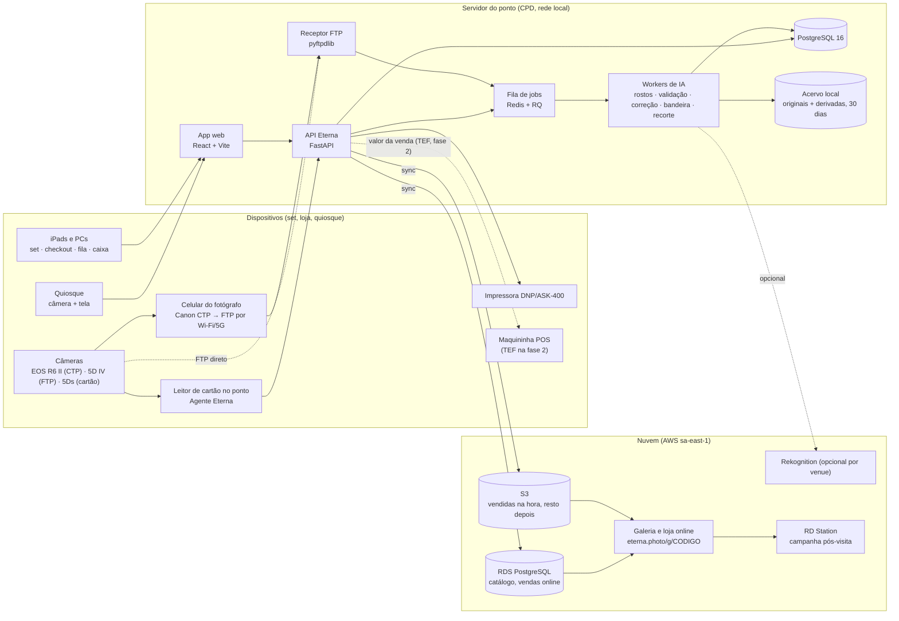
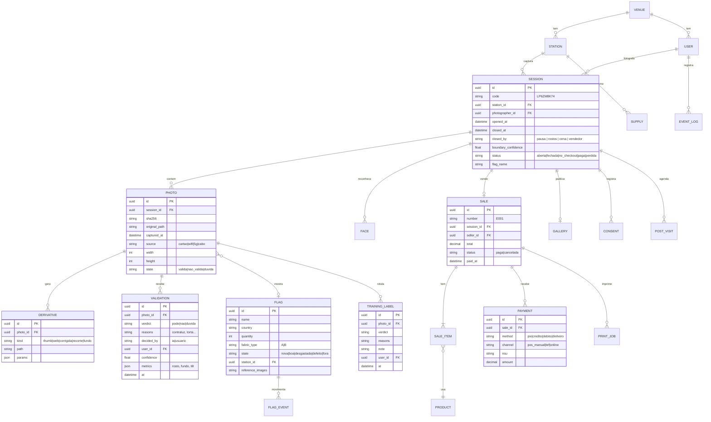
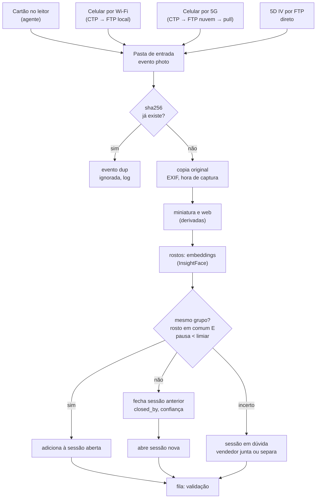
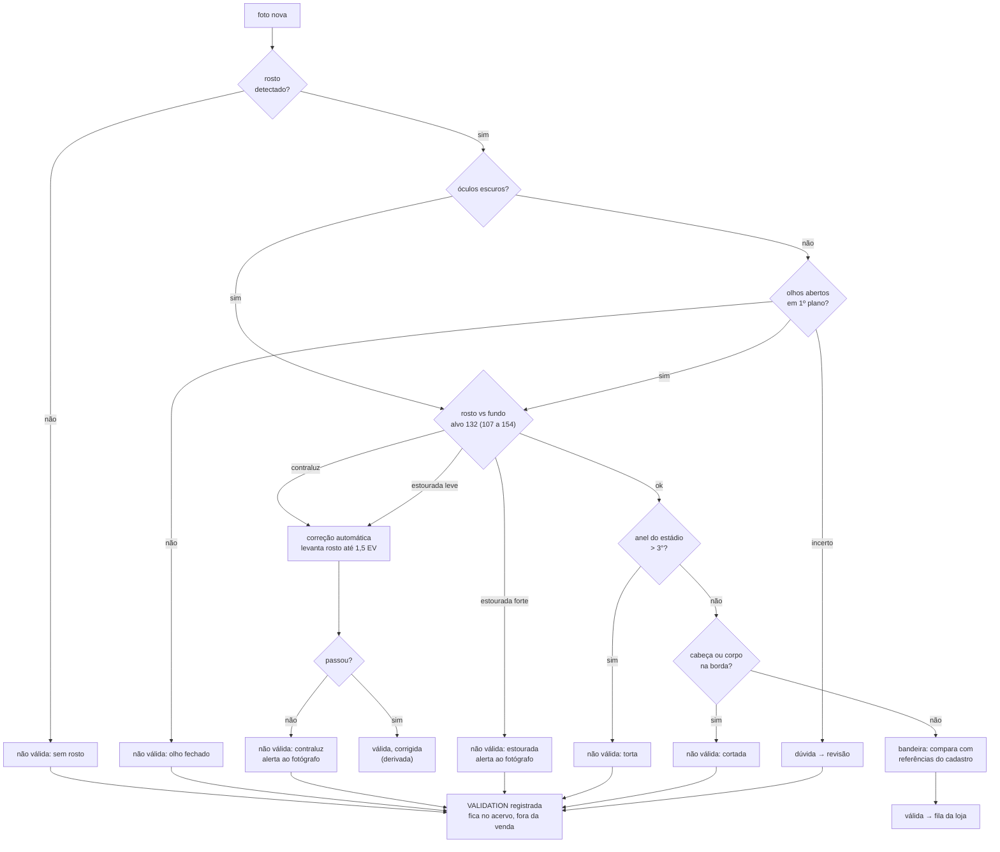
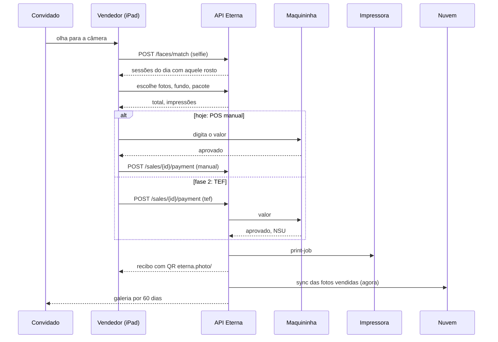
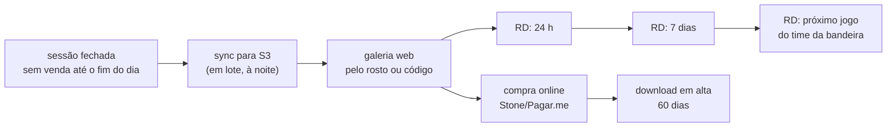
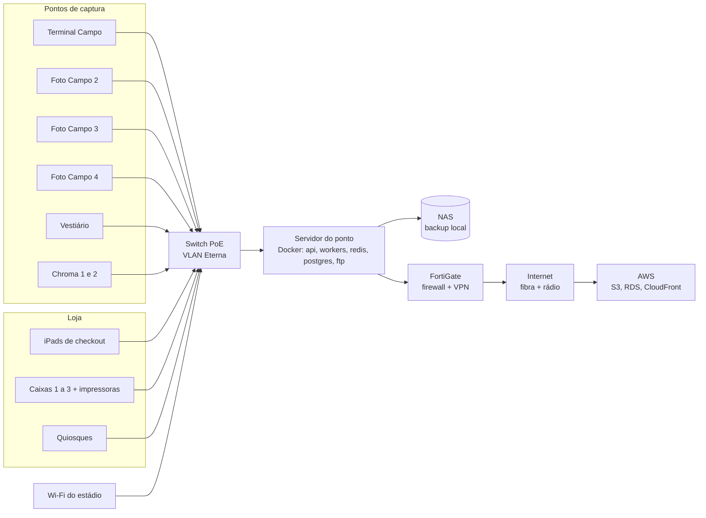
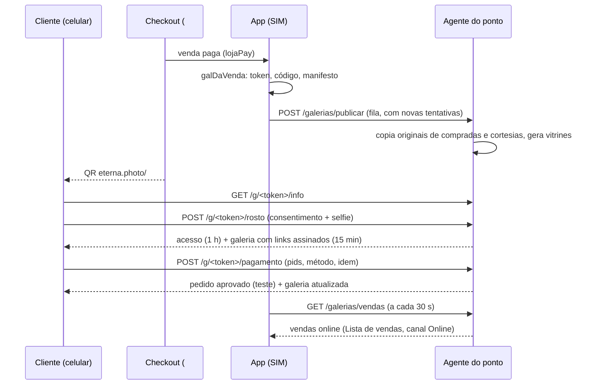

# Eterna: documentação técnica v1

26/10/2026 · Eduardo Rezende · versão editável: https://claude.ai/artifact/1hPgjcUPEFf5B6g7wGWWo4

## 1. Visão geral

Eterna é o sistema de captura, validação, venda e entrega de fotos do Tour do Maracanã, construído para substituir o Roverpix a partir de 01/12/2026 e depois ser licenciado a outros venues. Esta é a versão 1 da documentação técnica: descreve o protótipo que está no ar em [eterna.photo](https://eterna.photo) e a arquitetura de produção decidida até 26/10/2026.

**Escopo do MVP (jan a abr 2027)**

- Ingestão automática de fotos por cartão de memória, Wi‑Fi e 5G, sem ação do fotógrafo.
- Separação de grupos pelo servidor, sem foto preta: pausa entre cliques, troca de rostos, mudança de cena.
- Validação técnica e por IA antes da fila da loja; correção automática de exposição; registro de toda decisão para retreino.
- Checkout com reconhecimento facial (QR e código como contingência), pacotes, fundos de IA, pagamento em maquininha avulsa (TEF na fase 2), impressão e recibo com galeria.
- Galeria web do convidado por 60 dias; grupo sem venda vai para campanha pós-visita.
- Gestão: fluxo ao vivo, lista de vendas, índice por fotógrafo, qualidade, estoque (rolos e bandeiras), alertas.

**Princípios**

1. Local primeiro. Ingestão, validação, venda, impressão e relatórios funcionam sem internet. A nuvem recebe cópia e serve a galeria e a venda online.
2. Zero toque no set. O fotógrafo só fotografa. Nada de pasta, botão, formulário ou foto preta.
3. Nada se perde. Original sempre guardado; a correção gera uma derivada; exclusão é registrada, nunca apagada sem log.
4. Um domínio, um login. Todo mundo entra em `eterna.photo` com e-mail e código; o que aparece depois depende das permissões daquele e-mail, módulo a módulo (C, R, U, D).

**Estado em 26/10/2026**

| Peça | Estado | Onde |
| --- | --- | --- |
| App web (protótipo funcional, todos os perfis) | no ar, v19 (login por e-mail e código, permissões por módulo) | eterna.photo, GitHub Pages |
| Agente do ponto (leitor automático de cartão) | funcional, v1 | `agente/eterna-agente.py` |
| Servidor do ponto (API, banco, pipeline) | especificado; código inicial de 29/09 (FastAPI, 14 entidades, 14 testes) | a migrar para o repositório |
| Pipeline de IA | regras v1 definidas; correção de exposição testada em 28 fotos | seção 7 |
| Nuvem | decidida (AWS); conta a criar | seção 9 |

## 2. Arquitetura

Três camadas: dispositivos de captura e venda, o servidor do ponto (local, no CPD do Maracanã) e a nuvem. Tudo que a operação precisa roda no servidor local; a nuvem é cópia, galeria e venda online.



**Responsabilidades**

| Camada | Faz | Não faz |
| --- | --- | --- |
| Dispositivos | capturam, mostram telas do app, imprimem, cobram | não guardam estado; tudo vem da API |
| Servidor do ponto | ingestão, grupos, validação, correção, catálogo, vendas, impressão, relatórios, acervo de 30 dias | não depende de internet para nada disso |
| Nuvem | cópia do acervo, galeria do convidado, venda online, campanhas, backup | não participa da venda no balcão |

**Contingências de transferência** (reunião de 26/10): 1) celular por Wi‑Fi local; 2) celular por 5G para FTP na nuvem, que o servidor puxa; 3) cabo RJ45 da caixinha para laptop ou cartão no leitor. Os três caem na mesma pasta de entrada e passam pelo mesmo pipeline. Custo de parada citado: cerca de R$ 25.000 por dia.

## 3. Stack e versões

Python no servidor e no agente, TypeScript no app, PostgreSQL como banco único, Docker para empacotar. Versões são as estáveis em outubro de 2026; fixar no `pyproject.toml` e no `package.json` ao abrir cada módulo.

**Servidor do ponto**

| Camada | Tecnologia | Versão | Uso |
| --- | --- | --- | --- |
| Linguagem | Python | 3.12 | API, workers, agente |
| API | FastAPI | 0.115 | REST e WebSocket (fila ao vivo, set, checkout) |
| Servidor ASGI | Uvicorn | 0.30 | processo da API |
| Validação de dados | Pydantic | 2.9 | esquemas de entrada e saída |
| ORM e migrações | SQLAlchemy + Alembic | 2.0 / 1.13 | modelo de dados, migrações versionadas |
| Banco | PostgreSQL | 16 | tudo do ponto: sessões, fotos, vendas, estoque, logs |
| Fila de jobs | Redis + RQ | 7.4 / 1.16 | ingestão, IA, impressão, sync em segundo plano |
| Receptor FTP | pyftpdlib | 1.5 | recebe do Canon CTP (celular) e da 5D IV |
| Imagens | Pillow + NumPy | 10.4 / 2.1 | leitura, EXIF, derivadas, miniaturas |
| Visão | OpenCV (headless) | 4.10 | nitidez, inclinação, corte, exposição por região |
| Rostos | InsightFace (buffalo_l) sobre ONNX Runtime | 0.7 / 1.19 | detecção, embeddings, olhos, óculos; roda em CPU, GPU opcional |
| Recorte de fundo | rembg com BiRefNet | 2.0 | Chroma e fundos de IA |
| Rotulagem assistida (treino) | OpenAI API (modelo com visão) | atual | pose, expressão, segunda opinião em dúvidas; nunca na venda ao vivo |
| Impressão | CUPS ou spooler do Windows + driver DNP | - | hot folder por caixa |
| Testes | pytest + httpx | 8.3 / 0.27 | API e pipeline |
| Empacotamento | Docker + Compose | 27 / 2.29 | api, workers, redis, postgres, ftp em um `compose.yml` |

**App web (todos os perfis)**

| Camada | Tecnologia | Versão | Uso |
| --- | --- | --- | --- |
| Linguagem | TypeScript | 5.6 |  |
| UI | React | 18.3 | telas por perfil |
| Build | Vite | 5.4 | dev server e bundle estático |
| Rotas | React Router | 6.26 | `/#perfil/tela` como hoje |
| Dados | TanStack Query | 5 | cache e revalidação da API |
| Estado local | Zustand | 4.5 | sessão aberta, carrinho, filtros |
| Estilo | CSS com tokens (sem framework) | - | design system da seção 10 |
| QR | qrcode | 1.5 | recibo e galeria |
| Testes | Vitest + Playwright | 2 / 1.47 | unidade e fluxo ponta a ponta |

**Agente do ponto (leitor de cartão)**

| Item | Tecnologia | Versão | Uso |
| --- | --- | --- | --- |
| Linguagem | Python, só biblioteca padrão | 3.12 | vigia volumes, copia, dedupe por hash, serve miniaturas em 127.0.0.1:8765 |
| Miniaturas | `sips` (macOS) ou Pillow | - | 900 px |
| Empacotamento | PyInstaller | 6.10 | executável único para Windows e macOS, sem instalar Python no ponto |

**Nuvem**

| Item | Tecnologia | Uso |
| --- | --- | --- |
| Armazenamento | AWS S3 (sa-east-1) + CloudFront | acervo sincronizado, entrega da galeria |
| Banco online | AWS RDS PostgreSQL 16 | catálogo, vendas online, consentimentos |
| Galeria e loja | mesmo app web, build `cliente`, em S3 + CloudFront ou ECS | eterna.photo/g/CODIGO |
| Facial opcional | AWS Rekognition | venues que preferirem nuvem ao InsightFace local |
| Pagamento online | Stone/Pagar.me (checkout web) | galeria |
| Campanhas | RD Station (API) | pós-visita 24 h, 7 dias, jogo |

**Protótipo atual (eterna.photo)**: HTML, CSS e JavaScript sem framework em um arquivo, Google Fonts, qrcodejs 1.0.0, sprites WebP das fotos reais, GitHub Pages. Serve de referência de telas e comportamento para o app React.

## 4. Repositório

Um repositório único, [github.com/dudurezende10/eterna](https://github.com/dudurezende10/eterna), público enquanto for só protótipo; vira privado quando o código do servidor entrar. Branch `main` publica o app no GitHub Pages em eterna.photo a cada push (cerca de 1 minuto).

**Estrutura hoje (26/10)**

```text
eterna/
├─ index.html          app completo (HTML + CSS + JS), v18
├─ img/                fundos de IA e vestiário (6 jpg)
├─ sprites/            fotos reais em sprites WebP (12 arquivos, 373 fotos)
├─ agente/
│  └─ eterna-agente.py leitor automático de cartão
├─ CNAME               eterna.photo
├─ .nojekyll
└─ README.md
```

**Estrutura alvo (monorepo)**

```text
eterna/
├─ apps/
│  ├─ web/             React + Vite: perfis admin, foto, venda, valida, cliente, quiosque
│  └─ galeria/         build da loja online (mesmo código, só perfil cliente)
├─ services/
│  ├─ api/             FastAPI: rotas, esquemas, serviços, auth
│  ├─ workers/         jobs RQ: ingestão, grupos, validação, correção, bandeira, recorte, impressão, sync
│  ├─ ftp/             receptor pyftpdlib (CTP e 5D IV)
│  └─ ia/              modelos, regras v1, avaliação contra o gabarito do treino
├─ agente/             leitor de cartão (Python stdlib) + build PyInstaller
├─ packages/
│  ├─ design-tokens/   tokens CSS e JSON (seção 10)
│  └─ schema/          tipos compartilhados gerados do OpenAPI
├─ infra/
│  ├─ compose.yml      api, workers, redis, postgres, ftp
│  ├─ ponto/           instalação do servidor do ponto, backup, NAS
│  └─ aws/             S3, CloudFront, RDS (Terraform)
├─ docs/               esta documentação, ADRs, runbooks
├─ prototype/          index.html atual, congelado como referência
└─ .github/workflows/  testes, build, deploy do Pages e das imagens Docker
```

**Convenções**

- Branches: `main` (produção), `dev` (homologação no servidor do CPD), ramos curtos por tarefa.
- Commits em português, imperativo, com o módulo no início: `api: fecha grupo por pausa`.
- Versão do app no rodapé do menu (`v18 · 26/10 16:10`), gerada no build a partir da tag.
- Decisões de arquitetura em `docs/adr/NNNN-titulo.md`, uma por decisão (sem foto preta, PostgreSQL, InsightFace local).

## 5. Componentes

| Componente | Roda em | Porta e interface | Entrada | Saída |
| --- | --- | --- | --- | --- |
| Agente do ponto | PC de cada ponto de captura | `http://127.0.0.1:8765` (`/status`, `/events`, `/thumb/{id}`, `/file/{id}`) | cartão inserido (DCIM) | arquivos em `~/Eterna/inbox/AAAA-MM-DD/`, eventos `photo` e `dup` para a API |
| Receptor FTP | servidor do ponto | 21 (FTP) e 990 (FTPS), um usuário por fotógrafo | JPG do Canon CTP ou da 5D IV | arquivo na pasta de entrada, evento na fila |
| API Eterna | servidor do ponto | 8000, REST `/v1/*` e WebSocket `/ws` | app web, agente, FTP, quiosque | JSON, eventos ao vivo, jobs na fila |
| Workers | servidor do ponto (CPU; GPU opcional) | fila Redis `ingest`, `ia`, `print`, `sync` | jobs | fotos em grupos, validações, derivadas, impressões, cópias na nuvem |
| Banco | servidor do ponto | 5432 |  | fonte de verdade do ponto |
| Acervo | NAS ou disco do servidor | SMB/NFS | originais e derivadas | retenção 30 dias local |
| App web | navegador (iPad, PC, quiosque) | servido pela API ou pelo Pages | API | telas por perfil |
| Sync | worker `sync` | S3 e RDS por HTTPS | vendidas na hora, resto em lote | galeria online |
| Galeria | nuvem (fase 1: agente do ponto) | eterna.photo/#g/{token}, código curto como contingência | S3, RDS | fotos, compra, download (ver "Galeria online por QR") |

**Contratos principais da API** (nomes definitivos ao gerar o OpenAPI):

- `POST /v1/ingest/events` (agente e FTP): foto nova ou repetida, com hash, hora de captura, ponto, fotógrafo.
- `GET /v1/sessions?status=` e `WS /ws/sessions`: grupos em formação, fechados, no checkout, pagos.
- `POST /v1/sessions/{id}/merge` e `/split`: ajuste do vendedor em grupos em dúvida.
- `POST /v1/faces/match` (selfie): devolve sessões do dia com aquele rosto.
- `POST /v1/sales` e `POST /v1/sales/{id}/payment`: venda e pagamento (POS manual hoje; TEF depois).
- `POST /v1/print-jobs`: impressão por caixa.
- `GET /v1/reports/*`: semana, fotógrafos, vendas, estoque, bandeiras, alertas.
- `POST /v1/validations/{photo_id}`: decisão humana ou da IA, com motivo, nunca sobrescrita (histórico).

## 6. Modelo de dados

A sessão (grupo de convidados) é a unidade central. Foto nunca é apagada: ganha validações e derivadas. Venda liga sessão, vendedor, itens e pagamento. Tudo que a IA decide fica em `validation`, com quem decidiu e por quê.



**Regras de integridade**

- `PHOTO.sha256` único por venue: a segunda chegada do mesmo arquivo vira evento `dup`, não linha nova.
- `VALIDATION` é só inserção. O estado da foto é a última validação; o histórico inteiro alimenta o retreino.
- `SESSION.boundary_confidence` abaixo do limiar marca a sessão como "em dúvida" para o vendedor juntar ou separar.
- `FACE` guarda embedding e hash, nunca a imagem do rosto; apagado 60 dias depois da visita ou quando o consentimento é retirado.
- `SALE.number` sequencial por dia e por caixa; cancelamento muda `status`, não apaga.

## 7. Fluxos de entrada e saída

Quatro fluxos cobrem a operação: ingestão, validação, checkout e pós-visita. Entradas à esquerda, saídas à direita.

**7.1 Ingestão e grupos** (sem foto preta)



Limiar de pausa aprendido por ponto (mediana dos intervalos entre sessões dos últimos 7 dias); valor inicial 45 s.

**7.2 Validação e correção** (regras v1, requisitos seção 13)



Toda decisão, da IA ou de pessoa, vira uma linha em `VALIDATION`. Confiança baixa em qualquer regra manda para dúvida, nunca reprova sozinha.

**7.3 Checkout e pagamento**



**7.4 Não vendeu**



**Entradas e saídas do sistema (resumo)**

| Entrada | De | Formato | Saída | Para | Formato |
| --- | --- | --- | --- | --- | --- |
| Fotos | câmeras via agente, CTP, FTP | JPG (6 a 9 MB) | derivadas, grupos, validações | app, nuvem | WebP, JPG, JSON |
| Selfie | iPad, quiosque, celular | JPG | sessões correspondentes | app | JSON |
| PAX | catracas (painel Maracatour, JSON) | JSON | spend per guest, capture rate | gestão | relatórios, CSV |
| Catálogo e preços | admin | app | carrinho, recibo | checkout, quiosque, galeria | JSON |
| Pagamento | vendedor (manual) ou TEF | app, maquininha | venda registrada, impressão | lista de vendas, impressora | JSON, job |
| Rótulos do treino | validador | app | regras e gabarito da IA | pipeline | JSON |
| Inventário de bandeiras | admin, supervisor | app, CSV | uso por foto, lista de compra | gestão | relatórios |

## 8. Integrações externas

| Sistema | Direção | Protocolo | O que troca | Estado |
| --- | --- | --- | --- | --- |
| Canon Content Transfer Professional (celular) | entra | FTP/FTPS para o receptor local ou da nuvem | JPG no clique, auto transfer; R6 Mark II por cabo USB‑C | app validado na loja; teste de campo pendente |
| Canon EOS 5D Mark IV | entra | FTP pelo Wi‑Fi da câmera | JPG direto ao servidor, sem celular | a testar |
| Agente do ponto | entra | HTTP local 8765 | fotos do cartão, eventos dup | v1 funcional |
| Painel Maracatour (catracas) | entra | HTTP JSON `/api/stats`, `/api/fotos/stats?periodo=` | PAX por dia, hora e canal | disponível, sem login |
| Roverpix (transição até a troca) | entra | API em tempo real (credencial com o Ronaldo) | vendas e sessões para comparar o período paralelo | aguardando credencial |
| AWS S3 e CloudFront | sai | HTTPS, SDK boto3 | acervo e galeria | conta a criar |
| AWS Rekognition | sai (opcional) | HTTPS | facial para venues que preferirem nuvem | não usado no Maracanã |
| Maquininha POS | manual hoje | - | valor digitado pelo vendedor | em uso |
| TEF (Stone Connect, SiTef ou similar) | sai, fase 2 | API da adquirente ou cliente TEF | valor, confirmação, NSU, cancelamento | adquirente a definir |
| Stone/Pagar.me (online) | sai | API REST | checkout da galeria | fase 2 |
| RD Station | sai | API REST | contato, evento de visita, disparos 24 h, 7 dias, jogo | confirmar que é RD Station |
| Impressora DNP (ASK‑400) | sai | driver, hot folder | impressões por caixa, contador de rolo | em uso no Tour |
| OpenAI API | sai, só treino | HTTPS | rotulagem assistida e segunda opinião em dúvidas | chave oferecida na reunião de 26/10 |

## 9. Infraestrutura e rede

**Servidor do ponto (CPD)**: uma máquina com CPU de 8 núcleos ou mais, 32 GB de RAM, SSD NVMe de 2 TB para o acervo de 30 dias, GPU opcional (uma RTX de entrada reduz o tempo de rosto e recorte de 0,5 s para 0,05 s por foto). Sistema recomendado: Ubuntu Server 24.04 LTS com Docker; Windows Server 2022 é possível se for o padrão da TI, rodando os mesmos containers. Nobreak de 30 minutos (cotação de R$ 4.000 a 5.000).

**Rede**: VLAN própria para os pontos, iPads e quiosques; FortiGate como firewall e VPN para acesso remoto e para o pull do FTP na nuvem; link dedicado com redundância (fibra e rádio). Wi‑Fi do estádio para os celulares dos fotógrafos; 5G como contingência; cabo RJ45 nas caixinhas para descarga direta.



**Hospedagem do protótipo**: GitHub Pages (branch `main`), domínio eterna.photo (GoDaddy, registros A para 185.199.108/109/110/111.153 e CNAME www), HTTPS do GitHub. Em produção o app é servido pela API no servidor do ponto (sem depender de internet) e a galeria pela nuvem.

**E-mail do domínio**: hello@eterna.photo encaminhado para o Gmail do Eduardo pelo ImprovMX (plano grátis). DNS no GoDaddy: MX `mx1.improvmx.com` (10) e `mx2.improvmx.com` (20); SPF `v=spf1 include:spf.improvmx.com include:_spf.google.com ~all` (respostas saem pelo Gmail, "Enviar e-mail como"). É o e-mail oficial do Eterna: remetente dos códigos de login e contato do convidado (recibo e galeria). Envio real em produção sai pelo servidor (SMTP do Gmail com senha de app, ou o serviço da VM), sempre com remetente hello@eterna.photo.

**Roverpix (transição)**: enquanto o Eterna não opera sozinho, o agente do ponto sincroniza a API de relatórios da Roverpix (`/reports/orders`, `/payments`, `/photos`, cabeçalho `ApiKey`) a cada 5 minutos, últimos 30 dias, dia a dia (dias fechados ficam em cache). A chave fica só em `~/Eterna/roverpix.json` (permissão 600), digitada pelo admin na tela Repositório com o app aberto pelo agente; nunca vai para o site nem para o GitHub. Os dados brutos (com dados de clientes) ficam em `~/Eterna/roverpix/raw`; o app recebe por `GET /roverpix/data` só totais por dia, vendedor, fotógrafo, forma de pagamento e produto. Semana, Fotógrafos e Vendas e caixa passam a usar esses dados e seguem o filtro de datas.

**Backup**: originais e banco copiados para o NAS a cada hora; vendidas para o S3 na hora; acervo inteiro para o S3 à noite; retenção local de 30 dias, nuvem por 12 meses, galeria do convidado por 60 dias.

## 10. Design system

O mesmo sistema visual do site Wesden: papel claro, tinta quase preta, serifa para títulos e números grandes, sem-serifa para o resto, um acento terracota. Tudo em tokens CSS no `:root`, com versão escura automática. Os tokens já estão no `index.html` e vão para `packages/design-tokens`.

**Temas por venue**: o Eterna é a plataforma e cada venue entra com a própria marca. A tela Identidade (módulo Configuração) escolhe o venue, as duas cores (principal e apoio) e recebe o arquivo da logo oficial; o app aplica em `:root` (`--accent`, `--venue2`, `--display`, tema claro ou escuro) e troca nomes de pontos, taglines e assinatura. Regra de marca: a marca do venue vem primeiro em tudo que o público vê (quiosque, galeria, recibo), o Eterna assina pequeno ("fotos por Eterna"); nas telas da equipe o Eterna vem primeiro. Temas cadastrados: Viva Maracanã (Manual de Marca do Grupo Viva, out/2026: Azul #134078, Verde #005500, Amarelo #FFB800, secundárias Azul luz #307FE2, Azul noite #0C2340, Verde luz #43B02A, Amarelo luz #FCE300, Cinza museu #D9D9D6, Grafite #25282A; Big Shoulders com tracking 100 nos títulos, Inter nos textos; logo oficial em img/brand, branco sobre azul e azul sobre branco, mínimo 150 px em tela; grafismo multidão como pontos no menu e na entrada; white label com Eterna só como powered by) e Lollapalooza Brasil (escuro, rosa e lima, Archivo Black; variante de apresentação). As cores abaixo são as do tema base.

**Cor**

| Token | Claro | Escuro | Uso |
| --- | --- | --- | --- |
| `--bg` | #fafaf8 | #141311 | fundo da página |
| `--surface` | #ffffff | #1c1a17 | cartões e painéis |
| `--surface2` | #f1eee8 | #24211d | item de menu ativo, trilhas, fundos secundários |
| `--fg` | #141311 | #f2eee7 | texto e botão primário |
| `--muted` | #6b625a | #a69d92 | texto secundário, rótulos |
| `--line` | #dcd8d0 | #34302a | bordas |
| `--accent` | #53342e | #d2b29c | seleção de foto, destaque único por tela |
| `--good` / `--good-bg` | #2f6b3f / #e7f0e9 | #8fcb9d / #1f2e23 | pago, válida, conectado |
| `--warn` / `--warn-bg` | #8a6a14 / #f3ecd6 | #dcbb62 / #2f2812 | atenção, dúvida, em andamento |
| `--bad` / `--bad-bg` | #b3402a / #f6e3dd | #ee9479 / #3a211b | não válida, alerta, cancelada |
| `--bar` / `--bar2` | #141311 / #c9c2b6 | #f2eee7 / #4a443c | barras de gráfico, principal e comparativa |

Regra: uma cor de estado por elemento, sempre com texto junto (nunca só cor). O acento aparece uma vez por tela.

**Tipografia**

| Token | Fonte | Pesos | Onde |
| --- | --- | --- | --- |
| `--display` | Cormorant Garamond | 500, 600 | h1 38 px, h2 24 px, h3 19 px, números de tile 34 px, códigos de sessão 20 a 64 px, preços |
| `--body` | Inter | 400, 500, 600 | corpo 14 px / 1,45; notas 12 px; eyebrow 11 px em caixa alta com espaçamento 0,18 em |

Números sempre com `font-variant-numeric: tabular-nums`. Tabelas em 13 px.

**Espaço e forma**

- Escala de espaço: 4, 8, 12, 14, 16, 18, 22, 28 px. Gutter da página 28 px (16 no celular).
- Raio: 5 px em botões e inputs, 6 px em cartões e painéis, 999 em chips e pills, 28 px na moldura do celular, 12 px no quiosque.
- Bordas de 1 px em `--line`; sombra só na moldura do celular. Sem gradientes.
- Menu lateral de 230 px fixo; abaixo de 900 px vira barra horizontal no topo.

**Componentes** (nomes como estão no CSS)

| Componente | Classe | Para |
| --- | --- | --- |
| Tile | `.tile` | um número com rótulo e nota |
| Painel | `.panel` | bloco com título e conteúdo |
| Chip | `.chip` (`aria-pressed`) | filtro, modo, opção |
| Pill | `.pill.good/.warn/.bad/.neutral` | estado |
| Botão | `.btn`, `.primary`, `.ghost`, `.big` | ação; uma primária por tela |
| Cartão de sessão | `.scard` | código, fotógrafo, hora, estado |
| Foto | `.ph` (`data-sel`, `data-v`, `data-off`) | miniatura com seleção, nota, descarte |
| Cartão de perfil | `.role` | entrada de tela ou de perfil |
| Etapas | `.steps .step` | checkout em 4 passos |
| Fluxo | `.flow .stage` | etapas com contadores |
| Celular | `.phone` | visão do fotógrafo e do convidado |
| Quiosque | `.kiosk .screen`, `.face` | tela cheia, câmera |
| Barras | `.bars .bar` | comparação horizontal |
| Alerta | `.alert.bad/.warn/.good` | regra disparada |
| Recibo | `.receipt` | monoespaçada |

**Estados**: `aria-pressed` em chips e botões de seleção; `aria-current="page"` no menu; foco visível com contorno de 2 px no acento; `[disabled]` a 45% de opacidade; animações só na chegada de foto e na câmera do quiosque, desligadas com `prefers-reduced-motion`.

**Linguagem**: convidado (não cliente), anfitrião (fotógrafo no set), sessão ou grupo (não cartão), ponto de captura, passe de foto, galeria. Frases curtas, números na frente, sem texto explicativo dentro do app. Taxa, prazo e tamanho do arquivo sempre no recibo.

**Acessibilidade**: contraste mínimo 4,5:1 nos textos (os tokens acima cumprem nos dois temas); alvos de toque de 42 px ou mais (botões grandes de 56 px no set, checkout e quiosque); tudo operável por teclado nas telas de gestão.

## 11. Segurança, LGPD, backup e observabilidade

**Acesso**: entrada por e-mail e código de uso único (sem senha). O usuário digita o e-mail, recebe um código de 6 dígitos válido por 10 minutos e entra; a sessão dura 12 h. O que cada e-mail vê e faz vem do cadastro de usuários: permissão **C, R, U, D por módulo** (Set e ingestão, Venda, Quiosque, Galeria do convidado, Qualidade e IA, Relatórios, Configuração do set, Catálogo e preços, Estoque e bandeiras, Usuários e permissões), com perfis base (Admin, Fotógrafo, Vendedor, Validador, Supervisor, Quiosque, Cliente) que preenchem a matriz e podem ser ajustados por pessoa. Desligar ou remover o e-mail corta o acesso na hora. E-mail sem cadastro entra como Cliente e vê só a própria galeria. Quiosque e iPads do set entram com o e-mail do dispositivo. No protótipo (v19) o e-mail é simulado na tela; em produção o envio sai por Amazon SES ou Resend a partir da API, com o código guardado em Redis com expiração.

**Dados pessoais (LGPD)**: rosto é dado biométrico. O sistema guarda embedding e hash, nunca a imagem recortada do rosto; consentimento registrado em `CONSENT` no primeiro contato (checkout ou quiosque), com texto e versão; quem não autoriza usa QR ou código; embeddings apagados 60 dias depois da visita ou no pedido do titular; fotos não vendidas apagadas da nuvem em 60 dias; vendidas ficam 12 meses para reimpressão. Nome, e-mail e telefone só na venda e na galeria, com finalidade declarada; RD Station recebe apenas quem autorizou campanha.

**Rede e segredos**: API só na VLAN e pela VPN; FTP com usuário por fotógrafo e FTPS quando o CTP permitir; segredos em variáveis de ambiente do Docker, nunca no repositório; chaves de nuvem com permissão mínima por bucket.

**Backup e continuidade**: NAS a cada hora, S3 à noite; restauração testada por mês; servidor reserva (um PC de ponto) com o mesmo `compose.yml` e o último backup, sobe em 30 minutos; impressão e venda continuam sem internet.

**Observabilidade**: logs estruturados (JSON) por serviço; métricas de fila (tempo por foto em cada etapa), de ingestão (fotos por minuto por ponto, repetidas) e de IA (acerto contra o gabarito do treino); alertas operacionais já definidos no app (fotos por sessão, conversão, estação parada, rolo, bandeira). Ferramenta: Prometheus + Grafana no servidor do ponto, Sentry para erros do app.

## 12. Ambientes, versionamento e decisões em aberto

| Ambiente | Onde | Dados | Deploy |
| --- | --- | --- | --- |
| Desenvolvimento | notebook do desenvolvedor, Docker | amostra anonimizada (24 sessões) | `docker compose up` |
| Homologação | servidor do CPD, branch `dev` | cópia do acervo real, cartões de teste | push em `dev` |
| Produção | servidor do CPD, branch `main` | real | tag `vX.Y.Z`, janela fora do horário do Tour |
| Protótipo | GitHub Pages, eterna.photo | fotos reais em sprites, simulação no navegador | push em `main` |

Versionamento semântico: `v1.0.0` na substituição do Roverpix; o protótipo segue `v18`, `v19` até lá. Cada entidade e cada rota da API carrega versão no caminho (`/v1`).

**Decisões em aberto**

- [ ] Banco no servidor do ponto: PostgreSQL (recomendado) ou SQL Server, que a TI citou na reunião de 26/10. O ORM aceita os dois; a escolha afeta backup, licença e Docker.
- [ ] Sistema do servidor: Ubuntu com Docker (recomendado) ou Windows Server.
- [ ] Adquirente e forma de TEF (fase 2).
- [ ] "RD" do quadro de 26/10 é RD Station?
- [ ] Reflexo de flash na lente dos óculos: pode ou não pode?
- [ ] Nome definitivo: busca no INPI (classes 9, 41, 42) pendente desde 29/09.
- [ ] GPU no servidor do ponto: decidir depois de medir o tempo por foto em CPU com fotos em tamanho cheio.

**Documentos relacionados** (projeto Maracanã): requisitos v0.2, especificação v0.1, decisões técnicas, reunião de TI de 16/10, reunião de implantação de 26/10, inventário de bandeiras.

Fontes: protótipo em [eterna.photo](https://eterna.photo) e repositório [github.com/dudurezende10/eterna](https://github.com/dudurezende10/eterna); [Canon CTP](https://www.canon-europe.com/apps/content-transfer-mobile) e [câmeras compatíveis](https://cam.start.canon/en/S013/manual/html/UG-00_Before_0020.html); [Wi‑Fi e FTP da EOS 5D Mark IV](https://in.canon/en/support/8203044300); resumo da reunião "Implantação fluxo fotos" de 26/10/2026; requisitos Eterna v0.2 (projeto Maracanã).

## Glossário

| Termo | Significado |
| --- | --- |
| Sessão ou grupo | conjunto de fotos de uma família ou pessoa em um ponto, separado pelo servidor |
| Ponto de captura | lugar com fotógrafo ou estação automática (Terminal Campo, Foto Campo 2 a 4, Vestiário, Chroma 1 e 2) |
| Ingestão | chegada da foto ao servidor, por qualquer caminho, sem ação do fotógrafo |
| Validação | decisão pode, não pode ou dúvida sobre uma foto, com motivo; da IA ou de pessoa |
| Derivada | versão gerada de uma foto: miniatura, web, corrigida, recorte, com fundo |
| Checkout | tela única do vendedor: identificar, escolher, pagar, recibo |
| PAX | visitantes do dia pela catraca |
| Spend per guest | receita dividida por PAX |
| Índice do fotógrafo | receita do dia dividida pela média dos colegas do mesmo dia, vezes 100 |
| Agente do ponto | programa local que vigia o cartão e entrega as fotos |
| CTP | Canon Content Transfer Professional, app que manda a foto da câmera para FTP pelo celular |
| TEF | pagamento integrado: o sistema envia o valor à maquininha e recebe a confirmação |

## Histórico desta documentação

| Versão | Data | O que mudou |
| --- | --- | --- |
| v1 | 26/10/2026 | primeira versão: arquitetura, stack, repositório, modelo de dados, fluxos, integrações, infraestrutura, design system, segurança, ambientes |
| v1.1 | 26/10/2026 | acesso: login por e-mail e código substitui a tela de perfis; permissões CRUD por módulo; tela Usuários; app v19 |
| v1.2 | 26/10/2026 | câmera sempre ligada no checkout e quiosque; editor manual de ajustes; FTP embutido no agente; temas por venue (Maracanã, Lollapalooza) |
| v1.3 | 26/10/2026 | white label com a identidade Viva Maracanã do manual de marca |
| v1.4 | 26/10/2026 | e-mail hello@eterna.photo (ImprovMX + Gmail), registros de DNS |
| v1.5 | 26/10/2026 | hello@eterna.photo vira o e-mail oficial do Eterna (códigos de login e contato) |
| v1.6 | 26/10/2026 | sincronização Roverpix pelo agente (chave local, só agregados no app) |
| v1.7 | 28/10/2026 | galeria online por QR, fase 1 (app v77): rotas `#loja` e `#g`, manifesto, adaptadores, links HMAC, lápide, limites, CORS e Host, retenção 60 dias, administração Galerias online, canal Online, tempo da tela final, segurança e pendências da fase 2 |


## Fundos de IA com Photoroom (v41, 27/10/2026)

- Os 10 fundos limpos ficam em `img/bg-<id>.jpg` e estão cadastrados em `DATA.backgrounds` com ângulo de câmera, tipo e direção da luz, cor (cor, sépia, P&B), enquadramentos aceitos e posição do grupo (`pos`).
- O recorte e a montagem são feitos pelo Photoroom (Image Editing API, `POST https://image-api.photoroom.com/v2/edit`), chamado pelo agente do ponto. O Eterna não recorta mais no navegador.
- Chave: `~/Eterna/photoroom.json` (permissão 600), digitada pelo usuário em Fundos de IA. Chaves `sandbox_` são grátis (1.000 por mês, com marca d'água).
- Agente: `GET /photoroom/status`, `POST /photoroom/config` e `POST /photoroom/compose` (só aceitam a origem do próprio agente), `GET /photoroom/result/<arquivo>`.
- Pedido: foto (`pid` do agente em alta, ou JPEG da tela), fundo, `outputSize` do fundo, `padding*` calculado da posição do grupo, `lighting.mode=ai.auto`, `shadow.mode=ai.soft`, `export.format=jpeg`.
- Cache: `~/Eterna/fundos-ia/<hash foto>_<fundo>_<hash posição>.jpg`. A mesma foto no mesmo fundo não é cobrada de novo.
- Sala de imprensa: o app recoloca a bancada por cima do resultado, para o grupo ficar atrás da mesa.

## Galeria online por QR, fase 1 (v77, 27/10/2026)

Depois da compra, a tela final do Checkout mostra um QR. Quem escaneia confirma com uma selfie e vê as fotos compradas e as cortesias para baixar, e o resto da visita com marca d'água para comprar. Para escola, um QR geral por grupo: o responsável envia a foto do rosto da criança e vê só as fotos em que ela aparece. Armazenamento e pagamento ficam atrás de adaptadores neutros. Nesta fase o agente do ponto faz o papel do bucket e o pagamento é simulado.

Plano completo, critérios de aceite e adendos: `docs/planos/2026-10-27-galeria-qr-fase1.md`. Revisões: `...-revisao.md` (código) e `...-seguranca.md` (segurança).



### Rotas do app

| Rota | Quem usa | O que abre |
| --- | --- | --- |
| `#loja` | cliente no Checkout (perfil quiosque, ou o item Loja do menu da equipe) | Checkout sem login, sempre em tela cheia, sem menu e sem cabeçalho do app. Etapas `state.kiosk.step` = code → review → cart → done |
| `#g/<token>` | cliente que escaneou o QR | galeria pública sem login (`vGaleriaQR`, classes `gq-`) |
| `#g` | cliente sem o QR | campo para digitar o código curto do recibo |

- `render()` trata `state.pub` e `state.lojaRota` antes de tudo: não pede login, não chama `syncHash` e não mostra `.bare-exit`. Recarregar a página nunca abre o Checkout para a equipe; ele só abre com `#loja` ou com o perfil quiosque.
- **Checkout (`#loja`)**: Esc ou o botão Sair do painel da equipe chamam `lojaSair()`, que sempre leva ao login (faz logout se houver usuário). 3 toques seguidos no logo (`lojaLogo`, janela de 1,5 s) abrem o painel escondido da equipe com "Sessões esperando" e "Sair". Botão "Voltar ao início" em todas as etapas. Não há volta automática por inatividade. Idiomas por bandeiras em SVG (`LANG_FLAGS`, Brasil, EUA, Espanha, França, Alemanha), porque emoji de bandeira não aparece no Chrome do Windows.
- **Tela final do Checkout**: QR (`#lqr`) com o código `XXXX-XXXX` embaixo e contagem regressiva. Volta sozinha à câmera em `SIM.lojaFimSeg` segundos (padrão 30, de 5 a 120). `lojaTick` é o único timer do Checkout e morre ao sair da rota, trocar de etapa ou recarregar.
- **Galeria pública (`#g/<token>`)**, passos de `state.pub.step`:
  - `carregando` → `GET /g/<token>/info` no agente (tempo limite 2,5 s);
  - `codigo`, `nao_existe`, `expirada` (410) ou `chegando` (agente fora e token desconhecido neste aparelho; nova tentativa a cada 20 s);
  - `consent` (texto do titular ou do responsável, botão desligado até marcar) → `selfie` (câmera frontal para adulto, traseira para criança) → `buscando` → `nao` (sem rosto, não encontrado ou bloqueado, com tentativas restantes) ou `galeria`;
  - `pagar` (Pix ou Cartão, aviso "Pagamento de teste") → `aguardando` (reservado para o adquirente real, consulta a cada 5 s).
- **Modo agente e modo SIM**: com o agente respondendo, tudo passa pelas rotas `/g/*`. Sem agente, mas com o token em `SIM.galerias` (o mesmo navegador que vendeu), a galeria roda no navegador com `faceFind` e `photoCanvas`. O modo SIM existe para o protótipo e os testes.
- **Links vencidos**: com mais de 12 min de galeria aberta, ou se um download falhar, o app pede `POST /g/<token>/galeria` e tenta de novo uma vez. Acesso vencido (401) volta para a selfie com o aviso `gq_again`.
- Textos do cliente: chaves `gq_*` e `lj*` no `I18N`, nas 5 línguas. "Baixar todas" baixa uma por uma (sem ZIP nesta fase).

### Token e código curto

- Token: 16 bytes de `crypto.getRandomValues`, base64url sem `=`, 22 caracteres (`^[A-Za-z0-9_-]{22}$`). Nunca `Math.random`, nunca derivado do código LP.
- Código curto: `XXXX-XXXX` com o alfabeto `ABCDEFGHJKLMNPQRSTUVWXYZ23456789` (sem 0, O, 1, I). É só um apelido do token para digitar quando o QR falha, e também exige selfie.
- Os dois nascem no app (`galToken`, `galCodigo`, `galNovo`), então o Checkout nunca trava sem internet. O QR é sempre desenhado por `qrDraw(el,texto,tamanho)` com a cópia local `vendor/qrcode/qrcode.min.js` (qrcodejs 1.0.0, MIT). Sem a biblioteca, aparece o código em texto.
- O recibo da venda (Lista de vendas › Recibo) mostra o mesmo QR e o código (`drawQR`, `galCod`).

### Manifesto `sessao.json`

Igual no app (`SIM.galerias[token]`) e no agente (`~/Eterna/galerias/<token>/sessao.json`).

```json
{"v":1,"token":"Qm9…22c","codigo":"K7QM-4WXR","tipo":"sessao","venue":"maracana",
 "nome":null,"sessoes":["LP2IVBK56"],"menor":false,
 "criada":"2026-10-27T15:02:00Z","expira":"2026-12-26T15:02:00Z",
 "precos":{"dig":39,"todas":250},"moeda":"BRL",
 "fotos":[{"id":"ag_3f9a1c","sessao":"LP2IVBK56","direito":"comprada","canal":"loja"},
          {"id":"ag_77b2e0","sessao":"LP2IVBK56","direito":"cortesia","canal":null,
           "cortesia":{"motivo":"escola","por":"eduardo@eduardorezende.com","em":"…"}},
          {"id":"ag_9d01aa","sessao":"LP2IVBK56","direito":"venda","canal":null}],
 "envio":{"compradas":"pendente","vitrine":"pendente"}}
```

- `tipo`: `sessao` (uma sessão, criada na venda ou pela administração) ou `evento` (grupo de escola: `nome`, `data`, várias `sessoes`, `menor:true`).
- `expira` = `criada` + 60 dias. `encerrada:true` aparece depois de "Encerrar".
- `precos.dig` vem do item `dig` do catálogo ("Foto digital avulsa (galeria online)", R$ 39). `precos.todas` vem do `mais` ("Pacote Maracanã Mais", R$ 250).
- `envio` é preenchido pelo agente: `ok` quando os originais das compradas e cortesias e as vitrines estão prontos.
- O agente valida tudo em `gal_validar` (só campos conhecidos, tipos e tamanhos, até 2.000 fotos e 200 sessões) antes de gravar.

### Direito por foto

| Direito | De onde vem | O que o cliente vê |
| --- | --- | --- |
| `comprada` | venda paga da Loja (`canal:"loja"`, todas as fotos escolhidas, porque todo pacote inclui digital) ou compra na galeria (`canal:"online"`) | "Suas fotos", com Baixar (original) |
| `cortesia` | dada na administração, guardada por foto em `SIM.sessions[card].cort` e válida em todas as galerias que contêm a sessão | "Suas fotos", com selo Cortesia e Baixar |
| `venda` | o resto da sessão | "Mais fotos da sua visita", vitrine com marca d'água, ✓ para comprar |

- Precedência: `comprada > cortesia > venda`. Uma foto comprada não recebe cortesia.
- `galAtualizar(token)` recalcula as fotos a partir da sessão e preserva a `comprada/online`. Cancelar uma venda da Loja tira a `comprada/loja` no app.
- No agente, `gal_mesclar` nunca deixa uma compra regredir, de nenhum canal. Por isso o cancelamento ainda não chega ao agente (pendência da fase 2).
- Sessão de adulto: o rosto bate quando alguma foto tem semelhança ≥ 0,45 (`LIMITE`) e abre a sessão inteira. A faixa "talvez" (0,38 a 0,45) não abre.
- Grupo de escola: só as fotos em que o rosto bate com ≥ 0,50 (`LIMITE_MENOR`), nunca a sessão inteira. O limite ainda precisa ser calibrado com fotos de escola (Ronaldo, `/rostos/medir`).

### Adaptadores no agente

| Adaptador | Interface | Fase 1 | Fase 2 |
| --- | --- | --- | --- |
| Armazenamento `Repositorio` | `salvar_manifesto`, `ler_manifesto`, `subir`, `existe`, `url`, `abrir`, `apagar`, `listar_expiradas` | `RepositorioLocal` em `~/Eterna/galerias/<token>/{sessao.json,original/,vitrine/}` | `ETERNA_REPO=s3` (`put_object`, `generate_presigned_url`) ou `azure` (`upload_blob`, `generate_blob_sas`). Hoje levantam `NotImplementedError` |
| Pagamento `Pagamento` | `criar(pedido)`, `consultar(id)`, `webhook(corpo,cabecalhos)` | `PagamentoSimulado`: aprova na hora e devolve `teste:true` | `ETERNA_PAGAMENTO=<provedor>` (Mercado Pago ou Asaas), chaves em `~/Eterna/pagamento.json` (chmod 600). Liberação só pelo webhook assinado ou pela consulta |

- As rotas não mudam quando o adaptador muda. Sem SDK nesta fase.
- O preço é sempre recalculado no agente: `min(n × dig, todas)`. O `total` mandado pelo navegador é ignorado.
- Vitrine: miniatura de 900 px. Com OpenCV, a marca d'água "VIVA MARACANA" é gravada na imagem. Sem OpenCV, a tela põe a sobreposição `.wm` e o `/status` informa `vitrine_marca:false`. O original só é copiado e servido para foto `comprada` ou `cortesia`.
- `galeria_loop()` processa a fila por token: primeiro os originais das compradas e cortesias, depois as vitrines. Depois de uma compra online, os originais são preparados antes de responder.
- D14: o agente só recebe sessões cujas fotos são todas `ag_`. Sessões de exemplo (sprites) ficam com estado `local` e funcionam só no modo SIM.

### Links assinados (HMAC)

- Formato: `/g/<token>/foto/<pid>?v=<vitrine|original>&exp=<epoch>&sig=<hex>`.
- `sig = HMAC-SHA256(segredo, "token|pid|v|exp")`, comparada com `hmac.compare_digest` depois de checar o formato `^[0-9a-f]{64}$`.
- Segredo de 32 bytes em `~/Eterna/galeria-segredo.json` (chmod 600), criado na primeira vez.
- Validade: 15 min (`URL_TTL=900`). O acesso devolvido pela selfie vale 1 h (`ACESSO_TTL=3600`) e fica só em memória.
- A rota de foto checa de novo o manifesto a cada pedido: 403 com assinatura ruim ou vencida, pid fora do token, galeria encerrada ou expirada, ou `v=original` em foto `venda`.

### Rotas do agente

**Públicas** (CORS `*`; token validado por regex antes de qualquer caminho em disco)

| Rota | Entrada | Saída |
| --- | --- | --- |
| `GET /g/<token>/info` | | `{ok,tipo,menor,expira,estado:"pronta"\|"chegando",venue}`. Nunca `sessoes`, `fotos`, `codigo` nem a quantidade de fotos. 404 se não existe, 410 se encerrada, expirada ou com lápide |
| `GET /g/codigo/<CODIGO>` | | `{token}`, ou 404 (também para galeria encerrada, expirada ou com lápide) |
| `POST /g/<token>/rosto` | `{consentimento:true,versao,idioma,imagem:"data:image/jpeg;base64,…"}` | bateu: `{ok:true,acesso,exp,galeria}`. Sem rosto: `{ok:false,motivo:"sem_rosto",restam}`. Não bateu: `{ok:false,motivo:"nao_encontrado",restam}`. Bloqueado: 429 `{motivo:"bloqueado",ate}`. Reconhecimento desligado ou fotos ainda não lidas: 503 `{motivo:"processando"}`. Sem consentimento: 400. Corpo acima de 2 MB: 413 |
| `POST /g/<token>/galeria` | `{acesso}` | `{galeria}` com links reassinados. 401 se o acesso for inválido ou vencido |
| `GET /g/<token>/foto/<pid>?v=&exp=&sig=` | | JPEG, ou 403 (ver acima) |
| `POST /g/<token>/pagamento` | `{acesso,pids:[…],metodo:"pix"\|"cartao",idem}` | `{ok,pedido:{id,status,total,canal:"online",teste,checkout_url,pix_copia_cola},galeria}`. Pid fora do acesso ou que não está à venda: 400. Mesmo `idem` duas vezes: a mesma venda |
| `POST /pagamento/webhook/<provedor>` | | 501 (reservado para o adquirente real) |

Objeto `galeria`:

```json
{"tipo":"sessao","menor":false,"expira":"…","estado":"pronta","precos":{"dig":39,"todas":250},
 "fotos":[{"pid":"ag_3f9a1c","direito":"comprada","vitrine":"/g/…?v=vitrine&exp=…&sig=…","original":"/g/…?v=original&…","chegando":false}]}
```

**Locais** (Origin vazio ou `http://127.0.0.1:PORTA`/`http://localhost:PORTA`, e `Host` igual a `127.0.0.1:PORTA` ou `localhost:PORTA`; o resto recebe 403)

| Rota | Função |
| --- | --- |
| `POST /galerias/publicar` | recebe `{manifesto}`, mescla com o que existe e devolve `{ok,token,estado}`. Token com lápide: 410 `{estado:"encerrada"}` |
| `POST /galerias/encerrar` | recebe `{token}`, grava `expira=agora` e `encerrada:true` |
| `GET /galerias/vendas?desde=n` | `{vendas:[{id,token,sessoes,pids,n,total,metodo,em,canal,todas,teste}],next}`, de 500 em 500 |
| `GET /galerias/status` | `{fila,galerias:[{token8,estado,envio}]}` |

`/status` ganhou `galerias:{fila,total,vitrine_marca}`.

### Encerrar e lápide

- "Encerrar" (só grupos, na administração) grava `encerrada:true` e `expira=agora` no app e no agente.
- Republicar não desfaz: `gal_mesclar` mantém a menor validade entre o manifesto velho e o novo, e mantém `encerrada`. Não existe ação para reabrir na fase 1.
- A limpeza diária apaga do disco as galerias encerradas ou expiradas. Antes, grava uma lápide em `~/Eterna/galerias/encerradas.json`: `{token: {encerrada:true, motivo:"encerrada"|"expirada", em, codigo}}`.
- Com lápide: republicar dá 410 (a fila do app marca `encerrada`), `/info` dá 410 e o código curto dá 404. Os originais em `~/Eterna/inbox` continuam guardados.

### Limites de tentativas

| Limite | Valor | Onde |
| --- | --- | --- |
| Falhas de selfie por `(ip, token)` | 5 falhas bloqueiam 15 min (sem rosto também conta). Um acerto não zera as falhas | `falhou`, `bloqueio` |
| Selfies por IP | 10 `POST /rosto` por minuto | `limite_ok(ip,"rosto",10)` |
| Código curto por IP | 30 `GET /g/codigo` por minuto | `limite_ok(ip,"codigo",30)` |
| Grupo de escola, por `(ip, token)` | no máximo 2 crianças diferentes em 24 h | `evento_permite` |
| Grupo de escola, por galeria | no máximo 60 acessos por hora, somando todos os IPs | `evento_permite` |
| Corpo | 2 MB no `/rosto` e no `/galerias/publicar`; 64 KB no `/galeria` e no `/pagamento` | `corpo()` |
| Imagem | acima de 40 MP é recusada (`OPENCV_IO_MAX_IMAGE_PIXELS`) | início do agente |
| Conexão | `timeout` de 20 s na classe `H` | `H.timeout` |

No navegador (modo SIM), as tentativas ficam em `sessionStorage` (`eterna.gq.<token8>`), só com contador e hora.

### CORS e Host

- `/g/*`: públicas, CORS `*`.
- `/biblioteca`, `/thumb/`, `/file/`: CORS só para a origem do agente e `ETERNA_APP_ORIGIN`; outra origem recebe 403. O `Host` precisa ser o do agente (127.0.0.1, localhost ou o IP da rede com `ETERNA_REDE`), contra DNS rebinding.
- `/rostos/*` e `/galerias/*`: só origem local, com `Host` `127.0.0.1:PORTA` ou `localhost:PORTA`.
- Rotas com chave (Roverpix, Photoroom, FTP remoto): como antes, só origem local.

### Retenção: 60 dias

- Galeria: `expira` = criada + 60 dias. Depois disso, `/info` dá 410 e a limpeza diária apaga a pasta (com lápide).
- Leituras de rosto no agente (`RETENCAO_DIAS`): subiu de 30 para 60 (D10), para a selfie funcionar até o último dia da galeria. A limpeza roda ao iniciar e uma vez por dia dentro do `galeria_loop`, mesmo com o agente ligado sem parar.
- A selfie e a foto da criança nunca vão para disco, log, `localStorage` ou `sessionStorage`. No navegador, `selfieStop()` zera a imagem logo depois da busca.

### Arquivos no agente

| Caminho | Conteúdo |
| --- | --- |
| `~/Eterna/galerias/<token>/sessao.json` | manifesto |
| `~/Eterna/galerias/<token>/original/<pid>.jpg` | originais de compradas e cortesias |
| `~/Eterna/galerias/<token>/vitrine/<pid>.jpg` | vitrines de 900 px |
| `~/Eterna/galerias/encerradas.json` | lápides |
| `~/Eterna/galerias/vendas-online.jsonl` | `{id:"O0001",token,sessoes,pids,n,total,metodo,em,canal:"online",idem,todas,pagamento,teste}` |
| `~/Eterna/galerias/consentimentos.jsonl` | `{token,tipo:"titular"\|"responsavel",versao,idioma,em}`, sem IP e sem imagem |
| `~/Eterna/galeria-segredo.json` | segredo HMAC (chmod 600) |
| `~/Eterna/pagamento.json` | chaves do adquirente (fase 2, chmod 600) |

Variáveis novas: `ETERNA_REPO` (padrão `local`), `ETERNA_PAGAMENTO` (padrão `simulado`), `ETERNA_SEM_OPENCV` (testes).

### Estado novo no app (`SIM`)

| Chave | Conteúdo |
| --- | --- |
| `SIM.galerias[token]` | manifesto |
| `SIM.galFila` | `[{token,estado:"local"\|"pendente"\|"enviada"\|"encerrada"\|"erro",tent,erro,prox,em}]`. `galFilaTick` roda a cada 10 s; erro tenta de novo em 10 s, 30 s, 60 s e depois a cada 5 min |
| `SIM.vendasOnline` | `[{id,token,card,pids,n,total,pay:"Pix online"\|"Cartão online",at,canal:"online",status:"paga",todas,teste}]`. Vem do agente (`galVendasPoll`, a cada 30 s) ou do modo SIM |
| `SIM.galVendasN` | posição já lida de `/galerias/vendas` |
| `SIM.cortesiaLog` | `[{token,card,pid,acao:"deu"\|"retirou",motivo,nota,por,em}]`, até 500 |
| `SIM.sessions[card].cort` | cortesias por foto da sessão |
| `SIM.sessions[card].menor` | sessão com menor (consentimento do responsável) |
| `SIM.lojaFimSeg` | segundos da tela final do Checkout |

A venda paga cria e publica a galeria por `galDaVenda(card)`, na Loja (`lojaPay`) e no caixa (`caixaConfirm`). O `render` só lê.

### Administração: Galerias online

View `galerias` (`vGalerias`), módulo de permissão `galerias` ("Galerias e cortesias"). Admin recebe tudo; supervisor recebe criar, ver e alterar (sem excluir, então não vê "Encerrar"); os outros perfis não recebem nada. Um aviso no topo lembra a limitação da fase 1.

| Aba | O que faz |
| --- | --- |
| Sessões | busca por LP; tabela com venda, estado da galeria (sem galeria, local, pendente, enviada) e menor. Aberta a sessão: grade com o direito de cada foto. Tocar numa foto à venda abre a cortesia (motivo Escola, Parceiro, Reclamação ou Outro, nota opcional). Tocar numa cortesia oferece "Retirar cortesia". Botões "Criar galeria", "Ver QR", "Abrir galeria" (abre `#g/<token>` em outra aba), "Reenviar" e a chave "Sessão com menor" |
| Grupos e escolas | "Novo grupo" com nome, data, sessões do dia e "Grupo com menores" (marcado por padrão). Salvar cria um manifesto `evento` e marca `menor` nas sessões (e limpa das que saíram, se nenhum outro grupo com menor as tiver). Por grupo: "Imprimir QR" (página com logo, nome, data, QR grande, código e instrução), "Baixar PNG" (QR de 1024 px), "Abrir galeria", "Editar sessões" e "Encerrar" |
| Envio | `SIM.galFila` com estado, tentativas, último erro e "Tentar agora" |
| Cortesias | log com quando, quem, sessão, foto, motivo, ação (deu ou retirou) e nota |

Ações que gravam (`WRITE_OPS`): `gal-criar` (c), `gal-cort`, `gal-cort-ok`, `gal-cort-rm`, `gal-menor`, `gal-reenviar`, `gal-ev-editar` (u), `gal-ev-novo` e `gal-ev-salvar` (c), `gal-ev-encerrar` (d). Só leitura: `gal-tab`, `gal-open`, `gal-qr`, `gal-abrir`, `gal-ev-print`, `gal-ev-png`. As ações da galeria pública (`gq-*`) ficam fora do `WRITE_OPS`, porque não há usuário.

### Vendas: canal Online

- `allSalesSim()` junta as linhas de `SIM.vendasOnline` com `pdv:"Galeria online"`, `seller:"Online"`, itens `dig` (ou `mais` quando saiu pelo preço de todas) e `canal:"online"`. As demais linhas recebem `canal:"loja"`.
- Lista de vendas: chips "Canal: Todos / Loja / Online" e coluna Canal. Linhas online não têm Recibo nem Cancelar. O CSV ganhou a coluna `canal`.
- Venda com `teste:true` (pagamento simulado) aparece com status "teste" e pagamento "(teste)", e fica fora da receita.

### Checkout: tempo da tela final

Catálogo e preços › seção Checkout › "Tempo da tela final com o QR (segundos)". Padrão 30, mínimo 5, máximo 120, gravado em `SIM.lojaFimSeg` (permissão `catalogo.u`). Fora da faixa, o Checkout usa o padrão.

### Segurança da galeria por QR

**O que ainda é protótipo na v77**

- O celular do cliente não alcança o agente (127.0.0.1 no computador do ponto, e o navegador bloqueia https chamando IP de rede local). No celular, o QR mostra "Suas fotos estão chegando" até a nuvem (fase 2). A galeria funciona de verdade só no computador do ponto e nos testes.
- Pagamento simulado é o padrão: nada é cobrado e toda venda online sai com `teste:true`, fora da receita.
- Modo SIM: sem agente, toda a decisão (rosto, direito, compra) fica no navegador e é fácil de contornar. Só vale no navegador que tem o SIM e não expõe nada a terceiros, mas `window.ETERNA` expõe `SIM`. Precisa de uma chave para desligar em produção.
- Permissões da administração são verificadas só no navegador (o servidor passa a verificar a partir da v79).
- Estado em memória no agente (`acessos`, `_janelas`, `_falhas`, `_evento_acertos`): reiniciar o agente derruba os acessos, e o cliente volta para a selfie.
- Vendas e consentimentos em jsonl, com id de venda pela contagem de linhas.
- Sem prova de vida (liveness) na selfie. Risco aceito: quem tem o QR normalmente é o comprador.
- `LIMITE_MENOR` (0,50) não foi medido com fotos de crianças; o SFace foi calibrado em adultos.
- Com `ETERNA_REDE=1`, a galeria roda na rede local em http puro, com a selfie sem criptografia.

**Pendências para a fase 2**

- **IMPORTANTE.** Grupo de escola: quem já abriu as fotos de uma criança pode recortar o rosto de outra da vitrine e abrir as fotos dela. A v77 só reduz o risco (2 crianças por IP e galeria em 24 h, 60 acessos por galeria por hora). Decisão do Eduardo: PIN por criança ou família, ou desfoque dos outros rostos na vitrine.
- **IMPORTANTE.** Pagamento na Loja: `lojaPay` marca a venda como paga pelo que o cliente toca, inclusive Dinheiro, e isso libera o original na galeria. Sem TEF, a venda deve ficar "aguardando caixa" até um operador confirmar, com terminal e operador registrados. Decisão pendente do Eduardo.
- **IMPORTANTE.** Limite de selfies por `(ip, token)` no lugar de só por IP: hoje 10 por minuto num IP bloqueiam todos atrás do mesmo NAT (o Wi-Fi do estádio). Juntar com teto global na fila do `_busca_lock` e `X-Forwarded-For` só de proxy confiável.
- **IMPORTANTE.** Limite de concorrência nas rotas `/g/*` (a v77 já tem `timeout` de 20 s por conexão).
- **IMPORTANTE.** Adquirente real (Mercado Pago ou Asaas): liberar só pelo webhook com assinatura validada ou pela consulta, nunca pelo retorno do navegador.
- Banco em vez de jsonl: SQLite (ou o banco da nuvem) com `UNIQUE(token, idem)`; tirar `acessos`, `_janelas`, `_falhas` e `_evento_acertos` da memória.
- Compra online por foto valer em todas as galerias da sessão (hoje fica só no manifesto onde aconteceu, grupo ou sessão).
- Cancelamento de venda da Loja chegar ao agente, com uma ação explícita de estorno.
- Notas menores da revisão de segurança: limpeza de `_falhas`; faixa de preços no manifesto; recusar código curto repetido entre tokens; versão do consentimento definida pelo servidor e prazo para os logs; não expor `menor` no `/info` nem o total de galerias no `/status`; vitrine sem marca quando o `imread` falha; `os.link` para não duplicar originais; "não sou eu" e pedido de remoção na sessão de adulto (D2).
