# Eterna: fluxos do sistema

Como o Eterna funciona hoje, passo a passo, com cada bifurcação. Base: código da v91 (commit `e7833a6`), mapeado por leitura em 04/11/2026, sem rodar o sistema. Onde documento e código divergem, vale o código, e a divergência fica listada no próprio fluxo.

**Quem mudar um fluxo atualiza o diagrama no mesmo commit.** A documentação técnica continua em `DOCUMENTACAO-TECNICA.md`. O login futuro está em `planos/2026-11-04-login-real-e-dominio.md`.

Termos: **servidor** é o agente Eterna no venue; **nuvem** é a API da galeria na AWS; **Checkout** é a tela do cliente; **Posto de venda** e **Caixa** são as telas da equipe.

## Índice

| # | Fluxo | Parte |
|---|---|---|
| 1 | [Visão geral da plataforma](#1-visão-geral-da-plataforma) | Visão geral |
| 2 | [Entrada de fotos](#2-entrada-de-fotos) | Da câmera até a foto pronta |
| 3 | [Pipeline depois da chegada](#3-pipeline-depois-da-chegada) | Da câmera até a foto pronta |
| 4 | [Sessões por tempo e rosto](#4-sessões-por-tempo-e-rosto) | Da câmera até a foto pronta |
| 5 | [Validação, correção, olhos fechados, ajuste automático e fila do fotógrafo](#5-validação-correção-olhos-fechados-ajuste-automático-e-fila-do-fotógrafo) | Da câmera até a foto pronta |
| 6 | [Recorte antecipado e fundos de IA](#6-recorte-antecipado-e-fundos-de-ia) | Da câmera até a foto pronta |
| 7 | [Encontrar as fotos](#7-encontrar-as-fotos) | Do cliente até a foto entregue |
| 8 | [Checkout](#8-checkout) | Do cliente até a foto entregue |
| 9 | [Pagamento](#9-pagamento) | Do cliente até a foto entregue |
| 10 | [Fila de impressão](#10-fila-de-impressão) | Do cliente até a foto entregue |
| 11 | [Galeria online e compra pela nuvem](#11-galeria-online-e-compra-pela-nuvem) | Do cliente até a foto entregue |
| 12 | [Exclusão LGPD](#12-exclusão-lgpd) | Do cliente até a foto entregue |
| 13 | [Login e permissões hoje](#13-login-e-permissões-hoje) | Plataforma e operação |
| 14 | [Onde cada dado mora e como sincroniza](#14-onde-cada-dado-mora-e-como-sincroniza) | Plataforma e operação |
| 15 | [O que sobe para a nuvem](#15-o-que-sobe-para-a-nuvem) | Plataforma e operação |
| 16 | [Atualização do programa](#16-atualização-do-programa) | Plataforma e operação |
| 17 | [Instalação do servidor](#17-instalação-do-servidor) | Plataforma e operação |
| 18 | [Métricas e relatórios](#18-métricas-e-relatórios) | Plataforma e operação |
| 19 | [Ciclo de vida de uma foto](#19-ciclo-de-vida-de-uma-foto) | Plataforma e operação |

## Visão geral

### 1. Visão geral da plataforma

Mostra as peças do Eterna na v91 e o que cada uma conversa com a outra. Serve para localizar onde cada coisa roda antes de ler os demais fluxos.

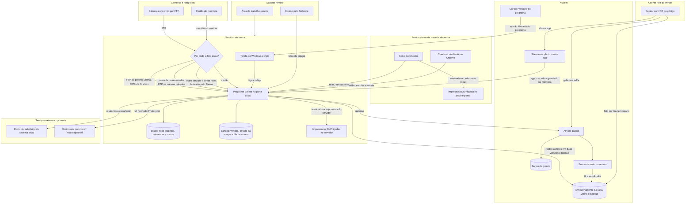

**O que funciona sem internet e o que não**

| Função | Situação sem internet | Condição |
|---|---|---|
| Receber fotos pelo FTP, pasta vigiada, cartão ou FTP da rede local | Funciona | A rede local precisa estar de pé |
| Ler rostos e montar sessões | Funciona | Os modelos precisam já estar no disco; a primeira carga deles vem do site |
| Selfie no Checkout | Funciona | A busca roda no servidor |
| Abrir o app em um ponto | Funciona com condição | O servidor precisa ter buscado o app desde que ligou. Servidor reiniciado sem internet responde `app_indisponivel` |
| Tela já aberta | Funciona | Não depende de recarregar |
| Login da equipe | Funciona | Hoje o código é gerado no navegador |
| Registrar venda | Funciona | A maquininha é avulsa; a conexão dela é não confirmado neste código |
| Imprimir | Funciona | No servidor ou na DNP do ponto |
| Fundo de IA com recorte local (modo padrão) | Funciona | Precisa do recorte instalado |
| Fundo de IA pelo Photoroom | Não funciona | Serviço externo |
| Painel "Servidor do ponto" | Funciona | Lê os bancos locais |
| Dados da Roverpix | Não funciona | Fica o último dado baixado |
| Enviar fotos para a nuvem | Funciona com condição | Fila espera se o servidor ligou com internet. Se ligou sem internet, ver a seção 4 |
| Publicar galeria na nuvem | Fica na fila | Sobe sozinha quando a conexão volta |
| Backup | Não funciona | Tenta de novo a cada 2 minutos; não acumula versões |
| Cliente abrir galeria que já subiu | Funciona | Depende da internet do cliente, não da do venue |
| Cliente abrir galeria que ainda não subiu | Não funciona | Até a fila andar |
| Suporte remoto | Não funciona | Tailscale precisa de internet |
| Atualizar o programa | Não funciona | Fica a versão do disco |

**Decisões**

| Decisão | Regra exata | Onde no código |
|---|---|---|
| Porta das telas | 8765, ou `ETERNA_PORTA`; ouve a rede só com `ETERNA_REDE`, que o vigia liga | `PORT`, `main`, `eterna-vigia.ps1 Liga` |
| Porta do FTP próprio | Tenta 21, depois 2121; `ETERNA_FTP_PORTA` só em testes. Nenhuma livre: FTP não abre | `ftp_server` |
| Pasta vigiada | Só com `ETERNA_PASTA`; retoma o que chegou nas últimas 12 h (`ETERNA_PASTA_RETOMAR`) | `pasta_vigiada` |
| Impressão por terminal | `ETERNA_IMPRESSORA_POSTOS`: terminal listado usa as DNPs dele; valor `local` imprime pelo navegador; fora da lista usa qualquer livre | `IMP_POSTOS`, `IMP_LOCAIS`, `imp_destinos` |
| De onde vem o app | Do `ETERNA_APP_ORIGIN` (padrão eterna.photo), renovado a cada 60 s, guardado só na memória; sem cópia e sem resposta: erro 502 | `H.app`, `app_cache` |
| Modo do recorte | Padrão local; Photoroom só com `fundos-modo.json` | `fundos_modo` |
| Roverpix | A cada 300 s, janela de 30 dias, só com chave | `rover_loop`, `ROVER_EVERY`, `ROVER_DAYS` |
| Suporte remoto hoje | Tailscale. A VPN do FortiGate é desenho-alvo, não está no código | `preparar-tailscale.ps1`; `docs/pesquisa/2026-11-02-eterna-como-produto.md` |

## Da câmera até a foto pronta

### 2. Entrada de fotos

Mostra por onde uma foto entra no Eterna e quando ela é recusada, ignorada ou aceita. As quatro entradas do servidor terminam na mesma etapa de registro; o envio pela tela fica só no navegador.

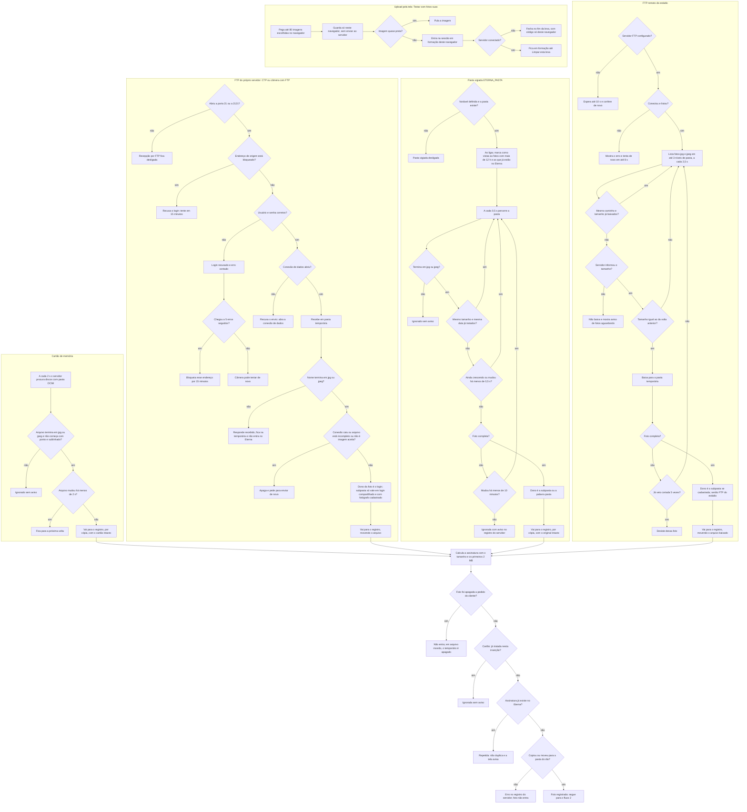

#### Decisões

| Decisão | Regra exata | Onde no código |
|---|---|---|
| Disco é cartão | Tem pasta `DCIM`; no Windows, procura de D: a Z:; verificação a cada 2 s | `list_volumes`, `watcher`, `POLL` |
| Extensão aceita no cartão e na pasta vigiada | Termina em `.jpg`, `.jpeg`, `.JPG` ou `.JPEG`, com diferença entre maiúscula e minúscula. Um `.Jpg`, por exemplo, não passa | `EXT`, `scan_card`, `pasta_vigiada` |
| Enviar fotos pela tela (v96-ux) | Plano B quando o leitor não reconhece o cartão. Em Minhas fotos, quem tem `set.c` (Fotógrafo, Supervisora e Admin) abre "Enviar fotos do cartão manualmente" e solta ou escolhe as fotos; cada JPG vai a `POST /fotos/enviar?nome=&quem=` (2 por vez, em ordem de nome, até 2.000 por envio). Só com o Eterna aberto pelo endereço do agente. O agente exige posto, origem local e `X-Eterna: 1`, `Content-Type: image/jpeg`, até 60 MB, fotógrafo cadastrado (não vale login compartilhado), extensão do cartão, 300 fotos por minuto por IP, 2 GB livres e no máximo 4 gravações ao mesmo tempo (503). Confere que é JPEG de verdade (`FF D8 FF` e `FF D9` no fim) e dá o nome do arquivo (rótulo seguro). Entra pelo `ingest_file` como foto de cartão: trilha atrasada do dia da chegada, sem mexer no desvio de relógio; repetida conta como "já estava no servidor". Rede caída: cada foto tenta 3 vezes, depois "Tentar de novo as N que faltaram" | `fotosEnviar`, `fotos_enviar_post`, `jpeg_de_verdade`, `envio_nome` |
| Extensão aceita no FTP e no FTP remoto | `jpg` ou `jpeg`, sem diferença entre maiúscula e minúscula | `FTPSession.handle`, `rftp_list` |
| Cartão ainda gravando | Última mudança há menos de 2 s: espera a próxima volta | `scan_card` |
| Porta do FTP | Tenta 21 e depois 2121. `ETERNA_FTP_PORTA` é só para testes | `ftp_server` |
| Login FTP bloqueado | 5 erros seguidos por endereço bloqueiam por 900 s (15 min). Durante o bloqueio, responde "tente de novo em 15 minutos". Login certo zera a contagem | `FTP_MAX_FALHAS`, `FTP_BLOQUEIO_S`, `ftp_bloqueado`, `ftp_falhou` |
| Foto completa | JPEG: começa com o marcador de início e tem o marcador de fim nos últimos 4 KB. PNG com nome de JPEG é aceito se tiver o bloco final. Outro conteúdo é recusado | `jpeg_completo` |
| Incompleto no FTP do servidor | Apaga e responde "Transferência incompleta, envie de novo". Não há retomada: a foto volta inteira | `FTPSession.handle` |
| Não JPG no FTP do servidor | Responde "recebido", fica na pasta temporária e não entra na biblioteca | `FTPSession.handle` |
| Dono no FTP do servidor | É o login. Subpasta só muda o dono em login marcado como compartilhado e se a subpasta for um fotógrafo cadastrado | `FTPSession.handle` |
| Pasta vigiada ao ligar | Marca como vista a foto com mais de `ETERNA_PASTA_RETOMAR` horas (padrão 12) ou que já está no Eterna. O resto entra, para recuperar o que chegou com o sistema desligado | `pasta_vigiada` |
| Incompleto na pasta vigiada | Espera até 600 s (10 min) desde a última mudança; depois ignora com aviso | `pasta_vigiada` |
| Dono na pasta vigiada | Nome da subpasta, ou "pasta" na raiz. O nome só vale como fotógrafo se for cadastrado (fluxo 4) | `pasta_vigiada`, `ff_quem` |
| Tamanho desconhecido no FTP remoto | Tamanho 0 ou não informado: não baixa e mostra "aguardando" | `rftp_loop` |
| Foto parou de crescer no FTP remoto | Mesmo tamanho em duas voltas seguidas (intervalo de 2,5 s) | `rftp_loop` |
| Cortada no FTP remoto | Apaga e tenta de novo; na 5ª vez, desiste daquele caminho e tamanho | `rftp_cortadas`, `rftp_loop` |
| Dono no FTP remoto | Subpasta logo abaixo da pasta configurada, se cadastrada (sem acento e em minúsculas); senão, "ftp-estadio" | `rftp_origem` |
| Upload pela tela | Só tipo `image/*`, até 80 por vez, em ordem de nome. Guarda no navegador. Imagem com brilho médio abaixo de 22 é pulada | tratamento `imp-files`, `upSave`, `detectBlack` |
| Fechamento do upload pela tela | Sem servidor: fecha no fim da fila. Com servidor: a fila acaba e a sessão não fecha sozinha | `ingTick`, `agentPoll` |
| Pedido de exclusão | Assinatura na lista de excluídas não entra de novo | `ingest_file`, `lgpd_excluidas` |
| Duplicado | Assinatura = tamanho + primeiros 2 MB. Já existente: evento de repetida, contador e métrica, sem nova cópia | `quick_hash`, `ingest_file` |
| Duplicado na mesma inserção do cartão | Ignorado sem evento | `ingest_file`, `cards` |

#### Divergências entre documento e código

- `DOCUMENTACAO-TECNICA.md` 7.1 diz "sha256 já existe". O código compara o SHA-256 do tamanho com os primeiros 2 MB. O SHA-256 do arquivo inteiro fica só na métrica.
- O mesmo diagrama traz "5G, FTP nuvem e pull" como entrada própria. No código há só um FTP remoto genérico, configurado na tela.
- O cabeçalho de `eterna-agente.py` diz que as credenciais do FTP são mostradas na tela ao iniciar. O código não as mostra no console nem no registro.
- O comentário de `pasta_vigiada` diz que a foto já existente cai como repetida depois de reiniciar. `pasta_vigiada` não chama `save_index`. Sem gravação por outro canal, a assinatura pode não estar no índice depois do reinício e a foto pode ser reprocessada.

#### Não confirmado

- Se cada câmera ou o CTP realmente reenvia depois da resposta de envio incompleto. Depende do aparelho; o código só pede o reenvio.
- O código não diferencia CTP de 5D: os dois são clientes de FTP. A diferença entre eles não foi confirmada aqui.
- Nada foi executado. O comportamento da sessão aberta no upload pela tela e o reprocessamento da pasta vigiada vêm da leitura do código.

### 3. Pipeline depois da chegada

Mostra o que acontece com a foto aceita até o rosto dela poder ser achado pela selfie. A sessão recebe a foto antes da leitura dos rostos, então os dois caminhos andam em paralelo.

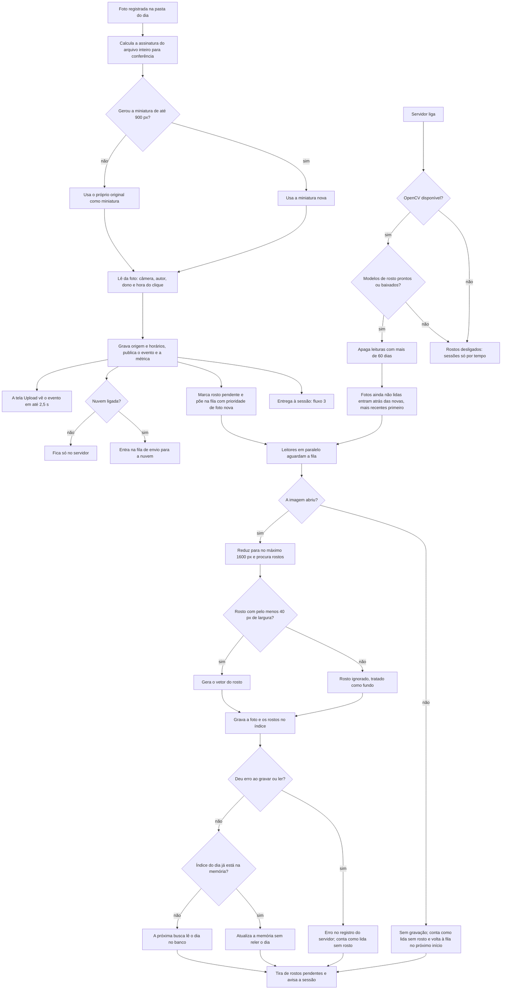

#### Decisões

| Decisão | Regra exata | Onde no código |
|---|---|---|
| Pasta da foto | Dia da data de modificação do arquivo recebido; nome com os 12 primeiros caracteres da assinatura + nome original | `ingest_file` |
| Miniatura | Lado maior de 900 px, qualidade 82. Mac usa `sips`; os demais usam Pillow. Se falhar, serve o original | `make_thumb`, `ingest_file` |
| Dados da foto | Modelo, autor, dono, série e hora do clique, lidos dos primeiros 256 KB; sem EXIF, o campo fica vazio | `exif_info`, `_exif_tiff` |
| Falha na sessão ou na fila do fotógrafo | É registrada e não barra a entrada da foto | `ingest_file` |
| Prioridade da fila de rostos | Foto nova primeiro; atraso do início depois | `rostos_enfileira`, `rostos_thread` |
| Rostos ligados | Exige OpenCV, numpy e os 2 modelos; `ETERNA_SEM_OPENCV` desliga. Falha deixa os rostos desligados, com motivo no status | `rostos_thread`, `modelos_ok` |
| Quantidade de leitores | `ETERNA_LEITORES`, ou metade dos núcleos (mínimo 1) | `rostos_thread` |
| Abertura da imagem | Abre em tamanho reduzido à metade. Se falhar, não grava em `foto`; no próximo início ela volta à fila | `leitor_loop`, `rostos_thread` |
| Limite de pixels no OpenCV | 40 milhões de pixels | `OPENCV_IO_MAX_IMAGE_PIXELS` |
| Detector de rosto | YuNet com confiança 0,7 sobre a foto reduzida a 1600 px. Vetor SFace de 128 números | `leitor`, `ler_rostos`, `LADO` |
| Rosto que conta | Largura de pelo menos 40 px na imagem reduzida | `ROSTO_MIN`, `ler_rostos` |
| Índice | Banco `rostos.db`, com uma tabela de fotos lidas e outra de rostos; regrava os rostos daquela foto | `rostos_db`, `leitor_loop` |
| Índice em memória | Acrescenta só quando o dia já está carregado | `mat_acrescenta`, `matriz` |
| Retenção | 60 dias, no início e uma vez por dia | `RETENCAO_DIAS`, `limpar_rostos` |
| Envio à nuvem | Só com a nuvem ligada; a continuação fica fora deste fluxo | `nuvem_enfileira` |

#### Divergências entre documento e código

- `DOCUMENTACAO-TECNICA.md` lista InsightFace, Redis e filas de trabalho. O código usa YuNet + SFace (OpenCV), linhas de execução e fila em memória.
- O diagrama 7.1 lê os rostos antes de decidir a sessão. No código, a foto entra na sessão primeiro e a decisão por rosto vem depois, com prazo (fluxo 3).
- O diagrama 7.1 cita derivadas "miniatura e web" na chegada. Na chegada, o código gera só a miniatura de 900 px.

#### Não confirmado

- O tempo real de cada etapa neste servidor. Existe medição em `/metricas`, mas nada foi executado.

### 4. Sessões por tempo e rosto

Mostra como as fotos viram sessões iguais em todos os navegadores. O tempo decide primeiro; o rosto só separa ou junta fotos que passaram no teste de tempo.

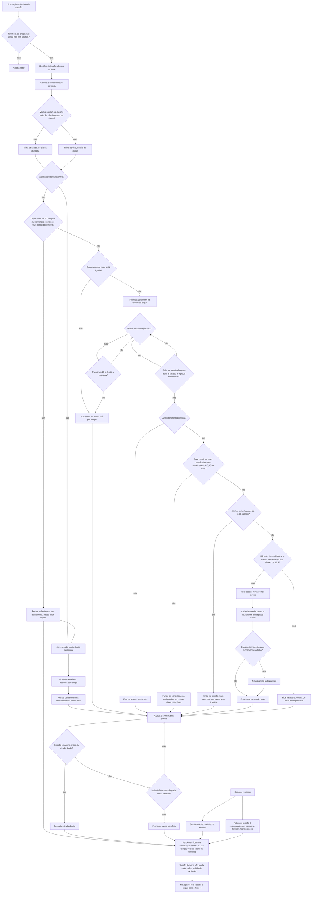

#### Decisões

| Decisão | Regra exata | Onde no código |
|---|---|---|
| Quem é o fotógrafo | 1) origem, se cadastrada; 2) autor ou dono da câmera, inteiro ou primeiro nome, se cadastrado; 3) sem fotógrafo, com a fonte: final da série da câmera, FTP do estádio, cartão ou pasta. Login compartilhado sem subpasta não conta como fotógrafo | `ff_quem`, `ff_cadastrados` |
| Separação sem fotógrafo | Trilha por série da câmera; sem série, pela fonte | `_sess_add` |
| Cadastro | Lido com cache de 30 s | `ff_cadastrados` |
| Hora do clique | Hora da câmera + desvio da série, se estiver entre 48 h antes e 10 min depois da chegada; senão, data do arquivo de origem na mesma janela; senão, a chegada | `sess_clique`, `SESS_CLIQUE_ANTES`, `SESS_CLIQUE_DEPOIS` |
| Desvio da câmera | Últimas 50 diferenças entre chegada e clique, sem fotos de cartão. Com 3 ou mais, descarta o que está a mais de max(3 x desvio mediano, 30 s) da mediana e usa o menor | `sess_desvio`, `ff_desvio` |
| Trilha atrasada (`SESS_ATRASO`) | Cartão sempre; demais fontes quando chegada − clique > 600 s | `sess_trilha` |
| Pausa (`SESS_PAUSA`) | 60 s. `ETERNA_SESSAO_PAUSA` de 2 a 600 só em testes | `_sess_pausa`, `_sess_add` |
| Motivo de abertura | Início (primeira da trilha), pausa, rostos novos, ou reagrupada no início do servidor | `_sess_add`, `_sess_decide` |
| Espera do rosto (`SESS_ROSTO_ESPERA`) | Até 20 s desde a chegada. A foto da frente segura as seguintes da trilha. Vencido o prazo, ou com os rostos desligados, entra por tempo | `_sess_drenar` |
| Erro na leitura | Conta como lida sem rosto | `leitor_loop`, `sess_rostos_lidos` |
| Rosto principal | Largura de pelo menos metade do maior rosto da foto e de pelo menos 40 px | `_sess_principais` |
| Rosto de qualidade | Confiança de pelo menos 0,80, largura de pelo menos 60 px e frontal: nariz a até 0,35 da distância entre os olhos | `_sess_qualidade`, `ler_rostos` |
| Candidatas | A aberta + em fechamento da trilha, até 3 | `SESS_CAND_MAX`, `_sess_cands` |
| Fundir | Semelhança de 0,45 ou mais com 2 ou mais candidatas: junta na mais antiga | `SESS_LIM_FUNDE`, `_sess_fundir` |
| Ficar | Melhor semelhança de 0,38 ou mais: vai para a mais parecida, que volta a ser a aberta | `SESS_LIM_FICA`, `_sess_decide`, `_sess_vira_aberta` |
| Abrir por rostos novos | Exige rosto de qualidade, pelo menos uma candidata com rosto guardado e melhor semelhança abaixo de 0,25 | `SESS_LIM_NOVO`, `_sess_decide` |
| Sem rosto guardado para comparar | Fica na aberta, como dúvida ou sem rosto | `_sess_decide` |
| Rostos guardados | Até 40 por sessão; repetido com semelhança de 0,7 ou mais não entra. Só em memória e só em sessões não fechadas | `SESS_ROSTOS_MAX`, `SESS_REPETIDO`, `_sess_guarda_rostos` |
| Fechar por pausa de clique | Trilha fecha a aberta e as em fechamento | `_sess_add`, `_sess_fecha_uma` |
| Fechar por falta de chegada | Mais de 60 s sem chegada na sessão; verificação a cada 2 s | `_sess_fechar`, `sess_loop` |
| Fechar por limite | Mais de 2 sessões em fechamento na trilha: a mais antiga fecha, registrada como pausa | `_sess_vira_aberta` |
| Virada do dia | Comparação pelo dia da primeira chegada | `_sess_fechar` |
| Início do servidor | Lê ontem e hoje; a não fechada fecha como reinício. Foto sem sessão usa os rostos do banco, que não votam por sessão nova | `sess_carregar`, `_sess_faces_db` |
| Guarda | Memória com hoje e ontem; arquivo por dia durante 60 dias; sem vetor de rosto no arquivo | `sess_loop`, `sess_gravar`, `SESS_RET_DIAS`, `sess_limpar` |
| Entrega ao navegador | Lê mudanças a cada 2,5 s; só a fechada vira sessão de venda, até 12 por ciclo | `agentPoll`, `srvPull`, `srvMaterializa`, `SRV_MAT_MAX` |

#### Divergências entre documento e código

- `DOCUMENTACAO-TECNICA.md` 7.1 diz que o limiar é aprendido por ponto, com valor inicial de 20 s, e prevê sessão em dúvida para o vendedor juntar ou separar. No código, a pausa é fixa em 60 s e a dúvida fica na sessão aberta, sem ação do vendedor.
- A seção "Fila do fotógrafo (v87)" ainda descreve pausa de 20 s e grupos próprios. A seção da v91 no mesmo documento registra que eles saíram, e o código confirma.
- A regra S2 do plano e da documentação usa o menor desvio. O código descarta primeiro os valores fora da curva; isso aparece em outra parte da documentação.
- O plano S2 diz que clique inválido cai na chegada. O código tenta antes a data do arquivo de origem.
- A regra S3 da documentação usa o dia do clique nas duas trilhas, e S14 diz que os arquivos são pelo dia do clique. Na trilha atrasada, o código usa o dia da chegada; o risco 7 da própria documentação já admite isso.
- O plano S3 define a atrasada pelo tempo. No código, foto de cartão é sempre atrasada, mesmo recém-clicada.
- O plano se chama v90; `VERSOES.md` registra esta regra na v91.
- O comentário em `main` diz que os grupos da fila são refeitos do meta. `ff_carregar` hoje carrega só a função do dia.

#### Não confirmado

- Se os limiares 0,38, 0,25 e 0,45 acertam em um dia real. `2026-11-02-pedidos-do-eduardo-pos-v91.md` deixa essa calibração pendente antes de 01/12.

### 5. Validação, correção, olhos fechados, ajuste automático e fila do fotógrafo

Mostra o que acontece depois do fechamento até a foto poder aparecer no Checkout, e como a Fila do fotógrafo mostra esse andamento. Neste fluxo, "correção" é o ajuste manual e o descarte, pois o código não tem outra etapa com esse nome.

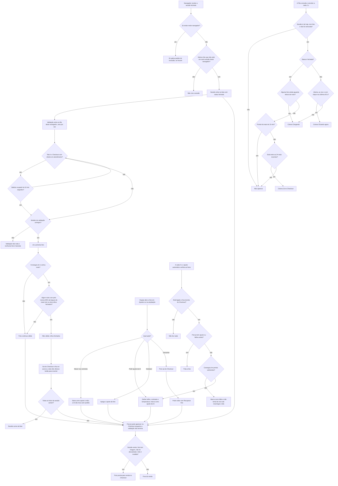

#### Decisões

| Decisão | Regra exata | Onde no código |
|---|---|---|
| Foto repetida no navegador | Foto que já está em outra sessão local não duplica | `srvMaterializa`, `photosInSessions` |
| Regra geral de validação | `validatePhoto` sempre devolve nulo. A única regra que pode barrar é a de olhos fechados | `validatePhoto`, `validateReal`, `ingClose` |
| Fila de validação | Uma por vez em cada navegador; cada navegador valida de novo | `VAL_FILA`, `ingClose` |
| Espera do balcão | Só na tela do Checkout. Livre = aguardando rosto e sem busca em andamento. Teto de 10 min seguidos | `valLivre`, `VAL_TETO` |
| Imagem validada | Miniatura de até 900 px, para foto do servidor; imagem maior é reduzida a 1400 px de largura | `photoCanvas`, `validateReal` |
| Detecção | Confiança mínima de 0,5 | `validateReal` |
| Quem conta | Largura de pelo menos 60% do maior rosto da foto | `validateReal` |
| Olho fechado | Maior abertura dos dois olhos abaixo de 0,19. Abertura = altura / largura do olho | `eyeOpen`, `validateReal` |
| Sem rosto ou erro | Foto continua válida: "sem rosto" não barra | `validateReal` |
| Efeito de não válida | Sai de `sessionObj` e do Checkout; continua no acervo. Compartilhado por `SIM.invalid` | `demoSessions`, `SIM_MAPA` |
| Gravação da validação | O resultado fica em memória até a próxima gravação do navegador | `ingClose`, `saveSim` |
| Ajuste automático ligado | Vale para o ponto inteiro; desligar exige permissão de alterar no módulo do set e registra quem mexeu. Ao religar, processa as que ficaram sem ajuste | `ajAutoSet`, `SIM.autoAj` |
| Lote do ajuste | Até 16 fotos a cada 3 s, sem foto já ajustada e sem as que falharam desde a última recarga da tela | `ajQueue` |
| Pontos suficientes | Pelo menos 50 pontos com brilho de 6 ou mais, em uma cópia com 160 px de largura | `ajAuto` |
| Valores do ajuste | Brilho de 75 a 140, contraste de 90 a 140, temperatura de −30 a +30, em passos de 5 | `ajAuto` |
| Ajuste manual protegido | Ajuste à mão só é trocado com pedido explícito da IA | `ajAuto`, `ajSet`, `aj-auto`, `aj-auto-all` |
| Original | O ajuste é um conjunto de valores aplicado na tela e na impressão; o arquivo original não muda | `SIM.edits`, `editStyleObj`, `printMontar` |
| Descartar e recuperar | Liga e desliga `SIM.discarded`; a foto sai ou volta | `aj-discard`, `m-discard` |
| Clicando agora | Status aberta, trilha ao vivo e último clique há 60 s ou menos | `ff_json` |
| Chegando | Resto das não fechadas, ou fechada com foto ainda na fila de rostos | `ff_json` |
| Já no Checkout | Fechada e sem pendência de rosto. Conta a partir do maior entre fechamento e última leitura | `ff_json` |
| Saída da coluna final | 15 min depois de pronta; no máximo 24 cartões | `FF_PRONTA_MIN`, `FF_PRONTAS_MAX` |
| Miniaturas na Fila | Até 6 e só nas duas primeiras colunas. Sem escolha salva no aparelho, só para quem não é do caixa e fora de tela cheia | `FF_PIDS`, `ffMiniOn`, `vFotoFila` |
| Função do dia | Vem da Escala, é validada e guardada na abertura da sessão; sem ela, usa o ponto padrão do fotógrafo | `ff_funcao_validar`, `_ff_func_snapshot`, `ffPadrao` |
| Falta de resposta | Mantém o último dado e mostra "Sem conexão com o servidor"; tempo limite de 4 s | `fotoFilaPoll` |

#### Divergências entre documento e código

- `DOCUMENTACAO-TECNICA.md` 7.2 descreve validação por sem rosto, óculos, exposição, contraluz, anel do estádio, borda e bandeira, com resultado "dúvida". No código, só olhos fechados barra. Não há dúvida nem revisão automática.
- O documento registra cada decisão em uma tabela `VALIDATION`, de só inserção. O código guarda só o mapa `SIM.invalid`, por foto, sem histórico de decisão.
- A seção 7.2 descreve correção por rosto até 1,5 EV, gerando derivada. O código calcula pelo histograma da foto inteira e guarda só valores de exibição, sem arquivo derivado.
- A lista `INVALID_REASONS` cita desfocada, sem rosto e cortada, e `validatePhoto` nunca as usa.
- A mensagem "rosto e olhos aprovados em todas" aparece mesmo quando a foto passou por não ter rosto detectado.
- A coluna "Já no Checkout" não espera a validação nem a chegada da sessão a cada navegador. Depende só do fechamento e da leitura de rostos no servidor.
- O plano S12 põe foto pendente de rosto em "Chegando". No código, uma sessão aberta ao vivo com clique recente fica em "Clicando agora" mesmo com pendência.
- A seção "Fila do fotógrafo (v87)" descreve `ff_estado`, 20 s e `G014`. O código usa a sessão e o código LP.

#### Não confirmado

- A tela diz que o ajuste vale para o Checkout, a impressão e a galeria. Checkout e impressão foram confirmados; na galeria, não localizei o uso do ajuste em `galAtualizar` nem em `_vitrine`.
- Taxa de acerto da regra de olhos fechados: não há medição no material lido.

### 6. Recorte antecipado e fundos de IA

Mostra quais fotos são recortadas antes do cliente chegar e como o Checkout monta os fundos. Se a montagem não for possível, o item some da venda e a foto normal continua disponível.

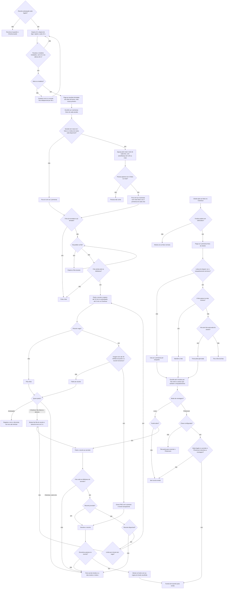

#### Decisões

| Decisão | Regra exata | Onde no código |
|---|---|---|
| Antecipado ligado | Padrão ligado. `ETERNA_PRE_RECORTE=0` desliga | `REC_PRE`, `rec_pre_loop` |
| Modo Photoroom e antecipado | O laço não confere o modo de montagem, então continua recortando | `rec_pre_loop` |
| Recorte disponível | `rembg`, `onnxruntime`, Pillow, numpy e scipy instalados; os 2 modelos baixados; sem `ETERNA_SEM_RECORTE`; sem erro nos últimos 60 s | `rec_estado`, `REC_ERRO_SEG` |
| Dias considerados | `ETERNA_BUSCA_DIAS`; padrão de 1, só hoje | `BUSCA_DIAS`, `rec_pre_loop` |
| Sessões consideradas | Status fechada, não removida, mais nova primeiro pelo fechamento | `rec_pre_loop` |
| Fotos escolhidas sempre | As 2 primeiras da sessão | `rec_pre_escolha` |
| Pessoa | Maior rosto de cada foto, comparado ao primeiro rosto do grupo, com semelhança de 0,45 ou mais. Conta se aparece em 3 fotos ou mais | `rec_pre_escolha`, `LIMITE` |
| Limite por sessão | Até 4 pessoas, com 2 fotos cada, + as 2 primeiras = até 10 recortes | `rec_pre_escolha` |
| Sem índice de rostos | Sem numpy, com até 2 fotos ou com erro no banco: só as 2 primeiras | `rec_pre_escolha` |
| O que o agente desconhece | A escolha não confere descarte nem foto não válida, que ficam no navegador | `rec_pre_escolha` |
| Prioridade do Checkout | O antecipado só pede o próximo com a fila vazia. O que já está rodando não é interrompido | `rec_pre_loop`, `rec_trabalho` |
| Tentativa do antecipado | Uma por foto até reiniciar. O Checkout ainda pode pedir aquela foto | `rec_pre_loop` |
| Concorrência | 1 recorte por vez; `ETERNA_RECORTE_CONC=2` permite 2 | `REC_CONC` |
| Fila | Até 24 pedidos | `REC_FILA_MAX`, `rec_pedir` |
| Taxa do Checkout | 60 recortes novos por minuto por endereço; o recorte pronto não conta | `REC_TAXA`, `recorte_post` |
| Tempo de espera | Checkout: 180 s. Antecipado: 600 s | `rec_pedir`, `rec_pre_loop` |
| Tamanhos | Modelos em 1600 px; PNG final com até 3000 px; prévia de 2400 px, derivada sem rodar os modelos | `REC_TRAB`, `REC_LADOS`, `rec_fazer` |
| Limite da imagem | Até 40 milhões de pixels | `MAX_PIXELS`, `rec_fazer` |
| Quem pode pedir o recorte ao vivo | Só postos autorizados, com código de foto e tamanho válidos (2400 ou 3000 px); fora disso, o pedido é recusado | `recorte_post` |
| Respostas do recorte ao vivo | Sem foto na biblioteca: "não encontrada". Indisponível: "recorte_indisponivel". Fila cheia ou limite: "muitos pedidos" ou "fila_cheia". Demora: "recorte demorou demais". Outro erro: "não deu para recortar" | `recorte_post` |
| Reação da tela | Indisponível ou erro de recorte: a foto sai dos fundos. Fila cheia ou demora: tenta em 3 s. Sem conexão: mostra mensagem, sem tirar da venda | `fiaRecorte`, `compHydrate`, `fiaFalhou` |
| Sem pessoa | Máscara em menos de 0,5% da imagem: item sai como "Ninguém encontrado na foto" | `fiaMedir`, `fiaMontar` |
| Cache | 2 dias; teto de 5 GB por `ETERNA_RECORTES_GB`, apagando os mais antigos; recorte de foto fora da biblioteca sai | `REC_DIAS`, `REC_TETO_GB`, `limpar_recortes` |
| Oferta no Checkout | Local: servidor conectado, recorte disponível e foto do servidor. Photoroom: sempre oferece | `fiaOferece`, `lojaAI` |
| Foto no Checkout | Até 2 fotos do próprio cliente. Depois da leitura: nota total de 70 ou mais e borda de 70 ou mais; se reprovar, troca por outra aprovada do cliente | `lojaAI`, `aiOk`, `AI_MIN` |
| Fundos por foto | Até 3, entre até 5 ativos, se aceitarem o enquadramento, ordenados pela combinação: ângulo 45%, luz 35%, direção 20% | `lojaAI`, `BG_MAX`, `bgOn`, `bgMatch` |
| Enquadramento | Pela altura e posição dos rostos: corpo inteiro, meio corpo ou fechada. Sem leitura, usa um valor calculado do código da foto | `aiAnalyze`, `aiScore` |
| Regras de montagem | Corte, altura, largura e posição por fundo e por tipo de foto. Os valores conferem com `docs/fundos-ia-regras.md` | `FIA_REGRAS`, `fiaLayout` |
| Impressão do fundo | Usa recorte de 3000 px e fundo de 5000 px; sem o arquivo de 5000 px, usa o de 2400 px com aviso. Espera até 60 s antes de registrar falha | `fiaMontar`, `printMontar` |
| Photoroom | Só com o modo ligado também no servidor; senão "photoroom_desligado". Sem chave: "Conecte o Photoroom". Falha da montagem tira o item da venda | `fundos_modo`, `composePR`, `do_POST`, `pr_compose` |

#### Divergências entre documento e código

- A tela de Fundos de IA diz que a IA dá nota a cada foto em quatro critérios. No código, as notas vêm de um cálculo sobre o código da foto (`h32`), sem ler a imagem. Só o enquadramento e a combinação de ângulo e luz usam a imagem.
- A mesma tela diz que a montagem é feita pelo Photoroom e que o Checkout mostra os 5 fundos com maior combinação. O padrão do código é a montagem local, com até 3 fundos por foto.
- O comentário em `REC_PRE` diz que cada sessão fechada é recortada. O código recorta só as escolhidas por `rec_pre_escolha`.
- O comentário diz que o pedido do Checkout "passa na frente". O código não interrompe o recorte em andamento e a fila atende por ordem de chegada; o antecipado apenas não coloca pedido novo enquanto há fila.
- A mensagem de início e o painel dizem que o recorte "carrega na primeira foto". Com o antecipado ligado, os modelos abrem cerca de 15 s depois da partida.
- `DOCUMENTACAO-TECNICA.md` não tem seção sobre o recorte antecipado. Ele aparece em `CONTEXTO-ETERNA.md` e `VERSOES.md`.

#### Não confirmado

- Regra de falha interna do Photoroom: li a estrutura de `pr_compose`, os limites e os erros, mas não testei a API.
- Tempo real por recorte. O comentário do código estima cerca de 40 s para 10 recortes; nada foi medido aqui.
- Se a seleção do antecipado cobre na prática as fotos que o Checkout pede. Não há medição no material lido.

## Do cliente até a foto entregue

### 7. Encontrar as fotos

Leva o cliente da câmera do Checkout até as fotos dele, de uma ou mais sessões do dia. A selfie decide o que entra; o código do recibo é a alternativa quando a câmera não resolve.

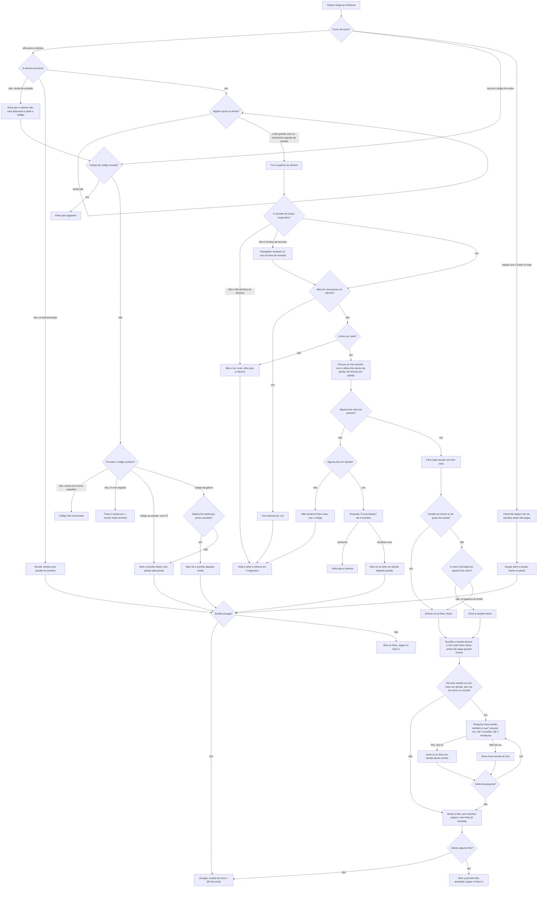

#### Decisões

| Decisão | Regra exata | Onde no código |
|---|---|---|
| Disparo da busca | Rosto com largura de pelo menos 12% do vídeo e confiança 0,7, conferido a cada 1,2 s, com pausa de 8 s entre tentativas se ninguém se mexeu. Ou movimento acumulado acima de 40 seguido de 5 leituras paradas (250 ms cada). | `camFaceCheck`, `camTick` |
| Quadros da selfie | 3 quadros com 250 ms entre eles, até 960 px de largura. O servidor lê o maior rosto de cada quadro, com mínimo de 60 px, e faz a média. | `camFound`, `_buscar` |
| Sem câmera | Com o servidor ligado: estado "câmera indisponível", nunca sorteia. Sem servidor: simula depois de 4,5 s. | `camMount`, `camFound` |
| Servidor de rostos fora | O Checkout só compara no navegador se houver foto de amostra. Sem elas, responde como "sem rosto". | `faceAgente`, `faceFind` |
| Mais de uma pessoa | O 2º maior rosto tem pelo menos 0,5 vez a largura do maior. A busca não roda. | `varias_pessoas`, `VARIAS_RAZAO`, `pessoas`, `FACE_VARIAS` |
| Janela de 90 minutos | Só sessões cuja última foto (hora do clique corrigida, senão a última chegada) está nos últimos N minutos. Padrão 90. Aceita 0 (dia todo) ou de 15 a 480; fora disso, o valor mais próximo. Valor do Painel de controle, gravado em `config/busca`, relido a cada 3 s. Vale no servidor e no navegador. | `buscar_vetor`, `busca_janela_cfg`, `busca_janela_efetiva`, `_busca_janela`, `sess_pids_janela`, `buscaJanelaMin`, `sesUltima`, `faceFind` |
| Quando a janela não vale | Com `ETERNA_BUSCA_DIAS` definida (dia todo dos dias da busca, 1 dia por padrão). Na galeria por QR (`todo:true`). Em código da sessão ou da galeria. No navegador, enquanto a janela está ativa, sessão sem hora fica de fora da selfie. | `busca_janela_efetiva`, `H.do_POST` em `/rostos/buscar`, `faceAgente`, `faceFind` |
| Foto clara ou em dúvida | Clara: semelhança de 0,45 ou mais. Em dúvida: de 0,38 até menos de 0,45. Abaixo disso, descartada. | `LIMITE`, `LIMITE_TALVEZ`, `FACE_SIM`, `FACE_DUV`, `faceFind` |
| Rosto principal | O rosto que bateu tem largura de pelo menos 0,5 vez a do maior rosto daquela foto. | `ROSTO_PRINCIPAL`, `buscar_vetor`, `faceFind` |
| Fotos que a selfie abre | Só as fotos em que o rosto de quem fez a selfie aparece, nunca a sessão inteira (LGPD). O código do recibo continua abrindo a sessão toda, porque quem tem o recibo é o dono da compra. | `lojaJuntar`, `lojaIdsSo` |
| Menor e escola | Protegida: sessão marcada como menor, ou incluída numa galeria de grupo. Filtra por foto usando a lista `so.ids`. | `lojaSesProtegida`, `lojaDele`, `lojaFotos` |
| Sessão âncora | Ordena por mais fotos claras, depois maior semelhança. Fica com a primeira não paga; se todas estão pagas, a primeira. | `lojaJuntar` |
| "Esta sessão também é sua?" | Só sessões sem foto clara, sem menor e fora de escola. Máximo de 3 sessões, por maior semelhança, com 3 miniaturas das mais parecidas. "Sim" junta todas as fotos em dúvida daquela sessão, nunca a sessão inteira. | `lojaJuntar`, ação `kiosk-tv-sim`, `kiosk-tv-nao` |
| "É uma destas?" | Só quando não há nenhuma foto clara. Até 4 sessões, ordenadas por número de fotos e semelhança. Abre as fotos em dúvida da sessão tocada. | `camFound`, `faceFind`, `faceCands`, ação `cam-pick` |
| O que sai da lista | Pela selfie com sessões juntadas: sessões pagas e fotos vendidas em qualquer venda paga deste navegador. Sempre: fotos descartadas e sem imagem. | `lojaFotos`, `vendidasTodas` |
| Nada sobrando | Sessão âncora paga, ou selfie sem foto restante: mostra o QR da venda (o da venda da sessão ou o da sessão). | `vQuiosque`, `lojaFim` |
| Código digitado | Sessão: `LP` mais 5 a 10 letras ou números. Galeria: `XXXX-XXXX`, de tipo sessão, não substituída. 5 erros seguidos travam 1 minuto; o contador sobrevive a recarregar a aba. | `lojaCodigo`, `LJ_COD` |
| Nenhum resultado | A mensagem fica 6 s e a câmera volta a procurar. | `camFound`, `lojaAbrirSo` |
| Quiosque | Mesma tela do Checkout. A selfie e a janela valem igual nas duas entradas. | `vQuiosque`, `camWanted`, `faceFind` |
| Painel da equipe | 3 toques no logo em até 1,5 s. Lista até 24 sessões não pagas, sem janela e sem passar pela selfie. | `lojaLogo`, `lojaEquipe`, ação `loja-open` |

#### Divergências

- `docs/relatorios/2026-10-31-servidor-do-ponto-robusto.md`, seção 2, diz que o Checkout mostra "nunca a sessão inteira". Na v91, a sessão entra inteira quando há foto clara com rosto principal e a sessão não é protegida. `lojaDele` continua no código, mas `so.ids` passa a trazer a sessão inteira nesse caso.
- O comentário em `vQuiosque` chama "Esta sessão também é sua?" de confirmação de sessão inteira. A ação `kiosk-tv-sim` junta só as fotos em dúvida, como diz o `GUIA-DA-EQUIPE.md`.
- A exclusão da sessão sem hora durante a janela não aparece em nenhum documento. O comentário de `sesUltima` diz "null = sem hora (amostra)", e o teste em `faceFind` a deixa de fora.

### 8. Checkout

Transforma as fotos encontradas em um pedido: o cliente escolhe fotos e fundos, o sistema sugere o pacote mais barato e a equipe acompanha tudo numa segunda janela. O pedido fica sempre registrado na sessão âncora.

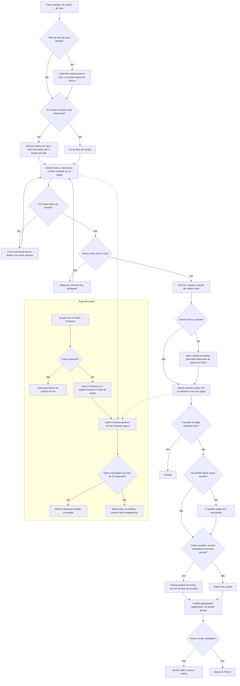

#### Decisões

| Decisão | Regra exata | Onde no código |
|---|---|---|
| Ordem das fotos | Sessão por sessão, por hora de abertura. Rótulo de ponto e hora só com mais de uma sessão. | `sesHora`, `lojaFotos`, `lojaBloco`, `lojaItems` |
| Oferta de fundos | Recorte pronto, ou modo Photoroom. Até 2 fotos do cliente, até 3 fundos por foto, pela melhor combinação. No modo local, só fotos vindas do servidor. Fundo que falhou sai da oferta e da escolha. | `fiaOferece`, `lojaAI`, `fiaFalhou`, `FIA_RUIM` |
| Contagem | Foto com fundo conta como foto do pacote: fotos do campo mais fotos com fundo. O item "Fundo de IA" do catálogo não é cobrado à parte no Checkout. | `lojaCart`, `lojaItems` |
| Catálogo inicial | Maracanã Mais, R$ 250, todas as digitais e nenhuma impressa. Tribuna de Honra, R$ 220, 12 e 12. Maracanã, R$ 190, 9 e 9. Gramado, R$ 150, 6 e 6. Zona Mista, R$ 110, 3 digitais. Arquibancada, R$ 70, 1 e 1. Foto adicional, R$ 35, digital e impressa. Preços editáveis no Catálogo. | `DATA.catalog`, `priceOf` |
| Pacote sugerido | Menor custo (pacote mais adicionais). Empate: mais impressas; depois o pacote menor. | `lojaIdeal`, `lojaPkgCusto` |
| Total e impressas | Total = pacote + fotos além do limite x preço da adicional. "Todas" não tem adicional. Impressas = menor valor entre fotos escolhidas e impressas do pacote, mais as adicionais. | `lojaCart`, `printsVenda` |
| Trava do pagamento | Botão desligado até escolher o meio. Com o meio escolhido, relê os dados e recusa se já está pago ou sem foto. Número da venda tirado com trava. | `vQuiosque`, `lojaPedido`, `pvSaleNo` |
| Regra da sessão âncora | Pedido, fotos escolhidas e situação "aguardando" ficam só na âncora. As outras sessões ficam listadas em `sessoes`. Foto de outra sessão entra em `selected` da âncora. | `lojaPedido`, `lojaSync`, `soCards` |
| Galeria da venda | Própria quando há mais de uma sessão, quando a âncora é protegida, ou quando alguma sessão não entrou inteira. Enquanto não paga, é refeita a cada pedido. | `lojaPedido`, `galDaVendaJunta`, `galDaSessao` |
| Uma pendência por sessão | Novo pedido fecha o anterior como substituído, motivo `novo_pedido`. | `dinAbertaDe`, `dinFechar`, `pvCancelEv` |
| Falha ao gravar | Restaura o estado anterior e não cria pendência. | `lojaPedido`, `saveSim` |
| 2ª janela | Abre em pop-up de 1280 x 800. As mensagens passam por `BroadcastChannel`, no máximo a cada 300 ms, e são repetidas a cada 5 s. Mais de 15 s sem mensagem é tela parada. Só funciona no mesmo navegador. | `lojaJanela`, `lojaEco`, `lojaEcoMsg`, `ecoNorm`, `ecoOff`, `ecoBody` |
| Saída do Checkout | Esc ou "Voltar ao início": zera as escolhas da tela. Se havia pedido aberto, ele continua aguardando. | `lojaEsc`, `lojaReset`, ação `loja-new` |

#### Divergências

- `DOCUMENTACAO-TECNICA.md`, seção 7.3, descreve iPad e API com `POST /faces/match` e `/sales/{id}/payment`. Essas rotas não existem no código. A busca é `POST /rostos/buscar`, e venda e pagamento correm no navegador, com eventos em `POST /ponto/eventos`.
- O comentário antes de `lojaFimSeg` diz que o Checkout volta à câmera em 5 s. O padrão é 30 s, de 5 a 120 (`LOJA_FIM_PADRAO`), como dizem o Guia e a documentação.
- A documentação da v77 lista as etapas como code, review, cart, done. O código também tem `emerg` e `talvez`.

### 9. Pagamento

Separa o pedido do cliente da venda de verdade. Só a equipe transforma um pedido em venda, depois de receber na maquininha avulsa da Imply ou em dinheiro.

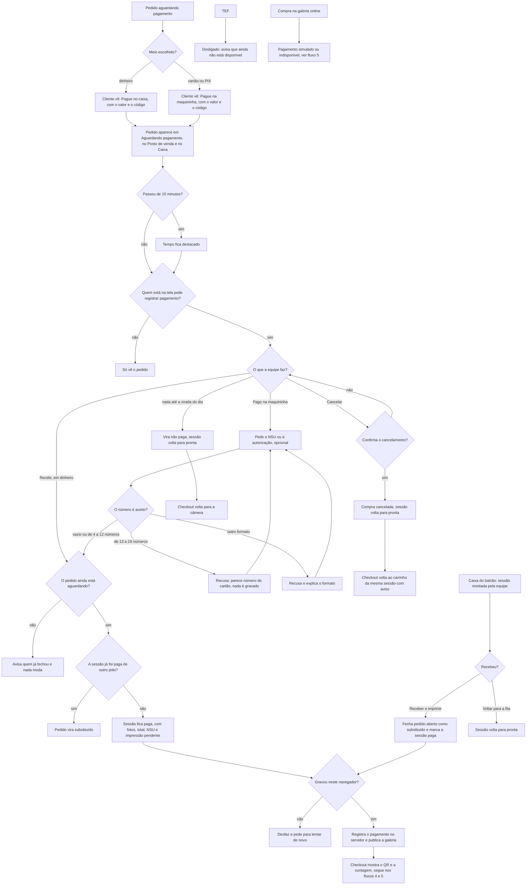

#### Decisões

| Decisão | Regra exata | Onde no código |
|---|---|---|
| Nenhum pagamento no toque | Todo meio do Checkout vira pedido aguardando. Sem venda, fundo comprado ou galeria publicada até a confirmação. | `lojaPay`, `lojaPedido` |
| Tela de espera | Mostra valor e código `XXXX-XXXX`. Não mostra QR nem contagem. | `lojaFim`, `vQuiosque` |
| Maquininha | Provedor `pos-manual`: confirmação humana, sem integração com a Imply. `PAG_PROV.tef` é nulo. | `PAG_PROV`, `pagProv` |
| Quem confirma | Só na tela da equipe, com permissão `venda.c`. Na rota do Checkout ou da galeria a confirmação é recusada. | `dinPegar`, `pendPainel` |
| NSU | Opcional. Limpa espaços, pontos, traços e barras. Aceita de 4 a 12 números. De 13 a 19 números é recusado como cartão. Dinheiro não pede. | `refLimpa`, `refErro`, `pendConfirmar` |
| "Pago" | A sessão recebe `status: paga`, carrinho, fotos, número da venda, meio, vendedor, posto e dados do pagamento. A impressão começa como pendente quando o pacote tem impressas. Fundos entram como comprados. | `pendConfirmar`, `impIniciar` |
| Publicação da galeria | Publica quando `pontoModo()` não é `posto`. Como `state.posto.disp` nunca recebe valor no código, publica sempre. | `pendConfirmar`, `pontoModo`, `galDaVenda` |
| Cancelamento | Pede confirmação. Pedido vira cancelado, motivo `cancelada_no_caixa`, evento com motivo `cancelada_no_posto`. A sessão só volta para pronta se ainda estava aguardando. | `dinCancelar`, `dinFechar`, `pvCancelEv` |
| Volta do Checkout | Confere a cada 5 s. Confirmado: QR e contagem. Cancelado: carrinho com aviso. Não paga ou substituído: volta à câmera. | `lojaPendCheck` |
| Fim do dia | Pedido aguardando de dia anterior vira não pago, motivo `fim_do_dia`. Fechados com mais de 30 dias saem, com teto de 1000. | `dinVirada`, `DIN_DIAS`, `DIN_MAX` |
| Alerta de espera | Mais de 15 minutos. | `CAIXA_ALERTA_MIN`, `dinAtrasada` |
| Caixa do balcão | Paga direto, sem pedido do Checkout. Fecha pedido aberto com motivo `pago_de_outro_jeito`. | `caixaConfirm`, `vCaixa` |
| Pagamento simulado | `PagamentoSimulado`, padrão de `ETERNA_PAGAMENTO`, só na galeria atendida pelo servidor. Aprova na hora, marca `teste: true` e fica fora das métricas. Outro valor impede o agente de iniciar. Webhook responde 501. | `PagamentoSimulado`, `pagamento_escolhido`, `metricas_dia`, `gal_post` |

#### Divergências

- `DOCUMENTACAO-TECNICA.md`, seção da v77: o diagrama diz "venda paga (lojaPay)", a seção "Segurança da galeria por QR" diz que cartão e PIX viram pagos pelo toque do cliente, e "Estado novo no app" diz que `lojaPay` publica a galeria. No código, `lojaPay` só cria o pedido aguardando.
- `GUIA-DA-EQUIPE.md`, seção "Dinheiro: aguardando caixa": diz que a tela final tem o QR e que abrir esse QR mostra "esperando o caixa". A tela de espera não tem QR, e o texto `ljCashQR` ficou sem uso. O passo `aguarda_caixa` só existe no modo local, com o token no mesmo navegador. Com a galeria ainda não publicada, a nuvem responde que não existe.
- `pendConfirmar` e seu comentário tratam um modo `posto` que nunca liga na v91 (`state.posto.disp` só é iniciado como nulo).
- O relatório de 31/10 diz que "nada mora só no navegador". O comentário em `simDocs` diz que sessões, galerias e vendas já têm dono no servidor. `SIM.caixaDin`, `status` da sessão e `SIM.galerias` ficam no `localStorage`, fora de `SIM_MAPA`, `SIM_INTEIRO` e `SIM_LISTA`. O Guia acerta ao exigir Checkout e Caixa no mesmo navegador.

### 10. Fila de impressão

Depois do pagamento, leva as fotos escolhidas até o papel, pela fila do servidor ou pela DNP ligada no próprio terminal. A fila acompanha a impressora de verdade; a baixa do rolo e o encerramento da venda dependem da confirmação da equipe.

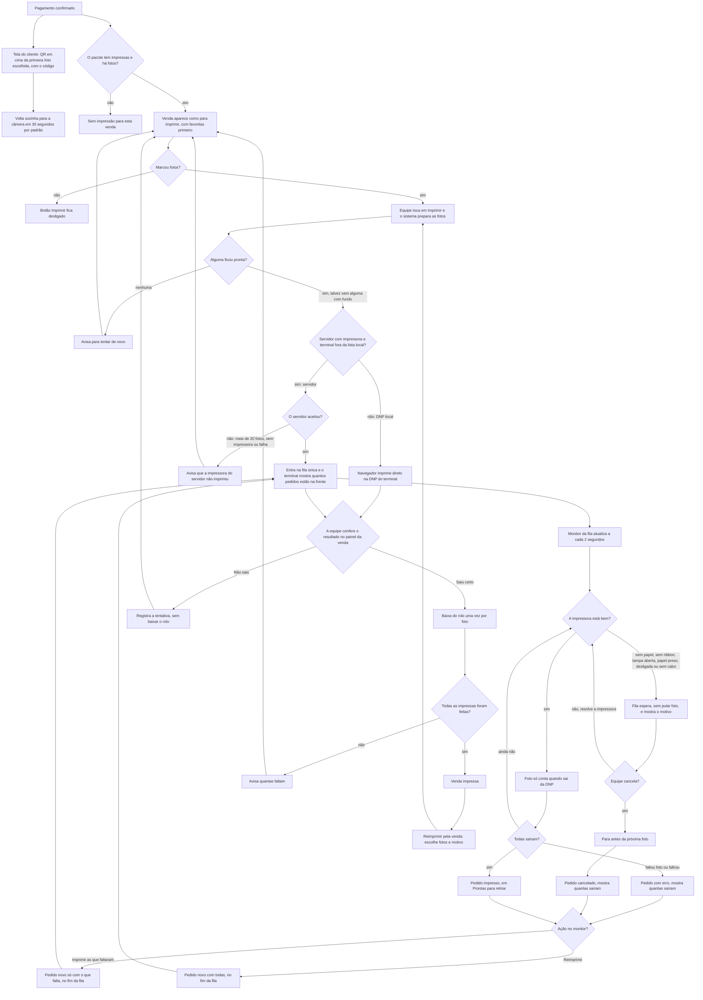

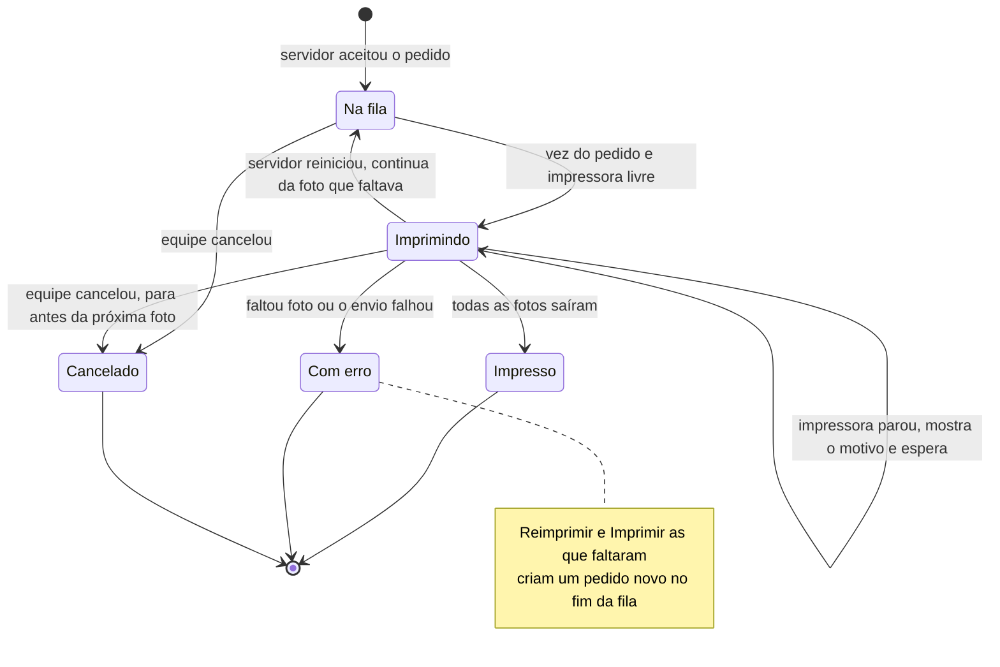

#### Decisões

| Decisão | Regra exata | Onde no código |
|---|---|---|
| QR sobre a foto | Só depois de confirmado. Usa a 1ª foto de `selected` da sessão. Sem foto do campo escolhida, o QR aparece sozinho. O QR aponta para o token da galeria. | `vQuiosque` (variável `fotoQR`), `.lj-qrfoto`, `drawLojaQR` |
| Tempo da tela final | Padrão 30 s, de 5 a 120 (`SIM.lojaFimSeg`). | `lojaFimSeg`, `lojaTick` |
| Se a venda imprime | Impressas maiores que zero e pelo menos uma foto. Caso contrário, situação "sem impressão". | `impIniciar`, `impFotos` |
| Lista de fotos | Favoritas primeiro, depois fotos do campo e fotos com fundo. Corta no número de impressas. Pacote prevendo mais que as fotos existentes conta "sem foto". A equipe pode trocar quais imprimir, até o que falta. | `impFotos`, `impSel`, `impFalta` |
| Preparo | Fundo em alta resolução com tempo limite de 60 s; imagens com 15 s para abrir. Foto que falha fica de fora. Sem nenhuma pronta, estado de erro. | `printMontar`, `compHi` |
| Servidor ou DNP local | Servidor quando o agente está ligado com `ETERNA_IMPRESSORA` e o nome do terminal não está em `IMP_LOCAIS`. Local usa `window.print`, que sai direto com `--kiosk-printing`. | `impImprimir`, `IMP_LOCAIS` |
| Envio ao servidor | JPEG com até 1800 px no lado maior, qualidade 0,92. De 1 a 20 fotos por pedido. | `impImprimir`, `imprimir` |
| Ordem e impressora | Ordem de chegada. Só espera pedido anterior que disputa a mesma impressora. A venda sai inteira na primeira livre entre as do terminal (`ETERNA_IMPRESSORA_POSTOS`), ou entre todas. | `imprimir_fila`, `imp_destinos` |
| Foto contada | Linha `FOTO` só depois da fila do Windows vazia e impressora parada. A próxima só vai depois disso. | PowerShell `Espera-Livre`, `imprimir_fila` |
| Pedido impresso | Saída 0, última linha `OK` e fotos contadas iguais às enviadas. Faltando uma, com erro "X de Y". | `imprimir_fila` |
| Avisos | Pouco papel, sem papel, ribbon acabando, sem ribbon, tampa aberta, papel preso, desligada ou sem cabo, pede manutenção, bandeja cheia, não encontrada no Windows, impressora parou, não termina há mais de 2 minutos. Aviso não derruba o pedido: fica esperando até resolver ou cancelar. | `IMP_ESTADO_PS1`, `Espera-Livre`, `imprimir_fila` |
| Monitor | O app lê a fila a cada 2 s. O estado das impressoras é lido do Windows a cada 10 s. Colunas: Na fila, Imprimindo agora, Prontas (12 últimas), Com erro ou canceladas (4 últimas). Previsão de 14 s por foto. Terminados somem depois de 3 h. Guarda os 200 últimos pedidos. | `vImpFila`, `impFilaPoll`, `imp_monitor`, `imp_fila_json`, `imp_pedido` |
| Ações do monitor | Na fila ou imprimindo: Cancelar. Com parte impressa: Imprimir as que faltaram e Reimprimir tudo. Demais: Reimprimir. Nos dois casos, pedido novo, com as fotos que ainda existem no disco. | `vImpFila`, `imp_acao`, ação `if-acao` |
| Reinício do servidor | Pedido na fila ou imprimindo volta para a fila, a partir da foto que faltava. | `imp_retomar`, `imp_salvar` |
| Sem impressora real | `ETERNA_IMPRESSORA_TESTE` simula 6 s por foto e desliga o monitor do Windows. Sem `ETERNA_IMPRESSORA`, a rota responde 503. | `imprimir_fila`, `imp_monitor`, `gal_post` |
| Saiu certo | Baixa o rolo por foto nova do `postoNome`. Com todas feitas, venda "impressa". Vale também para a reimpressão, que grava a lista e o motivo. | `impOk` |
| Não saiu | Registra `nao_saiu`, sem baixa. A venda continua como estava. | `impFalha` |
| Reimpressão pela venda | Só depois de impressa. Até o número de impressas da venda, com motivo obrigatório: Falhou, Outra cópia, Cor, Outro. | `impReimprimir`, `impReMax`, `IMP_MOTIVOS` |
| Rolo e alerta | 700 fotos por rolo, alerta abaixo de 40. Venda paga sem impressão há mais de 10 min vira alerta. | `ROLO_CAP`, `ROLO_ALERTA`, `IMP_ALERTA_MIN` |

#### Divergências

- `DOCUMENTACAO-TECNICA.md`, seção da v83: "Uma DNP por notebook, pelo Chrome". Na v91 é uma das duas opções, e o servidor tem preferência quando tem impressora. O painel da venda ainda diz "impressora deste posto" mesmo no modo servidor.
- O relatório de 31/10 diz que a foto só conta quando sai da DNP. Isso vale para a fila do servidor. No app, a venda passa para "enviada" assim que o servidor aceita o pedido, e os botões "Saiu certo" e "Não saiu" aparecem antes de a foto sair. Rolo e situação da venda dependem da resposta da equipe, sem ligação com a contagem da fila.
- Reimprimir pelo monitor da fila não baixa o rolo nem registra em `s.impressoes`. Só a reimpressão pelo painel da venda faz isso. Nenhum documento registra a diferença.

### 11. Galeria online e compra pela nuvem

Entrega as fotos no celular do cliente depois da visita. O QR ou o código abrem a galeria, a selfie confirma quem é, e cada foto mostra o que ele pode baixar e o que ainda está à venda.

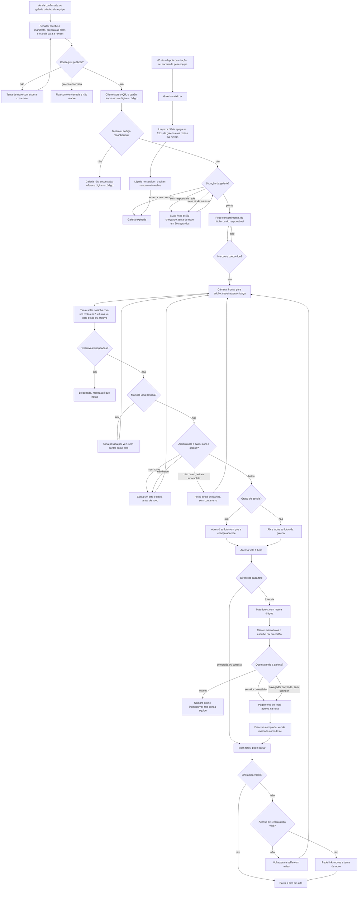

#### Decisões

| Decisão | Regra exata | Onde no código |
|---|---|---|
| Quem responde | Página em https usa a nuvem. Fora disso, o servidor, ou `window.ETERNA_AGENTE`. Sem resposta em 2,5 s e token no mesmo navegador: modo local. | `galApi`, `pubLoad` |
| Formato | Token de 22 caracteres. Código `XXXX-XXXX`, que também exige selfie. | `pubRead`, `pubCodigo` |
| Cartão com QR impresso | Lido no recibo. Aceita o endereço inteiro ou só o token. Mesmo cartão na mesma sessão: mostra de novo. Cartão já usado noutra venda: recusa. A galeria antiga vira substituída e o QR vai para a tela do cliente. Na nuvem, token com fotos de outra sessão é recusado (409). | `cartaoAtrelar`, `cartaoToken`, `publicar` em `app.py` |
| Publicação | O app tenta em 10 s, 30 s, 60 s e depois a cada 300 s. Só publica se todas as fotos vieram do servidor. Do servidor para a nuvem: espera de 5 s dobrando, até 300 s. | `galFilaTick`, `nuvem_galerias_loop` |
| Foto de outra sessão | O servidor recusa com 400 foto de outra sessão conhecida, ou fora da escolha da venda. | `_gal_confere_sessoes` |
| Consentimento | Obrigatório. Registra tipo, versão e idioma, sem imagem. A nuvem só lê rostos das fotos depois do primeiro consentimento. | `vGaleriaQR`, `gal_post`, `rosto`, `indexar` |
| Quem é tratado como criança | Galeria de grupo ou com `menor` verdadeiro: texto do responsável e câmera traseira. | `pubKid`, `pubSelfieAbrir` |
| Selfie automática | A cada 600 ms. 2 leituras seguidas com um único rosto de pelo menos 40 px e 20% da largura. Botão só se o detector falhar. Enviar arquivo fica disponível. | `selfieMount`, `vGaleriaQR` |
| Bateu com a galeria | Nuvem: 85 de 100 em adulto, 95 em grupo ou sessão com menor. Servidor: 0,45 em sessão, 0,50 em grupo. Sessão abre todas as fotos do manifesto; grupo abre só as fotos que bateram. | `rosto`, `LIMIAR_ADULTO`, `LIMIAR_CRIANCA`, `gal_post`, `LIMITE`, `LIMITE_MENOR` |
| Tentativas | 5 erros bloqueiam 15 min. Várias pessoas e leitura incompleta não contam. Grupo de escola tem tetos próprios por visitante e por hora. | `falhas`, `falhou`, `evento_permite`, `pubFalhou` |
| Direito por foto | Prioridade: comprada, cortesia, venda. Comprada vem de `selected` desta venda ou da compra online. Comprada nunca regride ao republicar. | `galAtualizar`, `gal_mesclar`, `publicar` em `app.py` |
| O que aparece | Comprada e cortesia: original para baixar. Venda: vitrine. Original nunca vai para foto à venda. | `galeria_obj`, `vGaleriaQR`, `gal_get` |
| Links assinados | Nuvem: 5 min. Servidor: 15 min, com redirecionamento para a nuvem de 5 min quando a foto já subiu. App renova com mais de 12 min de galeria ou depois de falha no download; 2ª falha abre o link em outra aba. | `URL_TTL` nos dois lados, `link`, `nuvem_link`, `pubBaixar`, `pubRenovar` |
| Acesso | 1 h. Vencido responde 401 e volta para a selfie. | `ACESSO_TTL`, `pubAcessoVenceu` |
| Compra online | Nuvem: sempre responde `compra_indisponivel` (503). Servidor: `min(n x R$ 39, R$ 250)` nos valores iniciais, calculado no servidor; o mesmo pedido repetido não duplica. Só foto à venda dentro do acesso. | `handler` em `app.py`, `gal_post`, `pubPagar`, `pubTotal` |
| 60 dias | `expira` = criação + 60 dias. Republicar nunca aumenta a validade. | `GAL_DIAS`, `galNovo`, `gal_mesclar`, `publicar` em `app.py` |
| Encerrar | Grupo de escola: a administração grava `expira` igual a agora e publica. LGPD: fluxo 12. Cartão: encerra a galeria substituída. | ação `gal-ev-encerrar`, `cartaoAtrelar` |
| Limpeza e lápide | No servidor, uma vez por dia: grava a lápide e apaga a pasta da galeria. Republicar responde 410, informação responde 410 e código responde 404. Na nuvem, limpeza diária apaga a coleção de rostos de galeria vencida ou encerrada. | `galeria_loop`, `lapide_gravar`, `gal_post`, `limpeza` |

#### Divergências

- Links: `DOCUMENTACAO-TECNICA.md` e o comentário de `pubBaixar` dizem 15 min. Na nuvem são 5 min, como diz `NUVEM.md`.
- Compra: a documentação da v77 descreve aprovação de teste. A nuvem nunca aprova: `COMPRA_ONLINE` e `CompraOnline` no `template.yaml` só mudam o campo `compra` da resposta, e o app ignora esse campo. No celular, o cliente vê a tela de pagamento com "Pagamento de teste" e recebe a mensagem de falha.
- O aviso da tela Galerias online e `CONTEXTO-ETERNA.md` dizem que o celular não alcança o servidor e que fica em "chegando". Hoje o celular usa a nuvem.
- Encerrar: a documentação diz que grava `encerrada: true` no app e no agente. A ação do grupo só muda `expira`. `gal_validar` não leva `encerrada` e o app não chama `POST /galerias/encerrar`.
- Limiares: a documentação só cita 0,45 e 0,50. A nuvem usa outro motor e outra escala (85 e 95). Sessão de menor fora de grupo usa 95 na nuvem e 0,45 no servidor.
- `docs/planos/2026-10-30-cartao-qr-impresso.md` diz que o cartão vira o QR "da galeria da venda". `cartaoAtrelar` trabalha com a galeria da sessão (`galDaSessao`), que não acha a galeria própria de venda com sessões juntadas. O mesmo vale para o código do recibo (`galCod`) e o botão "Mostrar ao cliente" (ação `eco-qr`).

### 12. Exclusão LGPD

Atende o cliente que não comprou e pede para não guardar as fotos dele. Tira foto, rosto e galeria do servidor e da nuvem, sem desfazer. Sessão vendida não passa por aqui.

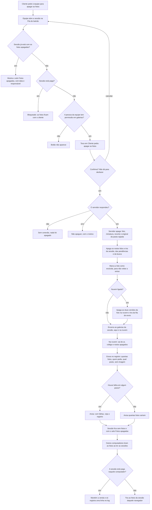

#### Decisões

| Decisão | Regra exata | Onde no código |
|---|---|---|
| Quem pede | O cliente, à equipe. A galeria e o Checkout não têm essa opção. | `vFila`, ação `lgpd-pedir` |
| Quem executa | Usuário com `galerias.u`. Botão só para sessão não paga. | `can('galerias','u')`, ação `lgpd-excluir` |
| Bloqueio de sessão vendida | `status` da própria sessão igual a paga: botão escondido e, se a ação chegar, mensagem "Venda paga: as fotos ficam com o cliente". | ação `lgpd-excluir` |
| O que é enviado | Todas as fotos da sessão, até 500, e as galerias de tipo sessão que contêm a sessão, até 20. | ação `lgpd-excluir`, `gal_post` |
| O que sai do servidor | Índice da biblioteca, foto, miniatura, recorte e o original da pasta vigiada com o mesmo nome e hash. Rostos e foto em `rostos.db`. Sessões em memória e em disco. Matriz de busca do dia. Fila de rostos pendentes. | `lgpd_excluir`, `ff_esquecer`, `sess_esquecer`, `sess_esquecer_disco` |
| Não volta a entrar | O hash fica em `lgpd_excluidas`, gravado em disco. | `lgpd_excluir`, `LGPD_EXCLUIDAS` |
| O que sai da nuvem | Versões alta e vitrine, e o item da fila de envio. A galeria encerrada apaga a coleção de rostos e o código curto. | `lgpd_excluir`, `nuvem_galeria_enfileira`, `publicar`, `apagar_rostos` |
| Galerias | Grava `encerrada: true`, `lgpd: true` e `expira` igual a agora. Galeria de grupo fica fora da lista. | `lgpd_excluir`, ação `lgpd-excluir` |
| O que fica | Número da venda e carrinho marcado como apagado na sessão, selo `s.lgpd`, `lgpd.log` e métrica da foto com pid, nome do arquivo, sessão, posto e autor. | ação `lgpd-excluir`, `lgpd_excluir`, `metrica_grava` |
| Falhas parciais | Cada falha é anotada e o processo continua. Responde `ok: false` com até 5 falhas. O app marca a sessão como apagada mesmo assim. | `lgpd_excluir`, ação `lgpd-excluir` |
| Outros computadores | Sessão fechada só muda pela LGPD. Sem venda paga: tira as fotos. Com venda paga: mantém e registra uma linha. | `srvPull`, `srvLgpd` |
| Prazo sem pedido | Rostos, sessões e galerias: 60 dias. | `RETENCAO_DIAS`, `sess_limpar`, `limpar_rostos`, `GAL_DIAS` |

#### Divergências

- A docstring de `lgpd_excluir` diz que "a venda continua no registro financeiro, sem as fotos". A trava da sessão paga está no app e o caminho normal nem chega lá.
- `GUIA-DA-EQUIPE.md` não tem nenhuma instrução sobre esse botão.
- A ação não fecha um pedido que esteja aguardando pagamento na sessão. Nenhum documento trata esse caso.

## Plataforma e operação

### 13. Login e permissões hoje

Descreve como uma pessoa entra e o que ela passa a ver, do jeito que o app funciona na v91. A conferência acontece no navegador: a seção "Pendências de segurança" de `DOCUMENTACAO-TECNICA.md` registra que o servidor ainda não é a fonte da verdade.

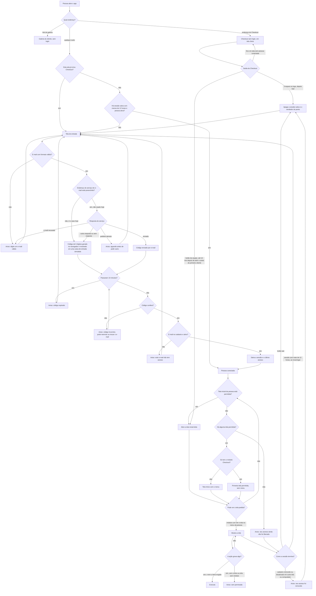

**Decisões**

| Decisão | Regra exata | Onde no código |
|---|---|---|
| Serviço de e-mail | `MAIL_API=''` na v91. Vazio: o código nasce no navegador. Os serviços `/auth/codigo` e `/auth/verificar` existem em `servidor/email` e na nuvem, mas o app não aponta para eles | `MAIL_API`, `mailApi`, `sendCode` |
| Código | 6 dígitos, validade de 10 minutos | `sendCode`, `checkCode` |
| Modo real, quando ligado | 202 = enviado; 429 = aguarde; 400 = e-mail inválido; outra resposta = modo local. Na conferência: 200 grava o token e entra; "expirado" volta ao e-mail; sem conexão avisa | `sendCode`, `checkCode` |
| Cadastro | `userFor`: e-mail existente e `active` diferente de falso. O pedido de código não consulta o cadastro; a conferência acontece em `login` | `userFor`, `login` |
| Sessão salva | Validade de 12 horas, em `eterna.session`; não é carregada em aba marcada como Checkout | `sessionLoad`, `LOJA_ABA` |
| Módulos | 17 módulos, cada um com Criar, Ver, Alterar e Excluir | `MODULES`, `OPS`, `can` |
| Perfis prontos | Admin, Fotógrafo, Atendimento e venda, Validador, Supervisor, Checkout; cadastro também pode nascer sem acesso | `PRESETS`, `SEED_USERS` |
| Ver uma tela | Módulo com Ver e tela no menu da pessoa. Checkout: Ver em `quiosque` ou `venda`. Permissões: exige também Alterar | `canView`, `menuOk` |
| Tela de abertura | `inicio` permitido; sem telas = sem acesso; só Checkout = primeira tela sem menu; demais = Início | `homeView`, `isBare` |
| Ação que grava | Ação listada exige a letra no módulo fixo da ação ou no módulo da tela; tela sem módulo é barrada | `WRITE_OPS`, `ACT_MOD`, `guardAct` |
| Cadastro sincronizado | Com servidor: coleção `usuarios` do estado. Sem servidor: cópia do navegador em `eterna.users.v1` | `dbLigar`, `agenteDb` |
| Cadastro sem administrador | O app recria os administradores da lista inicial | `ensureAdmin` |
| Sair | Para a câmera, apaga `eterna.posto.vendedor` e `eterna.session`, volta à entrada | `logout` |
| Checkout sem login | `#loja` marca a aba com `eterna.lojaTab` e não carrega a sessão salva. O vendedor das vendas é o declarado ao abrir pela equipe | `render`, `lojaJanela`, `postoVendedor` |
| Saídas do Checkout | Esc em aba sem pessoa: volta ao início. 3 toques em 1,5 s abrem o painel da equipe. Saída normal apaga a sessão. Volta ao app só por 10 minutos depois de "Abrir Checkout" | `lojaEsc`, `lojaSair`, `lojaLogo`, `lojaEquipeOn`, `lojaVoltarApp` |
| Situação declarada pelo projeto | Login e permissões são conferidos no navegador; o agente não confere usuário nas rotas | `DOCUMENTACAO-TECNICA.md`, "O que é protótipo na v78" e "Pendências de segurança" |

### 14. Onde cada dado mora e como sincroniza

Mostra como vendas e estado da equipe chegam ao servidor e o que acontece quando o servidor ou o navegador caem. O navegador guarda uma cópia e uma fila; o servidor é o dono dos dados que já confirmou.

| Dado | Onde mora | Cópia ou fila | Vai para a nuvem |
|---|---|---|---|
| Vendas (eventos criar, pagar, cancelar, impressão, rolo) | `~/Eterna/ponto/vendas.db` | Fila `eterna.ponto.fila.v1` no navegador | Backup do banco |
| Usuários, permissões, registro, diário, treino, venue, revisões, bandeiras, função do dia | `~/Eterna/ponto/estado.db` | Fila `eterna.db.fila.v1` | Backup do banco |
| Preços, catálogo, estoque, ajustes, descartes, fundos, cortesias | `estado.db`, coleção `sim`, um registro por item | `eterna.sim.v1` no navegador | Backup do banco |
| Sessões | `~/Eterna/ponto/sessoes/AAAA-MM-DD.json` | Lidas pelo app | Backup de hoje e ontem |
| Galerias | `~/Eterna/galerias/<token>/sessao.json` | `SIM.galFila` no navegador e fila no `nuvem.db` | Banco da galeria |
| Fotos originais e miniaturas | `~/Eterna/inbox/AAAA-MM-DD/` e `thumbs/` | Nenhuma | Original não sobe; sobem alta e vitrine |
| Rostos lidos | `~/Eterna/rostos.db` | Nenhuma | Não vão para o backup |
| Resumo do dia | `~/Eterna/ponto/metricas/AAAA-MM-DD.json` | Nenhuma | Backup de hoje e ontem |
| Métricas técnicas por foto | `~/Eterna/metricas.jsonl` | Nenhuma | Não |
| Fila de impressão | `~/Eterna/impressao/fila.json` | Nenhuma | Não |

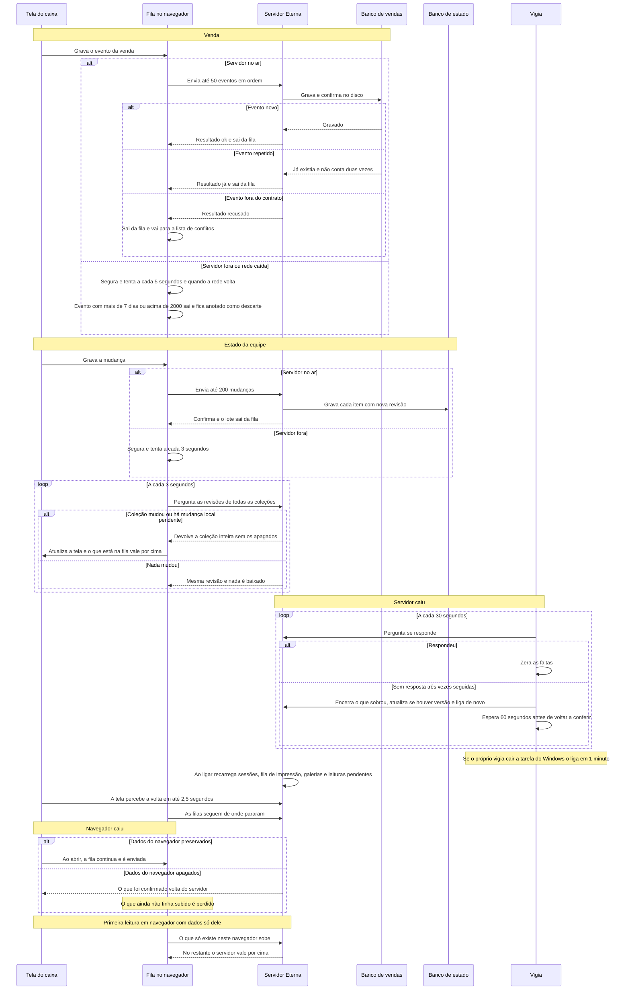

**Decisões**

| Decisão | Regra exata | Onde no código |
|---|---|---|
| Quando a venda sobe | Na hora, a cada 5 s e no evento de rede; só se o servidor estiver marcado como ligado; 1 envio por vez | `pvEvento`, `pontoFlush` |
| Lote de vendas | Até 50 eventos por envio; corpo até 2 MB | `pontoFlush`, `ev_receber`, `gal_post` |
| Repetição | `idem` único (`venda:seq`); gravação com `insert or ignore`: novo = `ok`, repetido = `ja` | `vendas_db`, `ev_receber` |
| Evento recusado | Tipo fora de criar, pagar, cancelar, impressao, rolo, ou identificador inválido; guardados até 500 em `eterna.ponto.conflitos.v1` | `_ev_limpo`, `pontoFlush` |
| Durabilidade | SQLite com `synchronous=full`; confirma depois do `commit` | `vendas_db`, `estado_db`, `ev_receber` |
| Limite da fila de vendas | 7 dias e 2.000 eventos; o excesso sai e fica em `eterna.ponto.descartes.v1` | `pvPoda`, `PV_DIAS`, `PV_MAX` |
| Envio do estado | Na hora e a cada 3 s; lote de 200 no navegador; servidor aceita até 500 por pedido e corpo de 8 MB | `agenteDb`, `gal_post`, `estado_gravar` |
| Item do estado ignorado | Coleção fora da lista, id vazio ou acima de 300 caracteres, valor acima de 512 KB. O servidor pula o item, e o lote sai da fila do navegador | `estado_gravar`, `ESTADO_MAX`, `agenteDb` |
| Coleções | `usuarios`, `usuarios_login`, `usuarios_log`, `diario`, `treino`, `config`, `reviews`, `bandeiras`, `funcao`, `sim` | `ESTADO_COLS` |
| Revisão | Contador global crescente; valor nulo apaga; a gravação não compara revisão, vale a última que chegou | `estado_gravar`, `estado_col`, `estado_revs` |
| Mudança local x servidor | Fila pendente vale por cima na tela. Em `sim`: primeira leitura, servidor vale e o que só existe aqui sobe; depois, mudança não enviada fica, e o que outro computador apagou sai | `agenteDb`, `simAplica`, `simSobe`, `dbMigra` |
| Fora da coleção `sim` | Sessões, galerias, vendas e fila de envio têm dono próprio | comentário antes de `SIM_MAPA` |
| Navegador cheio | Falha ao gravar marca `state.simCheio` | `pvEvento`, `agenteDb` |
| Saber se o servidor voltou | Consulta `/status` a cada 2,5 s | `agentPoll` |
| Vigia | Pergunta a cada 30 s com limite de 10 s; 3 faltas (cerca de 1min30) religam; espera 60 s | `eterna-vigia.ps1 Responde`, `Liga` |
| Tarefa do Windows | Religa o vigia em 1 minuto, até 999 vezes; não abre duas | `instalar-servidor.ps1` |
| Retomada ao ligar | Sessões, fila de impressão, galerias e fotos sem leitura de rosto voltam | `sess_carregar`, `imp_retomar`, `gal_indexar`, `rostos_thread` |

### 15. O que sobe para a nuvem

Mostra as quatro saídas para a nuvem: fotos, galerias, backup e o teste de saúde. Cada uma tem regra própria para falta de internet.

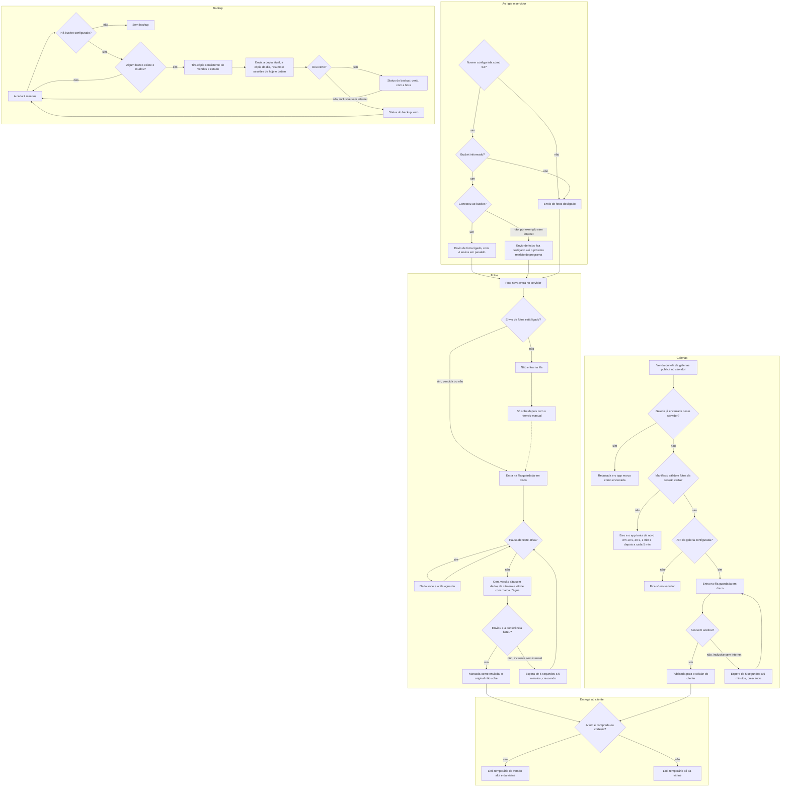

**Decisões**

| Decisão | Regra exata | Onde no código |
|---|---|---|
| Ligar o envio | `ETERNA_NUVEM=s3`, `ETERNA_BUCKET` e `head_bucket` com sucesso. Falhou: a função termina e não tenta de novo | `nuvem_loop` |
| O que entra na fila | Toda foto nova ao entrar, sem olhar se foi vendida; `INSERT OR IGNORE` por foto | `ingest_file`, `nuvem_enfileira` |
| Foto com envio desligado | Não é registrada; `POST /nuvem/reenviar` põe de novo todas as fotos e galerias abertas, e exige nuvem ligada | `nuvem_enfileira`, `nuvem_reenviar` |
| Versões enviadas | Alta com lado máximo de 3.000 px, JPEG 88, sem EXIF nem GPS; vitrine de 900 px com marca d'água | `nuvem_versoes`, `_vitrine`, `ALTA_LADO` |
| Conferência | `Content-MD5` no envio e `ETag` igual ao MD5 | `nuvem_envia` |
| Ritmo | Olha a fila a cada 1 s, pega até 40, 4 envios (`ETERNA_NUVEM_ENVIADORES`) | `nuvem_loop` |
| Falha ao enviar | Espera `min(300, 5 × 2^tentativas)` segundos, sem limite de tentativas | `enviador`, `nuvem_galerias_loop` |
| Pausa de teste | Arquivo `~/Eterna/nuvem-pausa` existe: nada sobe | `NUVEM_PAUSA` |
| Publicar galeria | Local em `/galerias/publicar`; encerrada responde 410; comprada não regride e validade não aumenta | `gal_post`, `gal_validar`, `gal_mesclar` |
| Fila do app para o servidor | Só foto vinda do servidor; espera 10 s, 30 s, 60 s e 300 s | `galFilaTick` |
| Fila do servidor para a nuvem | Só com `ETERNA_GALERIA_API`; acorda a cada 5 s ou no pedido; até 20 por volta; identifica-se com o segredo do ponto | `nuvem_galeria_enfileira`, `nuvem_galerias_loop` |
| Regras na nuvem | Sessão diferente em token já usado responde 409; encerrada tira do ar e apaga os rostos | `publicar` em `servidor/galeria-nuvem/app.py` |
| Backup | Espera 120 s; só com `ETERNA_BUCKET`; compara a data dos bancos e do arquivo WAL; só com mudança | `backup_loop` |
| Caminhos do backup | `backup/<pc>/<banco>.db`, `backup/<pc>/dia/AAAA-MM-DD/<banco>.db`, `backup/<pc>/metricas/` e `backup/<pc>/sessoes/`; a do dia é sobrescrita até o dia virar | `backup_loop` |
| Fora do backup | Rostos, fotos originais, `nuvem.db` e arquivos de configuração | `backup_loop` |
| Falha no backup | Grava erro em `/status`; não marca a mudança como enviada, então repete no próximo ciclo | `backup_loop`, `backup` |
| Saúde da nuvem | A cada 2 min abre um arquivo de teste pelo S3 e pelo CloudFront, se configurado | `nuvem_saude` |
| Link da foto | Validade de 5 minutos; CloudFront quando ligado, com reserva direta no S3 | `nuvem_link`, `LINK_TTL`, `link` em `app.py` |
| Compra online | Desligada por padrão (`COMPRA_ONLINE=0`); a nuvem responde indisponível | `handler` em `app.py` |

### 16. Atualização do programa

Mostra como uma versão testada do programa do servidor chega ao venue e o que acontece em cada falha. Vale só para o `eterna-agente.py`; o app segue outro caminho, indicado no diagrama.

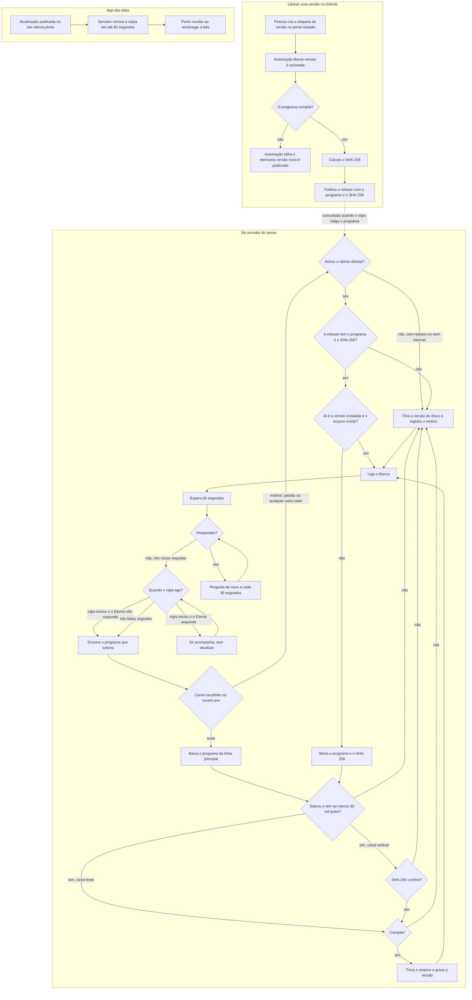

**Decisões**

| Decisão | Regra exata | Onde no código |
|---|---|---|
| Gatilho da release | Push de etiqueta `v*`; compila com `py_compile`; `gh release create` com `eterna-agente.py` e `eterna-agente.py.sha256` | `.github/workflows/liberar-versao.yml` |
| Quando o vigia procura versão | Só dentro de `Liga`: início com o Eterna fora do ar, ou 3 faltas. Não há consulta periódica | `eterna-vigia.ps1 Liga`, `Atualiza` |
| Canal | `ETERNA_CANAL` no `nuvem.env`: `teste` segue o `main`; qualquer outro valor ou ausência = estável | `Canal` |
| Canal estável | Lê `releases/latest` com limite de 30 s; download com limite de 60 s | `Atualiza` |
| Canal teste | Sem SHA-256; só tamanho e compilação; grava `main` em `versao.txt` | `Atualiza` |
| Já instalada | `versao.txt` igual à etiqueta e arquivo existente: não baixa | `Atualiza` |
| Tamanho mínimo | Menos de 50.000 bytes = falha de download | `Atualiza` |
| SHA-256 | Calculado no arquivo baixado e comparado ao da mesma release. Sem o SHA-256 da release, a troca é recusada. | `Atualiza` |
| Compilação | `python -m py_compile`; falhou: apaga o `.novo` | `Atualiza` |
| Troca | `Move-Item` sobre o arquivo e `versao.txt`; registro em `~/Eterna/vigia.log` | `Atualiza`, `Registra` |
| Janela de troca | Sem janela de horário, sem conferir venda aberta ou fila de impressão | `Liga` |
| Falha depois da troca | Não há volta automática: o vigia só religa em 3 faltas e fica no arquivo do disco | `eterna-vigia.ps1` |
| Situação da release | A consulta pública a `releases/latest` respondeu 404 em 04/11/2026, e o repositório local não tem etiquetas. No canal estável, o vigia hoje fica na versão do disco | `Atualiza`; `docs/planos/2026-11-02-pedidos-do-eduardo-pos-v91.md` |
| Vigia e primeira cópia | O vigia e a instalação inicial do programa vêm do `main`, fora do canal de release | `instalar-servidor.ps1`, `instalar-vigia.ps1`, `iniciar-eterna.bat` |
| App | Segue o `ETERNA_APP_ORIGIN`, fora do canal de release; renovado a cada 60 s na próxima abertura | `H.app` |

### 17. Instalação do servidor

Mostra o que o `Eterna-Servidor.exe` faz, passo a passo. O `.exe` só leva o `instalar-servidor.ps1` embutido e o executa; a cópia embutida hoje é igual ao script do repositório.

```mermaid
flowchart TD
  INI{"Como foi iniciado?"}
  INI -->|"Eterna-Servidor.exe"| X1["Windows pede permissão de administrador"]
  X1 --> X2["Extrai o script para a pasta temporária e executa com pausa no fim"]
  INI -->|"script direto"| ADM{"Está como administrador?"}
  X2 --> ADM
  ADM -->|"não"| ERRO["Mostra o erro e termina com falha; passos já feitos ficam"]
  ADM -->|"sim"| P1{"A pasta do usuário dono foi informada?"}
  P1 -->|"sim"| P3{"Existe o Python preparado do Eterna nessa pasta?"}
  P1 -->|"não"| P2["Procura em todos os usuários; com mais de um, usa a pasta Eterna alterada por último"]
  P2 --> P3
  P3 -->|"não"| ERRO
  P3 -->|"sim"| V1["Baixa o vigia da linha principal"]
  V1 --> V2{"Baixou com mais de 500 bytes?"}
  V2 -->|"sim"| V3["Troca o vigia"]
  V2 -->|"não"| V4{"Já havia vigia no disco?"}
  V3 --> PARA
  V4 -->|"não"| ERRO
  V4 -->|"sim"| PARA["Para o vigia e o Eterna que estiverem rodando"]
  PARA --> AT{"Há atalho do vigia na inicialização de algum usuário?"}
  AT -->|"sim"| AT2["Desliga o atalho, para não subirem dois"]
  AT -->|"não"| TAREFA
  AT2 --> TAREFA["Cria ou substitui a tarefa Eterna do sistema, ao iniciar o Windows"]
  TAREFA --> FW1["Reúne o Python preparado e o Python de origem, quando encontrado"]
  FW1 --> FW2["Desfaz bloqueios do firewall gravados para esses programas"]
  FW2 --> FW3["Refaz as regras do Eterna: Python e portas 8765 e 2121"]
  FW3 --> FW4{"A política da empresa ignora regras locais em algum perfil?"}
  FW4 -->|"sim"| FW5["Aviso: quem estiver nessa rede não conecta"]
  FW4 -->|"não"| FW6["Confirma o firewall liberado"]
  FW5 --> EN
  FW6 --> EN["Energia: não dorme na tomada e fechar a tampa não faz nada"]
  EN --> AL["Remove atalhos antigos do Eterna de cada usuário"]
  AL --> CH{"Chrome instalado?"}
  CH -->|"sim"| AL2["Cria o atalho comum na área de trabalho, com ícone do Chrome"]
  CH -->|"não"| AL3["Cria o atalho comum, sem esse ícone"]
  AL2 --> LIGA
  AL3 --> LIGA["Liga a tarefa e pergunta a cada 3 segundos, por até 3 minutos"]
  LIGA --> RESP{"Respondeu?"}
  RESP -->|"não"| AV["Aviso: veja o registro do vigia"]
  RESP -->|"sim"| OK["Mostra impressora, nuvem e rostos, e os endereços para os pontos"]
  AV --> FIM["Mensagem final: pode reiniciar; o Eterna sobe sozinho"]
  OK --> FIM
  FIM --> PAUSA{"Iniciado com pausa?"}
  PAUSA -->|"sim, pelo .exe"| PA["Espera Enter e o .exe apaga o script temporário"]
  PAUSA -->|"não"| TERM["Termina"]
```

**Decisões**

| Decisão | Regra exata | Onde no código |
|---|---|---|
| Elevação do `.exe` | Manifesto com `requireAdministrator` | `agente/instalador/app.manifest` |
| Script embutido | Recurso `instalar-servidor.ps1`, montado com o `csc` do .NET | `Eterna-Servidor.cs`, `montar.ps1` |
| Administrador | Sem o papel de administrador: erro e fim | `instalar-servidor.ps1`, início |
| Falha geral | `$ErrorActionPreference='Stop'` e `trap`: mostra o erro e sai com código 1, sem desfazer | `instalar-servidor.ps1`, `trap` |
| Pasta do dono | `-Base`, ou perfil com `Eterna\venv\Scripts\python.exe`, o de `Eterna` mais recente | `instalar-servidor.ps1` |
| Pré-requisito | Python e venv criados antes no usuário dono; a mensagem pede rodar o `instalar-vigia` | `instalar-servidor.ps1`; `CHECKLIST-SERVIDOR.md`, passo 7 |
| Vigia | Baixado do `main`, limite de 60 s, maior que 500 bytes | `instalar-servidor.ps1` |
| Parar o que roda | Processos com `eterna-vigia.ps1` ou `python.exe` com `eterna-agente.py` | `instalar-servidor.ps1` |
| Atalho antigo | `Eterna vigia.cmd` vira `.desligado` em cada usuário | `instalar-servidor.ps1` |
| Tarefa | `Eterna`, conta SYSTEM, ao iniciar, nível mais alto, sem limite de tempo, roda em bateria, 999 religadas a cada 1 min, nunca duas | `Register-ScheduledTask` |
| Pasta dos dados | Continua no perfil do dono, via `ETERNA_BASE`; o vigia ajusta `USERPROFILE` | `instalar-servidor.ps1`, `eterna-vigia.ps1` |
| Firewall | Entrada, perfil Any: venv, Python de `pyvenv.cfg` e portas TCP 8765 e 2121; regras `Eterna*` antigas são removidas | `instalar-servidor.ps1` |
| Política da empresa | `AllowLocalFirewallRules = False` no armazenamento ativo gera aviso | `Get-NetFirewallProfile` |
| Energia | Suspensão e hibernação na tomada = 0; tampa = nada, na tomada e na bateria | `powercfg` |
| Atalho | `Eterna.url` na área pública, apontando para o próprio computador na porta 8765 | `instalar-servidor.ps1` |
| Conferência | `/status` igual a 200, a cada 3 s, por até 3 min | `instalar-servidor.ps1` |
| Máquina fora do domínio | `instalar-tarefa.ps1` cria a tarefa em nome do dono, pedindo a senha dele. Em máquina corporativa a tarefa do sistema é o caminho documentado | `instalar-tarefa.ps1`; `CHECKLIST-SERVIDOR.md`, passo 7 |

**O que muda no instalador Linux** (análise de `docs/pesquisa/2026-11-02-eterna-como-produto.md`, seção 4; nada disso está implementado)

| Hoje (Windows) | No Linux |
|---|---|
| Impressão pelo PowerShell | Pillow (corte 10×15) e CUPS/IPP. A DNP DS-RX1HS precisa de teste de bancada antes de decidir; conferir se há driver Linux oficial |
| Tarefa do sistema e vigia | Serviço `systemd` com usuário `eterna` sem shell; programa em `/opt/eterna`, dono root, e dados em `/var/lib/eterna` |
| Atualização pelo vigia | Pacote `.deb` assinado em repositório próprio, ou release assinada conferida por um timer |
| Firewall do Windows | nftables ou ufw: 8765 só para caixas e VPN; 2121 só para a rede das câmeras; SSH só pela VPN |
| powercfg | Servidor sem suspensão e BIOS religando quando a energia volta |
| Sem BitLocker | LUKS no disco de dados, com desbloqueio pelo TPM |
| Windows Update | Atualização automática de segurança fora do horário, e registro de acesso com auditd |

### 18. Métricas e relatórios

Mostra de onde saem os números do Painel e como o resumo diário é montado. O Painel junta duas visões: a do navegador e Roverpix, e a seção "Servidor do ponto · todos os caixas".

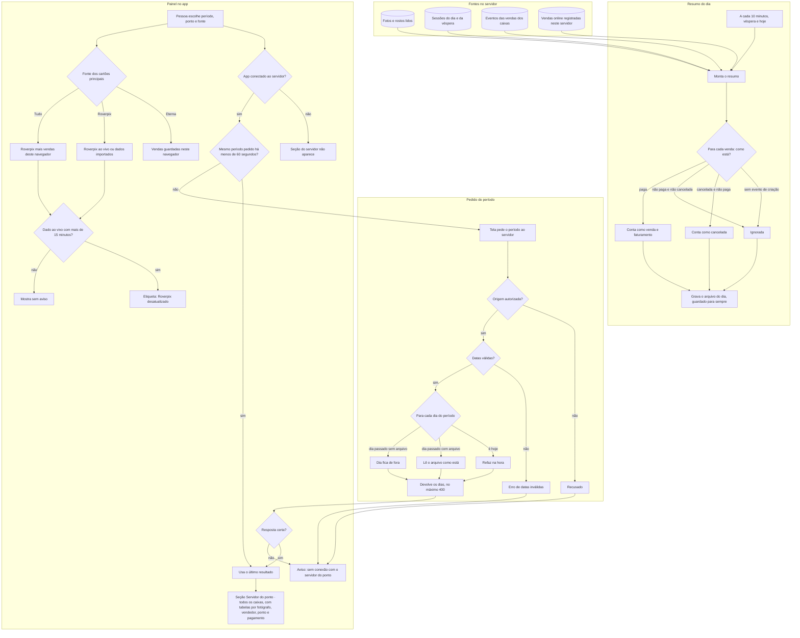

**Decisões**

| Decisão | Regra exata | Onde no código |
|---|---|---|
| Atualização do resumo | Véspera e hoje a cada 600 s; dias anteriores não são refeitos | `metricas_loop` |
| Arquivo do dia | `ponto/metricas/AAAA-MM-DD.json`, gravação atômica; o código não apaga | `metricas_gravar`, `MET_DIR` |
| Rota | `GET /metricas/dia?de=&ate=`; sem data = hoje; hoje é refeito; limite de 400 dias | `metricas_periodo`, `do_GET` |
| Fotos | `rostos.db`, por dia; sem linhas: soma das sessões | `metricas_dia` |
| Sessões | Exclui as removidas; venda de sessão de ontem conta para o fotógrafo | `metricas_dia` |
| Venda contada | Exige `criar` e `pagar`. Cancelada sem pagar vai para `canceladas` | `metricas_dia` |
| Paga e depois cancelada | Pelo código, continua contada como venda no resumo: o teste é "cancelada e não paga", e o cancelamento na Lista de vendas muda só o estado no navegador, sem evento `cancelar`. O evento só sai para pedido pendente. Não testado | `metricas_dia`, `pvCancelEv`, `sales-cancel` |
| Dia da venda | Lê a venda inteira se ela tem algum evento no dia, e soma sem filtrar pelo dia. Pelo código, venda com eventos em dois dias entra nos dois. Não testado | `_ev_ler`, `metricas_dia` |
| Impressões | Evento `impressao`: resultado `ok` soma em `impressoes`, demais em `impressoes_falhas` | `metricas_dia` |
| Vendas online | Só o arquivo local `galerias/vendas-online.jsonl`, sem as marcadas como teste. A API da nuvem não devolve vendas ao servidor | `vendas_ler`, `metricas_dia` |
| Conversão | Sessões com venda ÷ sessões; fotos vendidas ÷ fotos | `metricas_dia` |
| Ticket médio | Faturamento ÷ vendas | `metricas_dia` |
| Painel, seção do servidor | Só com `state.agent.on`; cache de 60 s por período | `srvMetPull`, `srvMetPainel`, `srvMetSoma` |
| Painel, cartões principais | Fonte `tudo`, `roverpix` ou `eterna`; a opção Eterna é rotulada "vendas deste computador" | `vPainel`, `painelFiltro`, `allSalesSim` |
| Roverpix | A cada 300 s, 30 dias; app recebe totais; etiqueta com mais de 15 min | `rover_loop`, `rover_data`, `applyLive`, `vPainel` |
| Métricas técnicas | `metricas.jsonl`, relido e podado para 3 dias; rota `/metricas` traz fila de rostos e uso da máquina | `metricas_carrega`, `metrica_grava`, `do_GET` |

### 19. Ciclo de vida de uma foto

Acompanha uma foto da chegada até a exclusão, com os prazos reais do código. O original no disco do servidor não tem prazo: só sai por pedido do cliente.

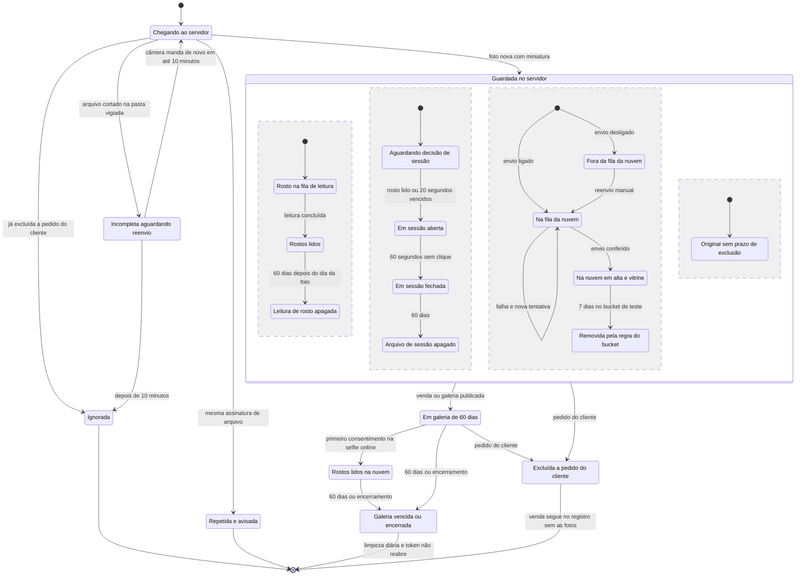

**Decisões**

| Decisão | Regra exata | Onde no código |
|---|---|---|
| Entradas | FTP próprio, pasta vigiada, FTP remoto e cartão | `FTPSession`, `pasta_vigiada`, `rftp_loop`, `scan_card` |
| Identidade da foto | Hash de conteúdo; os 12 primeiros caracteres viram o identificador | `ingest_file`, `quick_hash` |
| Excluída antes | Hash em `lgpd-excluidas.json`: não entra de novo | `ingest_file` |
| Arquivo cortado | Pasta vigiada espera 10 minutos e depois ignora | `pasta_vigiada`, `jpeg_completo` |
| Arquivo na origem | Pasta vigiada: fica onde está, sem prazo. FTP remoto: nada é apagado lá | `pasta_vigiada`, comentário de `rftp_loop` |
| Original no servidor | `inbox/AAAA-MM-DD/`, sem prazo: as únicas remoções do arquivo estão na exclusão a pedido | `ingest_file`, `lgpd_excluir`, `galeria_loop` |
| Miniatura | `thumbs/`, sem prazo | `ingest_file`, `lgpd_excluir` |
| Rostos locais | 60 dias contados pela pasta do dia; limpa ao ligar a leitura e uma vez por dia | `RETENCAO_DIAS`, `limpar_rostos`, `rostos_thread`, `galeria_loop` |
| Sessão | 60 s sem clique fecham; espera do rosto de 20 s desde a chegada | `SESS_PAUSA`, `SESS_ROSTO_ESPERA` |
| Arquivo de sessão | 60 dias | `SESS_RET_DIAS`, `sess_limpar` |
| Recorte | 2 dias, teto de 5 GB (`ETERNA_RECORTES_GB`), apagando os mais antigos | `REC_DIAS`, `REC_TETO_GB`, `limpar_recortes` |
| Validade da galeria | 60 dias a partir da criação; não aumenta em republicação | `GAL_DIAS`, `galNovo`, `gal_mesclar` |
| Arquivos da galeria no servidor | Originais de compradas e cortesias, e vitrines; saem na limpeza diária depois do vencimento, com registro que impede reabrir | `gal_processar`, `galeria_loop`, `lapide_gravar` |
| Rostos na nuvem | Só depois do primeiro consentimento; coleção apagada ao encerrar e na limpeza diária | `rosto`, `apagar_rostos`, `limpeza` em `app.py` |
| Registro da galeria na nuvem | Validade + 7 dias | `ttl_de` em `app.py` |
| Registros na nuvem | Eventos por 90 dias, consentimentos por 400 dias | `docs/NUVEM.md`, seção 4 |
| Bucket | Teste: 7 dias. Produção: 60 dias previstos no documento. A regra é configurada fora deste código | `docs/NUVEM.md`, seções 2 e 8.1 |
| Exclusão a pedido | Apaga original, miniatura, recorte, rostos, fila, alta e vitrine; encerra galerias; registro em `lgpd.log`; a venda fica | `lgpd_excluir` |
| Números do dia | Ficam depois que a foto sai | comentário antes de `VENDAS_DB` |

## O que ficou sem confirmar nesta leitura

- **Validade das fotos no bucket S3:** `template.yaml` não define regra de ciclo de vida. `NUVEM.md` cita 7 dias em teste e 60 em produção. A configuração real não foi conferida.
- **Nuvem em produção:** se a trava 409 do cartão e o valor de `CompraOnline` já foram implantados não dá para saber pelo repositório.
- **Motivos de parada da DNP:** o código lê códigos do Windows. Se a DS-RX1HS informa cada motivo não foi testado nesta leitura.
- **Situação de venda entre computadores:** não encontrei código que devolva ao navegador os eventos de venda enviados ao servidor. Pela leitura, um Checkout em outro navegador não vê a sessão como paga.

- Regra de expiração do bucket de produção, e se ela poupa a pasta `backup/`. Ela não está no código, e a própria pesquisa de 02/11 lista isso como não verificado.
- Restauração do backup: não há rotina no código, e a pesquisa de 02/11 diz que nunca foi testada.
- Publicação do site eterna.photo a partir do `main`: o código confirma só a origem do app; o `main` vem do documento de pedidos e do `CNAME` na raiz.
- Conexão da maquininha Imply sem a internet do venue: ela é avulsa, e a confirmação no app é manual.
- Versão e canal que rodam de fato nos servidores: sem acesso a eles nesta análise.
- CloudFront `fotos.eterna.photo`: script existe; `NUVEM.md` o marca como pendente. Ativação real não confirmada.
- Comportamentos marcados como "não testado" nas tabelas: lidos no código, sem execução.

## Outras divergências entre documentos e código

Em todos os casos abaixo, os diagramas seguem o código.

| Assunto | O documento diz | O código faz | Onde |
|---|---|---|---|
| O que sobe | Relatório de 31/10 e pesquisa de 02/11: sobem "as fotos vendidas" | Toda foto nova entra na fila, vendida ou não. `NUVEM.md` 3.3 está de acordo com o código | `ingest_file` |
| Tudo sem internet | Relatório de 31/10: tudo funciona sem internet | O app vem do eterna.photo e fica só na memória. Servidor reiniciado sem internet não abre telas novas | `H.app` |
| Fila sem internet | `NUVEM.md` seção 1: fotos esperam na fila e sobem sozinhas | Vale se o servidor ligou conectado. Ligado sem internet, o envio de fotos não tenta de novo e as fotos não entram na fila até o reenvio manual | `nuvem_loop`, `nuvem_enfileira` |
| Fila de vendas | Comentário do `pontoFlush`: "nunca descarta" | `pvPoda` tira eventos acima de 7 dias ou 2.000, com registro | `pvEvento`, `pvPoda` |
| Compra pela nuvem | Pesquisa de 02/11: "o cliente compra pela nuvem" | Compra online desligada; a API responde indisponível | `handler` em `app.py` |
| Login por e-mail | `DOCUMENTACAO-TECNICA`: entra com e-mail e código; hello@ como remetente | `MAIL_API` vazio: código nasce no navegador. O relatório de 31/10 já registra isso | `sendCode` |
| Prazo do original | `DOCUMENTACAO-TECNICA`, diagrama: acervo local de 30 dias | Sem prazo | `ingest_file`, `galeria_loop` |
| Arquitetura | `DOCUMENTACAO-TECNICA`: React e Vite, FastAPI, PostgreSQL, Redis, pyftpdlib | App em arquivo único e servidor em Python com SQLite e FTP próprio. O documento se apresenta como especificação de 26/10 | `index.html`, `eterna-agente.py` |
| Só versão liberada | Pesquisa de 02/11: desde 02/11 só entra versão liberada | Vale para o agente no canal estável. Vigia, instalação inicial e app vêm do `main`. `pedidos-do-eduardo-pos-v91` já registra o app | `instalar-servidor.ps1`, `iniciar-eterna.bat`, `H.app` |
| Plano de atualização | Plano do instalador: consulta a cada 30 min, pacote com o app, teste em porta livre, janela, volta sozinho, 3 versões | Só ao religar; só o programa; só compilação; sem janela e sem volta | `eterna-vigia.ps1` |
| Retenção de 60 dias | Comentário e documentos: leituras ficam 60 dias | Ao ligar, fotos do disco sem leitura voltam para a fila, inclusive as com mais de 60 dias. Pelo código, são relidas com o dia antigo e apagadas na limpeza seguinte. Não testado | `rostos_thread`, `leitor_loop`, `limpar_rostos` |
| Pausa da sessão | Relatório de 31/10: pausa de 20 s | 60 s na v91. O relatório é anterior | `SESS_PAUSA` |
| Selfie e fotos | Relatório de 31/10: achado pela selfie, vê só as próprias fotos | A v91 mudou: `lojaDele` só para menor e escola, segundo o plano de pedidos. Fluxo detalhado fora deste escopo | `docs/planos/2026-11-02-pedidos-do-eduardo-pos-v91.md` |
| Usuário do servidor | `CHECKLIST-SERVIDOR` passo 0 e 3: usuário eterna; passo 7: usuário de quem usa o computador | O instalador aceita qualquer perfil com a venv | `instalar-servidor.ps1` |

## Diagramas que ainda podemos construir

| Diagrama | Para que serve | Depende de |
|---|---|---|
| Instalador Linux, passo a passo | Guiar a criação do instalador | Decidir a distribuição e testar a DNP em bancada |
| Rede e portas do venue | Mostrar quem fala com quem, por qual porta, na VLAN e na VPN | Desenho final do FortiGate |
| Modelo de dados | Tabelas e relações de `vendas.db`, `estado.db` e DynamoDB | Pode fazer agora |
| Dia de operação, por pessoa | Fotógrafo, vendedor, caixa e supervisor lado a lado, da abertura ao fechamento | Pode fazer agora |
| Contingências | O que fazer quando caem Wi-Fi, internet, servidor, impressora ou maquininha | Decidir o caminho do 5G |
| Restauração do backup | Do servidor perdido até voltar a vender, com o tempo medido | Fazer o primeiro teste de restauração |
| Login novo por tela | O que muda em cada tela com o servidor exigindo login | Aprovar o plano do login |
