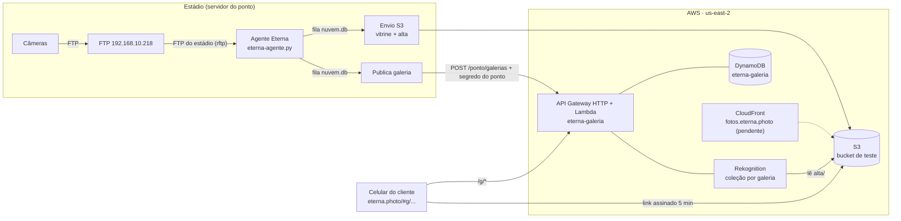

# Eterna na nuvem: fotos online, galeria do cliente e teste de estanque

Documento de operação e reconstrução da parte de nuvem do Eterna. O desenho e as decisões estão no plano [`planos/2026-10-28-v85-nuvem-e-ponta-da-venda.md`](planos/2026-10-28-v85-nuvem-e-ponta-da-venda.md); aqui está **o que foi construído, onde está e como recriar do zero**. Responsável: TI Maracatour (Ronaldo). Início: 28 e 29/10/2026.

## 1. Princípio
O estádio é autossuficiente e a nuvem é uma extensão.
- **No Maracanã, sem depender de internet nem da AWS:** recebimento das fotos (FTP), selfie no balcão (reconhecimento local, YuNet + SFace), escolha, pagamento na maquininha Imply, impressão na DNP e registro da venda.
- **Na nuvem (AWS), o que acontece depois que o cliente vai embora:** galeria pelo QR, selfie no celular, download das compradas, eventos e, no futuro, compra online, retargeting e retenção de 60 dias.
- Se a internet cair, o estádio continua vendendo. As fotos e as galerias esperam numa fila no servidor do ponto e sobem sozinhas quando a conexão volta.



## 2. Conta e recursos na AWS

| Recurso | Nome / valor | Como foi criado | Observação |
|---|---|---|---|
| Conta | conta da TI Maracatour (número fora deste documento) | já existia | o plano da conta só libera **us-east-2 (Ohio)**; São Paulo exige mudar o plano |
| Bucket S3 | `eterna-teste-<número da conta>` (us-east-2) | script `eterna-setup.sh` no CloudShell (seção 8.1) | privado (Block Public Access), SSE-S3, **apaga tudo com 7 dias** (bucket de teste), tags `projeto=eterna`, `uso=teste-estanque` |
| CORS do bucket | GET/HEAD de qualquer origem | CloudShell (seção 8.2) | só permite o navegador baixar; a leitura continua exigindo link assinado |
| Política IAM | `EternaAgenteTeste` | `eterna-setup.sh` | S3 Put/Get/Delete só neste bucket; ListBucket do bucket; Rekognition só em coleções `et-*` + DetectFaces/CompareFaces/ListCollections |
| Usuário IAM | `eterna-agente-teste` | `eterna-setup.sh` | chave criada no console e salva no ponto com `aws configure --profile eterna-teste`; trocada antes da produção |
| Certificado | `fotos.eterna.photo`, ACM em **us-east-1** (exigência do CloudFront) | `aws acm request-certificate` (seção 8.3) | ARN no CloudShell (`cert-arn.txt`); aguardando o CNAME de validação na GoDaddy |
| CloudFront | `fotos.eterna.photo` | `servidor/nuvem/cloudfront-fase2.sh` (pendente) | só entrega com link assinado; chave pública no CloudFront, privada no ponto; OAC + política do bucket com `SourceArn` |
| Stack CloudFormation | `eterna-galeria` (us-east-2) | `sam deploy` de `servidor/galeria-nuvem/template.yaml` | cria a tabela, a função, o papel IAM da função e a API |
| DynamoDB | `eterna-galeria` | stack | sob demanda, TTL em `ttl`, recuperação de 35 dias (PITR), criptografado |
| Lambda | `eterna-galeria` (Python 3.12, arm64, 512 MB, 30 s) | stack | código `servidor/galeria-nuvem/app.py` |
| API Gateway HTTP | `https://whe2hyve2j.execute-api.us-east-2.amazonaws.com` (saída `EnderecoApi`, criada em 29/10 13:05) | stack | CORS para `https://eterna.photo` e `http://127.0.0.1:8765`; limite de 50 req/s (pico de 100) |

### DNS (GoDaddy, zona `eterna.photo`)
Só se **adicionam** registros; nada do site (`@`, `www` do GitHub Pages, MX, TXT) é alterado.

| Tipo | Nome | Valor | Para quê | Situação |
|---|---|---|---|---|
| CNAME | `_fbfea1ceb4d0fac98c1da85a30dfd39b.fotos` | `_3d3491aa7db623405103d28b49d5e860.wzccmgtwzk.acm-validations.aws.` | validar o certificado | pedido ao Eduardo |
| CNAME | `fotos` | domínio `dxxxx.cloudfront.net` impresso pela fase 2 | servir as fotos | depois da fase 2 |
| CNAME | `api` (+ validação) | a definir | `api.eterna.photo` | futuro |

## 3. Servidor do ponto (agente)

### 3.1 Variáveis de ambiente novas

| Variável | Exemplo | Efeito |
|---|---|---|
| `ETERNA_NUVEM` | `s3` | liga o envio das fotos para a nuvem |
| `ETERNA_BUCKET` | `eterna-teste-<número da conta>` | bucket |
| `ETERNA_AWS_PERFIL` | `eterna-teste` | perfil da AWS CLI com a chave (nunca no código) |
| `ETERNA_AWS_REGIAO` | `us-east-2` | região do bucket (padrão us-east-2) |
| `ETERNA_NUVEM_ENVIADORES` | `4` | envios em paralelo |
| `ETERNA_CDN` | `fotos.eterna.photo` | quando houver CloudFront, os links saem por ele |
| `ETERNA_CDN_CHAVE_ID` | id da chave pública impresso pela fase 2 | assinatura dos links do CloudFront |
| `ETERNA_GALERIA_API` | `EnderecoApi` da stack | publica cada galeria na nuvem |
| `ETERNA_GALERIA_PUBLICA` | endereço público | só para o teste com porta pública (seção 6.3) |
| `ETERNA_TESTE_CARGA` | `1` | libera `/rostos/projecao` e `/nuvem/link` (só para testes) |

### 3.2 Arquivos em `~/Eterna`

| Arquivo | Conteúdo | Sigilo |
|---|---|---|
| `nuvem.db` | SQLite: tabela `fila` (pid, arquivo, entrou, tentativas, prox, feito, bytes, md5_alta, md5_vitrine, erro) e `galerias` (token, prox, tentativas, feito, erro) | interno |
| `nuvem-pausa` | se existir, nada sobe (simula queda de internet nos testes) | — |
| `nuvem-segredo.txt` | segredo do ponto para publicar galerias na API (na nuvem fica só o SHA-256) | **sigiloso**, criado com permissão 600 |
| `cloudfront-privada.pem` | chave privada RSA 2048 que assina os links do CloudFront | **sigiloso**, nunca sai do ponto |
| `cloudfront-publica.pem` | chave pública (vai para o CloudFront) | público |
| `metricas.jsonl` | uma linha por foto recebida e lida, com `nuvem`, `nuvem_ms`, `nuvem_bytes`, `nuvem_md5` | interno |

### 3.3 Envio das fotos (parte E)
1. `ingest_file` grava a foto e chama `nuvem_enfileira(pid, arquivo)`, que faz `INSERT OR IGNORE` na `fila`.
2. `nuvem_loop` (1 thread) separa até 40 pendentes por segundo para `ETERNA_NUVEM_ENVIADORES` threads.
3. Cada envio:
   - `nuvem_versoes` gera a **alta** (lado maior 3000 px, JPEG 88, sem EXIF e GPS, orientação aplicada) e a **vitrine** (900 px com marca d'água, `_vitrine`);
   - `put_object` em `alta/<pid>.jpg` e `vitrine/<pid>.jpg` com `Content-MD5`: o S3 recusa se chegar diferente, e o ETag devolvido é conferido.
4. **Sucesso:** grava `feito`, os bytes e os MD5. **Falha:** tenta de novo depois de 5, 10, 20... até 300 s.
5. **O original não sobe** (plano D2). Cerca de 0,9 MB por foto contra 4 a 5 MB do original.

### 3.4 Links e plano B
- `nuvem_link(pid, v)` devolve `{url, reserva}`. `url` é o CloudFront assinado (canned policy, RSA-SHA1, 5 min) quando `ETERNA_CDN` está configurado; `reserva` é o S3 assinado (SigV4, 5 min), pelo endereço **regional** (`s3.us-east-2.amazonaws.com`). O endereço global é recusado fora da us-east-1.
- **Sentinela (`nuvem_saude`):** a cada 2 min grava ou lê `saude/ok.txt` pelo S3 e pelo CloudFront. Expõe `s3_ok`, `cdn_ok` e as falhas em `/status`, e avisa no console.
- A rota `/g/<t>/foto` do agente responde **302 para a nuvem** quando a foto já subiu (`nuvem_tem`); se não, serve do disco.

### 3.5 Publicação das galerias (parte F)
- Ao publicar uma galeria (`POST /galerias/publicar` vindo do app), o agente grava o manifesto local e chama `nuvem_galeria_enfileira(token)`.
- `nuvem_galerias_loop` envia o manifesto para `ETERNA_GALERIA_API/ponto/galerias`, com o cabeçalho `X-Eterna-Ponto: <segredo>`. Em caso de falha, tenta de novo com espera crescente.
- **Encerrar** (`POST /galerias/encerrar`) também entra nessa fila: o manifesto vai com `encerrada: true` e a nuvem tira a galeria do ar e apaga os rostos dela.
- **Desligado por padrão:** sem `ETERNA_GALERIA_API`, nenhuma galeria sai do ponto.

### 3.6 FTP do estádio
- `rftp_list` entende servidores sem MLSD (IIS): lista por NLST e entra nas subpastas (uma por fotógrafo).
- Desde a v81, só vale a subpasta de **fotógrafo cadastrado**.
- **Foto cortada no servidor não é baixada:** `jpeg_completo` falha, ela espera o reenvio e é ignorada depois de 5 voltas.

## 4. API da galeria na nuvem (`servidor/galeria-nuvem`)
Mesmo contrato das rotas `/g/*` do agente (`galeria-qr-fase1.md`), para o app não mudar de tela.

| Rota | Faz |
|---|---|
| `GET /g/codigo/<XXXX-XXXX>` | código curto → token (30 por minuto por IP) |
| `GET /g/<token>/info` | tipo, menor, validade, estado, `compra` |
| `POST /g/<token>/rosto` | `{imagem, consentimento:true, versao, idioma}` → `{acesso, exp, galeria}` ou `{motivo: sem_rosto, nao_encontrado, bloqueado}`; **503 `processando`** enquanto a leitura dos rostos não termina ou o teto do dia foi atingido (não conta como tentativa) |
| `POST /g/<token>/galeria` | `{acesso}` → galeria com links novos |
| `POST /g/<token>/pagamento` | **503 `compra_indisponivel`** enquanto `CompraOnline=0` |
| `POST /ponto/galerias` | `{manifesto}` com `X-Eterna-Ponto` → grava. **Não lê rostos.** Com `encerrada: true`, apaga a coleção e o código curto |
| (agendada) `{"limpeza": true}` | uma vez por dia: apaga a coleção de toda galeria vencida, encerrada ou sem registro |

**Regras de acesso:**
- A selfie é comparada pelo Rekognition **só com a coleção da galeria**, `et-maracana-<HMAC-SHA256(token)[:16]>`: o token não vai para a AWS.
- **Rostos só depois do consentimento.** Publicar não lê nada. A primeira selfie com consentimento marca `cons` e lê as fotos que faltam com o tempo que sobra da chamada (o API Gateway corta em 30 s). O que não couber continua em segundo plano (`{"indexar": token}`), que só roda em galeria com `cons`.
- **Leitura sem repetir:** o progresso (`idx`) é gravado a cada foto e uma trava (`lk`) impede duas leituras da mesma galeria ao mesmo tempo. Uma foto nunca é paga duas vezes.
- **Rostos com prazo:** a coleção é apagada quando a galeria é encerrada no ponto (na hora) ou vence (limpeza diária). Coleção sem registro também é apagada.
- **Tetos de custo:** até 600 fotos lidas por galeria, `LimiteLeiturasDia` (15 mil) leituras e `LimiteBuscasDia` (10 mil) selfies por dia na conta. Passou do teto, o cliente vê "processando" e nada mais é cobrado. Alerta de orçamento por e-mail (`EmailOrcamento`, `OrcamentoMensalUsd`, padrão US$ 300): 80% do gasto real e 100% da previsão.
- **Sessão de adulto:** semelhança ≥ 85 em qualquer foto libera a sessão inteira.
- **Escola e sessão de menor:** ≥ 95, e só as fotos em que a criança aparece.
- 5 selfies erradas por (IP, galeria) bloqueiam por 15 min.
- **Escola:** no máximo 2 crianças diferentes por IP em 24 h e 60 acessos por hora por galeria.
- O acesso vale 1 h.
- **Comprada nunca regride, a validade nunca aumenta e a galeria encerrada não volta.** São as mesmas regras do `gal_mesclar` do agente.

**Modelo no DynamoDB** (`pk`, `sk`, `ttl`):

| pk | sk | Conteúdo | Expira |
|---|---|---|---|
| `GAL#<token>` | `M` | `m` (manifesto JSON) | validade + 7 dias |
| `IDX#<token>` | `M` | `cons` (houve consentimento), `idx` (pids lidos), `lk` (trava) | validade + 7 dias; apagado com a coleção |
| `COL#<coleção>` | `M` | `token`, `exp`: liga a coleção à galeria para a limpeza | apagado com a coleção |
| `COD#<codigo>` | `M` | `token` | igual à galeria |
| `ACE#<acesso>` | `M` | `token`, `pids`, `exp` | 1 h |
| `FAL#<iphash>#<token>` | `M` | falhas e bloqueio | 1 dia |
| `EVA#<iphash>#<token>` | `M` | crianças abertas por IP (escola) | 24 h |
| `LIM#<chave>#<janela>` | `M` | contador de limite (inclui `IDX` e `BUS`, os tetos do dia) | 2 janelas |
| `EVT#<token>` | `<iso>#<rand>` | evento: `tipo`, `ip` (hash com sal do dia), extras | 90 dias |
| `CON#<token>` | `<iso>#<rand>` | consentimento: titular ou responsável, versão, idioma | 400 dias |

Eventos registrados: `qr_aberto`, `codigo_digitado`, `selfie_ok`, `selfie_nao`, `selfie_sem_rosto`, `selfie_processando`, `selfie_teto`, `galeria_vista`, `compra_tentada`.

Teste local sem AWS e sem custo: `python servidor/galeria-nuvem/teste_local.py servidor/galeria-nuvem` (consentimento, leitura interrompida e retomada, encerrar, limpeza e teto).

## 5. App (`index.html`)
- `GAL_API` = `https://whe2hyve2j.execute-api.us-east-2.amazonaws.com` (até existir `api.eterna.photo`) define a base das rotas da galeria fora do estádio: `galApi()` usa `window.ETERNA_AGENTE` (porta pública de teste), depois `GAL_API` em https e, por último, o agente local.
- `galUrl(u)` aceita link absoluto (S3 ou CloudFront) ou relativo (agente).
- `galBase()` monta o link do QR: `state.agent.galPublica` (vindo de `/status`), depois `window.ETERNA_AGENTE` e, por último, `https://eterna.photo/#g/`.
- `galNuvem()` diz se a galeria está sendo atendida pela nuvem. Nesse caso o consentimento usa `gq_consentSelfNuvem` / `gq_consentKidNuvem`, que citam a AWS nos Estados Unidos e o apagamento dos rostos, e a versão gravada é `GQ_VERSAO-aws`.
- Sem essas configurações, o comportamento é igual ao da v82.

## 6. Ferramentas de teste
### 6.1 Teste de estanque (`agente/teste-carga.py`)
- `enviar --nomes carlos,klassius,...` usa os fotógrafos cadastrados, porque o FTP do estádio só aceita a pasta de fotógrafo cadastrado.
- Relatório com a **seção Nuvem**: tempo até ficar online (mediana, 95% e pior), fotos conferidas pelo MD5, fila, falhas, queda de internet simulada e custo projetado.
- Foto que o Eterna já tinha **não conta como perdida**. Picos falsos de rede no reinício são descartados.
- `nuvem-links` monta uma página com o QR de fotos sorteadas, para abrir no celular pelo 4G, com troca automática para o S3.

### 6.2 Resultados
| Data | Teste | Resultado |
|---|---|---|
| 28/10 | 587 fotos vendidas, FTP da 218, 50 min | 587/587, acurácia 95,4%, sessão pronta em 17,9 s (95%), busca 0,11 s |
| 29/10 | R1 com nuvem, sessões reais do HD, 10 min | 259/259, 0 perdidas, acurácia 96,8%, **foto online em 3,0 s (95%)**, **85/85 conferidas pelo MD5** |

### 6.3 Porta pública (`agente/porta-publica.py`)
Só para demonstração, antes da API na nuvem existir.
- Filtra e deixa passar só o app (`/`, `img/`, `vendor/`, `sprites/`) e `/g/*`. Todo o resto responde 404.
- Injeta `window.ETERNA_AGENTE` e é exposta por Cloudflare Tunnel, ligado pelo responsável da TI.
- Desligada em 29/10. **Não faz parte da arquitetura final.**

## 7. Dimensionamento e custos para 15 mil fotos por dia
Estimativa com preços públicos da us-east-2; conferir na calculadora da AWS. Base: 15 mil fotos/dia, 7 fotógrafos, 8 h.

| Peça | Volume diário | Limite que importa | Custo |
|---|---|---|---|
| **Internet do estádio (subida)** | ~17 GB/dia (1,15 MB por foto, alta + vitrine) | ~5 Mbit/s de média em 8 h; pico de ~15 Mbit/s. **É o gargalo real:** se a subida for menor, a fila do ponto cresce e esvazia depois do expediente | — |
| S3 | 30 mil PUT/dia; ~1 TB guardado em 60 dias | sem limite prático | ~US$ 23/mês de espaço + ~US$ 5/mês de PUT |
| Rekognition: leitura das fotos | só fotos de galeria com selfie. Ex.: 30% das sessões com galeria e metade delas com selfie ≈ 2.250 fotos/dia | teto `LimiteLeiturasDia` = 15 mil (um dia inteiro); cota de transações por segundo da conta (conferir no Service Quotas) | ~US$ 2/dia; **no máximo US$ 15/dia** pelo teto |
| Rekognition: selfies | ~1.500/dia no exemplo | teto `LimiteBuscasDia` = 10 mil | ~US$ 1,50/dia; no máximo US$ 10/dia |
| Rekognition: rostos guardados | somem no vencimento da galeria | — | centavos |
| Lambda + API Gateway | algumas dezenas de milhares de chamadas/dia | 50 req/s (pico 100) na API; concorrência da conta | centavos a poucos dólares/mês |
| DynamoDB | sob demanda | sem limite prático | centavos/mês |
| CloudFront | downloads | franquia de 1 TB e 10 milhões de requisições/mês | ~zero |

**Plano da conta (29/10):** plano gratuito da AWS, com crédito de US$ 140 e prazo até 29/04/2027. Quando o crédito acaba, o acesso aos serviços é cortado. Na homologação os tetos ficam baixos (1.000 leituras e 1.000 selfies por dia, no máximo ~US$ 2/dia de Rekognition; orçamento de US$ 50). **Antes da produção é obrigatório passar a conta para o plano pago**, senão a galeria na nuvem para quando o crédito acabar.

**No exemplo, ~US$ 130/mês; o pior caso pelos tetos fica em ~US$ 780/mês.** O alerta de orçamento avisa antes. O que ainda falta medir é o lado do estádio (subida da internet, disco e CPU do servidor do ponto num dia cheio), que é o objetivo do teste de estanque completo (R2/R3).

## 8. Como recriar do zero
### 8.1 Bucket e usuário do agente (CloudShell, us-east-2)
Script `eterna-setup.sh` (no histórico da conversa de 29/10 e reproduzido aqui):
1. `create-bucket`, `put-public-access-block` (tudo bloqueado), `put-bucket-encryption` (AES256);
2. `put-bucket-lifecycle-configuration` (Expiration 7 dias e AbortIncompleteMultipartUpload 1 dia; em produção, 60 dias);
3. `put-bucket-tagging`;
4. `iam create-policy EternaAgenteTeste` com a política da seção 2;
5. `iam create-user eterna-agente-teste`;
6. `attach-user-policy`.

A chave de acesso é criada pelo console e configurada no ponto com `aws configure --profile eterna-teste`.

### 8.2 CORS
```bash
aws s3api put-bucket-cors --bucket <bucket> --cors-configuration '{"CORSRules":[{"AllowedMethods":["GET","HEAD"],"AllowedOrigins":["*"],"AllowedHeaders":["*"],"MaxAgeSeconds":3600}]}'
```
### 8.3 Certificado e CloudFront
```bash
aws acm request-certificate --region us-east-1 --domain-name fotos.eterna.photo --validation-method DNS --query CertificateArn --output text | tee cert-arn.txt
aws acm describe-certificate --region us-east-1 --certificate-arn $(cat cert-arn.txt) --query 'Certificate.DomainValidationOptions[0].ResourceRecord'
# CNAME de validação na GoDaddy, depois:
curl -fsSL https://raw.githubusercontent.com/dudurezende10/eterna/main/servidor/nuvem/cloudfront-fase2.sh -o fase2.sh && bash fase2.sh
```
O script espera o certificado, cria a chave pública, o grupo de chaves, o OAC, a distribuição (CachingOptimized, só HTTPS, TLS 1.2+) e a política do bucket. Ele imprime o CNAME `fotos` e o `ETERNA_CDN_CHAVE_ID`.

### 8.4 Galeria na nuvem
Ver [`servidor/galeria-nuvem/README.md`](../servidor/galeria-nuvem/README.md): um `sam deploy` no CloudShell, com o bucket e o SHA-256 do segredo do ponto.

### 8.5 Agente
```bash
ETERNA_NUVEM=s3 ETERNA_BUCKET=<bucket> ETERNA_AWS_PERFIL=eterna-teste ETERNA_AWS_REGIAO=us-east-2 \
ETERNA_GALERIA_API=<EnderecoApi> [ETERNA_CDN=fotos.eterna.photo ETERNA_CDN_CHAVE_ID=<id>] python eterna-agente.py
```
Dependências: `pip install boto3 cryptography` (além de opencv-python-headless, numpy e psutil).

## 9. Para apagar tudo (fim do teste)
1. `aws cloudformation delete-stack --stack-name eterna-galeria --region us-east-2` (a tabela e a função somem);
2. apagar as coleções `et-maracana-*` do Rekognition (`list-collections` + `delete-collection`);
3. esvaziar e apagar o bucket;
4. desativar a chave e apagar o usuário `eterna-agente-teste` e a política;
5. desativar a distribuição do CloudFront e apagar o certificado;
6. remover os CNAME da GoDaddy.

## 10. Antes da produção
As pendências operacionais e de segurança da homologação ficam fora do repositório, no servidor do ponto (`~/Eterna/NUVEM-pendencias.md`). Este repositório é público.
