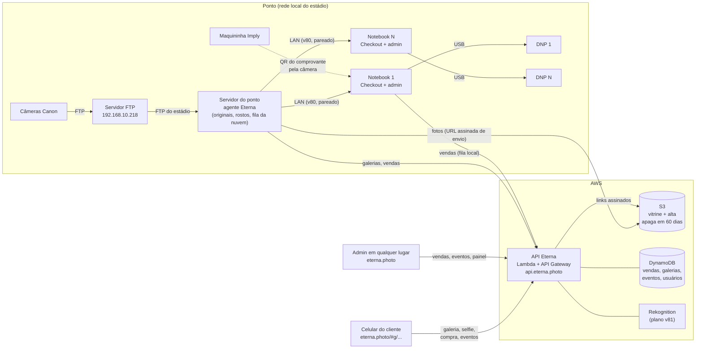

# Plano v85: fotos na nuvem e a ponta da venda (maquininha Imply, impressão DNP, venda acompanhada, eventos)

Autor: Ronaldo (TI Maracatour), 28/10/2026. Este plano parte da v81 (`d3d049c`) e do teste de estanque de 28/10, em que 587 de 587 fotos chegaram pelo FTP do estádio e a acurácia foi de 95,4%. Não mexe em código; descreve o que falta para o Tour vender de verdade, com várias pessoas vendendo ao mesmo tempo.

## Objetivo
Fechar o ciclo da venda no Tour:
1. O cliente escolhe as fotos no Checkout, na tela espelhada do notebook do vendedor.
2. O vendedor acompanha a escolha ao vivo.
3. O cliente paga na maquininha da Imply, com o valor digitado, sem TEF.
4. O pedido da Imply fica ligado à venda do Eterna.
5. As fotos impressas saem na DNP do próprio notebook, cada uma identificada com a venda.
6. O QR da tela final abre a galeria **no celular do cliente**, onde ele baixa o que comprou e compra o resto online.
7. Tudo fica registrado: as vendas de todos os notebooks num lugar só, e os eventos da galeria (QR aberto, foto vista, foto baixada).
8. Os fundos de IA saem a custo zero na prévia, e o provedor da foto final comprada é escolhido por teste comparativo (seção "Fundos de IA").

## Como a operação vai funcionar
1. O cliente termina o Tour. O fotógrafo já enviou as fotos pelo FTP; elas chegam ao servidor do ponto, que lê os rostos.
2. O vendedor clica em **Abrir Checkout**. A janela do cliente vai para o segundo monitor, virada para o cliente. A janela do admin continua com o vendedor.
3. O cliente olha para a câmera e a sessão abre. Ele marca ✓ ou ✗ em cada foto e escolhe o pacote. O vendedor vê na tela dele, ao vivo, a foto que o cliente está olhando, as escolhidas, o pacote e o total, e vai conversando: "essa ficou ótima".
4. O cliente escolhe **Cartão ou PIX** e a tela mostra "Pague na maquininha: R$ X". A venda fica **aguardando maquininha**.
5. O vendedor digita o valor na maquininha da Imply. Aprovado, **aproxima o comprovante da câmera** do notebook: o Eterna lê o QR com o pedido da Imply, grava na venda e marca como paga.
6. O Eterna publica a galeria e manda imprimir as fotos impressas do pacote na DNP do notebook. Cada foto sai com uma faixa fina com o código da venda e o número da foto (2/5).
7. A tela do cliente mostra o QR. No celular, ele abre a galeria, baixa as compradas e pode comprar as outras.
8. Cada passo fica registrado: a venda e o pedido Imply no banco central, as impressões, os acessos à galeria e os downloads.

## Achados no código (v81) que mudam o desenho
1. **O eterna.photo é só o app (GitHub Pages). Foto, galeria e venda ficam no computador do agente.** O QR não abre no celular: a galeria mostra "Suas fotos estão chegando" (limitação já registrada em `galeria-qr-fase1.md`). O adaptador `Repositorio` existe, mas só `RepositorioLocal` está implementado; `ETERNA_REPO=s3` levanta `NotImplementedError`.
2. **As vendas ficam no `localStorage` (`eterna.sim.v1`) de cada navegador e de cada origem.** `127.0.0.1:8765` e `eterna.photo` não veem as mesmas vendas, e outro notebook não vê nada. O banco compartilhado (`claude.use('db')`) não sincroniza vendas.
3. **Cartão e PIX ficam "pagos" na hora em que o cliente toca no botão** (`lojaPay`), sem ninguém confirmar. Só Dinheiro passa por "aguardando caixa" (v79). Não há campo para pedido Imply, NSU ou autorização. O TEF do balcão é simulado (`caixa-tef` gera um NSU aleatório).
4. **Nada imprime.** "Receber e imprimir", `dinConfirmar` e `caixa-reprint` só mostram "Imprimindo." e baixam o estoque. O único `print()` é o do QR de grupo. As impressas são "as primeiras do pacote": não há escolha de quais.
5. **O vendedor não acompanha a venda.** A janela do Checkout (`lojaJanela`) e a do admin conversam só pelo evento `storage` do SIM. O carrinho (`state.kiosk`: etapa, pacote, pagamento) fica na memória da janela do cliente, e o admin só redesenha quando muda `simResumo()`.
6. **Não há registro de eventos da galeria.** O agente grava só `consentimentos.jsonl` e `vendas-online.jsonl`. O funil "viram" do Painel vem da Roverpix e fica `null` para o Eterna.
7. **O pagamento online é simulado** (`PagamentoSimulado`, sempre aprovado, `teste:true`); o webhook responde 501.
8. **O app não lê QR.** `vendor/qrcode` só gera. O `BarcodeDetector` do Chrome **não existe no Windows**, então a leitura precisa de biblioteca (jsQR, Apache-2.0) em `vendor/`.
9. **A busca de rosto só aceita a própria máquina do agente** (`origem_local`, v77). Um notebook de Checkout em outro computador é recusado (confirmado no teste de estanque: 403 em todas as buscas pela rede). O v80 trata disso com pareamento.
10. **O login da equipe é simulado** (o código aparece na tela). Uma API na nuvem com vendas e fotos não pode confiar nisso.

## Arquitetura proposta



- **Servidor do ponto:** um agente só recebe as fotos, guarda os originais, lê os rostos uma vez e publica na nuvem. É o 192.168.10.218 ou um mini PC dedicado.
- **Notebooks:** são terminais do v80. Abrem o app pelo servidor do ponto na rede, com pareamento, e imprimem na DNP ligada neles.
- **Nuvem:** guarda as versões web das fotos e as galerias, atende o celular do cliente, centraliza as vendas e os eventos. O original nunca sai do estádio.

## Volume e custo (15 mil fotos por dia, aproximado; conferir na calculadora da AWS)

| | Todas as fotos | Só sessões com galeria (padrão D3, ~30%) |
|---|---|---|
| Por foto | vitrine 900 px (~0,15 MB) + alta 3000 px (~1 MB) | igual |
| Por dia | ~17 GB | ~5 GB |
| 60 dias guardados | ~1 TB | ~0,3 TB |
| Upload médio do estádio (8 h) | ~5 Mbit/s | ~1,5 Mbit/s |
| Armazenamento S3 (EUA / São Paulo) | ~US$ 23 / ~US$ 41 por mês | ~US$ 7 / ~US$ 12 por mês |

Os originais de 2 a 4 MB, que somariam 30 a 57 GB por dia e 8 a 16 Mbit/s constantes, **não sobem**. Ficam no servidor do ponto, que imprime e faz o Photoroom. A alta de 3000 px é a foto digital entregue ao cliente.

Outros custos mensais estimados:
- Saída de dados (downloads e vitrines vistas): ~US$ 10–40, conforme o uso.
- API e banco: < US$ 10.
- Rekognition: teto do v81, de US$ 4 por dia, cerca de US$ 120 por mês no máximo.

**Total estimado: US$ 50 a 200 por mês.**

## Escopo (em ordem de implementação; cada parte se testa sozinha)

### Etapa 1: ponta da venda num notebook (sem nuvem; pode começar já)
- **A. Maquininha Imply e vínculo do pedido.**
  - Cartão e PIX na Loja passam a `aguardando` (estado novo `aguardando_pos`), como o Dinheiro da v79. Nada é publicado nem impresso antes da confirmação.
  - No admin, um painel "Aguardando maquininha" (junto do `dinPainel`) com Confirmar e Cancelar.
  - Confirmar abre a câmera para ler o QR do comprovante (jsQR). O campo também aceita o pedido digitado: 16 caracteres, maiúsculas, sem espaços, com máscara 4-4-4-4.
  - Um pedido Imply não pode ser usado em duas vendas: a segunda tentativa é recusada com o número da venda que já o tem.
  - A venda grava `pos: {pedido, metodo, parcelas, lido_por, em, por}`. A Lista de vendas e o CSV ganham as colunas `pedido_imply`, `metodo`, `parcelas`.
  - A tela final do cliente mostra o **código curto da venda** (ex.: `E-7K3Q`), que o vendedor pode digitar no campo de referência da maquininha, se a Imply tiver esse campo (a confirmar).
- **B. Vendedor acompanhando ao vivo.**
  - A janela do Checkout publica o estado num `BroadcastChannel('eterna-loja')`, a cada mudança e a cada 5 s. O estado inclui: etapa, sessão, foto em tela, escolhidas, fundos de IA, pacote Ideal, pacote escolhido, total, forma de pagamento, idioma e segundos parados.
  - O admin ganha um painel lateral "Venda em andamento": foto atual grande, miniaturas das escolhidas, carrinho linha a linha e total. Só leitura nesta etapa.
  - Na etapa de pagamento, o painel mostra o botão que leva ao Confirmar da maquininha.
  - O painel some quando a janela do Checkout fecha (sem sinal por 15 s).
- **C. Impressão na DNP do notebook.**
  - Pelo navegador, como no v80 D10: página 102×152 mm, uma foto por página, Chrome do notebook com `--kiosk-printing`, a DNP como impressora padrão e papel 10×15 no driver. **Substitui a ASK-400 do v80; o resto do D10 vale.**
  - Imprime o original com o ajuste da venda, até `prints`, das escolhidas, com as favoritas primeiro. O vendedor pode trocar quais antes de imprimir.
  - **Faixa de identificação** dentro dos 10×15 (D6): código da venda, posição (2/5), data e um QR pequeno da galeria.
  - "Saiu certo", "Não saiu" e "Reimprimir" (com motivo). O registro `impressoes: [{em, por, pids, motivo}]` vai na venda. O estoque baixa no "Saiu certo".
  - A impressão só libera com a venda paga (Dinheiro confirmado ou maquininha confirmada).
  - Um atalho de Chrome por notebook ("Eterna Checkout") com as flags certas, no padrão do `iniciar-eterna.bat`.

### Etapa 2: vários notebooks no mesmo ponto (v80 adaptado)
- **D. v80 partes A a D** (segurança da rede, pareamento, feed do ponto, vendas no agente), como estão no plano.
- **Muda em relação ao v80:**
  - cada notebook é ao mesmo tempo terminal (`checkout`) e caixa (`equipe`) da sua própria venda;
  - a impressão é a da parte C, no próprio notebook, e não num caixa central;
  - a reserva "imprimindo" (v80 D12) só vale se houver caixa central.
- A tela "Vendas ao vivo" (v80 E) continua útil para o supervisor.

### Etapa 3: nuvem
- **E. Bucket e publicação.**
  - Bucket S3 privado por venue (`eterna-<venue>-fotos`), com prefixos `vitrine/`, `alta/` e `galerias/<token>/`.
  - Criptografia SSE-S3 e Block Public Access ligado.
  - Regra de ciclo de vida que **apaga com 60 dias** (`RETENCAO_DIAS`) e versionamento desligado.
  - O agente do ponto gera a vitrine (900 px, com marca d'água, como hoje) e a alta (3000 px, qualidade 88, sem EXIF de câmera e GPS).
  - Fila persistente `nuvem_fila` no SQLite do agente. O envio usa **URL assinada de PUT pedida à API**: o agente não guarda chave da AWS, só o token do aparelho. Novas tentativas com espera crescente.
  - `/status` mostra fila, atraso e erro. Alerta no admin se o atraso passar de 10 min.
  - `RepositorioS3` implementa a interface `Repositorio` que já existe.
- **F. API e galeria na nuvem.**
  - `api.eterna.photo`: AWS Lambda (Python 3.12) atrás do API Gateway HTTP.
  - As rotas `/g/*` de hoje (`info`, `codigo`, `rosto`, `galeria`, `foto`, `pagamento`) passam para a API com o mesmo contrato. O app troca a base com `GAL_API` e não muda de tela.
  - Links de foto são URLs assinadas do S3 que valem 5 min. A alta só sai para foto `comprada` ou `cortesia`.
  - A selfie na galeria segue o v81 D3 (CompareFaces só dentro das fotos da galeria, teto diário). A busca 1:N do Checkout continua local (v81 D2).
- **G. Vendas centrais.**
  - Toda venda (Loja, balcão, online) vai para a API com o id que nasce na origem (v80 D7), por uma **fila local no notebook ou no agente**. Sem internet, o ponto continua vendendo e sincroniza depois; reenviar é idempotente.
  - A Lista de vendas, o Painel e o CSV leem da API. Assim o admin em qualquer lugar vê as vendas de todos os notebooks.
  - O SIM local fica como cache.
- **H. Login real da equipe.**
  - Código por e-mail enviado pela API (SES, o mesmo do v82) e sessão em cookie `HttpOnly; Secure; SameSite=Strict` no domínio da API.
  - Usuários e permissões (módulos CRUD da v78) passam a morar no banco.
  - Sem isso, a API não abre vendas nem eventos.
- **I. Eventos da galeria.**
  - A API grava, sem dado pessoal: `qr_aberto`, `codigo_digitado`, `selfie_ok`, `selfie_nao`, `galeria_vista`, `foto_ampliada`, `foto_baixada`, `compra_iniciada`, `compra_paga`, `compra_falhou`.
  - Cada evento leva token, pid (quando houver), canal, `ref` (v82 F) e hash do IP com sal diário. **Sem IP puro, sem nome, sem rosto.**
  - O detalhe da venda mostra a linha do tempo da galeria.
  - O Painel ganha o funil do Eterna: vendas na Loja → QR aberto → viu as fotos → baixou → comprou online. Isso preenche o "viram", que hoje é `null`.
  - Retenção de 90 dias (v80 D15).

### Etapa 4: dinheiro de verdade online e pós-venda
- **J.** Adquirente real (Mercado Pago ou Asaas), liberando só por webhook assinado. Estorno e cancelamento chegam à galeria (pendências da fase 2 em `galeria-qr-fase1.md`).
- **K.** Pós-venda do v82, que depende de E a I.

### Fundos de IA: recorte e montagem (complementa o v84)
O Photoroom foi considerado caro. O custo vem de **quando** ele é chamado, não do preço unitário.
- Valores aproximados de 2026, a conferir: Plus (recorte, luz, sombra e fundo) ~US$ 0,10 por imagem; Basic (só recorte) ~US$ 0,02.
- Nas **prévias** do Checkout (~1.500 sessões por dia × 6 montagens), daria ~US$ 900 por dia.
- **Só na foto de IA vendida**, é ~US$ 0,10 numa venda de R$ 40 (~1,4%).

O v84 já segue essa linha: prévia local e Photoroom só na foto comprada.

**Opções avaliadas para recortar e montar:**

| Opção | Custo por foto | Rosto | Observação |
|---|---|---|---|
| **Montagem local**: recorte BiRefNet + regras do v84 | R$ 0 | 100% original | o BiRefNet é o melhor recorte de código aberto (licença MIT, conferir); roda no servidor do ponto, sem internet |
| **Photoroom Plus** | ~US$ 0,10 | 100% original (recorta e reilumina, não redesenha) | já integrado ao Eterna (v50) |
| **Nano Banana** (Google Gemini 2.5 Flash Image) | ~US$ 0,04 (Pro: ~US$ 0,13 a 0,24) | **redesenhado**: preserva bem, mas pode mudar detalhes, mais visível em grupo e criança | montagem muito natural; toda imagem sai com marca d'água invisível do Google (SynthID); o rosto vai para o Google (API paga, sem treino com os dados); exige constar no consentimento, como a AWS no v81 |
| fal.ai (BiRefNet hospedado / IC-Light) | recorte ~US$ 0,001–0,01; reiluminação ~US$ 0,10 | original / reiluminado | só o recorte fica mais barato; a reiluminação custa o mesmo que o Photoroom |
| RMBG-2.0 (BRIA) | licença paga | original | é o BiRefNet com treino próprio; os pesos são CC BY-NC, então vender exige licença ou a API da BRIA |
| Geradores de uso geral (OpenAI, Gemini do aplicativo) | — | redesenhado | descartados para a foto do cliente; o Gemini Plus é assinatura pessoal, sem API para o sistema |

**Recomendação da TI:**
- **L1. Prévias sempre locais e de graça.** Recorte com **BiRefNet no lugar do ISNet** do v84 D1 (bordas e cabelo melhores; mesmo caminho pelo onnxruntime no agente). A montagem segue as regras do v84.
- **L2. Foto final comprada: decidir por teste comparativo.**
  - Usar 20 fotos reais do campo, de adultos, grupos e crianças, com consentimento interno ou fotos da equipe.
  - Montar cada uma nos 4 fundos aprovados de três jeitos: local, Photoroom e Nano Banana.
  - O Eduardo compara lado a lado, às cegas, o rosto (igual ao original?), o realismo (luz, sombra, borda) e o custo.
- **L3. Regra de decisão:**
  - se a montagem local for aceitável, o Photoroom sai e o custo vira zero;
  - se o Nano Banana passar no rosto em **todas** as fotos, vira a final comprada (mais barato que o Photoroom), com o consentimento atualizado;
  - senão, fica o Photoroom só na foto vendida, como no v84.
- **L4. Seja qual for o provedor, ele entra atrás de um adaptador** (como `Repositorio` e o provedor de rostos do v81), com a montagem local como reserva quando o serviço falha ou estoura o teto diário.

## Fora do escopo
- TEF integrado à maquininha (fica o POS digitado).
- Leitura automática do pedido pela API da Imply (ver risco 4).
- Impressão pelo agente (pasta quente da DNP, spooler) e status real do rolo.
- Imprimir fotos com fundo de IA (continuam só digitais, como no v80).
- Subir os originais para a nuvem.
- Vários venues no mesmo bucket (um bucket por venue desde já, como o `galeria-qr-fase1.md` prevê para escala).

## Decisões assumidas (padrão mais seguro; o Eduardo pode trocar)

| # | Decisão |
|---|---|
| D1 | **Nuvem na AWS**, porque o reconhecimento vai para o Rekognition (v81). Região **São Paulo (sa-east-1)**: dados de rosto de clientes brasileiros ficam no Brasil (LGPD) e a galeria abre mais rápido. Custa ~75% a mais que os EUA. Se o Rekognition não estiver disponível em sa-east-1, só ele roda em us-east-1, com a mesma regra de opt-out do v81. |
| D2 | **Original não sobe.** Na nuvem ficam só a vitrine (900 px, com marca) e a alta (3000 px), que é a foto digital entregue. A impressão usa o original do ponto. |
| D3 | **Sobem só as sessões que ganham galeria**: vendidas, cortesia, grupo de escola ou com contato de pós-venda. As outras ficam só no ponto. Com isso, o cliente que não comprou nada no balcão não tem galeria online (como hoje, sem QR). Se o Eduardo quiser galeria para todos, troca para "todas"; o custo está na tabela. |
| D4 | **O agente não tem credencial da AWS.** Pede à API uma URL assinada de PUT por foto, autenticado pelo token do aparelho (v80 D5). |
| D5 | **Cartão e PIX deixam de ser pagos no toque** e passam a `aguardando_pos`. Venda aguardando não publica galeria nem imprime. Sem confirmação em 15 min, alerta (`CAIXA_ALERTA_MIN`). Na virada do dia, não paga (`dinVirada`). |
| D6 | **Faixa de identificação na foto impressa:** 6 mm na borda de baixo do 10×15, branca, com o código da venda, a posição (2/5), a data e um QR de 5 mm da galeria. A foto é reduzida para caber (sem corte). O Eduardo pode trocar por "sem faixa" (fica só o registro no sistema). |
| D7 | **Pedido Imply único por venda:** o mesmo pedido em duas vendas é recusado. Corrigir um pedido errado exige permissão `financeiro.u` e fica no histórico. |
| D8 | **Eventos sem dado pessoal** e retenção de 90 dias. O IP vira hash com sal que troca todo dia. |
| D9 | **Banco: DynamoDB sob demanda**, sem custo parado e sem servidor para manter. Tabelas `vendas` (chave venue+id, índice por dia), `galerias`, `eventos` (expira por TTL), `usuarios`. Alternativa: Postgres (Supabase, que a TI já usa no Maraca Acessos), se o Eduardo preferir relatórios em SQL. |
| D10 | **A busca 1:N do Checkout continua local**, no servidor do ponto (rápida, sem custo, sem internet). A nuvem só faz a selfie da galeria (v81 D2 e D3). |

## Decisões em aberto para o Eduardo
1. Região: São Paulo ou EUA (D1)?
2. Galeria só para sessões com venda ou cortesia, ou para todas (D3)?
3. Faixa de identificação na foto impressa: sim (D6) ou não?
4. Banco: DynamoDB (D9) ou Postgres?
5. Modelo de impressora. A recomendação da TI é a **DNP DS-RX1HS**: menor custo por foto e rolo grande. A DS620A é mais rápida e mais cara. Uma por notebook, via USB, já decidido.
6. Os textos do Checkout que prometem "prontas em 2 minutos" continuam? Um pacote com 12 impressas leva ~2,5 min na RX1HS.
7. Fundos de IA: trocar o ISNet do v84 pelo BiRefNet (L1) e escolher o provedor da foto final pelo teste comparativo local × Photoroom × Nano Banana (L2, L3)?

## O que a TI e a Maracatour precisam providenciar
- **Conta AWS da Maracatour** com Organization e política de opt-out de IA (v81), domínio `api.eterna.photo` (DNS na GoDaddy) e e-mail de envio no SES (v82).
- **Imply:** um comprovante da maquininha para confirmar o conteúdo do QR (o pedido de 16 caracteres?), se a maquininha aceita uma referência digitada (para o código curto da venda) e se a ticketeira tem API ou exportação diária dos pedidos, para a conciliação.
- **DNP:** uma impressora para teste, com o driver instalado num notebook do Checkout.
- **Teste dos fundos de IA:** 20 fotos de campo com consentimento e uma chave da API do Google AI Studio (Nano Banana), colada no Eterna pela equipe, nunca no repositório.
- **Internet do estádio:** pelo menos 10 Mbit/s de upload livres no horário do Tour (com folga sobre o ~1,5–5 Mbit/s médio).

## Contratos

### Venda (campos novos)
```json
{
  "id": "T3-lq8k2a9f3",
  "codigo": "E-7K3Q",
  "status": "aguardando_pos | paga | cancelada | nao_paga",
  "pos": {
    "pedido": "AB12CD34EF56GH78",
    "metodo": "credito | debito | pix",
    "parcelas": 1,
    "lido_por": "qr | digitado",
    "em": "2026-10-29T14:05:11-03:00",
    "por": "ronaldo.santos@maracatour.com.br"
  },
  "impressoes": [
    { "em": "...", "por": "...", "pids": ["8b69d689c412"], "resultado": "ok | nao_saiu", "motivo": null }
  ],
  "galeria": { "token": "...", "codigo": "K7QM-4WXR" },
  "sincronizada_em": "..."
}
```

### API (prefixo `https://api.eterna.photo`)
| Rota | Quem chama | O que faz |
|---|---|---|
| `POST /fotos/url-envio` | agente do ponto (token do aparelho) | devolve URLs assinadas de PUT para `vitrine/<pid>` e `alta/<pid>`, válidas por 10 min |
| `POST /galerias` | agente do ponto | cria ou atualiza o manifesto (mesmo formato de `sessao.json`) |
| `POST /vendas` | notebook ou agente (fila) | grava a venda; idempotente pelo `id`; 409 se o conteúdo divergir ou o pedido Imply já estiver em outra venda |
| `GET /vendas?de=&ate=&ponto=&status=` | admin (sessão) | lista; `GET /vendas.csv` com as colunas novas |
| `GET /g/<token>/info`, `/galeria`, `/foto/<pid>?v=`, `POST /rosto`, `POST /pagamento` | celular do cliente | os mesmos contratos de hoje (`galeria-qr-fase1.md`) |
| `POST /g/<token>/evento` | celular do cliente | `{tipo, pid?, ref?}`; resposta 204; limite por (token, IP) |
| `GET /vendas/<id>/eventos` | admin | linha do tempo da galeria da venda |
| `POST /auth/codigo`, `POST /auth/entrar`, `POST /auth/sair` | equipe | login por código no e-mail |

### Mensagem do Checkout para o admin (`BroadcastChannel('eterna-loja')`)
```json
{ "tipo": "estado", "etapa": "fotos | carrinho | pagamento | fim",
  "sessao": "LP11DZZH4", "foto": "8b69d689c412", "i": 4, "de": 22,
  "escolhidas": ["..."], "ia": ["..."], "ideal": "maracana", "pacote": "maracana",
  "total": 190, "pagamento": "card", "idioma": "pt", "parado_s": 12 }
```

## Critérios de aceite
1. Cartão na Loja: a venda fica "Aguardando maquininha", não aparece QR de galeria e não imprime. Ao confirmar com a leitura do QR do comprovante, vira paga com o pedido Imply gravado.
2. O mesmo pedido Imply numa segunda venda é recusado com o número da venda que já o tem.
3. A Lista de vendas e o CSV mostram pedido Imply, método e parcelas.
4. Com o Checkout no segundo monitor, o admin mostra em até 1 s a foto que o cliente está vendo, as escolhidas e o total. Fechando o Checkout, o painel some em até 15 s.
5. Uma venda paga com 5 impressas imprime 5 fotos 10×15 na DNP padrão, sem janela de impressão, cada uma com a faixa "E-7K3Q · n/5". "Reimprimir" pede o motivo e fica no registro.
6. Uma foto que chega ao ponto aparece no S3 (vitrine e alta) em menos de 2 min com internet normal. Com a internet cortada por 30 min, nada se perde e a fila esvazia sozinha quando volta.
7. O QR da tela final, lido num celular **fora da rede do estádio** (4G), abre a galeria, mostra as fotos e baixa a alta das compradas. A alta de uma foto não comprada é recusada (403).
8. Uma venda feita no notebook 1 aparece no admin do notebook 2 e no eterna.photo de outra rede em até 1 min.
9. Abrir o QR, ampliar uma foto e baixar outra gera três eventos na linha do tempo da venda, e o funil do Painel conta essa venda em "QR aberto", "viu" e "baixou".
10. Uma foto com mais de 60 dias some do S3 (regra de ciclo de vida) e a galeria mostra "expirada".
11. Nenhuma credencial da AWS no agente, no app ou no repositório.

## Riscos (para o revisor de segurança)
1. **URL assinada vazada:** expira em 5 min (fotos) e 10 min (envio). O PUT só aceita `image/jpeg`, com tamanho máximo de 3 MB.
2. **Selfie e LGPD:** a selfie da galeria passa a ir para a AWS. Valem o consentimento e o opt-out do v81, e o RIPD do DPO antes de ligar.
3. **Fila presa sem internet:** o ponto continua vendendo e imprimindo. A galeria do cliente fica "Suas fotos estão chegando" até sincronizar. A tela final avisa "as fotos online chegam em alguns minutos".
4. **Conciliação com a Imply:** sem API da Imply, a ligação depende do vendedor ler o comprovante. A auditoria diária de vendas da TI (Imply × MaracaFly × Roverpix) passa a incluir o Eterna, cruzando pelo pedido. Ela aponta venda paga sem pedido, pedido sem venda e valor divergente.
5. **Login simulado até a parte H:** a API não pode abrir antes do login real. Até lá, só as rotas do cliente (`/g/*`) e as do agente (token de aparelho) ficam no ar.
6. **Custo descontrolado:** alarme de orçamento na AWS (Budgets) em US$ 150 por mês. Teto diário do Rekognition (v81 D10). Limite por (token, IP) nas rotas `/g/*`.
7. **Impressão silenciosa na impressora errada:** o `--kiosk-printing` usa a impressora padrão do Windows. O atalho do Checkout confere na abertura se a padrão é uma DNP e avisa se não for.

## Ordem e dependências
| Etapa | Partes | Depende de | Observação |
|---|---|---|---|
| 1 | A, B, C | nada | dá para fazer já, num notebook com o agente local |
| 2 | D (v80 A–D) | etapa 1 | só quando houver mais de um notebook no ponto |
| 3 | E, F, G, H, I | conta AWS, domínio da API, SES | E e F tiram o "Suas fotos estão chegando"; G e H centralizam as vendas |
| 4 | J, K | etapa 3, contrato do adquirente | pagamento online real e pós-venda |
| em paralelo | L1–L4 (fundos de IA) | v84 | o teste comparativo pode rodar já, fora do app, com as 20 fotos |
