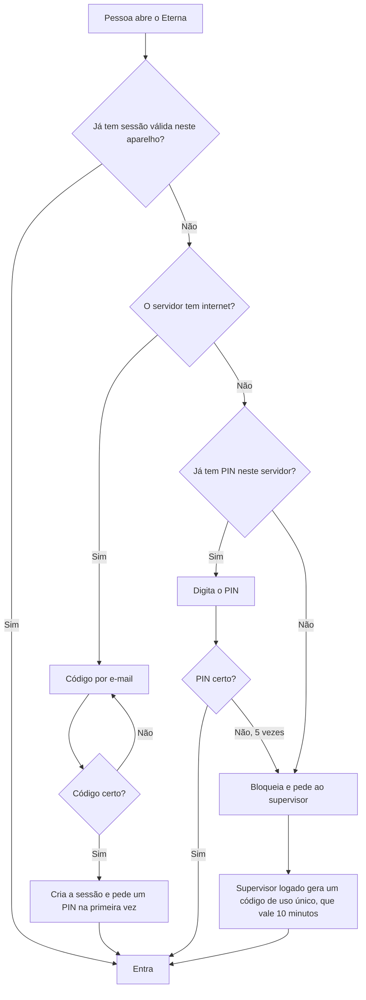

# Login de verdade e domínio eterna.photo no Microsoft 365 (04/11/2026)

**Situação: proposta, aguardando o ok do Ronaldo e do Eduardo. Claude: não implemente sem esse ok.**

## 1. Como está hoje

| Peça | Situação |
|---|---|
| Tela de login | Pronta. Com `MAIL_API` vazio, o código é gerado no navegador e aparece na caixa simulada |
| Rotas na nuvem | **Já existem na stack `eterna-galeria`:** `POST /auth/codigo` e `POST /auth/verificar`, com código de 6 dígitos, 10 minutos, 5 tentativas, uso único, limites por e-mail e IP, envio pelo Amazon SES e token de 12 horas |
| Envio | Desligado: falta `MailFrom`, e `MailDominio` ainda é `vivamaracana.com.br`. Não confirmado se a conta SES saiu do modo de teste |
| Serviço `servidor/email` (VM) | Fora de uso desde 26/10. Pode sair do repositório quando este plano fechar |
| Servidor do venue | Ainda não confere quem está logado |
| Cadastro | Fica no `estado.db`. A nuvem não sabe quem é da equipe: o código sai para qualquer e-mail válido |
| DNS | No GoDaddy. Site no GitHub Pages; recebimento pelo ImprovMX (`hello@` vai para o Gmail do Eduardo) |

## 2. Decisões propostas

1. **O código de login sai pelo Amazon SES, de `hello@eterna.photo`.** O código já está pronto, o volume é baixo e o login do produto não fica dependendo do tenant da Maracatour. Se o SES não for liberado na conta, a alternativa é o Graph com um app limitado a uma caixa.
2. **O domínio entra no Microsoft 365 para as caixas de gente:** `hello@`, suporte e outras. Não é o domínio padrão do tenant e não muda nada para quem usa `@maracatour`.
3. **Cada pessoa entra com o próprio e-mail**, sem licença nova por fotógrafo. Decisão do Ronaldo.
4. **O servidor do venue confere o login.** Ele valida o token, guarda a sessão e aplica as permissões do cadastro. A galeria do cliente segue aberta pelo QR.

## 3. Domínio, em ordem

Nenhum passo altera os registros do site (A e `www`). Antes de tudo, exportar o DNS do GoDaddy.

| # | Onde | O que fazer | Efeito | Como voltar |
|---|---|---|---|---|
| 1 | Microsoft 365 | Adicionar o domínio, com configuração manual de DNS. Não usar a configuração automática | Nenhum | Remover o domínio |
| 2 | GoDaddy | TXT `MS=...` na raiz | Nenhum | Apagar o TXT |
| 3 | Exchange | Domínio aceito como Internal Relay | Quem está no tenant continua mandando para o `hello@` | Remover |
| 4 | AWS SES | Criar a identidade `eterna.photo` | Nenhum | Apagar a identidade |
| 5 | GoDaddy | 3 CNAME de DKIM do SES | Assinatura válida | Apagar |
| 6 | GoDaddy | SPF único: `v=spf1 include:spf.protection.outlook.com include:spf.improvmx.com include:_spf.google.com ~all` | Autoriza o Microsoft 365 | Voltar o valor anterior, que está na cópia |
| 7 | GoDaddy | 2 CNAME de DKIM do Microsoft 365 e `_dmarc` com `p=none` | Só monitora | Apagar |
| 8 | AWS | Pedir a saída do modo de teste do SES, se necessário | Pode levar até 1 dia | — |
| 9 | CloudShell | `sam deploy` com `MailFrom=hello@eterna.photo` e `MailDominio=eterna.photo` | Liga o envio | Deploy com `MailFrom` vazio |

**Só depois**, e em janela combinada: recriar no Microsoft 365 os endereços em uso no ImprovMX e levar o MX e o `autodiscover`. O Eduardo precisa confirmar que o `hello@` chega antes de desligar o ImprovMX. Voltar é repor o MX antigo, e a propagação depende do TTL.

## 4. Login no sistema, por etapas

Cada etapa sobe separada. A conferência no servidor entra primeiro só registrando, para nenhuma venda parar por causa dela.

**Etapa 1. Código de verdade por e-mail**
- Preencher `MAIL_API` no app.
- Tirar a caixa simulada de produção.
- A nuvem só envia o código para quem está no cadastro, que o servidor do venue publica. A resposta é igual para e-mail desconhecido.

**Etapa 2. O servidor passa a saber quem é**
- `POST /auth/sessao` no agente: recebe o token da nuvem, valida, confere o cadastro e devolve a sessão.
- A sessão vai em cookie `HttpOnly`, porque as fotos carregam por ``, que não manda cabeçalho. Vale 12 horas.
- Modo `ETERNA_LOGIN=registra`: aceita tudo e registra quem faltaria.

**Etapa 3. Pareamento dos aparelhos** (a etapa 2 do plano v83)
- Caixa, quiosque e janela do Checkout são aprovados uma vez por um supervisor.
- A janela do Checkout continua sem login de pessoa: quem responde é o aparelho.

**Etapa 4. O servidor exige**
- Modo `ETERNA_LOGIN=exige`: cada rota confere aparelho, pessoa e permissão.
- Precisa do https na rede local (pedido 5 do Eduardo), para a sessão não trafegar aberta.
- Liga primeiro no servidor de teste e, depois de uma semana sem bloqueio indevido, em produção.

## 5. Sem internet

O e-mail depende de internet, e o ponto não pode parar.

- O PIN é guardado só como hash no servidor, nunca no navegador.
- Tudo que entra sem e-mail fica na auditoria, com quem autorizou.
- Mudar permissão ou cadastrar pessoa exige admin logado no servidor, com ou sem internet.

## 6. Fora de escopo agora

Login com a conta Microsoft (SSO), MFA e separação por cliente: ficam para o Eterna como produto (`docs/pesquisa/2026-11-02-eterna-como-produto.md`).

## 7. Testes para dar por pronto

1. O e-mail chega no Outlook, no Gmail e no iCloud, fora do spam, com SPF, DKIM e DMARC aprovados.
2. O site eterna.photo, o `hello@` e o `ti@maracatour.com.br` seguem funcionando depois de cada passo do DNS.
3. Cabo de internet do servidor desligado: entrada com PIN e com código do supervisor.
4. Com `ETERNA_LOGIN=exige`, a galeria por QR, o FTP das câmeras e a impressão seguem funcionando.
5. Pessoa desativada perde o acesso em todos os aparelhos.
6. `testes/sessoes_agente.py` e os testes do app continuam passando, com as novas rotas cobertas.
