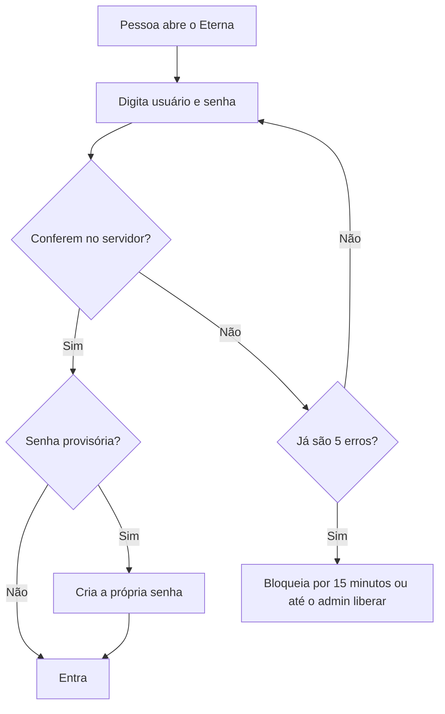
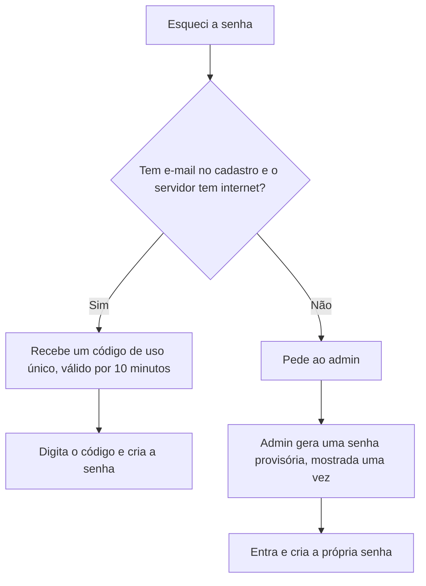

# Login com usuário e senha e domínio eterna.photo no Microsoft 365 (04/11/2026)

**Situação: etapas 1 e 2 prontas na branch `login-senha`, autorizadas pelo Ronaldo em 04/11. As demais seguem por etapa.**

**O que mudou no mesmo dia:** a primeira versão pedia código por e-mail para entrar. Isso deixaria de fora quem não tem e-mail e quem está sem internet. O acesso passa a ser por usuário e senha, conferidos no servidor do estádio. O e-mail fica só para recuperar a senha.

## 1. Como está hoje

| Peça | Situação |
|---|---|
| Tela de login | Pronta. Com `MAIL_API` vazio, o código é gerado no navegador e aparece na caixa simulada |
| Rotas na nuvem | **Já existem na stack `eterna-galeria`:** `POST /auth/codigo` e `POST /auth/verificar`, com código de 6 dígitos, 10 minutos, 5 tentativas, uso único, limites por e-mail e IP, envio pelo Amazon SES e token de 12 horas |
| Envio | Desligado: falta `MailFrom`, e `MailDominio` ainda é `vivamaracana.com.br`. Não confirmado se a conta SES saiu do modo de teste |
| Serviço `servidor/email` (VM) | Fora de uso desde 26/10. Pode sair do repositório quando este plano fechar |
| Servidor do venue | Ainda não confere quem está logado |
| Cadastro | Fica no `estado.db`. A nuvem não sabe quem é da equipe: o código sai para qualquer e-mail válido |
| DNS | No GoDaddy. Site no GitHub Pages; recebimento pelo ImprovMX: um único redirecionamento `*@eterna.photo` para o e-mail do Eduardo. De 28/10 a 04/11, só o `hello@` recebeu mensagens |

## 2. Decisões

1. **Usuário e senha, conferidos no servidor do estádio.** Funciona sem internet e não exige e-mail. Quem acessa de fora entra no mesmo servidor, com a mesma senha.
2. **Tudo fica no servidor, no mesmo banco:** `~/Eterna/ponto/estado.db`.
3. **A senha nunca fica legível.** É guardada só como hash `scrypt` com sal por pessoa. Nem o admin consegue ver.
4. **O admin cadastra as pessoas.** Não há autocadastro.
5. **Cada pessoa troca a própria senha.** Quem esquecer recupera pelo e-mail, se tiver, ou pede uma senha provisória ao admin.
6. **Um serviço de e-mail simples no servidor** manda a recuperação de senha. Ele não é necessário para entrar.
7. **A galeria do cliente segue aberta pelo QR**, e o FTP das câmeras não muda.

## 3. Domínio, em ordem

Nenhum passo altera os registros do site (A e `www`). Antes de tudo, exportar o DNS do GoDaddy.

| # | Onde | O que fazer | Efeito | Como voltar |
|---|---|---|---|---|
| 1 | Microsoft 365 | Adicionar o domínio, com configuração manual de DNS. Não usar a configuração automática | Nenhum | Remover o domínio |
| 2 | GoDaddy | TXT `MS=...` na raiz | Nenhum | Apagar o TXT |
| 3 | Exchange | Domínio aceito como Internal Relay | Quem está no tenant continua mandando para o `hello@` | Remover |
| 4 | AWS SES | Criar a identidade `eterna.photo`. **Feito em 04/11** | Nenhum | Apagar a identidade |
| 5 | GoDaddy | 3 CNAME de DKIM do SES. **Feito em 04/11** | Assinatura válida | Apagar |
| 6 | GoDaddy | SPF único: `v=spf1 include:spf.protection.outlook.com include:spf.improvmx.com include:_spf.google.com ~all` | Autoriza o Microsoft 365 | Voltar o valor anterior, que está na cópia |
| 7 | GoDaddy | 2 CNAME de DKIM do Microsoft 365 e `_dmarc` com `p=none` | Só monitora | Apagar |
| 8 | AWS | Pedir a saída do modo de teste do SES. Sem ela, só endereços autorizados recebem | Pode levar até 1 dia | — |
| 9 | CloudShell | `sam deploy` com `MailFrom=hello@eterna.photo` e `MailDominio=eterna.photo` | Liga o envio | Deploy com `MailFrom` vazio |

**Só depois**, e em janela combinada: criar no Microsoft 365 a caixa compartilhada `hello@`, sem pega-tudo, e levar o MX e o `autodiscover`. O Eduardo precisa confirmar que o `hello@` chega antes de desligar o ImprovMX. Voltar é repor o MX antigo, e a propagação depende do TTL.

## 4. Como guardar

- **Senha:** tabela nova `credencial` no `estado.db`, só com o hash. Essa tabela não entra em nenhum feed: `GET /ponto/usuarios` continua publicando só os campos atuais.
- **Sessão:** cookie `HttpOnly`, válido por 12 horas, porque as fotos carregam por ``, que não manda cabeçalho. O servidor guarda só o hash do token.
- **Nome, usuário, e-mail e permissões:** coleção `usuarios` do `estado.db`, como hoje. A proteção desses dados vem do disco cifrado (BitLocker no Windows, LUKS no Linux).
- **Cópia de segurança:** conferir o que a cópia atual leva antes da etapa 1. A tabela de senhas só pode sair cifrada.

## 5. Fluxos

### Entrar

- A mensagem é a mesma para usuário inexistente e senha errada.
- Desativar a pessoa ou trocar a senha encerra as sessões dela.
- Entradas, erros e trocas de senha ficam na auditoria, nunca com a senha.

### Recuperar a senha

### Cadastrar

1. O admin informa nome, usuário, permissões e, se houver, e-mail.
2. O servidor gera a senha provisória, mostrada uma única vez.
3. No primeiro acesso, a pessoa cria a própria senha, com no mínimo 10 caracteres. O servidor recusa senhas óbvias, e a provisória vence em 72 horas.

**Primeiro admin:** criado por um comando no próprio servidor. Nenhuma senha fica no código nem no repositório.

**Usuário sem e-mail:** hoje o app exige que o identificador seja um e-mail. O identificador passa a ser o usuário, como `rafael.melo`, e o e-mail vira opcional. Quem já está cadastrado continua com o e-mail como usuário, para o histórico de vendas não mudar.

## 6. Serviço de e-mail

- Uma função `enviar_email` no agente, com novas tentativas.
- O envio passa por uma rota nova na nuvem, autenticada com o segredo do ponto que o servidor já tem, e sai pelo SES de `hello@eterna.photo`. Assim nenhuma senha de e-mail nova fica no servidor.
- A rota aceita só a mensagem de recuperação de senha, com limite por hora.
- Sem internet, a tela indica pedir ao admin. O login continua normal.

## 7. Etapas

Cada etapa sobe separada, para nenhuma venda parar por causa dela.

**Ordem de instalação:** o servidor busca a tela no eterna.photo. Ao unir com a `main`, a tela nova chega a todos os servidores em até 1 minuto. Por isso o agente novo vai primeiro para o servidor e os administradores são criados antes da união.

| # | O que entra | Efeito para a equipe |
|---|---|---|
| 1 | Tabela, rotas de login e auditoria, com `ETERNA_LOGIN=registra`: aceita tudo e registra quem faltaria | Nenhum |
| 2 | Telas de entrar, criar senha e cadastro pelo admin. Sai a caixa simulada | Passa a entrar com usuário e senha |
| 3 | Serviço de e-mail e recuperação de senha | "Esqueci a senha" funciona |
| 4 | https na rede local (pedido 5 do Eduardo), para a senha não trafegar aberta | Nenhum, se o certificado estiver certo |
| 5 | Pareamento dos aparelhos (etapa 2 do plano v83). A janela do Checkout segue sem login de pessoa | Aprovação única por aparelho |
| 6 | `ETERNA_LOGIN=exige`, primeiro no servidor de teste e, depois de uma semana sem bloqueio indevido, em produção | Sem login, não entra |

## 8. Em aberto

- **Tela da equipe no eterna.photo:** o site não fala com o servidor do estádio. Decidir se ela sai de lá e fica só o endereço do servidor. A galeria não muda.
- **Rotas `/auth/codigo` e `/auth/verificar`:** sem uso depois deste plano. Saem da nuvem quando a etapa 3 estiver no ar.

## 9. Testes para dar por pronto

1. Cabo de internet do servidor desligado: entrar, trocar a senha e usar a senha provisória funcionam.
2. Vendedor sem e-mail: é cadastrado, entra e recupera o acesso pelo admin.
3. O banco, o feed de usuários, a cópia de segurança e os logs não mostram senha legível.
4. 5 erros bloqueiam o usuário.
5. Pessoa desativada perde o acesso em todos os aparelhos.
6. O e-mail de recuperação chega no Outlook e no Gmail, fora do spam, com SPF e DKIM aprovados.
7. O site eterna.photo, o `hello@` e o `ti@maracatour.com.br` seguem funcionando depois de cada passo do DNS.
8. Com `ETERNA_LOGIN=exige`, a galeria por QR, o FTP das câmeras e a impressão seguem funcionando.
9. `testes/sessoes_agente.py` e os testes do app continuam passando, com as novas rotas cobertas.
