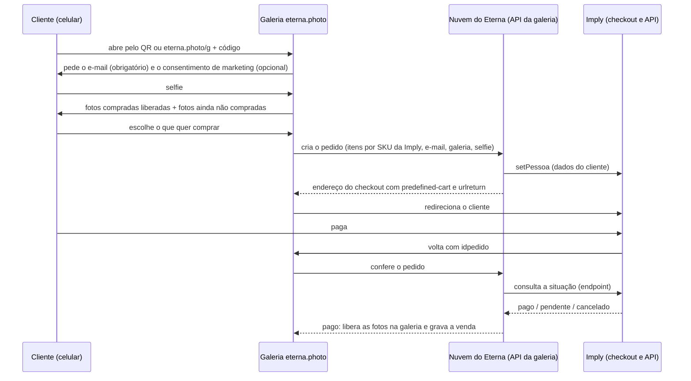

# Compra online das fotos pela Imply (plano, 11/11/2026)

Decisão do Ronaldo (11/11): **toda venda de foto passa pela Imply**, a ticketeira atual. No balcão já é assim (POS Imply,
"Pago na maquininha"). A galeria online (eterna.photo) deixa de ter pagamento próprio: o cliente paga no checkout da Imply e volta.
Os produtos e os preços são os da Imply, com o mesmo código (`idproduto`, usado como SKU no Eterna).

Fluxo proposto pela Imply (P&D da Imply, e-mail de 11/11, assunto "Demanda Nova - API"):

1. o cliente vem do sistema de fotos;
2. o sistema de fotos chama `setPessoa` e manda a pessoa logada para
   `https://maracanatour.eleventickets.com/pt/checkout?urlreturn=<volta>`, com o campo de informações extras
   `predefined-cart`: produto, quantidade e um código de referência do pedido;
3. a Imply monta o carrinho e abre o checkout;
4. depois do pagamento, volta para `<volta>?idpedido=<nosso código>`;
5. o sistema de fotos consulta a situação do pedido num endpoint (passa o nosso código; volta produto, situação, valor etc.).

Regra da Imply sobre produto: **o produto tem de existir lá**, com o preço configurado lá; o Eterna manda só o código de
referência e a quantidade.

## Como fica no Eterna

Regras:

- **A volta do cliente não prova nada.** O `idpedido` na volta só diz qual pedido conferir. A foto só é liberada depois que a
  Nuvem consulta a Imply e ela responde "pago". A consulta sai da Nuvem (credencial da Imply só lá, nunca no navegador).
- **Pedido que o cliente não volta para ver** (fechou a aba depois de pagar): a Nuvem confere sozinha os pedidos pendentes
  (a cada poucos minutos na primeira hora, depois espaçando até 24 h). Pago conferido = fotos liberadas e e-mail ao cliente
  com o link da galeria.
- **Código de referência do pedido** = o nosso (`ON-` + aleatório), único, gravado antes de mandar o cliente para a Imply.
  Consultar o mesmo pedido duas vezes não libera duas vezes (o pedido muda de situação uma vez só).
- **Preço** vem da Imply. A galeria mostra o preço do catálogo do Eterna, que é cópia do da Imply pelo SKU; se a Imply
  responder outro valor pago, vale o da Imply e a diferença fica registrada para conferência.
- **Estorno/cancelamento** na Imply: a consulta passa a responder cancelado/estornado; as fotos daquele pedido voltam a ficar
  bloqueadas na galeria e a venda fica marcada (o registro nunca é apagado).
- **E-mail do cliente (lead)** é pedido antes da selfie, gravado no banco da Nuvem junto com: data e hora, galeria/venda do QR,
  selfie (a referência, não a imagem), pedidos online e o que ficou sem comprar. Consentimento de marketing é caixa separada,
  opcional, com data e texto aceito (LGPD). Só quem marcou vai para o RD Station (etapa 2).
- O balcão continua como hoje (POS Imply, conferência pelo número do comprovante).

## Dados que a Nuvem passa a guardar

| Registro | Campos |
|---|---|
| pedido online | código nosso, galeria, itens (SKU, quantidade, fotos escolhidas), valor esperado, situação, idpedido/nº da Imply, valor pago, quando criou, quando conferiu, quantas consultas |
| lead | e-mail, idioma, consentimento de marketing (sim/não, data, versão do texto), galeria/venda, selfie, primeiro e último acesso |

## setPessoa (documentação recebida da Imply em 11/11)

- `POST https://maracanatouradmin.eleventickets.com/api/OAuth2/v01/setPessoa/`, cabeçalho `Authorization: Server <WS_CHAVE>`
  (chave do usuário de serviço, dada pela Eleven; fica só no segredo da Nuvem, nunca no navegador nem no repositório).
- Corpo: array com 3 posições: `[ {dados da pessoa}, false, ["de_para"] ]`. A 3ª posição diz como achar a pessoa já
  cadastrada (atualiza em vez de duplicar); recomendado `["de_para"]`.
- Dados obrigatórios: `de_para` (o nosso identificador da pessoa), `tipo_pessoa` (código da Eleven), `nome`, `email` e **ao
  menos um documento**: `cpf`, `passaporte` ou `documento`. Opcionais: celular, telefone, endereço, empresa.
  Número/objeto vazio invalida a chamada (omitir o campo); texto vazio é ignorado.
- Resposta 200 com `result` = token de acesso da pessoa (não devolve o id interno; a correlação é o `de_para`). Erro também vem
  com 200 e `error.code`: 13033 JSON inválido, 13034 sem de_para/nome, 13037 e-mail inválido, 13038 tipo_pessoa inválido,
  13042 falha ao gravar.
- Login automático: redirecionar o cliente para
  `https://maracanatouradmin.eleventickets.com/OAuth2/external?token=<result>&url=<destino>`, onde destino é a URL completa
  (com https://) em Base64 e depois codificada para URL. O cliente entra já logado na página de destino (para nós, o checkout
  com o carrinho pronto).

Consequências para o Eterna:

- **Para comprar online o cliente precisa informar nome, e-mail e CPF (ou passaporte, estrangeiro).** O e-mail continua
  sendo pedido antes da selfie (lead); nome e CPF/passaporte são pedidos só na hora de "Comprar", para não afastar quem só
  quer ver as fotos.
- `de_para` = id da pessoa no Eterna (`EP-` + aleatório, um por e-mail), gravado no lead.
- O CPF é dado pessoal sensível de cadastro: vai para a Imply, e no Eterna fica só o necessário para conferência (decisão a
  tomar: guardar só os 3 últimos dígitos ou não guardar).

## O que falta a Imply responder (antes de construir)

1. `setPessoa` (documentação recebida; faltam): o `tipo_pessoa` informado é o de **AGÊNCIA**; qual é o código para o cliente
   final (pessoa física)? Quanto tempo vale o token (`result`) e se é de uso único. O `url` do login automático aceita o
   endereço do checkout com `predefined-cart` e `urlreturn` dentro (Base64)? Há limite de tamanho?
2. `predefined-cart`: o formato exato (exemplo de JSON), onde vai (no endereço ou num POST), limite de itens.
3. Endpoint de consulta: endereço, autenticação, um exemplo de resposta, a lista de situações (pago, pendente, cancelado,
   estornado, expirado) e se traz o nº do pedido Imply, o meio de pagamento e o valor por item.
4. Aviso automático (webhook) quando o pedido muda de situação, para não depender só da consulta.
5. `urlreturn`: aceita `https://eterna.photo/...`? A volta acontece também quando o cliente desiste ou o pagamento é recusado?
6. Lista oficial de produtos com o código a passar (o `idproduto` da planilha "Consulta_de_produtos_FOTOS" é esse código?).
   Produtos que só a venda online usa (ex.: 1 foto digital avulsa) precisam ser criados lá.
7. Ambiente de homologação com credencial de teste.
8. Nota fiscal: sai pela Imply?
9. (Pedido do Ronaldo, para o ERP TOTVS) endpoint com a lista das vendas por período, além da consulta individual.

## Decisões do lado da Maracatour

- Quais produtos são vendidos online (só digitais: 1 foto digital avulsa, Zona Mista, Todas as fotos digitais?).
- Comparação do catálogo Eterna x Imply (11/11): os 5 pacotes batem em nome e preço; faltam no Eterna "Acima de 15 fotos
  digitais", "1 foto digital e impressa", "3 fotos digitais e impressas", "Figurinha Copa" e "Porta-retrato"; "Todas as fotos
  digitais" está como "Pacote Maracanã Mais"; "Foto adicional" é "digital ou impressa" na Imply e "digital e impressa" no
  Eterna; "Fundo de IA" (40) e "Foto digital avulsa" (39) não existem na Imply.

## Etapas

1. Catálogo idêntico ao da Imply, com SKU (depende das decisões acima).
2. E-mail obrigatório + consentimento antes da selfie, gravado na Nuvem.
3. Pedido online + redirecionamento + conferência + liberação (depende das respostas 1 a 7 da Imply, com homologação).
4. Envio ao RD Station de quem consentiu, com o que não comprou.
