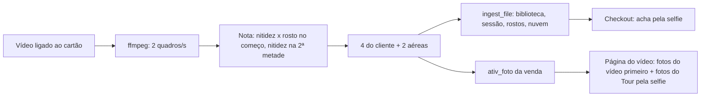

# Fotos do Drone tiradas do vídeo (teste de 12/11/2026)

Pedido do Ronaldo: vender, junto com o vídeo do Drone, fotos do cliente, tiradas do próprio vídeo ou pelo drone, no checkout do Eterna.

## O que os vídeos de verdade mostraram

Cinco vídeos do dia 12/11, processados só no computador (os quadros foram apagados depois do teste; nada foi para o repositório nem para a nuvem):

| | |
| --- | --- |
| Formato | HEVC (H.265), 1920 × 1080, 29,97 quadros/s, cerca de 35 Mbit/s |
| Duração | 13 a 56 s |
| Tamanho | 63 a 265 MB (média do sistema antigo: 142 MB por vídeo) |

- Os vídeos são **1080p** (2 megapixels por quadro), mesmo com a opção 4K existindo no catálogo. Um quadro de 1080p vale para foto digital e impressão 10 × 15 (cerca de 270 dpi); não para impressão grande.
- O vídeo segue sempre o mesmo roteiro: **10 a 12 primeiros segundos** com o cliente perto (de frente, com a bandeira, depois andando), e o resto é o voo sobre o estádio e a cidade.
- Os quadros do começo, com o drone parado, saem nítidos e prontos para vender. Os quadros do voo saem muito nítidos, mas mostram a paisagem: o cliente fica pequeno ou nem aparece.
- Medir só a nitidez escolhe a paisagem. A escolha das fotos do cliente tem que procurar o rosto. O Eterna já tem detecção e reconhecimento de rosto nas fotos do Tour, e a foto da venda serve de referência.

## Como ficou (v99.26.0)

As fotos do vídeo seguem o mesmo fluxo das fotos dos fotógrafos, como se o piloto tivesse tirado cada uma:

1. **Gatilho:** `ativ_video_grava`. Quando o tipo da venda está em `ATIV_FOTOS_TIPOS` (hoje só `drone`), abre uma thread com `ativ_fotos_video(venda, qr)`; nos outros tipos segue só a busca do Tour.
2. **Quadros:** `ffmpeg -vf fps=2 -q:v 2` numa pasta `quadros-*` dentro da pasta de vídeos, apagada no fim. O ffmpeg é procurado em `ETERNA_FFMPEG`, no PATH e em `%LOCALAPPDATA%\Microsoft\WinGet\Links`. Sem ffmpeg: nada acontece, a entrega segue igual.
3. **Escolha** (`_quadro_nota`, `ativ_fotos_escolhe`):
   - trecho do cliente: `t < min(15 s, 40% da duração)`; nota = variância do Laplaciano × área do maior rosto (YuNet, imagem reduzida a 640 px); 4 melhores com 1,5 s entre elas;
   - trecho aéreo: `t ≥ max(início, metade do vídeo)`; nota = nitidez; 2 melhores com 5 s entre elas.
4. **Entrada no Eterna:** cada quadro recebe a data do voo + t (`os.utime`) e passa por `ingest_file(..., "DRONE_<código>_NN.jpg", origem "Drone · <piloto>", tipo "drone")`. Com isso a foto ganha sessão, rostos lidos (busca por selfie no Checkout), vitrine com marca d'água e envio à nuvem, sem código novo nesses caminhos.
5. **Na venda:** tabela `ativ_foto(venda, qr, pid, tipo cliente|aerea, t, em)`. `ativ_tour_atualiza` põe essas fotos primeiro na galeria da página do vídeo, mesmo com a busca pelo rosto desligada, e soma as fotos do Tour achadas pela selfie. Uma segunda chamada não repete as fotos.

Resultado nos vídeos de 12/11: 56 s → 4 do cliente (1,5 a 6,5 s) e 2 aéreas; 24 s → 4 e 2; 13 s → cliente nos primeiros 5 s e aérea no fim. Cerca de 4 a 5 s por vídeo no computador de teste.

**Instalação no servidor do ponto:** `winget install Gyan.FFmpeg` (uma vez).

## O que ainda depende da diretoria

- Preço e pacote das fotos do Drone.
- Gravar em 4K (8 megapixels por quadro) ou ampliar por IA (Real-ESRGAN na placa de vídeo) só a foto comprada, para impressão maior.
- Fotos no modo foto do drone (12 a 48 megapixels), se quiserem um pacote "foto profissional": o piloto precisa parar o vídeo ou tirar as fotos antes.
