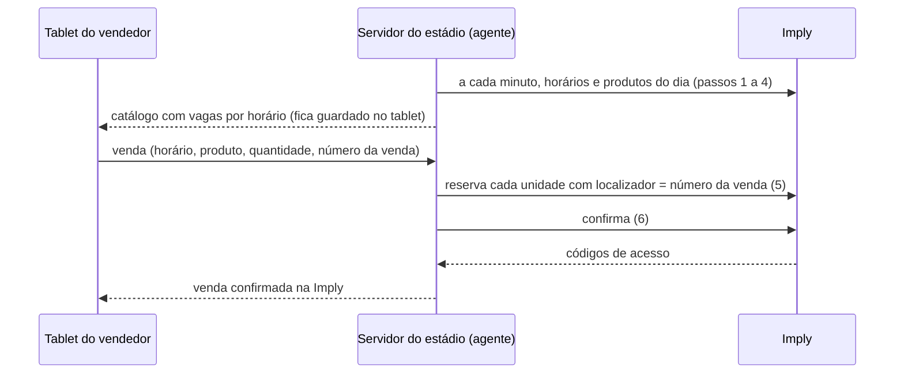

# Venda pela API da Imply: Drone, Chute a Gol, Snap Pop e fotos (12/11/2026)

**Situação:** credencial recebida em 12/11. Em 12/11 à noite a Imply completou o cadastro e marcou a pessoa "Viva Maracanã" como **Corporativo**: a leitura passou a mostrar horários e produtos, com as ativações e as fotos. Venda ainda não construída.

**Por quê:** hoje os tablets vendem as ativações sem falar com a Imply, e os horários (slots) de cada ativação não baixam. Com a API, cada venda do Eterna reserva e confirma a vaga na Imply, e o estoque do horário cai na hora. A mesma API serve depois para a venda online das fotos e das ativações (plano `2026-11-11-compra-online-pela-imply.md`).

## Credencial

- Usuário de serviço da Imply, criado para a Viva Maracanã. Pedido do Ronaldo em 11/11, com sigilo.
- A chave e o id da pessoa ficam só no servidor, em `imply-ws.env` (`IMPLY_URL`, `IMPLY_IDPESSOA`, `IMPLY_TOKEN`), fora do repositório. Nunca vão para o navegador nem para o tablet.
- Cabeçalho `Authorization: Bearer <IMPLY_TOKEN>`. O Cloudflare da Imply recusa clientes sem `User-Agent` de navegador ou de aplicativo (erro 1010). O cliente do Eterna manda `User-Agent: Eterna/1.0`.

## A API (SuperIngressoV02, coleção Postman da Imply)

Base: `<IMPLY_URL>/api/SuperIngressoV02/v01/`. Toda resposta vem com HTTP 200, `{id, error, result}`. Erro vem em `error.code` e `error.message`.

| Passo | Método e rota | Para quê |
|---|---|---|
| 1 | `GET GetEventos/<idpessoa>/` | Eventos liberados para nós (Tour, cada ativação, fotos). Traz `idevento`, `titulo`, `esgotado` e `modo_apresentacao` |
| 2 | `GET GetApresentacoesHorarios/<idpessoa>/<idevento>/` | Dias que têm horário |
| 3 | `GET GetApresentacoes/<idpessoa>/<idevento>/<AAAA-MM-DD>/` | Os horários (slots) do dia: `idapresentacao`, `dthr`, `esgotado`. Com `modo_apresentacao` = 1 a data é dispensável |
| 4 | `GET GetProdutos/<idpessoa>/<idapresentacao>/` | Produtos do horário, com `idproduto`, `valor`, `esgotado` e desconto |
| 5 | `PUT ReservarIngresso/` | Corpo `[idpessoa, idapresentacao, idproduto, localizador, {nome, documento}, codigo]`. Segura a vaga por 20 min. Uma chamada por unidade, todas com o mesmo `localizador` |
| 6 | `POST ConfirmacaoCompra/` | Corpo `[localizador]`. Fecha a venda e devolve os códigos de acesso. Depois disso o localizador não aceita mais reservas |
| 7 | `GET ImpressaoIngressos/<localizador>/` | Links do PDF e da wallet |
| 8 | `POST CancelarIngressos/` | Corpo `[localizador, codigo]`. Sem `codigo`, cancela a compra inteira. Código já usado na catraca não cancela |
| 9 | `GET InfoAcesso/<localizador>/<codigo>/` | Se o código já passou no controle de acesso |

- `localizador` é nosso: o número da venda do Eterna, único. É a chave para confirmar, imprimir e cancelar, e torna o reenvio seguro.
- `codigo` é opcional: a mídia de acesso. Sem ele, a Imply gera uma.

## O que o teste de 12/11 mostrou

- A chave autentica.
- `GetEventos` devolve só o **Tour Oficial Maracanã**. As ativações e as fotos ainda não aparecem: a Imply avisou que está liberando essas permissões.
- O Tour tem horários todos os dias a partir de 12/11.
- `GetApresentacoes` responde o erro **13089, cadastro incompleto**: a pessoa "Viva Maracanã" na Imply está sem o bairro no endereço. Até isso ser preenchido, não dá para ver horários nem produtos.
- Nenhuma reserva nem compra foi feita.

## Novo teste, 12/11 à tarde (depois do aviso da Imply de que liberou produtos e ativações)

- Só leitura (eventos, dias, horários e produtos). Nenhuma reserva nem compra.
- `GetEventos` continua devolvendo **só o Tour Oficial Maracanã** para o usuário da API: as ativações ainda não aparecem para ele (a liberação pode ter sido feita para outro usuário ou só para o PDV).
- `GetApresentacoes` continua com o erro **13089**: o cadastro da pessoa "Viva Maracanã" está sem o **bairro** (é o único campo do endereço que falta).

## Teste depois do cadastro completo (12/11 à noite)

Só leitura. Nenhuma reserva nem compra. A Imply completou o endereço (bairro) e marcou a pessoa "Viva Maracanã" como Corporativo.

- O erro 13089 sumiu: `GetApresentacoes` devolve os horários do dia, e `GetProdutos` devolve 57 produtos por horário.
- `GetEventos` continua com um evento só, o **Tour Oficial Maracanã**. **As ativações não são eventos próprios: são produtos dentro de cada horário do Tour**, separados pelo tipo de produto (`idtipoproduto`, `dsctipoproduto`).
- Horário que já passou ou fechou para venda responde `GetProdutos` com o erro code 0, "Não disponível esse tipo de evento no momento no WS". Para o Eterna, isso quer dizer "horário fechado".
- Campos de cada produto: `idproduto`, `idtipoproduto`, `dsctipoproduto`, `dscproduto`, `valor`, `taxa`, `preco_ctaxa`, `desconto`, `valor_sem_desconto`, `esgotado`, `mapa_modo_venda` e `mapa_modo_venda_detail`.

Tipos de produto que interessam ao Eterna. Os valores são sem a taxa da Imply (10%), que vem em `taxa` e `preco_ctaxa`.

| Tipo (`dsctipoproduto`) | `idtipoproduto` | Produtos (valor) |
|---|---|---|
| Drone | `2b84d57f11d1e713fc66eda8db0596374f0b9dd6` | Asteroid (180), Boomerang (Arquibancada) (120), Inside Out (Bench) (250), Inside Out (Campo) (220), Drone Grupos (15) |
| Chute a Gol | `092b352b3bc0e4b4e6bc95c5171ee3a0f023584b` | 3 Chutes (110), 5 Chutes (140), 3 Chutes + 1 Medalha + 1 Vídeo (149), 5 Chutes + 1 Medalha + 1 Vídeo (169), 5 Chutes + 1 Mini bola + 1 Medalha + 1 Vídeo (229), 5 Chutes + 1 Bola Semi-Pro + 1 Medalha + 1 Vídeo (259), 5 Chutes + 1 Bola Pro + 1 Medalha + 1 Vídeo (279) |
| Chute a Gol / Produto | `a7847f1623f14298428eec77a80e7554a5b20cc9` | 1 Medalha avulsa (60), 1 Mini bola (115), 1 Bola Semi-Pro (170), 1 Bola Pro (195) |
| Snap Pop | `b34741dc22020df8cd751e9df801997ed0af9dff` | 1 pessoa (110), 2 pessoas (190), 3 pessoas (290) |
| Foto | `8d1ddc94d7d7af3d69d24be08ca54ff501874923` | Todas as fotos digitais (250), 12 fotos (220), 9 fotos (190), 6 fotos (150), 3 fotos digitais (110), 1 foto digital + impressa (70), 1 foto adicional (35), Porta-retrato (75), Figurinha Copa (20) |

Os outros tipos que vêm junto (ingressos do Tour, combos, cortesias, Museu do Flamengo, estacionamento) não são vendidos pelo Eterna.

**O que muda na proposta abaixo:**
- O **horário da ativação é o horário do Tour** (`idapresentacao`), e o estoque de cada ativação é o do produto naquele horário (`esgotado`). Não existe um slot próprio do Drone.
- O catálogo do tablet passa a ser montado pelo `idtipoproduto`. O nome do produto na Imply (`dscproduto`) é o que liga cada item do Eterna ao `idproduto`. O `idproduto` muda de um horário para outro? Ainda não sabemos: no teste, o mesmo produto teve o mesmo id em 12/11. Conferir num segundo dia antes de guardar o id fixo.
- Os preços batem com a tabela das ativações no Eterna. O agente vai conferir isso sozinho e avisar quando um preço mudar na Imply.
- **Lugar marcado (resolvido em 12/11):** as ativações e as fotos vinham com `mapa_modo_venda` 1, "Lugar marcado", e o `ReservarIngresso` não tem campo de lugar. A pedido do Ronaldo, a Imply mudou todas para "Quantidade sem lugar marcado". Conferido na API no horário de 13/11 09:00: Drone, Chute a Gol, Chute a Gol / Produto, Snap Pop e Foto agora estão sem lugar marcado. O estacionamento continua com lugar marcado, mas não é vendido pelo Eterna.

## Como fica no Eterna (proposta)

- **A chave fica só no servidor do estádio.** O tablet nunca fala com a Imply.
- **Allotment (12/11, Ronaldo):** as ativações são vendidas conforme o estoque de cada horário na Imply. **Quem precisa de internet é só o servidor do estádio.** O tablet precisa apenas do Wi-Fi do estádio para falar com o servidor, que faz a ponte:
  - de minuto em minuto, o servidor lê na Imply os horários e o estoque de cada produto e serve isso aos tablets;
  - quando o vendedor escolhe horário e produto, o servidor reserva na hora na Imply (a vaga fica presa por 20 min) e confirma quando a venda é concluída;
  - os tablets veem o mesmo estoque, porque todos leem do servidor. Uma venda num tablet tira a vaga dos outros no próximo minuto, ou na hora, quando a reserva volta.
- **Quando falta conexão:**
  - **Sem o Wi-Fi do estádio:** o tablet vende pelo último estoque que recebeu (local first) e manda ao servidor quando voltar.
  - **Sem a internet do servidor:** os tablets continuam vendendo pelo último estoque, e as vendas ficam "Aguardando Imply".
  - Nos dois casos pode acontecer de vender uma vaga que acabou: é a decisão 1 abaixo.
- **Local first continua:** a venda é gravada no tablet antes de tudo. O servidor reserva e confirma na Imply quando recebe. Sem internet no estádio, a venda fica "Aguardando Imply" e o servidor tenta de novo.
- **Reenvio sem duplicar:** o localizador é o número da venda. Se a confirmação já foi feita, o servidor não reserva de novo.
- **Cancelamento** no Eterna chama `CancelarIngressos` com o mesmo localizador.
- **Vagas na tela:** o tablet mostra as vagas de cada horário pelo último catálogo que recebeu, e o horário esgotado fica apagado.

## Decisões que faltam (Ronaldo)

1. **Venda sem internet num horário que esgotou:** com local first, o tablet pode vender uma vaga que já acabou na Imply. Proposta: a venda vale e o painel avisa o supervisor para remanejar o horário.
2. **Nome e documento na reserva:** a API pede `{nome, documento}` e a venda das ativações não pede dado do cliente (decisão de 11/11). Proposta: mandar "Viva Maracanã" e o CNPJ da Maracatour, com o número da venda no localizador.
3. **Pagamento (Ronaldo, 12/11):** o pagamento é feito no POS da Imply, mas **horário e produto são escolhidos só no tablet**. Se o vendedor escolhesse o horário também no POS, os dois poderiam divergir. Por isso o POS não lança produto; quem tira a vaga do estoque é o servidor do Eterna, pela API (`ReservarIngresso` com o número da venda como localizador).
   - **Caminho preferido, a confirmar com a Imply:** o tablet mostra o QR da reserva, com o localizador, e o POS lê esse QR e cobra aquela reserva. O valor e o produto vêm da reserva, sem digitar nada no POS. A venda só é confirmada na Imply quando o pagamento passa. Se o pagamento não acontecer, a reserva cai sozinha em 20 min.
   - **Se o POS não souber cobrar uma reserva da API:** a reserva é confirmada pela API (faturada para a pessoa "Viva Maracanã"). O POS cobra só o valor, e o tablet lê o QR da cobrança do POS (localizador de 12 dígitos) para ligar a cobrança à venda. É a conciliação com o financeiro, venda a venda.
   - **Perguntas para a Imply:** (a) o POS consegue cobrar uma reserva feita pela API, lendo o localizador? (b) se não, o POS consegue cobrar um valor avulso, sem produto, sem gerar outra venda no estoque?
4. **Horário na venda:** hoje a tela de venda não escolhe horário. Com slot, passa a escolher. Proposta: o próximo horário com vaga vem escolhido.

## Pendências com a Imply

1. ~~Completar o cadastro da pessoa "Viva Maracanã"~~: feito em 12/11, pessoa marcada como Corporativo.
2. ~~Liberar as ativações e as fotos para esse usuário~~: feito. Elas vêm como produtos dentro dos horários do Tour.
3. ~~Produtos com "Lugar marcado"~~: a Imply passou ativações e fotos para quantidade sem lugar marcado (12/11).
4. Um ambiente ou modo de teste para reservar e confirmar sem gerar venda de verdade, ou a autorização para um teste com cancelamento logo em seguida (decisão do Ronaldo).
