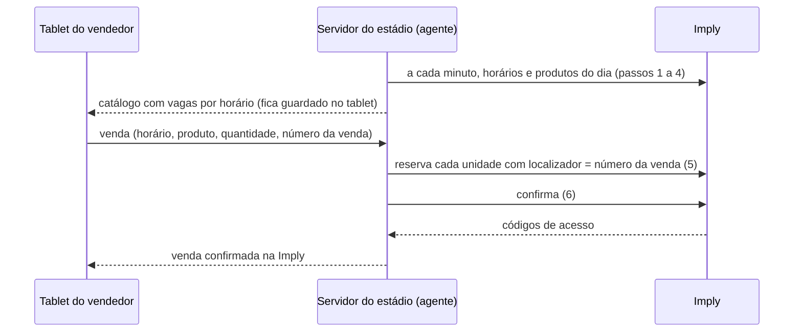

# Venda pela API da Imply: Drone, Chute a Gol, Snap Pop e fotos (12/11/2026)

**Situação:** credencial recebida em 12/11. Leitura testada. Venda ainda não construída.

**Por quê:** hoje os tablets vendem as ativações sem falar com a Imply, e os horários (slots) de cada ativação não baixam. Com a API, cada venda do Eterna reserva e confirma a vaga na Imply, e o estoque do horário cai na hora. A mesma API serve depois para a venda online das fotos e das ativações (plano `2026-11-11-compra-online-pela-imply.md`).

## Credencial

- Usuário de serviço da Imply, criado para a Viva Maracanã. Pedido do Ronaldo em 11/11, com sigilo.
- A chave e o id da pessoa ficam só no servidor, em `imply-ws.env` (`IMPLY_URL`, `IMPLY_IDPESSOA`, `IMPLY_TOKEN`), fora do repositório. Nunca vão para o navegador nem para o tablet.
- Cabeçalho `Authorization: Bearer <IMPLY_TOKEN>`. O Cloudflare da Imply recusa clientes sem `User-Agent` de navegador ou de aplicativo (erro 1010). O cliente do Eterna manda `User-Agent: Eterna/1.0`.

## A API (SuperIngressoV02, coleção Postman da Imply)

Base: `<IMPLY_URL>/api/SuperIngressoV02/v01/`. Toda resposta vem com HTTP 200, `{id, error, result}`. Erro vem em `error.code` e `error.message`.

| Passo | Método e rota | Para quê |
|---|---|---|
| 1 | `GET GetEventos/<idpessoa>/` | Eventos liberados para nós (Tour, cada ativação, fotos). Traz `idevento`, `titulo`, `esgotado` e `modo_apresentacao` |
| 2 | `GET GetApresentacoesHorarios/<idpessoa>/<idevento>/` | Dias que têm horário |
| 3 | `GET GetApresentacoes/<idpessoa>/<idevento>/<AAAA-MM-DD>/` | Os horários (slots) do dia: `idapresentacao`, `dthr`, `esgotado`. Com `modo_apresentacao` = 1 a data é dispensável |
| 4 | `GET GetProdutos/<idpessoa>/<idapresentacao>/` | Produtos do horário, com `idproduto`, `valor`, `esgotado` e desconto |
| 5 | `PUT ReservarIngresso/` | Corpo `[idpessoa, idapresentacao, idproduto, localizador, {nome, documento}, codigo]`. Segura a vaga por 20 min. Uma chamada por unidade, todas com o mesmo `localizador` |
| 6 | `POST ConfirmacaoCompra/` | Corpo `[localizador]`. Fecha a venda e devolve os códigos de acesso. Depois disso o localizador não aceita mais reservas |
| 7 | `GET ImpressaoIngressos/<localizador>/` | Links do PDF e da wallet |
| 8 | `POST CancelarIngressos/` | Corpo `[localizador, codigo]`. Sem `codigo`, cancela a compra inteira. Código já usado na catraca não cancela |
| 9 | `GET InfoAcesso/<localizador>/<codigo>/` | Se o código já passou no controle de acesso |

- `localizador` é nosso: o número da venda do Eterna, único. É a chave para confirmar, imprimir e cancelar, e torna o reenvio seguro.
- `codigo` é opcional: a mídia de acesso. Sem ele, a Imply gera uma.

## O que o teste de 12/11 mostrou

- A chave autentica.
- `GetEventos` devolve só o **Tour Oficial Maracanã**. As ativações e as fotos ainda não aparecem: a Imply avisou que está liberando essas permissões.
- O Tour tem horários todos os dias a partir de 12/11.
- `GetApresentacoes` responde o erro **13089, cadastro incompleto**: a pessoa "Viva Maracanã" na Imply está sem o bairro no endereço. Até isso ser preenchido, não dá para ver horários nem produtos.
- Nenhuma reserva nem compra foi feita.

## Como fica no Eterna (proposta)

- **A chave fica só no servidor do estádio.** O tablet nunca fala com a Imply.
- **Local first continua:** a venda é gravada no tablet antes de tudo. O servidor reserva e confirma na Imply quando recebe. Sem internet no estádio, a venda fica "Aguardando Imply" e o servidor tenta de novo.
- **Reenvio sem duplicar:** o localizador é o número da venda. Se a confirmação já foi feita, o servidor não reserva de novo.
- **Cancelamento** no Eterna chama `CancelarIngressos` com o mesmo localizador.
- **Vagas na tela:** o tablet mostra as vagas de cada horário pelo último catálogo que recebeu, e o horário esgotado fica apagado.

## Decisões que faltam (Ronaldo)

1. **Venda sem internet num horário que esgotou:** com local first, o tablet pode vender uma vaga que já acabou na Imply. Proposta: a venda vale e o painel avisa o supervisor para remanejar o horário.
2. **Nome e documento na reserva:** a API pede `{nome, documento}` e a venda das ativações não pede dado do cliente (decisão de 11/11). Proposta: mandar "Viva Maracanã" e o CNPJ da Maracatour, com o número da venda no localizador.
3. **Pagamento:** a compra pela API sai faturada para a pessoa "Viva Maracanã" na Imply. Falta definir com o financeiro como isso fecha com o que o tablet recebeu (PIX, cartão e dinheiro).
4. **Horário na venda:** hoje a tela de venda não escolhe horário. Com slot, passa a escolher. Proposta: o próximo horário com vaga vem escolhido.

## Pendências com a Imply

1. Completar o cadastro da pessoa "Viva Maracanã" (endereço com bairro). Sem isso a API não mostra horários (erro 13089).
2. Liberar as ativações (Drone, Chute a Gol, Snap Pop) e as fotos para esse usuário. Até 12/11 só o Tour aparece.
